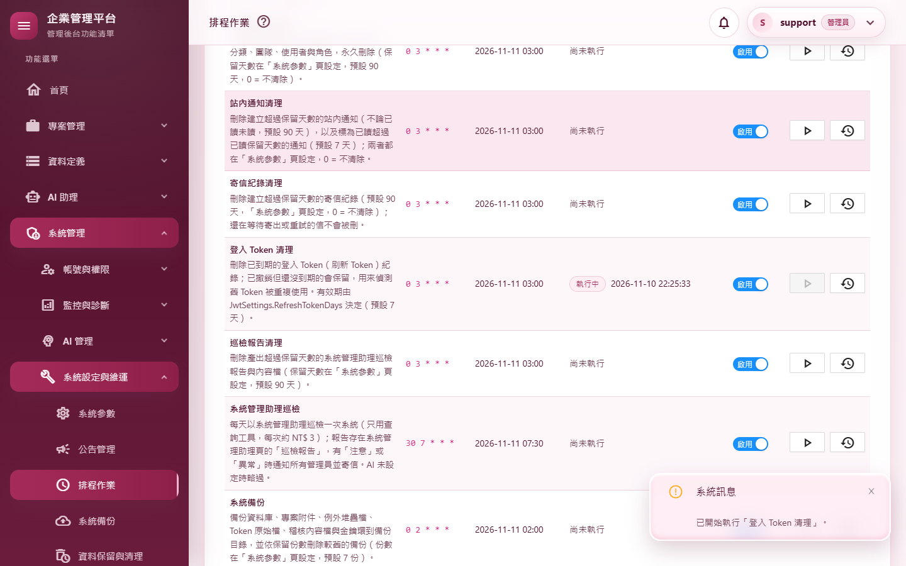
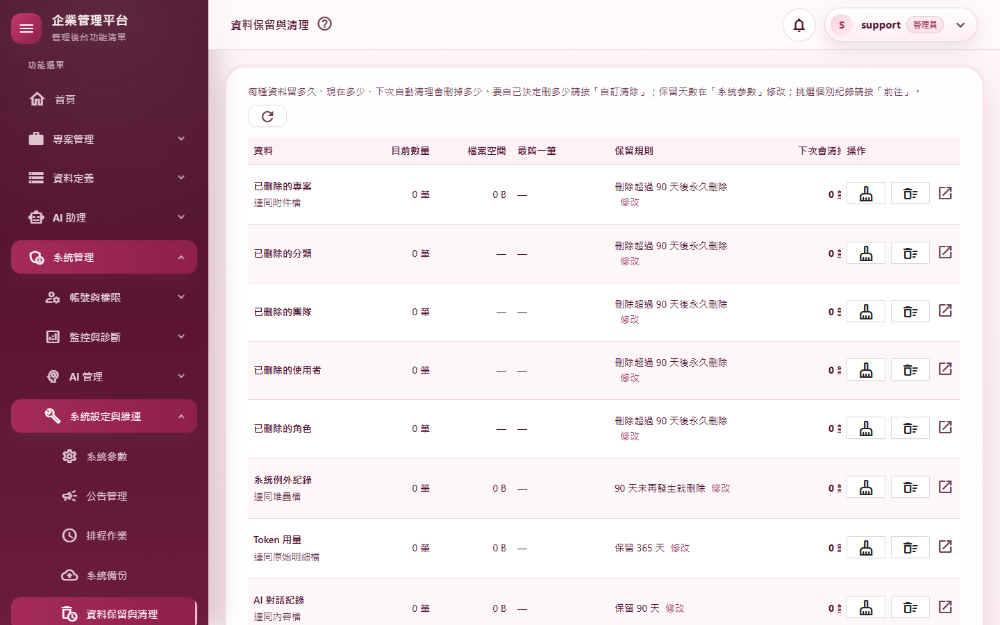
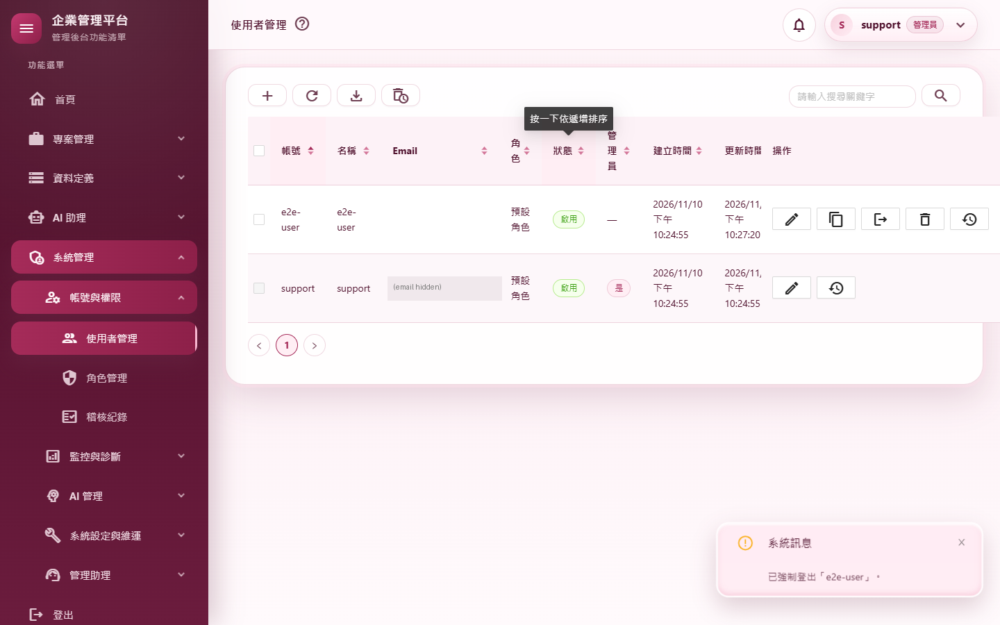
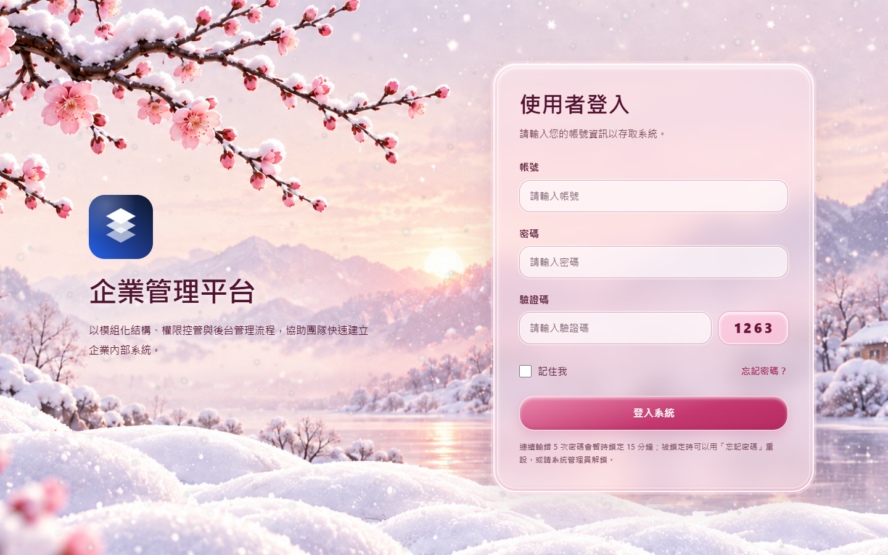
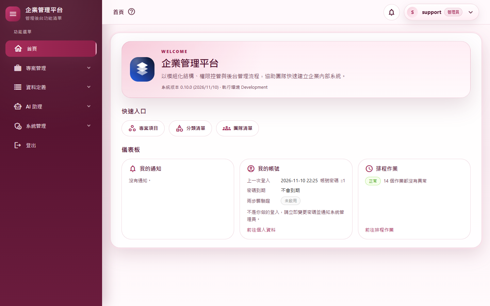
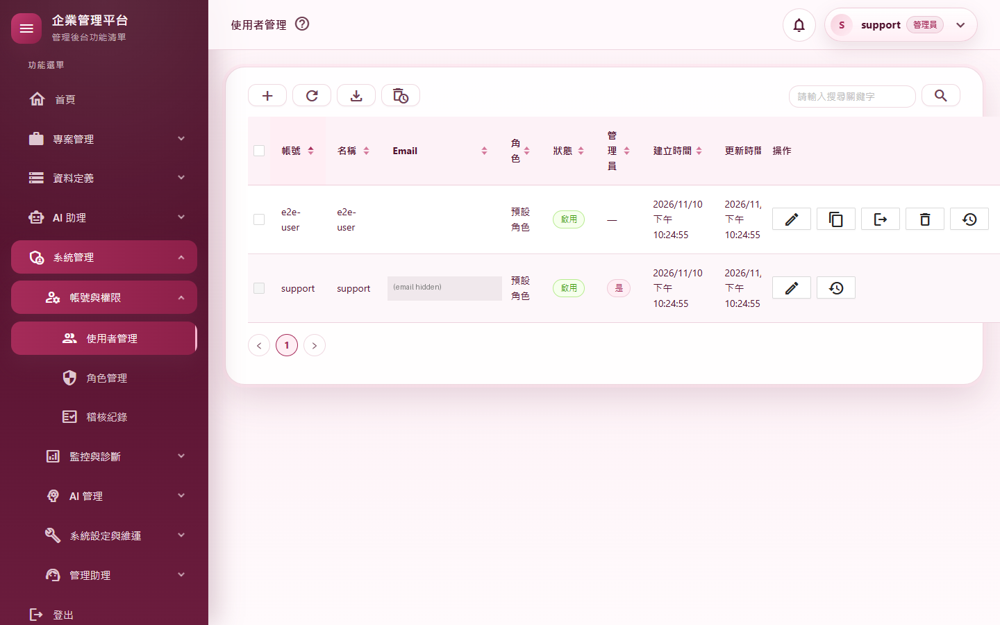

# M01 基礎建設 測試報告（0.10.0）

- 文件版本：1.0
- 文件狀態：已實作
- 現行系統版本：0.10.0
- 首次實作版本：0.10.0
- 最後核對日期：2026/11/10

## 摘要

| 項目 | 結果 |
|---|---|
| 範圍 | 伺服器端刷新 Token（輪替、重用偵測、撤銷）、Auth API（refresh／logout／bridge／me）、API 依 Token 載入目前使用者、強制改密碼／設定兩步驟驗證期間擋 API、工作階段版本快取立即失效（既有問題修正）、登入 Token 清理排程、WASM 前端空殼專案、測試路徑統一、實機驗證工具。**不搬任何頁面** |
| 自動化測試 | 2,579 個全部通過（M1 前 2,536 個；新類別 43 個＋腳本隔離檢查多 1 個案例－改寫的 JWT 測試少 1 個＝淨增 43） |
| 品質關卡 | 7 步全部通過（結果見 A.3） |
| 實機驗證 | 11 個情境全部通過；全部 37 個路由煙霧測試全部通過 |
| 複刻腳本 | `New-StarterProject.ps1` 複刻出 `Acme.Erp`：8 個專案（含 `Acme.Erp.Web.Client`）改名正確、建置 0 警告、2,569 個測試全部通過 |
| 獨立審查 | 8 項發現：4 項中度、1 項低度已修正並補測試；1 項低度註解錯位已修正；2 項低度列為已知限制 |
| 版本 | 0.9.177 → 0.10.0 |

變更內容見 [changelog：WASM 遷移 M1 基礎建設](../../changelog/2026-11-10-WASM遷移M1基礎建設.md)。

---

## A.1 測試策略

| 層次 | 涵蓋什麼 | 工具 |
|---|---|---|
| 單元測試 | 刷新 Token 紀錄的每條規則（以可控時鐘驗證寬限期與到期）、版本快取的清除與世代計數、攔截器的 SQL 判斷、清理排程 | xUnit、SQLite（記憶體與檔案） |
| 整合測試 | 真的主機與資料庫：Token API 的成功與每種拒絕、網頁 Cookie 換 Token、網頁登出撤銷、`/me`、強制改密碼擋 API、版本換掉後 access token 立即失效 | `WebApplicationFactory` |
| 守門測試 | 測試檔不得自己找路徑（`SourceTree`）、WASM 專案只能參考三個共用專案、新排程登記到所有該登記的地方 | xUnit |
| 回歸 | 既有 2,536 個測試；網頁版登入檢查的 21 個測試斷言一字未改 | xUnit |
| 品質關卡 | 建置（Release）、格式、全部測試、文件編碼、CRUD 產生器錨點、弱點掃描 | `scripts/Invoke-QualityGate.ps1` |
| 實機驗證 | 真的網站（隔離資料庫）、真的 Chrome，操作網頁與在頁面內呼叫 API，並查資料庫與稽核核對 | `scripts/Start-E2EHost.ps1`、`scripts/e2e/m01-tokens.mjs`、`smoke-routes.mjs` |
| 基準比對 | 實機日誌裡的錯誤，用未修改的 0.9.177（main）跑同一套煙霧測試比對是否既有 | git worktree |
| 複刻驗證 | 新專案 `MyProject.Web.Client` 會被複刻腳本正確改名、新專案可建置與測試 | `New-StarterProject.ps1` |
| 獨立程式審查 | 未參與實作的審查者讀完整份變更，找安全漏洞、正確性與測試缺口 | 另一個 AI 審查代理（只讀） |

---

## A.2 自動化測試

**新增的測試類別**

| 測試類別 | 驗證的行為 |
|---|---|
| `RefreshTokenStoreTests`（12） | 只存雜湊（64 字元 SHA-256、不含原值）並記下版本與用戶端資訊；輪替後同一串、舊的標為 `Rotated` 並指向新的；**寬限期內**重送舊的回 `Superseded` 且不撤銷、新的仍可用；**寬限期後**重用整串撤銷；不認得、空字串、過期都無效；版本不符回 `SessionRevoked` 並撤銷；停用與已刪除帳號回 `UserInactive`；依整串撤銷（登出）與依網頁登入撤銷只影響該次登入；有整串上限時到期時間永遠不超過它、過了就無效；四個平行輪替（檔案資料庫、各自連線）只有一個成功、其餘 `Superseded`、贏家的新 Token 仍可用；清理只刪到期的 |
| `TokenApiIntegrationTests`（13） | 刷新輪替、立刻重送不撤銷也不寫 `ReuseDetected`；登出後刷新被拒並寫 `Logout` 稽核；bridge 的持久性跟著「記住我」（兩種）且記下 `web-bridge` 與登入識別；沒帶 `X-MyProject-Client` 回 400 且沒發 Token；沒有 Cookie 或 Cookie 已被撤銷回 401；舊 Cookie 沒有登入識別時補上並重新簽發；**Cookie 版本已過時但快取仍放行時 bridge 仍回 401**（審查發現 1；暫時拿掉修正時這個測試會失敗，已確認）；換出的 Token 不比 Cookie 活得久；網頁登出後換出的 Token 失效；`/me` 從資料庫回傳完整工作階段；強制改密碼時業務 API 回 403＋`PASSWORD_CHANGE_REQUIRED` 而 `/me` 可用；版本換掉後同一個 access token 下一個請求就 401 |
| `SecurityStampInvalidationTests`（13） | 先讓快取記住舊版本，再以真的服務改版本，不前進時間就判定舊版本無效：強制登出、停用（`ExecuteUpdate`）、管理員在交易中改角色、存新密碼（追蹤實體、無明確交易）、**實際刪除使用者**（審查補的缺口）；快取的世代計數擋下「清除前開始的寫回」（審查發現 2）；SQL 判斷的 7 種正反例 |
| `RefreshSessionRetentionJobTests`（2） | 只刪到期的、撤銷但未到期的保留並寫稽核 `RefreshSession.AutoPurge`；沒刪到資料不寫稽核 |
| `SourceTreeConventionTests`（2） | 測試檔不得自己從執行目錄往上找；`SourceTree` 的每個路徑都指向真的資料夾 |
| `ClientProjectBoundaryTests`（1） | `MyProject.Web.Client` 只參考 Dtos、Models、Share，且是 BlazorWebAssembly SDK |

**修改的既有測試**

| 測試 | 修改 | 理由 |
|---|---|---|
| 37 個測試檔的私有路徑工具 | 改成一行委派給 `SourceTree` | 純重構；前後測試數與結果相同（2,536 → 2,536＋2 個新守門） |
| `JwtTokenServiceTests` | 改寫 3 個測試為 2 個 | 刷新 Token 不再是 JWT，`ValidateRefreshToken` 已移除；改驗證存取 Token 的 claims 與刷新 Token 原樣帶入 |
| `SessionTests.Refresh_ShouldFailAfterRotation…` | 第二次刷新改用第一次刷新拿到的新 Token | 輪替後舊 Token 會被判定為重送／重用，不再是「版本失效」；斷言的稽核內容（`reason=SessionRevoked`）不變 |
| `ApiIntegrationTests.SoftDeletedUsersToken_ShouldBeForbidden` → `…_ShouldBeRejected` | 預期由 403 改為 401 | 行為變更：每個請求都從資料庫載入使用者，帳號已刪除＝工作階段失效；與停用帳號一致 |
| `AuthenticationStateHelperTests` | 只改 `CreateHelper` 的建構方式 | 載入規則抽到 `CurrentUserLoader`；21 個測試的斷言一字未改且全部通過，證明網頁版行為不變 |
| `ScheduledJobWiringTests`、`DataRetentionOverviewServiceTests`、`ScaffoldScriptConventionTests`、`LoggingConventionTests` | 登記新排程、新資料列、新腳本與兩個無行為類別的豁免 | 新增項目的登記 |

> 說明：刷新 Token 紀錄、Token API 與審查修正的測試是先寫、後實作；其中部分測試在實作前只確認了「編譯失敗」（型別尚不存在），沒有逐一看到斷言失敗。安全性最關鍵的「過時 Cookie 換 Token」測試另外以暫時拿掉修正的方式確認它會失敗。

---

## A.3 品質關卡

`pwsh ./scripts/Invoke-QualityGate.ps1`（2026/11/10，完整 7 步）：

| 步驟 | 結果 | 秒數 |
|---|---|---|
| Restore | 通過 | 0.9 |
| Build（Release） | 通過（0 警告、0 錯誤，含新的 `MyProject.Web.Client`） | 7.4 |
| Format | 通過（`dotnet format --verify-no-changes`） | 22.8 |
| Test | 通過（2,579 個） | 46.8 |
| Docs encoding | 通過（`docs/` 與根目錄 `.md` 皆 UTF-8 含 BOM） | 0.1 |
| CRUD anchors | 通過（一般、含團隊、管理員專屬各 24 項） | 0.5 |
| Vulnerability | 通過（8 個專案都沒有已知弱點，含新加入的 `Microsoft.AspNetCore.Components.WebAssembly(.Server)` 10.0.14） | 26.6 |

合計 105 秒，`QUALITY GATE PASSED`。

---

## A.4 實機驗證

**環境**見 A.7。每次都是全新的隔離資料庫；support 用暫時密碼；另由腳本在隔離資料庫建一個一般帳號 `e2e-user`（support 不受「必須改密碼」約束、也不能在網頁改自己的密碼，所以 S5、S6、S8 用它）。
結果原檔：`scripts/e2e/m01-tokens.mjs` 產生的 `m01-results.json` 與 `smoke-results.json`（不進版控）。

| # | 情境 | 步驟 | 預期 | 實際結果 | 判定 |
|---|---|---|---|---|---|
| S1 | 記住我→持久 Token | 勾「記住我」登入，在頁面內 `POST /api/v1/Auth/bridge`（帶標頭） | 200，`isPersistent=true` | HTTP 200，`isPersistent=true`，帳號 support | 通過 |
| S2 | 未記住→非持久 Token | 不勾「記住我」登入後同樣呼叫 | 200，`isPersistent=false` | HTTP 200，`isPersistent=false` | 通過 |
| S2a | 資料庫內容 | 查 `RefreshSession` | 兩筆 `web-bridge`、記下登入識別、持久旗標 1／0 | 2 筆，持久旗標 1／0，登入識別都有值 | 通過 |
| S3 | CSRF 防護 | bridge 不帶 `X-MyProject-Client` | 400 | HTTP 400 | 通過 |
| S4a | 輪替與寬限期 | 刷新一次；立刻重送舊的；再刷新新的 | 200；401；200（不撤銷） | 200（換到新 Token）；401；新的仍 200 | 通過 |
| S4b | 重用偵測 | 等 31 秒後再用最早的 Token；再用最新的 | 都 401；稽核 `Token.ReuseDetected` | 都 HTTP 401；`Token.ReuseDetected` 1 筆 | 通過 |
| S7 | 網頁登出撤銷 | bridge 換 Token 後從 `/Auths/Logout` 登出，再刷新 | 401；紀錄撤銷原因 `WebLogout` | HTTP 401；`WebLogout` 1 筆 | 通過 |
| S9 | 清理排程與資料保留頁 | 排程頁找「登入 Token 清理」按「立即執行」；開資料保留頁 | 執行成功；資料保留頁有「登入 Token」列 | `Succeeded`「刪除 0 筆已到期的登入 Token 紀錄。」；有 1 列（截圖 01、02） | 通過 |
| S8 | 強制改密碼擋 API | 把 `e2e-user` 標成必須改密碼，以 API 登入後呼叫 `Category/search` 與 `/me`，再解除 | 403＋`PASSWORD_CHANGE_REQUIRED`；`/me` 200 且旗標 true；解除後不再被擋 | 403（`PASSWORD_CHANGE_REQUIRED`）；`/me` 200（true）；解除後 200 | 通過 |
| S5 | 改密碼後舊 Token 失效 | `e2e-user` 網頁登入、換 Token，到「變更密碼」頁改密碼，再用舊刷新 Token | 401；稽核 `Token.RefreshFailed reason=SessionRevoked` | 密碼已變更；HTTP 401；稽核 1 筆 | 通過 |
| S6 | 強制登出立即生效（快取修正） | `e2e-user` 換 Token 並用一次（版本進快取）；support 在「使用者管理」按「強制登出」；立刻再用存取 Token；對方網頁換頁 | 之前 200、之後**立刻** 401；網頁回到登入頁 | 之前 200、之後立刻 401；回到登入頁（截圖 03、04） | 通過 |
| R01–R37 | 全部路由煙霧測試 | support 開 30 個登入後路由，未登入開 6 個登入相關路由，最後開登出頁 | 每頁 HTTP < 500、沒有錯誤列、沒有無權限畫面、沒有頁面錯誤 | 37／37 通過；`/Auths/TwoFactor`、`/Auths/RefreshSession`（沒有待驗資料或票證）與 `/Auths/Logout` 依設計導回登入頁（截圖 05、06） | 通過 |

> 截圖中 support 的 Email 已遮蔽（來自開發機的 User Secrets）。

**伺服器日誌**：最後一次實機執行有 3 筆 ERROR，都來自同一件事：`/` 啟動頁整頁導向 `/App` 時，舊連線的登入檢查撞到已釋放的 DbContext。
用**未修改的 0.9.177（main）**跑同一套煙霧測試，出現完全相同的 3 筆（當時記在 `AuthenticationStateHelper`），確認是既有問題、不是 M1 造成，列入 A.6。

**首次載入量**：M1 還沒有任何頁面以 WASM 執行，不量測；從 M2 起記錄。

---

## A.5 程式審查

獨立審查（只讀、未參與實作）跑了建置與全部測試，結論是沒有立即可被利用的重大漏洞。發現與處理：

| # | 嚴重度 | 發現 | 處理 |
|---|---|---|---|
| 1 | 中 | bridge 用資料庫的**新**版本發 Token：Cookie 驗證看的是快取，別的行程剛換版本（或快取競態）時，過時的 Cookie 能換出一串躲過撤銷的 Token | 已修正：bridge 以資料庫比對 Cookie 上的版本，不符回 401。新增整合測試（以不經 EF 的 SQL 換版本模擬別的行程），並確認拿掉修正時測試會失敗 |
| 2 | 中 | 版本快取「查詢途中被清除」時會把舊版本寫回，舊登入又能用到快取過期 | 已修正：快取加世代計數，查詢前記下世代、寫回時世代變了就不寫。新增單元測試 |
| 3 | 中 | 正常的同時刷新（多分頁）或回應遺失後重送，會被當成重用而整串撤銷，使用者被登出 | 已修正：30 秒寬限期內回 `Superseded`（401、不撤銷），超過才算重用。新增寬限期內／外兩個測試、平行測試改為驗證贏家 Token 仍可用；實機 S4a／S4b。用戶端仍要讓多個分頁排隊刷新，已列入 M2 必辦（見遷移計畫） |
| 4 | 中 | bridge 換出的 Token 不受 Cookie 效期約束，Cookie 閒置逾時或「記住我」期限到了仍能無限刷新 | 已修正：新增 `AbsoluteExpiresAtUtc`（整串上限，取 Cookie 的到期時間），輪替不得超過。新增單元與整合測試。migration 尚未發佈，直接重新產生 |
| 5 | 低 | 刷新與登出同時發生時，被誤記成「重用」 | 已修正：搶不到時重新讀這一筆，確實被換掉才算重送／重用，否則回無效 |
| 6 | 低 | 舊版 Cookie（沒有登入識別）同時呼叫兩次 bridge，其中一串 Token 的登入識別沒人持有，網頁登出撤銷不到 | 列為已知限制：只影響 0.10.0 之前發出的 Cookie 第一次換 Token 的瞬間，該串仍受版本、到期時間與 Cookie 上限保護 |
| 7 | 低 | `AuditActions` 中寄信紀錄的說明註解掛到新類別上 | 已修正 |
| 8 | 低 | `CurrentUserLoader` 在要導去改密碼頁時也先組好權限與團隊，多幾次查詢 | 列為已知限制：結果正確，只在被強制設定的少數請求多查幾次 |

另外，審查列為「已檢查沒問題」的項目：Token 只存雜湊且不進日誌；輪替的交易與條件式搶占；攔截器對 EF Core 實際產生的 SQL（追蹤實體存檔、`ExecuteUpdate`、`ExecuteDelete`）都判斷正確；singleton 只相依 singleton；中介軟體順序；全域篩選器先於 `[HasPermission]`；bridge 的 CSRF 防護（CORS 未開 `AllowCredentials`、Cookie 預設 SameSite=Lax）；網頁版登入檢查的行為與順序；`/me` 向下相容；migration 與 Cascade；`Start-E2EHost.ps1` 隔離全部 12 個外部路徑且不寫密碼。

---

## A.6 已知限制

1. **既有問題（0.9.177 就有，M1 未改）**：換頁瞬間舊 Blazor 連線的登入檢查撞到已釋放的 DbContext，日誌留下 3 筆 ERROR；使用者已在新頁面，畫面不受影響。M10 移除 Server 模式後自然消失，已記入[速查表 §10](../../architecture/開發慣例與限制速查.md)。
2. 審查發現 6、8（見 A.5）。
3. 網頁登出時只撤銷刷新 Token；已發出的存取 Token 仍可用到到期（預設 60 分鐘，M9 檢討）。M1 還沒有 WASM 頁面會保存 Token，瀏覽器端清除留到 M2。
4. 寬限期 30 秒內攔截到 Token 的攻擊者不會觸發整串撤銷（換取「多分頁同時刷新不被登出」的取捨）。
5. 多主機或 IIS 重疊回收時，別的行程最晚在快取存活時間（預設 5 分鐘）後才看到版本變更；bridge 已不受影響（發現 1 的修正）。
6. 實機情境 S8 用直接改資料庫的方式把帳號標成「必須改密碼」（模擬管理員設定），不是透過畫面操作。

---

## A.7 測試環境

| 項目 | 內容 |
|---|---|
| 作業系統 | Windows 11 Pro 10.0.26300 |
| .NET SDK | 10.0.400（`global.json`），執行階段 ASP.NET Core 10.0.14 |
| 瀏覽器 | 本機 Google Chrome（headless），playwright-core 1.49.1（裝在 repo 外） |
| Node.js | 24.16.0（內建 `node:sqlite` 唯讀查詢隔離資料庫） |
| 網站 | `scripts/Start-E2EHost.ps1`：`https://localhost:7144`，Development 環境；12 個外部路徑與日誌都在暫存資料夾，每次全新資料庫 |
| 資料庫 | SQLite（隔離），migration 至 `AddRefreshSession` |
| AI 模型 | 未使用（M1 不涉及 AI 功能） |
| 開發機資料 | 實機與測試都未寫入 `C:\temp\MyProject`。⚠️ 實作期間一次未隔離的 `dotnet ef migrations remove` 建出空的 `C:\temp\MyProject\AuditKey`（已刪除）並讓開發資料庫做了一次 WAL checkpoint（資料未變更）；之後的 ef 指令都已隔離 |
