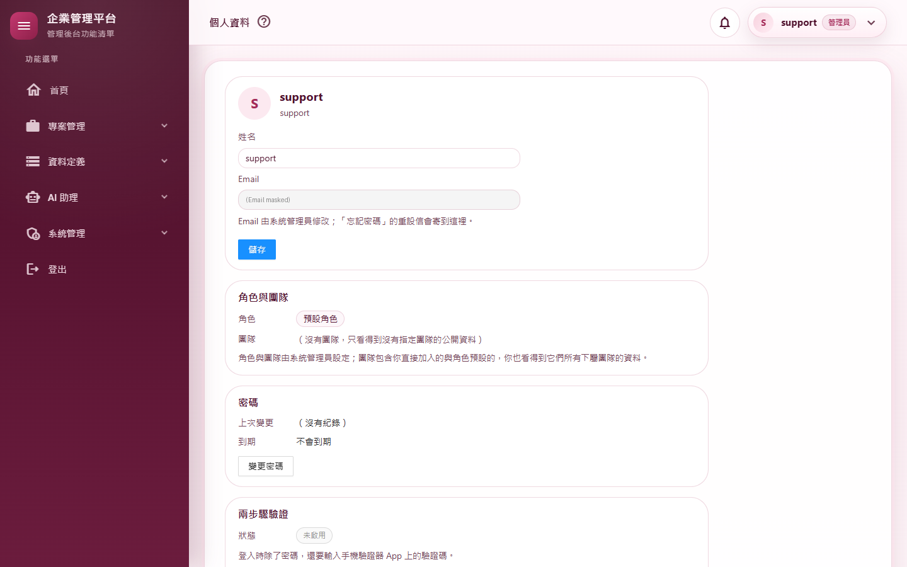
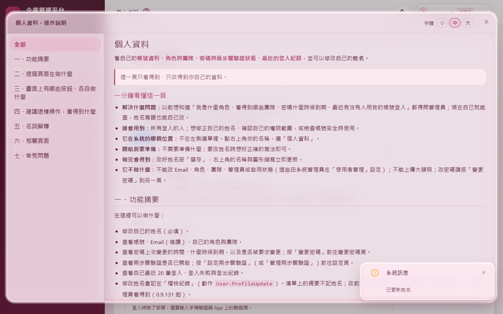
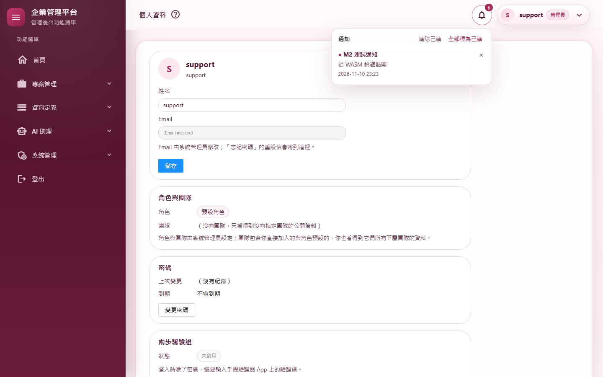
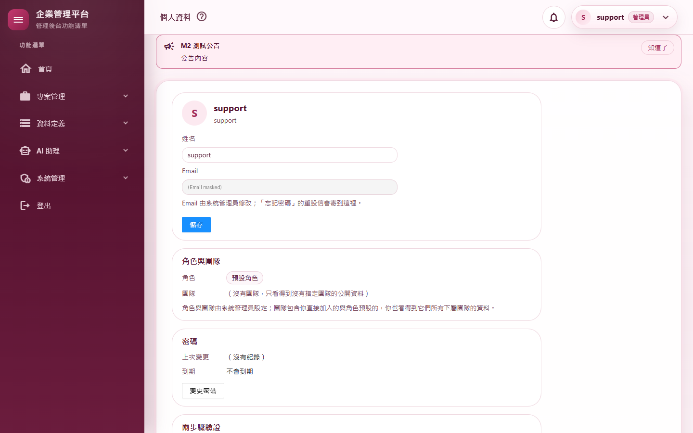
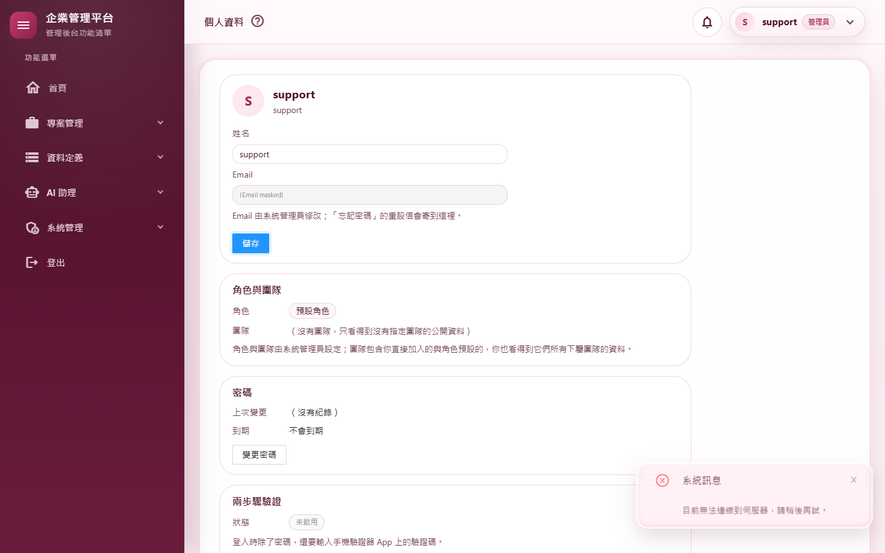
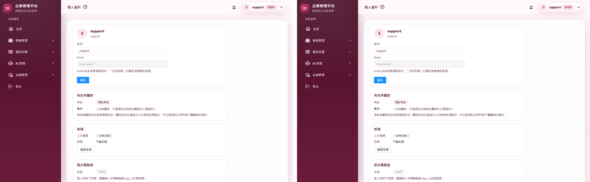

# M02 外框與個人資料 測試報告（0.10.1）

- 文件版本：1.0
- 文件狀態：已實作
- 現行系統版本：0.10.1
- 首次實作版本：0.10.1
- 最後核對日期：2026/11/10

## 摘要

| 項目 | 結果 |
|---|---|
| 範圍 | 第一個 WASM 頁面「個人資料」（`/Profile`）；WASM 版外框（側邊選單、頂欄、通知鈴鐺、公告橫幅、操作說明、關於）；外框與個人資料 API（`shell`、`notifications`、`announcements`、`profile`）；WASM 頁面的 Token 工作階段（Cookie 換 Token、跨分頁排隊刷新、斷線處理）；Server／WASM 頁面互相切換；共用的純顯示元件搬到 Client 專案。其他 36 個頁面不動 |
| 自動化測試 | 2,632 個全部通過（M1 結束時 2,579 個；新類別 `ShellApiIntegrationTests` 28 個、`Client/ClientSessionTests` 25 個＝淨增 53） |
| 品質關卡 | 7 步全部通過（結果見 A.3） |
| 實機驗證 | 14 個情境全部通過；全部 37 個路由煙霧測試全部通過 |
| 外觀比對 | Server 版（M1）與 WASM 版個人資料頁同尺寸截圖逐像素比對：每個像素每個色版最多差 1／255（背景漸層的抖色），肉眼無差異 |
| 獨立審查 | 7 項發現（2 項中、2 項中低、3 項低）全部修正；6 個測試缺口全部補上 |
| 版本 | 0.10.0 → 0.10.1 |

變更內容見 [changelog：WASM 遷移 M2 外框與個人資料](../../changelog/2026-11-10-WASM遷移M2外框與個人資料.md)；與計畫不同的做法見 [遷移計畫 M2 段](../WASM遷移計畫.md)。

---

## A.1 測試策略

| 層次 | 涵蓋什麼 | 工具 |
|---|---|---|
| 整合測試 | 真的主機與資料庫、以 API 登入拿到的 Token 呼叫：每個新端點沒有 Token 回 401、選單依權限過濾、說明內容、開頁稽核與錯誤回報（含限流）、只能動自己的通知、公告、個人資料與併發戳記 | `WebApplicationFactory` |
| 單元測試 | WASM 端的 `ClientSession` 與 `ApiClient`：以假的 HTTP 回應與 Token 存放驗證 Cookie 換 Token、刷新、跨分頁沿用、身分綁定、401 重試、強制設定導向、斷線；路由表、頁名對照、鈴鐺數字 | xUnit |
| 守門測試 | 頁面授權、操作說明登記、色票與浮層樣式規則改為同時掃描 Server 與 Client（`SourceTree.UiRoots`）；Client 專案只參考三個共用專案（M1） | xUnit |
| 回歸 | M1 結束時的 2,579 個測試 | xUnit |
| 品質關卡 | 建置（Release）、格式、全部測試、文件編碼、CRUD 產生器錨點、弱點掃描 | `scripts/Invoke-QualityGate.ps1` |
| 實機驗證 | 真的網站（隔離資料庫）、真的 Chrome：操作畫面、查資料庫與稽核核對、斷網 | `scripts/Start-E2EHost.ps1`、`scripts/e2e/m02-shell.mjs`、`smoke-routes.mjs` |
| 外觀比對 | 同一個頁面 Server 版（M1 的煙霧測試截圖）與 WASM 版逐像素比對 | Pillow |
| 獨立程式審查 | 未參與實作的審查者讀完整份變更，找安全漏洞、正確性與測試缺口 | 另一個 AI 審查代理（只讀） |

---

## A.2 自動化測試

**新增的測試類別**

| 測試類別 | 驗證的行為 |
|---|---|
| `ShellApiIntegrationTests`（28） | 6 個讀取端點與 8 個寫入端點沒有 Token 都回 401＋`ApiResult`；系統資訊含版本與說明主題；選單依權限過濾（管理員看得到使用者管理、一般帳號看不到）；說明有七個章節、沒有 script、未登記的路由 404；開頁稽核去掉 query string、**Server 頁面與不存在的路徑不記**（3 個案例）、**每分鐘 60 筆後不再記**；錯誤回報可接受、**以使用者為單位跨請求限流**（超過回 `accepted=false`，另一位使用者不受影響）；通知只看得到自己的、不安全的連結被去掉、已讀／刪除／清除，**別人的通知標不了已讀也刪不掉（404）**；公告顯示到被關閉；個人資料含登入紀錄、改姓名要帶正確的併發戳記 |
| `Client/ClientSessionTests`（25） | 沒有 Token 時以 Cookie 換、依「記住我」存放並帶 `X-MyProject-Client`；換不到回登入頁並清掉 storage；強制改密碼／設定兩步驟驗證整頁導走（2 個案例）；別的分頁已換好就沿用、不打伺服器；**別的分頁存的是別人的 Token 就不沿用**；**存的 Token 不是這次網頁登入的人就丟掉重換**；刷新被拒改用 Cookie 重換；**斷線時刷新回 false、不丟例外、不導走**；登出清 Token 並交給網頁登出頁；API 401 先刷新再重試一次；被要求改密碼導到變更密碼頁；連不上伺服器回失敗結果；`ClientRouteTable` 判斷（8 個案例，含 `/%50rofile`、結尾斜線與無效編碼）；頁名先找選單再找說明主題；鈴鐺「99+」與 Server 版一致（3 個案例） |

粗體是獨立審查之後補的測試（見 A.5）。

**修改的既有測試**

| 測試 | 修改 | 理由 |
|---|---|---|
| `PageHelpCatalogTests`、`ThemeConventionTests` | 掃描範圍改為 `SourceTree.UiRoots`（Web 的 `Components` 與 Client） | 個人資料頁與外框複本在 Client 專案，規則要一併涵蓋 |
| `PageAuthorizationTests` | 一併檢查 Client 組件的頁面 | `/Profile` 搬到 Client 後仍須有 `[Authorize]` |
| `FormModalConventionTests` | `OverlayStyles.razor` 的路徑改到 Client | 檔案搬家（命名空間不變） |
| `ProfileTests` | 登入動作文字改測 `ProfileController.DescribeLoginAction` | Server 版的個人資料檢視已刪除，同一段邏輯移到 API |
| `LogoutConfirmationConventionTests` | 失敗訊息的路徑文字 | `LogoutConfirm` 搬到 Client |
| `SourceTree` | 新增 `UiRoots` | 給上面這些測試共用 |

> 說明：M2 前半（新端點與 WASM 工作階段）的測試是先寫、後實作，其中部分只確認了「編譯失敗」（型別尚不存在）。**審查後補的測試是在修正之後才寫的**，沒有逐一看到它們在修正前失敗；跨模式開頁稽核（審查發現 5）沒有單元測試，改以實機情境 W13 直接查資料庫驗證。

---

## A.3 品質關卡

`pwsh ./scripts/Invoke-QualityGate.ps1`（2026/11/10，完整 7 步）：

| 步驟 | 結果 | 秒數 |
|---|---|---|
| Restore | 通過 | 0.8 |
| Build（Release） | 通過（0 警告、0 錯誤） | 16.5 |
| Format | 通過（`dotnet format --verify-no-changes`） | 23.1 |
| Test | 通過（2,632 個） | 42.9 |
| Docs encoding | 通過（290 個檔案，`docs/` 與根目錄 `.md` 皆 UTF-8 含 BOM） | 0.1 |
| CRUD anchors | 通過（一般、含團隊、管理員專屬各 24 項） | 0.3 |
| Vulnerability | 通過（8 個專案都沒有已知弱點） | 19.7 |

合計 103 秒，`QUALITY GATE PASSED`。

---

## A.4 實機驗證

**環境**見 A.7。全新的隔離資料庫；support 用暫時密碼；`Start-E2EHost.ps1` 另外開啟瀏覽類稽核（`AuditLogSettings:RecordBrowsing`），讓 W13 能查開頁稽核。腳本另在隔離資料庫建一個一般帳號 `e2e-user`（W10、W11、W13 用）。
結果原檔：`scripts/e2e/m02-shell.mjs` 產生的 `m02-results.json` 與 `smoke-results.json`（不進版控）。

| # | 情境 | 步驟 | 預期 | 實際結果 | 判定 |
|---|---|---|---|---|---|
| W1 | 從 Server 頁面進入 WASM 頁面 | 開分類清單（Server），右上角選單點「個人資料」 | 整頁載入成 WASM 版 `/Profile` | 停在 `/Profile`、以 WebAssembly 執行；第一次進入（含下載）1,999 ms，`_framework` 傳輸 27.3 MB（開發模式：未修剪、未壓縮、含除錯資訊）（截圖 01） | 通過 |
| W1b | 再次進入（已快取） | 回分類清單後直接開 `/Profile` | 比第一次快 | 1,393 ms | 通過 |
| W2 | WASM 外框 | 看頂欄頁名、側邊選單、右上角 | 頁名「個人資料」、選單完整、管理員標籤 | 頁名「個人資料」、選單項目 34 個、管理員標籤 1 個 | 通過 |
| W3 | 改姓名同步右上角 | 改姓名按「儲存」，再重新整理 | 右上角立即更新、重新整理後仍在 | 右上角立即顯示新姓名；重新整理後姓名「support 測試名」 | 通過 |
| W4 | 操作說明窗 | 按頂欄的「?」 | 「全部」＋七個章節 | 目錄 8 項（截圖 02） | 通過 |
| W5 | 通知鈴鐺 | 伺服器端新增一則給 support 的通知；開鈴鐺、點通知 | 未讀數 1、清單有它；點了標為已讀並導到連結（Server 頁面） | 未讀數「1」；點開後資料庫已讀＝是，導到 `/categories`（截圖 03） | 通過 |
| W6 | 公告橫幅 | 新增一則對全體的公告；按「知道了」後重新載入 | 顯示；關閉後不再出現 | 顯示（截圖 04）；重新載入後橫幅 0 個 | 通過 |
| W7 | WASM → Server 頁面 | 從側邊選單點「資料定義 › 團隊」 | 整頁載入成 Server 版 | 停在 `/teams`，Server 版表格顯示 | 通過 |
| W8 | 斷線不卡死 | 個人資料頁中斷網路後按「儲存」；恢復後再按 | 出現提示、不卡住；恢復後存檔成功 | 出現「目前無法連線到伺服器，請稍後再試。」（截圖 05）；恢復後「已更新姓名」 | 通過 |
| W9 | 從 WASM 頁面登出 | 右上角「登出」→ 確認 | 清掉瀏覽器的 Token、撤銷刷新 Token、只寫一筆登出稽核、回登入頁 | 登出前有 Token、登出後沒有；撤銷原因 `WebLogout` 1 筆；稽核 `Logout` 1 筆 | 通過 |
| W10 | 換人登入 | 改用 `e2e-user` 登入，開個人資料 | 看到的是 `e2e-user` | 個人資料顯示帳號「e2e-user」 | 通過 |
| W11 | 強制改密碼導向 | 把 `e2e-user` 標成必須改密碼，開 `/Profile` | 導到變更密碼頁（Server） | 停在 `/ChangePassword` | 通過 |
| W13 | 跨模式換頁的開頁稽核 | `/App` → 右上角「個人資料」（整頁載入成 WASM）→ 右上角「變更密碼」（整頁載入成 Server） | `/Profile`、`/ChangePassword` 各只記一筆 | `/Profile` 1 筆、`/ChangePassword` 1 筆 | 通過 |
| W12 | 沒有頁面錯誤 | 收集以上過程中瀏覽器的未處理錯誤 | 0 個 | 0 個 | 通過 |
| R01–R37 | 全部路由煙霧測試 | support 開 30 個登入後路由，未登入開 6 個登入相關路由，最後開登出頁 | 每頁 HTTP < 500、沒有錯誤列、沒有無權限畫面、沒有頁面錯誤 | 37／37 通過；`/Profile` 以 WASM 顯示；`/Auths/TwoFactor`、`/Auths/RefreshSession` 與 `/Auths/Logout` 依設計導回登入頁 | 通過 |

> W13 第一次執行時判為失敗（`/ChangePassword` 2 筆）。查資料庫後確認多出的一筆是**上一個情境 W11** 的開頁稽核：它是非同步寫入，比 W13 記下起點晚了一點才落庫。改成從 W13 的 `/App` 那一筆之後開始數，以全新資料庫重跑整套，全部通過。產品行為沒有改。

> 截圖中 support 的 Email 已遮蔽（來自開發機的 User Secrets）。

**外觀比對**：M1 煙霧測試的 Server 版 `/Profile` 截圖與本次 WASM 版截圖（同為 1440×900）逐像素比對，差異分布在內容區，每個色版最多差 1／255，是背景漸層的抖色；版面、字型、間距、顏色相同（截圖 06）。審查修正前的一次執行兩張圖完全相同。

**首次載入量**：開發模式下第一次進入要下載 27.3 MB（未修剪、未壓縮、含除錯資訊），本機約 2 秒；之後由瀏覽器快取。正式發佈（修剪＋壓縮）的大小與時間在 M12 量測。

**伺服器日誌**：有 3 筆 ERROR，都來自煙霧測試登入後 `/` 啟動頁整頁導向 `/App` 時，舊連線的登入檢查撞到已釋放的 DbContext。這是 M1 已用未修改的 0.9.177 比對確認的既有問題（見 [M01 報告](M01-基礎建設.md) A.6），與 M2 無關。其餘只有 WARN（連線中斷、錯誤頁與找不到頁面的預期紀錄）。

---

## A.5 程式審查

獨立審查（只讀、未參與實作）跑了建置與全部測試（當時 2,612 個），結論是新端點的授權與 CSRF 防護沒有問題，也沒有 XSS。發現與處理：

| # | 嚴重度 | 發現 | 處理 |
|---|---|---|---|
| 1 | 中 | 瀏覽器存的 Token 從不比對是誰的：同一個瀏覽器另一個分頁換人登入，或從重設密碼信等頁面進入登入頁（`auth-reset.js` 不一定執行），WASM 頁可能用上一個人的 Token | 已修正：主機把 Cookie 的使用者 Id 傳給 WASM（`ClientRoutes.ExpectedUserId`）；`ClientSession` 啟動時與沿用別的分頁的 Token 時都比對，不符就丟掉重換；執行中換到別人的 Token 就整頁重載。補 2 個單元測試；實機 W10 |
| 2 | 中 | `client-errors` 的限流失效：`BrowserErrorReporter` 的計數是「每個實例」，API 每個請求一個實例 | 已修正：新增 singleton `PerUserRateLimiter`，以使用者為單位跨請求計數（上限沿用 `ClientErrorReporting:MaxPerCircuitPerMinute`），超過回 `accepted=false` 並計入記錄管線監控。補整合測試 |
| 3 | 中低 | 編碼網址（`/%50rofile`）主機與 WASM 判斷不一致，造成不停重新整理；從路徑重組網址，`//` 開頭可能變成站外網址 | 已修正：`ClientRouteTable.Normalize` 先解碼；兩邊的路由器都略過第一次導覽；整頁載入一律用 `NavigationManager.Uri`；WASM 的找不到頁面改顯示「找不到這個頁面」＋回首頁。補路由表測試案例 |
| 4 | 中低 | 斷線時剛好要刷新 Token：經 JS（Web Locks）回呼的例外會變成 `JSException`，整頁出錯 | 已修正：`RefreshUnderLockAsync`、`/me` 自行接住網路例外並回失敗；`ApiClient` 另接 `TaskCanceledException`、`JSException`。補單元測試；實機 W8 |
| 5 | 低 | Server 頁與 WASM 頁互相切換時開頁稽核記兩筆 | 已修正：即將整頁載入到另一邊時，離開的一邊不記（`ApplicationCircuitHandler`、`ClientMainLayout`）。實機 W13 |
| 6 | 低 | 開頁稽核 API 相信前端送來的任意路徑、沒有次數上限 | 已修正：只接受 `ClientRouteTable` 的路徑，每位使用者每分鐘 60 筆。補整合測試 |
| 7 | 低 | 定期更新（鈴鐺、公告）的資源釋放：釋放後計時迴圈讀已釋放的 token；JS 例外時沒釋放乾淨；元件在啟動完成前被移除時計時器不停 | 已修正：迴圈只拿啟動時的 token、釋放可重複呼叫且一定執行到底；元件在啟動途中被移除就立刻停掉計時器 |

審查列出的 6 個測試缺口（別人的通知、限流、路由正規化、使用者 Id 不符、斷線刷新、寫入端點 401）都已補上，見 A.2 的粗體項目。

審查列為「已檢查沒問題」的項目：通知與公告一律用目前使用者的 Id，讀不到也改不到別人的；個人資料只能讀寫自己的並帶併發戳記；新端點只接受 JWT，沒有 CSRF 問題；說明窗的 HTML 來自已停用原始 HTML 的 Markdown 管線，公告與通知以純文字輸出，通知連結先經 `ReturnUrlGuard`；Token 刷新不會無限循環；`/Profile` 有 `[Authorize]`，主機在整頁請求時就擋掉未登入者；外框的管理員標籤、側邊欄收合記憶、說明字體大小、相關頁面依權限過濾、頁名對照、錯誤回報、「關於」都保留；個人資料頁標記與 Server 版逐行相同。

---

## A.6 已知限制

1. **通知與公告每 60 秒更新一次**（以及切回分頁時），不是即時推送；M8 加上推播串流後恢復即時。
2. **進出 WASM 頁面會整頁重新載入**；第一次進入要下載程式（開發模式 27.3 MB，正式發佈的大小在 M12 量測）。
3. **外框有兩份**（Server 版與 WASM 版複本）：M10 移除 Server 模式前，改外框要兩邊同步（速查表 §6.33 第 6 點）。
4. 前端一般日誌留在瀏覽器主控台，沒有送回伺服器（`RemoteLoggerProvider` 延後，M6 視需要再加）；未處理例外與瀏覽器錯誤已送回。
5. 從 WASM 頁登出不呼叫 `/api/v1/Auth/logout`（由網頁登出頁撤銷），已發出的存取 Token 仍可用到到期（預設 60 分鐘，M9 檢討）。
6. 限流計數在記憶體中，多主機時各自計算；網站重新啟動後歸零。
7. **既有問題（0.9.177 就有）**：換頁瞬間舊 Blazor 連線的登入檢查撞到已釋放的 DbContext，日誌留下 3 筆 ERROR，畫面不受影響（見 M01 報告 A.6）。
8. 實機 W5、W6、W11 以直接改資料庫的方式建立通知、公告與「必須改密碼」旗標（模擬伺服器端產生或管理員設定），不是透過畫面操作。

---

## A.7 測試環境

| 項目 | 內容 |
|---|---|
| 作業系統 | Windows 11 Pro 10.0.26300 |
| .NET SDK | 10.0.400（`global.json`），執行階段 ASP.NET Core 10.0.14 |
| 瀏覽器 | 本機 Google Chrome（headless），playwright-core 1.49.1（裝在 repo 外） |
| Node.js | 24.16.0（內建 `node:sqlite` 唯讀查詢隔離資料庫） |
| 網站 | `scripts/Start-E2EHost.ps1`：`https://localhost:7144`，Development 環境；12 個外部路徑與日誌都在暫存資料夾，每次全新資料庫；開啟瀏覽類稽核 |
| 資料庫 | SQLite（隔離），migration 至 `AddRefreshSession`（M2 沒有資料庫異動） |
| AI 模型 | 未使用（M2 不涉及 AI 功能） |
| 開發機資料 | 實機與測試都未寫入 `C:\temp\MyProject` |
