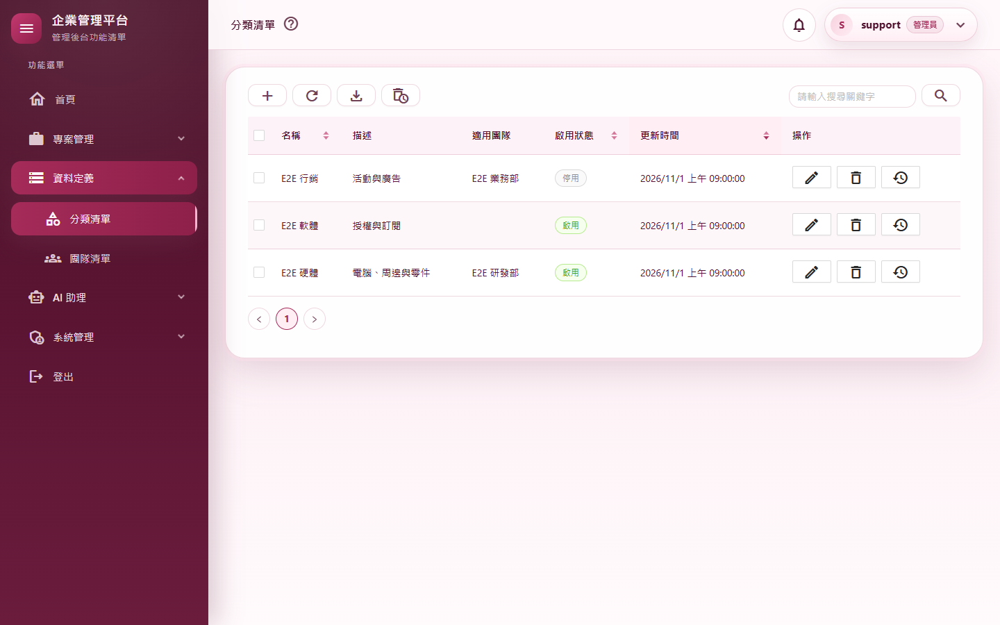
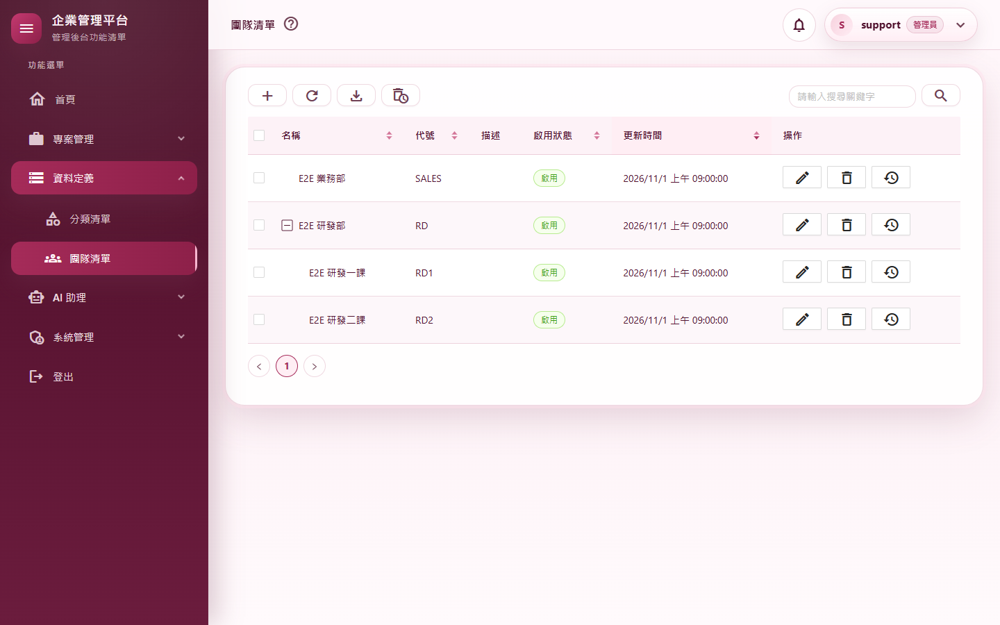
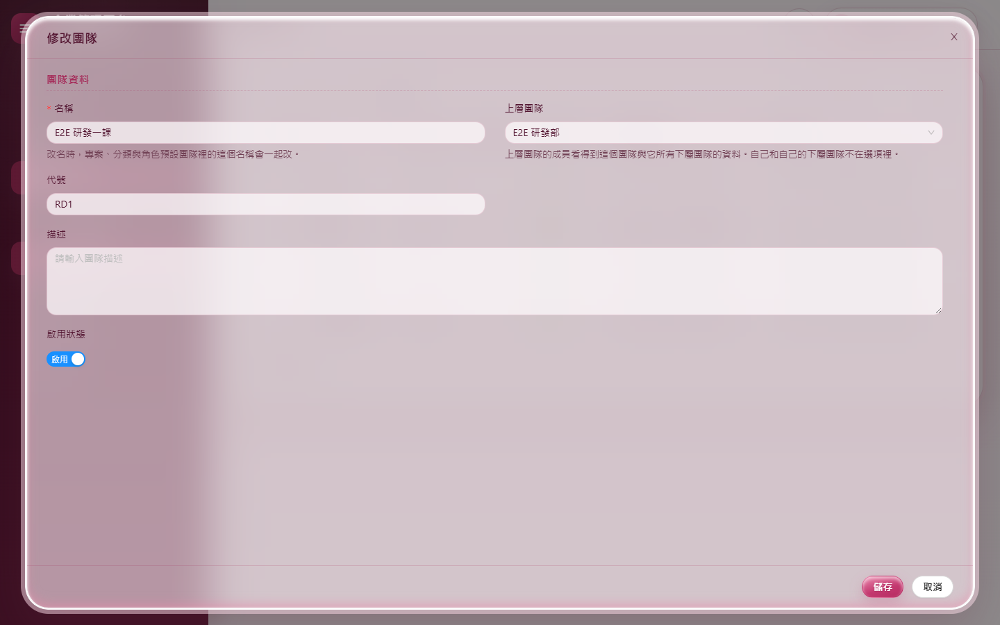
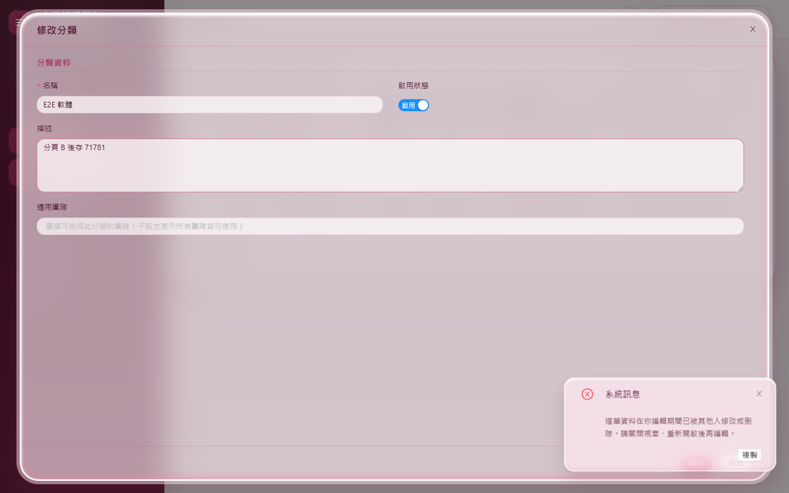
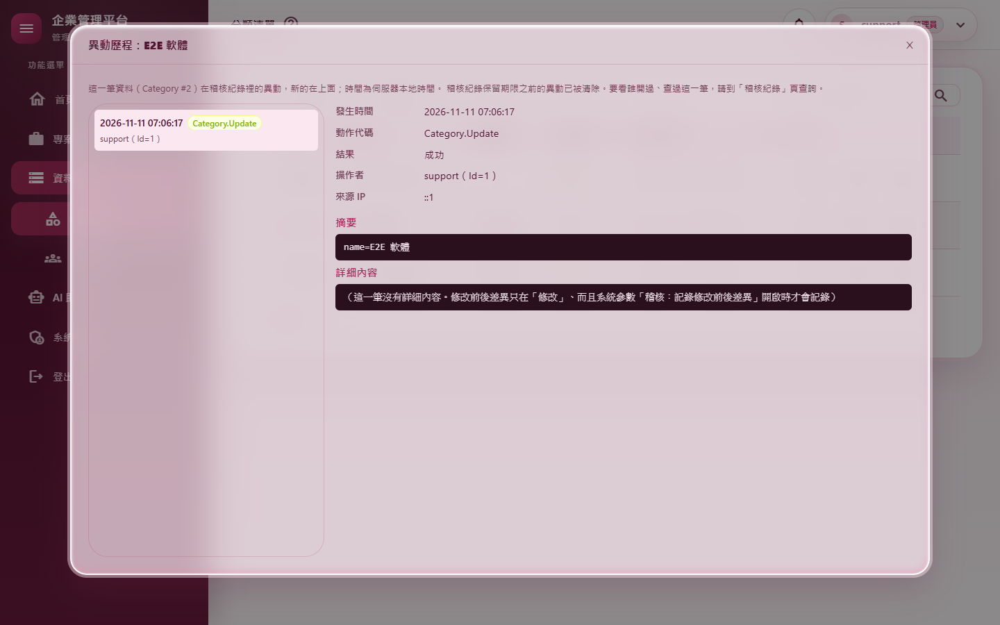
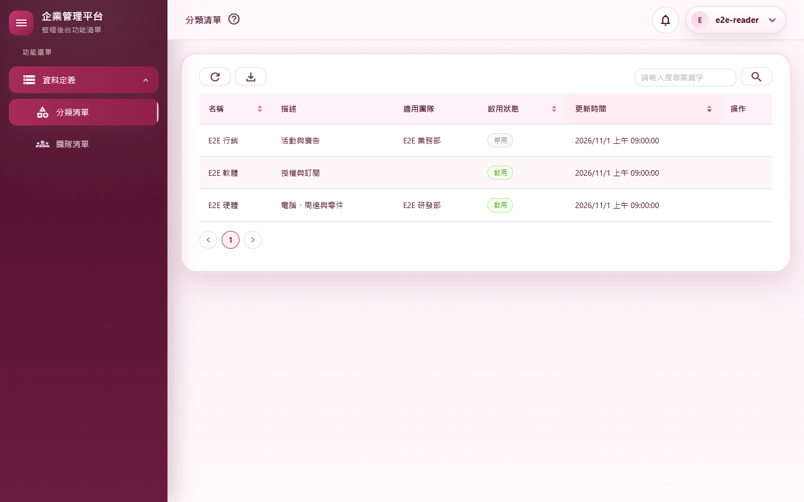
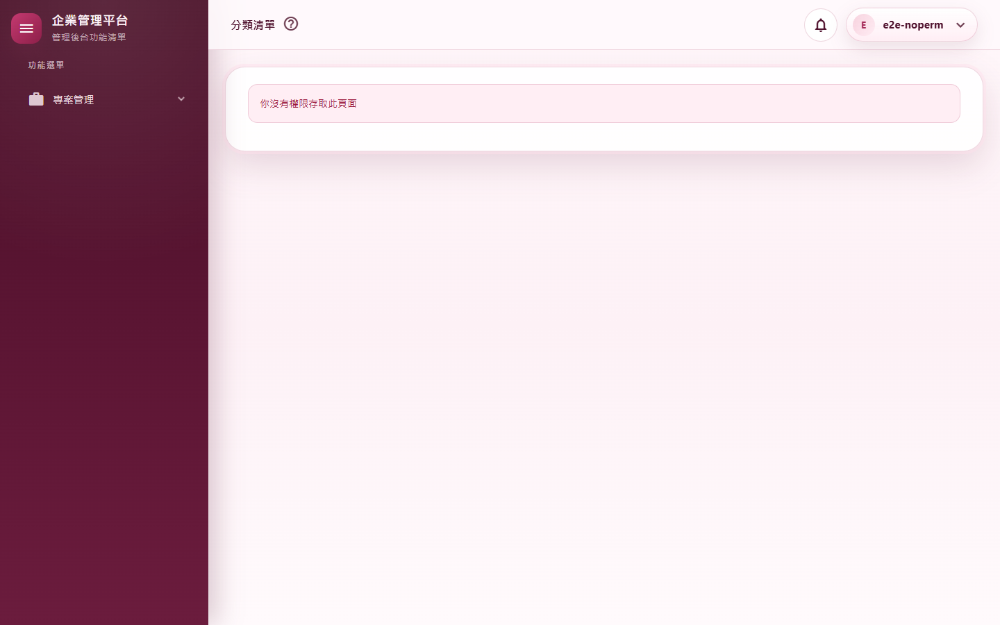
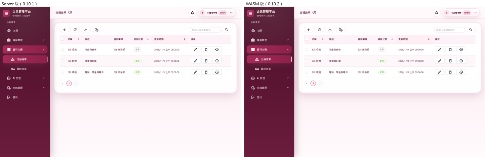
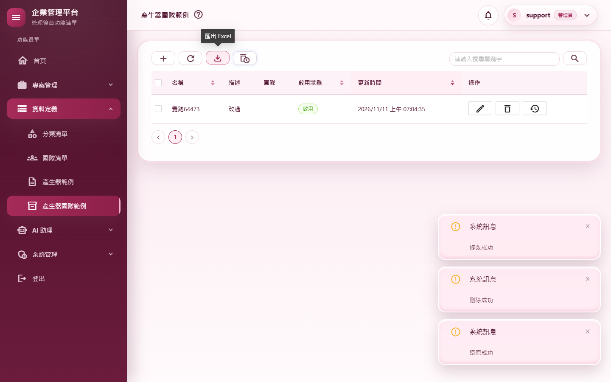

# M03 測試報告：分類、團隊與 CRUD 產生器

- 里程碑：WASM 遷移 M3（計畫見 [WASM遷移計畫](../WASM遷移計畫.md)）
- 版本：0.10.1 → 0.10.2
- 測試日期：2026/11/11
- 分支：`feature/wasm-m03-crud`（尚未合併）

## 摘要

| 項目 | 結果 |
|---|---|
| 範圍 | 分類（`/categories`）、團隊（`/teams`，部門樹）改在 WebAssembly 執行，Server 版頁面刪除；分類、團隊 API 改走與畫面相同的服務（刪除 `CategoryRepository`、`TeamRepository`），補齊顯示已刪除、還原、永久刪除、切換啟用、存檔前檢查、匯出、表單選項、部門樹等端點；異動歷程 API（只限管理員）；共用元件（工具列按鈕、權限判斷、通知、異動歷程對話窗等）搬到 Client 讓兩種頁面共用；CRUD 產生器改為只產生 WASM 頁面 |
| 自動化測試 | 2,667 個全部通過（M2 結束時 2,632 個，淨增 35） |
| 品質關卡 | 7 步全部通過（結果見 A.3） |
| CRUD 產生器驗證 | `Test-CrudGenerator.ps1` 全部通過：產生 3 個模組（一般、含團隊、管理員專屬）後建置、格式、2,714 個測試、文件編碼、**新增的實跑**（3 個產生的頁面在 WASM 各做新增、修改、刪除、還原）、重跑不改動任何檔案 |
| 實機驗證 | 13 個情境全部通過；全部 37 個路由煙霧測試全部通過（全新的隔離資料庫） |
| 外觀比對 | Server 版（改版前）與 WASM 版 8 個畫面逐像素比對：4 個完全相同；2 個最多差 1／255（背景漸層的抖色）；2 個在搜尋按鈕邊緣有 14 個像素、最多差 8／255。肉眼無差異 |
| 獨立審查 | 7 項發現（2 項中、5 項低）全部修正並補測試 |
| 版本 | 0.10.1 → 0.10.2 |

---

## A.1 測試策略

| 層次 | 涵蓋什麼 | 工具 |
|---|---|---|
| 整合測試 | 真的主機與資料庫、以 API 登入拿到的 Token 呼叫：分類、團隊每個端點的成功與失敗、重名與版本衝突 409、團隊範圍外 404、唯讀角色寫入 403、顯示已刪除要刪除權限、匯出檔內容、每個動作稽核只記一筆、異動歷程只限管理員、沒有權限開 WASM 頁面的稽核、伺服器日期格式 | `WebApplicationFactory` |
| 單元測試 | WASM 端：DTO 與畫面資料互轉、API 錯誤訊息取用、匯出被拒的原因、追蹤碼只給緊接的錯誤、異動歷程斷線時不出錯、`/me` 轉成畫面權限、日期格式與伺服器相同；服務的失敗種類（`Kind`） | xUnit |
| 守門測試 | 資料頁都要有異動歷程（含 CRUD 樣板的新路徑）、選單權限鍵與頁面一致（認得 WASM 頁的 `CanAccessPage`）、資料保留頁「前往」帶 `?deleted=1`，都改為同時掃描 Server 與 Client | xUnit |
| 回歸 | M2 結束時的 2,632 個測試 | xUnit |
| 品質關卡 | 建置（Release）、格式、全部測試、文件編碼、CRUD 產生器錨點、弱點掃描 | `scripts/Invoke-QualityGate.ps1` |
| 產生器驗證 | 在暫存 worktree 產生 3 個模組、建置、測試、實跑、冪等 | `scripts/Test-CrudGenerator.ps1`、`scripts/e2e/crud-generated.mjs` |
| 實機驗證 | 真的網站（隔離資料庫）、真的 Chrome：操作畫面、兩個分頁同時修改、下載檔案、查資料庫與稽核 | `scripts/Start-E2EHost.ps1`、`scripts/e2e/m03-crud.mjs`、`smoke-routes.mjs` |
| 外觀比對 | 同一組固定資料，改版前（Server）與改版後（WASM）各拍 8 個畫面逐像素比對 | `scripts/e2e/m03-views.mjs`＋Pillow |
| 獨立程式審查 | 未參與實作的審查者讀完整份變更，找授權漏洞、正確性與測試缺口 | 另一個 AI 審查代理（只讀） |

---

## A.2 自動化測試

測試數：2,632 → 2,667（全部通過）。

| 測試類別 | 驗證的行為 |
|---|---|
| `CategoryTeamApiTests`（新，22） | 分類完整流程（新增→查看→修改→停用→刪除→顯示已刪除→還原→刪除→永久刪除），**稽核依序各一筆、操作者正確**；過期版本號存檔回 409、先存的內容保留；重名（去空白、不分大小寫）新增與檢查都回 409；還原時已有同名回 409；只能永久刪除已刪除的資料；不存在的 id 每個端點都回 404；搜尋的排序（不分大小寫）、啟用篩選、分頁，**只有按搜尋才寫搜尋稽核**；匯出 xlsx 的欄位與筆數、匯出稽核；團隊範圍：看不到、讀不到、刪不到、切換不了別隊的分類，表單選項只列自己的範圍，指定範圍外的團隊回 400；唯讀角色可讀、可匯出，**12 個寫入端點都回 403**；團隊完整流程與稽核；部門樹、可選上層排除自己與下屬、有下屬不可刪（400，與改寫前相同）、上層選到下屬（400）；團隊改名同步分類引用；名稱或代號重複 409；部門樹模式匯出含上層名稱；**沒有權限開 `/categories`、`/teams` 記一筆 `Permission.Denied`（via=WASM）**（2 個案例）；異動歷程只列異動、打開與點開各記一筆稽核、非管理員 403；審查補測：**只有檢視權限查或匯出已刪除的資料回 403**、**存檔前檢查要新增／修改權限、範圍外的 id 一律 404（修改、還原、永久刪除也是）**、部門樹模式匯出照啟用條件篩選 |
| `Client/ClientApiMappingTests`（新，10） | 分類、團隊的 DTO 與畫面資料來回轉換每個欄位都不變（「適用團隊」清單與儲存格式互轉）；新增用的 DTO 預設 Id 與版本號；API 失敗顯示原因而不是「資料衝突」這類分類字；異動歷程只回「有沒有詳細內容」、不帶伺服器路徑；`/me` 轉成畫面權限的規則與伺服器相同（5 個案例） |
| `Client/ClientCultureTests`（新，4） | 套用伺服器的日期時間格式後，與伺服器的 `DateTime.ToString()` 結果一字不差；表格欄位用的顯示格式也是；沒拿到格式仍是 zh-TW |
| `Client/ClientSessionTests`（＋） | 路由表認得 `/categories`、`/teams`（含大小寫與 query string）、`/projects` 仍是 Server 頁；審查補測：**匯出被拒時回傳伺服器給的原因**、追蹤碼只取用一次；**異動歷程斷線時清單丟「讀不到」、詳細內容回說明文字**（不讓對話窗出錯） |
| `ShellApiIntegrationTests`（＋1） | `GET /api/v1/shell/culture` 不需登入、回傳伺服器 zh-TW 的日期時間格式 |
| `TeamTreeTests`、`SoftDeleteTests`（改） | 原本對 `TeamRepository`／`CategoryRepository` 的測試改成驗證服務的失敗種類（API 依它回 400／404／409）與改名同步引用 |

**為了這次改動而調整的既有測試**

| 測試 | 修改 | 理由 |
|---|---|---|
| `CategoryTeamRepositoryUniquenessTests` | 刪除 | 兩個 Repository 已刪除；它守的「API 與畫面的重名規則一致」改由同一個服務保證，並由 `CategoryTeamApiTests` 的重名案例驗證 |
| `RequirePermissionTests`、`AuditHistoryTests`、`ToastCopyButtonTests` | 另外登記 `ServerPagePermissions`、`ServerAuditHistorySource` | 元件改注入 `PagePermissions`、`IAuditHistorySource`（Server 與 WASM 各一份實作）；斷言一字不改 |
| `ViewNotificationTests` | 設定追蹤碼來源 | `ViewNotification` 搬到 Client，追蹤碼來源改由主機在啟動時提供 |
| `AuditHistoryConventionTests`、`MenuPermissionConsistencyTests`、`DataRetentionOverviewServiceTests` | 改用 `SourceTree.UiFile`／`UiRoots`；權限檢查的正則同時認得 `CanAccessPage` 與 `Permissions.IsAdmin` | 分類、團隊頁搬到 Client；WASM 頁的寫法不同但規則相同 |
| `LoggingConventionTests` | 豁免清單加 `ServerPagePermissions.cs` | 純判斷、沒有 I/O |

---

## A.3 品質關卡

`pwsh ./scripts/Invoke-QualityGate.ps1`（所有修正與文件同步完成後的最後一次執行）：

| 步驟 | 結果 | 秒數 |
|---|---|---|
| Restore | 通過 | 1.1 |
| Build（Release） | 通過（0 警告、0 錯誤） | 22.4 |
| Format | 通過（`dotnet format --verify-no-changes`） | 79.1 |
| Test | 通過（2,667 個） | 97.2 |
| Docs encoding | 通過（292 個檔案，`docs/` 與根目錄 `.md` 皆 UTF-8 含 BOM） | 0.2 |
| CRUD anchors | 通過（一般、含團隊、管理員專屬各 24 項） | 0.9 |
| Vulnerability | 通過（沒有已知弱點） | 23.7 |

合計 224.6 秒，`QUALITY GATE PASSED`。

`scripts/Test-CrudGenerator.ps1`（審查修正之後）：產生 3 個模組各約 20 秒、建置 20.2 秒、格式 11.6 秒、全部測試 111.5 秒（2,714 個，含產生模組的服務與 API 測試）、文件編碼、實跑 61.9 秒、重跑不改動任何檔案，全部通過。

---

## A.4 實機驗證

隔離資料庫（`Start-E2EHost.ps1`，全新）＋本機 Chrome。資料由 `m03-views.mjs` 佈置：4 個團隊（研發部底下兩個課、業務部、一個已刪除）、4 個分類（研發部的、公開的、業務部的停用、一個已刪除）、唯讀角色 `e2e-reader`、研發部的分類維護人員 `e2e-rd`、只能看專案的 `e2e-noperm`。

### 情境

| # | 情境 | 步驟 | 預期 | 實際結果 | 判定 |
|---|---|---|---|---|---|
| C1 | 分類完整流程 | 新增（未指定團隊的提醒→仍要儲存）、修改、點狀態標籤停用、刪除、顯示已刪除、還原、再刪除、永久刪除 | 每一步都成功、資料庫最後沒有這筆、稽核依序各一筆 | 頁面以 WebAssembly 執行；通知依序「新增成功／修改成功／已停用「E2E 新分類4791」／刪除成功／還原成功／已永久刪除」；資料庫 0 筆；稽核 Create→View→Update→Disable→Delete→Restore→Delete→Purge（截圖 01） | 通過 |
| C2 | 重名 | 新增名稱「 e2e 硬體 」（前後空白、大小寫不同） | 擋下 | 顯示「分類名稱已存在，無法新增。」 | 通過 |
| C3 | 兩個分頁同時修改 | 兩個分頁都打開「E2E 軟體」的修改窗；A 先存，B 再存 | B 得到版本衝突訊息，A 的內容保留 | B 顯示「這筆資料在你編輯期間已被其他人修改或刪除。請關閉視窗、重新開啟後再編輯。」；資料庫描述是 A 的值（截圖 04） | 通過 |
| C4 | 匯出 Excel | 按「匯出 Excel」 | 下載 xlsx、寫匯出稽核 | 下載 `MyProject.Web-categories-20261111-070621.xlsx`（檔頭為 xlsx 格式）；`Category.Export` 稽核 1 筆 | 通過 |
| C5 | 異動歷程（管理員） | 「E2E 軟體」那一列按「異動歷程」，點第一筆 | 列出異動，右邊顯示摘要 | 列出 1 筆，點開顯示 `Category.Update`、操作者、來源 IP、摘要（截圖 05） | 通過 |
| C6 | 團隊批次刪除 | 新增「批次上層」「批次下層」並把下層掛到上層下；展開、兩個都勾選，「刪除選取（2）」 | 先刪下屬再刪上層，兩筆都刪掉 | 通知「已刪除 2 筆」；兩筆都已刪除（截圖 02 為部門樹） | 通過 |
| C7 | 團隊改名同步分類 | 把「E2E 業務部」改名為「E2E 業務處」，回分類清單 | 「E2E 行銷」的適用團隊跟著改 | 適用團隊顯示「E2E 業務處」 | 通過 |
| C8 | 資料保留頁「前往」 | 資料保留與清理頁「已刪除的分類」按「前往」 | 一進來就是已刪除的清單 | 停在 `/categories?deleted=1`，工具列顯示「返回清單」 | 通過 |
| C9 | Server 與 WASM 頁面互相切換 | `/projects`（Server）→ 側邊選單「團隊清單」→「分類清單」 | Server→WASM 整頁載入；WASM→WASM 不重載 | `/projects` 不是 WASM；`/teams` 以 WASM 顯示；`/categories` 正常顯示 | 通過 |
| C10 | 管理員操作沒有錯誤 | C1～C9 期間收集頁面錯誤與 Blazor 未處理例外 | 沒有 | 無 | 通過 |
| C11 | 團隊範圍 | `e2e-rd`（研發部）打開分類清單；以他的 Token 讀業務部的分類 | 只看到研發部與公開的；API 回 404 | 清單有「E2E 硬體」「E2E 軟體」、沒有「E2E 行銷」；API 回 404 | 通過 |
| C12 | 唯讀角色 | `e2e-reader` 打開分類清單；以他的 Token 新增、刪除 | 看不到寫入按鈕與勾選欄；API 回 403 | 寫入按鈕與勾選欄 0 個；POST 403、DELETE 403（截圖 06） | 通過 |
| C13 | 沒有權限開頁 | `e2e-noperm` 打開 `/categories` | 顯示沒有權限；伺服器記權限拒絕 | 顯示「你沒有權限存取此頁面」；`Permission.Denied`（`/categories`、via=WASM）1 筆（截圖 07） | 通過 |

### 全部路由煙霧測試

37 個路由（含已改為 WASM 的 `/Profile`、`/categories`、`/teams`）全部開得起來、沒有錯誤列或無權限畫面、沒有頁面錯誤。

### CRUD 產生器實跑（`Test-CrudGenerator.ps1`）

| 頁面 | 結果 |
|---|---|
| `/gensamples`（一般） | 以 WebAssembly 執行；新增、修改（描述改為「改過」）、刪除、顯示已刪除、還原全部成功 |
| `/genteamsamples`（含團隊） | 同上（截圖 09） |
| `/genadminsamples`（管理員專屬） | 同上 |
| 頁面錯誤 | 無 |

### 外觀比對

改版前以 0.10.1（Server）拍下基準截圖，改版後以同一組固定資料拍 WASM 版，逐像素比對（1440×900）：

| 畫面 | 差異 |
|---|---|
| 分類清單 | 14 個像素、最多 8／255（搜尋按鈕上緣的陰影） |
| 分類修改窗 | 完全相同 |
| 分類已刪除清單 | 完全相同 |
| 部門樹 | 完全相同 |
| 部門樹展開 | 205 個像素、最多 1／255（側邊選單背景漸層） |
| 團隊修改窗 | 948 個像素、最多 1／255（背景漸層） |
| 團隊搜尋 | 205 個像素、最多 1／255 |
| 唯讀角色的分類清單 | 14 個像素、最多 8／255（同分類清單） |

截圖 08 為分類清單的並排對照。

**比對過程中發現並修正的兩個問題**（實作期間，不是審查）：

1. **時間格式不同**：WASM 版第一次比對時「更新時間」是「上午9:00:00」，Server 版是「上午 09:00:00」。瀏覽器內建的 zh-TW 地區資料與伺服器不同；而且實測在 WASM 裡改執行緒語系不會影響畫面渲染。改成伺服器提供格式（`GET /api/v1/shell/culture`），WASM 啟動前讀取，表格的時間欄位明確指定這個格式。另外固定載入完整的地區資料（不論瀏覽器語言都用 zh-TW）。
2. **頁面底部出現錯誤列**：WASM 版分類頁在「表單選項」讀回來之前就先畫出表格，之後才加上勾選欄，AntDesign 釋放勾選欄時丟 `NullReferenceException`。改成權限與選項都確定之後才畫表格。這條規則已寫進產生器樣板。

### 伺服器日誌

最後一次執行的錯誤共 4 筆：

- 3 筆是 M01 測試報告 A.6 已記錄、改寫前就存在的換頁收尾時序問題（煙霧測試登出時 `JSDisconnectedException`／`ObjectDisposedException`）。
- 1 筆 `Unobserved task exception`（`NullReferenceException`，堆疊全在 ASP.NET Core 的 `RemoteJSRuntime.EndInvokeDotNet` → SignalR）：發生在測試關閉瀏覽器時，Server 頁面的電路已斷線、還有一個 JS 回呼在收尾。屬於同一類 Blazor Server 收尾時序，不經過 M3 的程式，使用者不會看到。這是第一次看到這種形式，列入 A.6。

---

## A.5 獨立審查

審查者讀完整份變更（未參與實作）。

| # | 嚴重度 | 發現 | 修正 | 補的測試 |
|---|---|---|---|---|
| 1 | 中 | 只有「檢視」權限的人可以呼叫搜尋、匯出 API 帶 `deleted=true`，看到已刪除的資料與刪除者（Server 版只有刪除權限的人看得到「顯示已刪除」） | 分類、團隊與產生器樣板：`Deleted` 要刪除權限，否則 403（`ForbidUnless`） | `DeletedList_WithoutDeletePermission_ShouldReturn403`；產生器 API 測試也加上 |
| 2 | 中 | WASM 頁匯出被拒（超過 10,000 筆）時顯示「驗證失敗」，不是原因 | `ApiClient.DownloadAsync` 改取 `ErrorMessage` | `Download_WhenTheServerRefuses_ShouldReturnTheReason` |
| 3 | 低 | 存檔前檢查只要檢視權限，可探出範圍外的名稱是否存在；修改時先比名稱再看範圍，範圍外的 id 可能回 409 | 檢查要新增（Id 為 0）或修改權限；修改與檢查先確認範圍，範圍外一律 404（分類、團隊、樣板） | `CheckAndOutOfScopeWrites_ShouldNotRevealOtherTeamsRecords`（含還原、永久刪除的範圍） |
| 4 | 低 | WASM 錯誤通知的追蹤碼可能是更早一次、沒跳通知的失敗留下的 | 追蹤碼只在失敗後 10 秒內有效，取用一次就清掉 | 同 2 的測試一併驗證取用一次 |
| 5 | 低 | 表單選項讀取失敗時沒有提示（「適用團隊」變空） | 顯示錯誤通知（分類頁與樣板） | 實機以外不易重現，未另加自動化測試 |
| 6 | 低 | 團隊部門樹模式匯出忽略 `IsEnabled` 條件（只影響直接呼叫 API 的人） | 有啟用條件時改走一般查詢 | `Team_Export_InTreeMode_ShouldHonourTheEnabledFilter` |
| 7 | 低 | 產生器實跑時，暫時密碼出現在子行程的命令列上 | 改以環境變數傳給 `Start-E2EHost.ps1`（新增 `E2E_SUPPORT_PASSWORD` 的備援） | — |

審查另外列出的測試缺口（異動歷程斷線、範圍外的還原與永久刪除）已補上。

**文件同步時另外發現**：團隊「還有下屬不可刪除」與「改成已刪除團隊用過的名稱」兩種錯誤，改走服務後由 400 變成 409；`GET {id}` 加了整數限制，非數字的 id 由 400 變成 404。這違反 M3 開始時「網址、HTTP 狀態碼、欄位不變」的約定，已改回與改寫前相同（兩種錯誤歸為「規則不符」回 400、移除路由的整數限制），並以測試固定（`Team_Tree_ParentCandidates_AndDeletingAParent_ShouldFollowTheHierarchyRules` 斷言 400、`Category_UnknownId_ShouldReturn404_ForEveryEndpoint` 斷言非數字 id 回 400）。

**說明**：審查後補的測試中，1、2、3、6 先看到失敗（修正前執行）再修正；「異動歷程斷線」的測試是在現有行為上補的，沒有修正前的失敗紀錄。

---

## A.6 已知限制

- **兩種頁面並存**：專案、使用者、角色等 34 個頁面仍是 Server 版；在兩種頁面之間切換時會整頁載入（M10 移除 Server 模式前都是如此）。
- **共用元件只搬了純顯示與流程的部分**：異動歷程對話窗、權限判斷改為「同一個元件、兩種資料來源」；其他仍依賴伺服器服務的元件會在後續里程碑一起處理。
- **WASM 表格的時間欄位要指定格式**：新寫的 WASM 頁面若有時間欄位，要加 `Format="@ClientCulture.DateTimeFormat"`（產生器樣板已處理），否則會顯示瀏覽器的格式。
- **完整地區資料**：為了不論瀏覽器語言都用 zh-TW，WASM 下載量多約 1～2 MB；正式發佈的大小在 M12 量測。
- **批次刪除逐筆呼叫 API**：與 Server 版相同的規則與稽核，選取多筆時會發多個請求（一頁最多 10～50 筆）。
- **伺服器日誌的收尾時序錯誤**：見 A.4，屬 Blazor Server 電路收尾，M10 移除 Server 模式後一併消失。
- **既有的 CRUD 模組不轉換**：已用舊產生器複刻出去的專案，裡面的 Server 版 CRUD 頁面不提供轉換方式（使用者決定）；產生器也不再提供產生 Server 版的選項。

---

## A.7 截圖

| # | 內容 |
|---|---|
| 01 |  |
| 02 |  |
| 03 |  |
| 04 |  |
| 05 |  |
| 06 |  |
| 07 |  |
| 08 |  |
| 09 |  |

截圖中沒有個人 Email（隔離資料庫只有測試帳號）。
