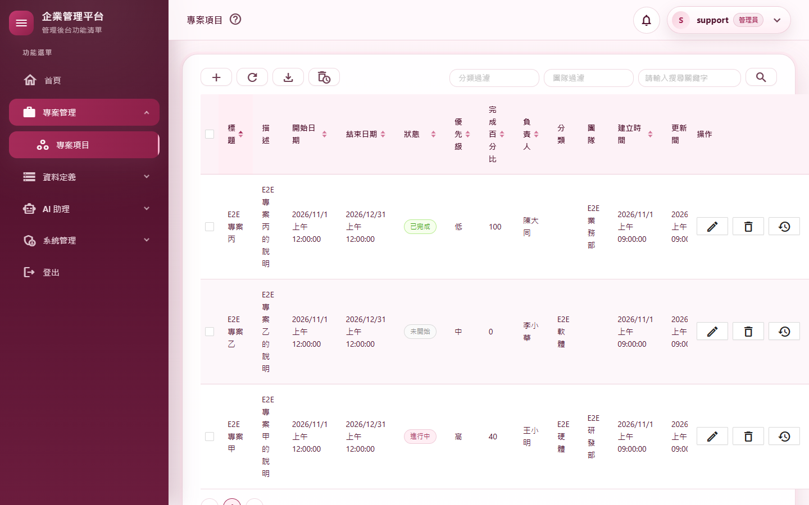
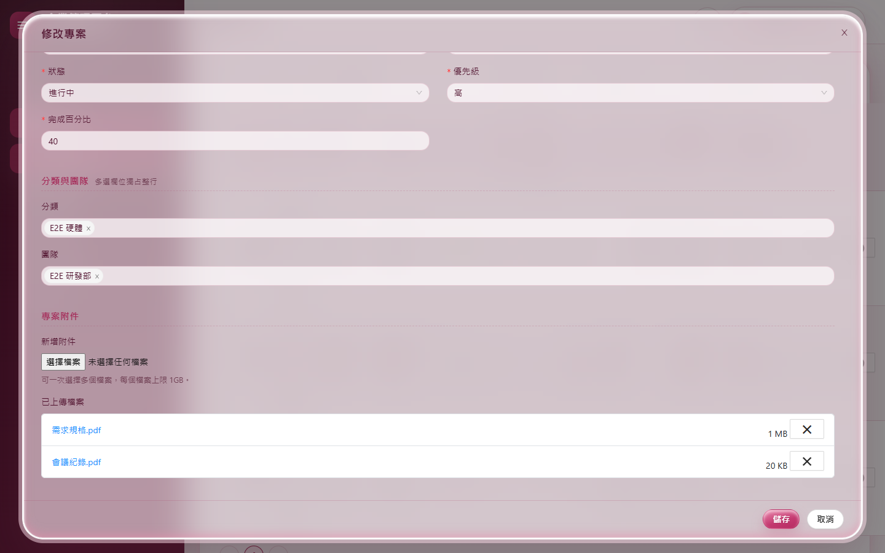
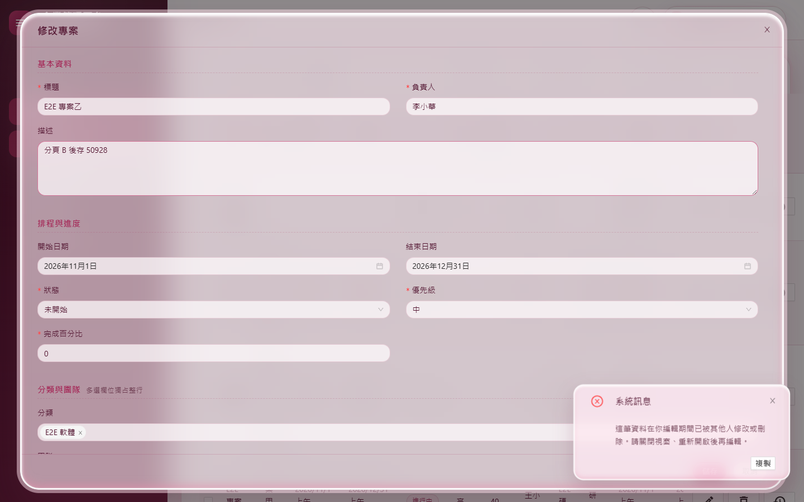
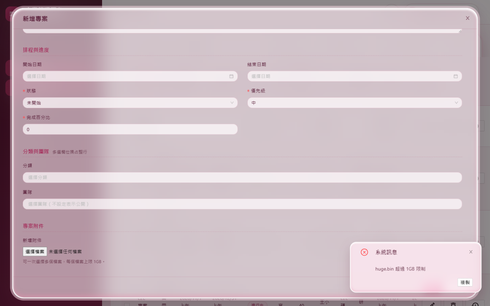
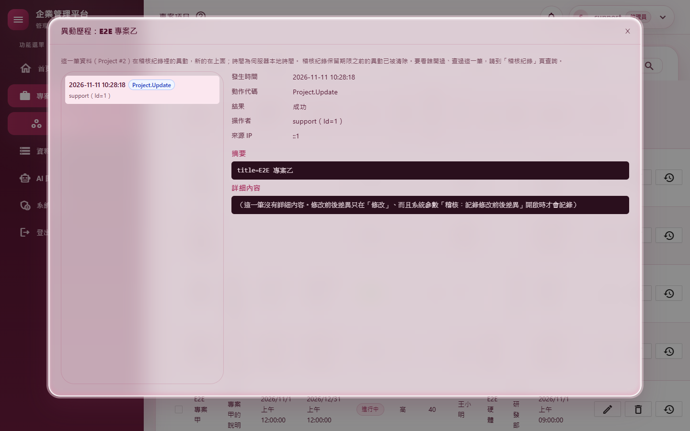
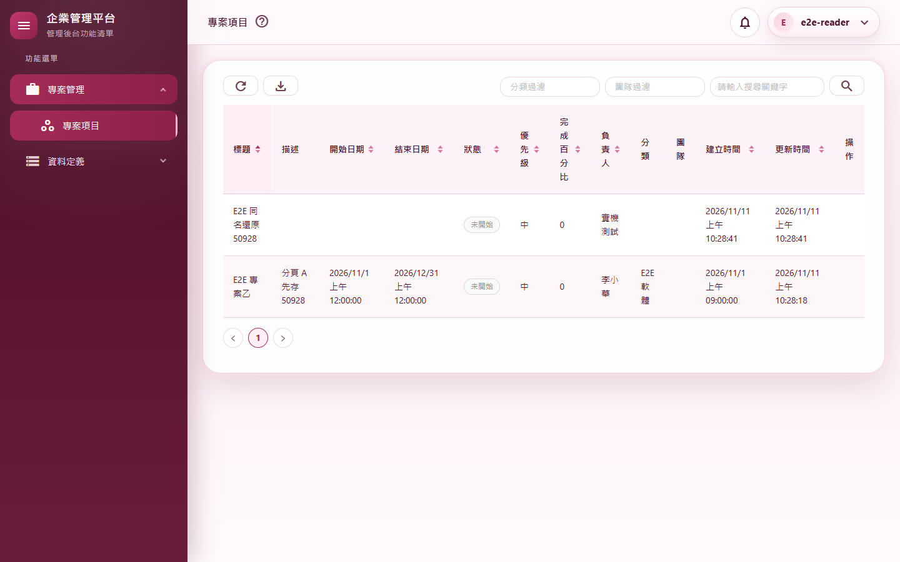
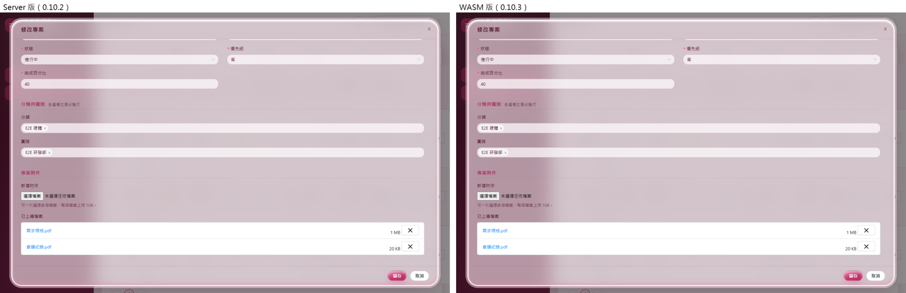

# M04 測試報告：專案、附件與下載票證

- 里程碑：WASM 遷移 M4（計畫見 [WASM遷移計畫](../WASM遷移計畫.md)）
- 版本：0.10.2 → 0.10.3
- 測試日期：2026/11/11
- 分支：`feature/wasm-m04-projects`（尚未合併）

## 摘要

| 項目 | 結果 |
|---|---|
| 範圍 | 專案項目（`/projects`）改在 WebAssembly 執行，Server 版頁面刪除；專案 API 改走與畫面相同的 `ProjectService`（刪除最後一個 Repository `ProjectRepository`）；附件改經 HTTP 上傳（同一個網址收 JSON 與 multipart，檔案由瀏覽器直接送出、不經 WASM 記憶體）；附件下載改用一次性下載票證，退役只收 Cookie 的 `ProjectFileController`；IIS 的 `web.config` 放寬請求大小 |
| 使用者決定 | 專案 API 沒有外部系統在用，規則與訊息統一成畫面的行為（網址、狀態碼、欄位不變）；專案名稱統一不可重複（名稱沒改的舊重名資料照常可存）；下載票證一次性、60 秒、不支援續傳 |
| 自動化測試 | 2,704 個全部通過（M3 結束時 2,667 個，淨增 37） |
| 品質關卡 | 7 步全部通過（結果見 A.3） |
| 實機驗證 | 19 個情境全部通過；全部 37 個路由煙霧測試全部通過（全新的隔離資料庫） |
| 外觀比對 | Server 版（改版前）與 WASM 版 5 個畫面逐像素比對：**5 個完全相同** |
| 大檔 | 約 200 MB 的附件上傳加存檔 5.3 秒，下載後 SHA-256 與原檔相同；過程中頁面的 JS 記憶體約 9 MB |
| 獨立審查 | 13 項發現：6 項修正並補測試，其餘 7 項是設計取捨或已核准的變更，寫進文件與 A.6 |
| 版本 | 0.10.2 → 0.10.3 |

---

## A.1 測試策略

| 層次 | 涵蓋什麼 | 工具 |
|---|---|---|
| 整合測試 | 真的主機與資料庫、以 API 登入拿到的 Token 呼叫：專案每個端點的成功與失敗、JSON 與 multipart 兩種新增修改、附件存入與實體檔、重名與版本衝突 409、團隊範圍外 404、唯讀角色寫入 403、規則不符 400、匯出、每個動作稽核各一筆；下載票證的一次性、帳號停用或工作階段失效後失效、專案刪除後失效；Swagger 文件產生、沒帶 Content-Type 與其他 JSON 類型 | `WebApplicationFactory` |
| 整合測試（服務） | SQLite 記憶體資料庫：附件存失敗時整筆回滾、標題去空白、還原撞名、已刪除清單的過濾 | xUnit＋SQLite |
| 單元測試 | 票證服務（一次性、60 秒、不可猜、同時兌換只成功一次、過期的會清掉）；WASM 端：專案 DTO 互轉不帶出實體檔路徑、由瀏覽器送出的請求遇 401 刷新後重送、離線、IIS 錯誤頁；`web.config` 的上限與程式一致 | xUnit |
| 回歸 | M3 結束時的 2,667 個測試 | xUnit |
| 品質關卡 | 建置（Release）、格式、全部測試、文件編碼、CRUD 產生器錨點、弱點掃描 | `scripts/Invoke-QualityGate.ps1` |
| 實機驗證 | 真的網站（隔離資料庫）、真的 Chrome：上傳真的檔案（含 200 MB 與 1.1 GB）、下載後比對雜湊、查資料庫、實體檔與稽核 | `scripts/Start-E2EHost.ps1`、`scripts/e2e/m04-projects.mjs`、`smoke-routes.mjs` |
| 外觀比對 | 同一組固定資料，改版前（Server）與改版後（WASM）各拍 5 個畫面逐像素比對 | `scripts/e2e/m04-views.mjs`＋Pillow |
| 發佈驗證 | `dotnet publish` 後檢查輸出的 `web.config` 同時有處理常式與請求上限 | `dotnet publish` |
| 獨立程式審查 | 未參與實作的審查者讀完整份變更，找安全漏洞、授權缺口、正確性與測試缺口 | 另一個 AI 審查代理（只讀） |

---

## A.2 自動化測試

### 新增與修改的測試

| 測試類別 | 驗證的行為 |
|---|---|
| `ProjectApiTests`（新，20） | 帶兩個附件新增（multipart）→ 查看（附件清單、大小、實體檔存在）→ 以票證下載內容相同 → 帶附件修改（移除一個、加一個，移除的實體檔已刪）→ 刪除 → 顯示已刪除 → 還原 → 刪除 → 永久刪除（實體檔全部移除），**稽核依序各一筆**、下載稽核一筆；JSON 新增照舊可用並回傳新 Id 與版本號；重名（去空白、不分大小寫）新增 409，**名稱沒改的舊重名資料照常可存**，改成別人的名稱 409；狀態不合法、結束早於開始回 400，日期可不填；附件類型不在白名單回 400 且什麼都不建立；過期版本號帶附件修改回 409、附件沒存進去；搜尋的關鍵字比對負責人、狀態篩選、分類篩選、負責人篩選、排序不分大小寫；匯出 xlsx 與匯出稽核；唯讀角色可讀可下載，新增（兩種格式）、修改、刪除、顯示已刪除、匯出已刪除都 403；**團隊範圍外**：清單看不到、讀取、申請票證、刪除、修改（兩種格式，名稱重複也一樣）都 404；票證只能用一次、亂寫的票證 404；**申請票證後帳號被停用、工作階段版本換掉（改密碼、強制登出）、專案被刪除，兌換都 404**；舊的 Cookie 下載網址已移除；表單選項；審查補測：**Swagger 文件產得出來**、**沒帶 Content-Type 回 401／415（不是 500）**、**text/json 與 application/*+json 照舊可用** |
| `ProjectServiceSaveTests`（新，5） | 審查補測：**新增時附件寫入失敗，專案不建立、實體檔清掉**；**修改時附件寫入失敗，資料與版本號都不變，照原本的視窗再存一次就成功**；標題存檔前去掉 Tab 與全形空白，重名檢查不會被空白繞過；**還原時已有同名的專案回 409**；已刪除清單照分類過濾 |
| `DownloadTicketServiceTests`（新，7） | 票證帶回申請時的內容、只能用一次；59 秒還能用、60 秒失效；200 張票都不同、至少 43 個字元、只用網址安全的字元；32 個執行緒同時兌換同一張只有一個成功；過期沒用的票在下一次發票時清掉；帶附件的新增、修改兩個 action 都放寬了請求大小 |
| `WebConfigTests`（新，1） | `web.config` 的 `maxAllowedContentLength` 與 `ProjectController.MaxRequestBytes` 一致 |
| `Client/ClientApiMappingTests`（＋1） | 專案的 DTO 與畫面資料來回轉換每個欄位都不變（分類、團隊、附件清單）；附件的 DTO 沒有實體檔位置欄位 |
| `Client/ClientSessionTests`（＋5） | 路由表認得 `/projects`（含大小寫與 query string），`/myusers` 仍是 Server 頁；由瀏覽器送出的 multipart 遇 401 時刷新後以新 Token 重送；瀏覽器送不出去時回「目前無法連線到伺服器」；回應不是 ApiResult（IIS 錯誤頁）時顯示狀態碼 |

### 因改寫而調整的既有測試

| 測試 | 修改 | 理由 |
|---|---|---|
| `ApiIntegrationTests.ProjectFileDownloadEndpoint_ShouldBeRegistered` | 刪除 | 端點已移除；改由 `TheOldCookieDownloadEndpoint_ShouldBeGone` 驗證它不存在 |
| `ExportTests` | 方法群組改寫成 lambda | `ProjectService.GetAsync` 多了選填參數（API 的篩選） |
| `LoggingConventionTests` | 拿掉 `UpdateOutcome.cs` 豁免與 `Repositories` 資料夾 | 這兩個都已刪除 |
| `SoftDeleteTests`、`TeamTreeTests` | 拿掉 `using MyProject.Business.Repositories` | 命名空間已不存在 |

**TDD 說明**：`ProjectApiTests` 的第一批（16 個）與票證測試是和實作一起寫的，第一次執行時只有兩個測試本身的錯誤（斷言順序、PUT 沒有回傳資料），沒有留下「實作前先失敗」的紀錄。審查後補的 9 個測試（`ProjectServiceSaveTests` 5 個、`ProjectApiTests` 的 Swagger、沒帶 Content-Type、text/json）都是先執行看到 8 個失敗，修正後才通過（application/problem+json 修正前就能用）。

---

## A.3 品質關卡

`pwsh ./scripts/Invoke-QualityGate.ps1`

| 步驟 | 結果 | 秒數 |
|---|---|---|
| Restore | 通過 | 1.4 |
| Build（Release） | 通過（0 警告、0 錯誤） | 18.2 |
| Format | 通過（`dotnet format --verify-no-changes`） | 81.6 |
| Test | 通過（2,704 個） | 105.9 |
| Docs encoding | 通過（294 個檔案，`docs/` 與根目錄 `.md` 皆 UTF-8 含 BOM） | 0.2 |
| CRUD anchors | 通過（一般、含團隊、管理員專屬各 24 項） | 0.8 |
| Vulnerability | 通過（沒有已知弱點） | 22.3 |

合計 230.4 秒。CRUD 樣板這次沒有改動，所以沒有跑 `Test-CrudGenerator.ps1`。

---

## A.4 實機驗證

以 `scripts/Start-E2EHost.ps1` 啟動（全新的隔離資料庫、12 個外部路徑與日誌都在暫存資料夾、support 的暫時密碼只放在環境變數），用 `scripts/e2e/m04-projects.mjs` 操作真的 Chrome。

### 情境

| # | 情境 | 步驟 | 預期 | 實際結果 | 判定 |
|---|---|---|---|---|---|
| P1 | 帶附件新增 | 新增專案、選兩個檔案、儲存（未指定團隊的提醒→仍要儲存） | 成功、兩個附件與實體檔都在 | 頁面以 WebAssembly 執行；「新增成功」；資料庫 2 個附件、實體檔都在 | 通過 |
| P2 | 下載與票證 | 打開修改窗、點附件檔名下載；再用同一個網址抓一次 | 內容相同；第二次 404 | 下載檔名正確、SHA-256 與上傳的相同；網址是 `/api/v1/downloads/…`；第二次回 404（截圖 02） | 通過 |
| P3 | 修改時移除、加入附件 | 移除一個既有附件、加一個新檔、儲存 | 附件清單正確、移除的實體檔刪掉 | 剩下的兩個附件正確；移除的實體檔已不存在 | 通過 |
| P4 | 約 200 MB 的附件 | 新增帶一個 200 MB 的檔案，再下載回來 | 能上傳（超過 IIS／Kestrel 預設的 30 MB）、內容相同、頁面不爆記憶體 | 上傳加存檔 5.3 秒；資料庫大小 209,715,200；下載後 SHA-256 相同；頁面 JS 記憶體約 9 MB | 通過 |
| P5 | 超過 1 GB | 選一個 1.1 GB 的檔案 | 選檔時就擋 | 顯示「huge.bin 超過 1GB 限制」，待上傳清單 0 筆（截圖 04） | 通過 |
| P6 | 不允許的附件類型 | 選一個 `.html` 檔 | 選檔時就擋 | 顯示「檔案 攻擊….html 的類型不在允許清單中。」，待上傳清單 0 筆 | 通過 |
| P7 | 重名 | 新增標題「 E2E 專案甲 」（前後空白） | 擋下 | 顯示「專案名稱已存在，無法新增。」 | 通過 |
| P8 | 兩個分頁同時修改 | 兩個分頁都打開「E2E 專案乙」；A 先存；B 加一個附件再存 | B 得到衝突訊息、附件沒存進去 | B 顯示「這筆資料在你編輯期間已被其他人修改或刪除…」；資料庫描述是 A 的值；晚到的附件 0 個（截圖 03） | 通過 |
| P9 | 刪除、還原、永久刪除 | 刪除 → 顯示已刪除 → 還原 → 刪除 → 永久刪除 | 永久刪除後實體檔移除 | 永久刪除前 2 個實體檔、之後 0 個；稽核 Create→View→Update→Delete→Restore→Delete→Purge | 通過 |
| P9b | 還原時撞名 | 新增 X → 刪除 → 再新增 X → 還原舊的 X | 擋下 | 顯示「已有同名的專案…無法還原」，未刪除的 X 只有 1 筆 | 通過 |
| P10 | 匯出 Excel | 按「匯出 Excel」 | 下載 xlsx、寫匯出稽核 | 下載 `MyProject.Web-projects-…xlsx`（檔頭為 xlsx 格式）；`Project.Export` 稽核 | 通過 |
| P11 | 批次刪除 | 勾兩筆，「刪除選取（2）」 | 兩筆都刪掉 | 「已刪除 2 筆」；未刪除的剩 0 筆 | 通過 |
| P12 | 異動歷程（管理員） | 「E2E 專案乙」按「異動歷程」 | 列出異動 | 列出 1 筆 `Project.Update`（截圖 05） | 通過 |
| P13 | 資料保留頁「前往」 | 「已刪除的專案」按「前往」 | 一進來就是已刪除的清單 | 停在 `/projects?deleted=1`，看到「E2E 舊專案」 | 通過 |
| P14 | Server 與 WASM 頁面互相切換 | `/myusers`（Server）→ 側邊選單「專案項目」 | 整頁載入、以 WASM 顯示 | `/myusers` 不是 WASM；`/projects` 是 WASM | 通過 |
| P15 | 管理員操作沒有錯誤 | P1～P14 期間收集頁面錯誤與 Blazor 未處理例外 | 沒有 | 無 | 通過 |
| P16 | 團隊範圍 | 大檔專案改成只限研發部；管理員與業務部的人各申請它附件的票證；業務部的人開清單 | 管理員拿得到；業務部的人看不到也拿不到 | 管理員 200、業務部 404；讀專案 404；清單有「E2E 專案丙」（業務部）、沒有「E2E 專案甲」（研發部） | 通過 |
| P17 | 唯讀角色 | `e2e-reader` 打開專案頁；以他的 Token 新增、刪除 | 看不到寫入按鈕與勾選欄；API 回 403 | 寫入按鈕與勾選欄 0 個；POST 403、DELETE 403（截圖 06） | 通過 |
| P18 | 沒有權限開頁 | 只有分類權限的 `e2e-catonly` 打開 `/projects` | 顯示沒有權限；伺服器記權限拒絕 | 顯示「你沒有權限存取此頁面」；`Permission.Denied`（`/projects`、via=WASM）1 筆 | 通過 |

### 全部路由煙霧測試

37 個路由全部通過（每頁 HTTP 200、沒有錯誤列或無權限畫面、沒有頁面錯誤），`/projects` 以 WebAssembly 顯示。

### 外觀比對

| 畫面 | 差異 |
|---|---|
| 專案清單 | 完全相同 |
| 專案修改窗 | 完全相同 |
| 專案修改窗（捲到附件區） | 完全相同 |
| 已刪除清單 | 完全相同 |
| 唯讀角色的專案清單 | 完全相同 |

截圖 07 為修改窗附件區的並排對照。第一次比對時唯讀清單有 55 個像素、最多 8／255 的差異（搜尋按鈕邊緣），最後一次執行時沒有差異，判斷是陰影的抖色。

### 實機發現並修正的問題（實作期間，不是審查）

**下載附件後切到「顯示已刪除」整頁空白**：第一版用 `location.assign(票證網址)` 讓瀏覽器下載。下載本身成功，但瀏覽器會先開始一次換頁（觸發 `beforeunload`）。之後切換到「顯示已刪除」時，AntDesign 表格的操作欄計算固定欄位位置時丟 `ArgumentNullException`，整頁變空白。

- 重現與定位：先寫最小探針，只做「刪除後切到已刪除」，3 輪都正常；再逐步加入新增附件、打開修改窗、下載、開第二個分頁，確定只有「下載」這一步會觸發。
- 修正：改用暫時建立的 `<a download>` 連結觸發下載，不會開始換頁。同一組步驟重跑兩次都正常，完整情境也全部通過。
- 這條規則已寫進速查表：WASM 頁面觸發下載一律用 `<a download>`，不可用 `location.assign`。

### 伺服器日誌

最後一次執行的錯誤共 4 筆，都是煙霧測試登出時的已知收尾時序問題，M01～M03 報告都已記錄：

- Blazor Server 電路的未處理例外。
- 導向 `/Auths/Logout` 失敗。
- 載入使用者權限失敗。
- `Unobserved task exception`。

專案頁、專案 API、下載端點沒有任何錯誤。警告 43 筆都是預期內容，例如：

- 唯讀角色被權限拒絕。
- 團隊範圍外的讀取與下載被拒。
- 測試關閉瀏覽器時電路斷線。

---

## A.5 獨立審查

審查者讀完整份變更（未參與實作）。下載票證的核心流程沒有發現安全漏洞：

- 票證是 32 位元組亂數，取出即作廢。
- 兌換時依序重新檢查帳號、工作階段版本、強制設定、檢視權限、團隊範圍與檔案。
- 權限篩選器在讀取上傳內容之前就執行，沒有權限的人無法讓伺服器收下大檔。

### 修正的發現

| # | 嚴重度 | 發現 | 修正 | 補的測試 |
|---|---|---|---|---|
| 1 | 中 | 同一個網址的 JSON 與 multipart 兩個 action，讓 Swagger 文件產生失敗（開發環境 `/swagger` 整份 500） | multipart 版不列入 Swagger（格式寫在 Web API 端點目錄） | `SwaggerDocument_ShouldStillGenerate`（修正前丟 `SwaggerGeneratorException`） |
| 2 | 中 | 沒帶 Content-Type 時兩個 action 都符合，路由模稜兩可回 500（匿名也能觸發）；`text/json` 不再被接受 | JSON 版接受 `application/json`、`text/json`、`application/*+json`（與改寫前相同）；multipart 版路由 `Order = 1`，模稜兩可時由 JSON 版處理（回 415，與改寫前相同） | `Create_WithoutAContentType_ShouldBehaveAsBefore`、`Create_WithOtherJsonContentTypes_ShouldStillWork` |
| 3 | 中 | 資料已存檔但附件存失敗：回 500、專案留著卻沒附件、沒寫稽核；使用者再存會撞到重名或版本衝突（服務原本就這樣，本次的重名規則讓它更明顯） | 資料與附件放在同一個資料庫交易：任何一步失敗就整筆回滾、新寫入的實體檔刪掉；要移除的實體檔在提交之後才刪；寫到一半的檔案也清掉 | `AddAsync_WhenAnAttachmentFailsToSave_ShouldLeaveNothingBehind`、`UpdateAsync_WhenAnAttachmentFailsToSave_ShouldKeepTheRecordAndItsVersion_SoTheUserCanRetry` |
| 5 | 低 | 重名檢查可被繞過：標題存檔前沒去空白（C# 與 SQLite 去空白的規則不同，Tab、全形空白可繞過）；刪除期間有人新增同名，還原後出現兩筆同名 | 標題存檔前一律去前後空白；還原時已有同名的專案回 409（與分類相同） | `SavedTitles_ShouldBeTrimmed_…`、`RestoreAsync_WhenAnActiveProjectHasTheSameTitle_ShouldReturnConflict`；實機 P9b |
| 6 | 低 | 附件類型要整份上傳完才被伺服器拒絕（選錯一個 900 MB 的檔案要等它傳完） | 選檔時依伺服器給的白名單先擋，訊息與伺服器相同；伺服器存檔時仍再檢查 | 實機 P6 |
| 9 | 低 | API 的「顯示已刪除」忽略分類、團隊過濾（服務原本就這樣，現在 API 公開了這兩個條件） | 服務套用過濾；WASM 頁在「顯示已刪除」時不送（與 Server 版相同） | `GetDeletedAsync_ShouldHonourTheCategoryAndTeamFilters` |
| 12 | 低 | 程式註解與測試豁免清單還提到已刪除的類別 | 更新 `Program.cs`、`ApplicationBuilderExtensions.cs`、`RequestActorResolver.cs` 的註解；`LoggingConventionTests` 拿掉 `UpdateOutcome.cs` 與 `Repositories` | — |

### 沒有修改的發現（設計取捨或已核准）

| # | 發現 | 處理 |
|---|---|---|
| 4 | 重名是全系統唯一，團隊範圍外的人新增同名會得到 409，等於知道範圍外有這個名稱 | 全域唯一的必然結果（改寫前的 API 也一樣）；寫進速查表、PRD、操作說明 |
| 5（部分） | 名稱唯一靠程式檢查、沒有資料庫唯一索引，兩個請求同時新增同名可能都成功 | 寫進已知限制（A.6） |
| 7 | 舊的下載網址 `/api/project-files/{id}/download` 已移除、失去續傳 | M4 計畫明列退役；續傳的取捨使用者已確認 |
| 8 | `GET api/v1/Project/{id}` 每次寫一筆「查看」稽核（改寫前的 API 不寫） | 與畫面及 M3 的分類、團隊 API 一致（WASM 頁開修改窗就是呼叫它） |
| 10 | 下載管理工具或掃描擴充功能先抓一次網址，會把一次性票證用掉，真正下載時 404 | 寫進操作說明的常見問題與部署文件；使用者再點一次即可 |
| 11 | 沒填日期的專案，API 回應從 `0001-01-01T00:00:00` 變成 `null` | 使用者同意統一成畫面行為（日期可不填）；寫進 changelog |
| 13 | 帶附件的修改寫三筆稽核（修改、附件上傳、附件刪除） | 與 Server 版相同，每個動作各一筆 |

---

## A.6 已知限制

- **兩種頁面並存**：使用者、角色、稽核等 33 個頁面仍是 Server 版；在兩種頁面之間切換時會整頁載入（M10 移除 Server 模式前都是如此）。
- **下載不能續傳**：票證只能用一次，下載中斷要回頁面重新點檔名（使用者已接受）。下載管理工具若先抓過一次網址，也要再點一次。
- **票證存在記憶體**：只在單一行程有效。IIS 應用程式集區要維持一個工作行程（預設值）；應用程式集區回收時，還沒用的票證失效，使用者再點一次即可。M11 拆成獨立 API 主機時要重新評估。
- **專案名稱唯一沒有資料庫索引**：兩個人在同一瞬間新增同名的專案，可能兩筆都成功（舊資料本來就可能重名，所以沒有加唯一索引）。
- **一次存檔的上限 4 GB**：IIS 的 `maxAllowedContentLength` 最多只能設到 4 GB，所以一次帶的附件合計不能超過 4 GB（單一附件仍是 1 GB）。Server 版經 SignalR 上傳沒有這個上限。
- **multipart 不在 Swagger 裡**：帶附件的新增、修改格式寫在 Web API 端點目錄。
- **伺服器日誌的收尾時序錯誤**：見 A.4，屬 Blazor Server 電路收尾，M10 移除 Server 模式後一併消失。

---

## A.7 截圖

| # | 內容 |
|---|---|
| 01 |  |
| 02 |  |
| 03 |  |
| 04 |  |
| 05 |  |
| 06 |  |
| 07 |  |

截圖中沒有個人 Email（隔離資料庫只有測試帳號）。
