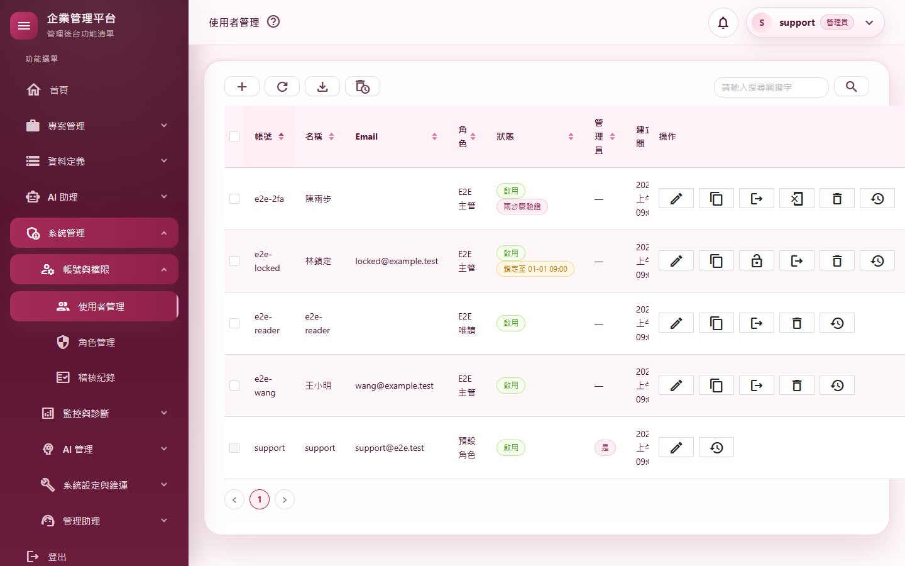
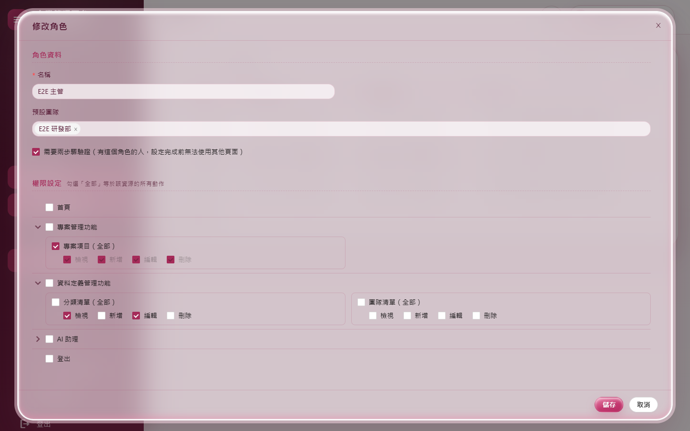
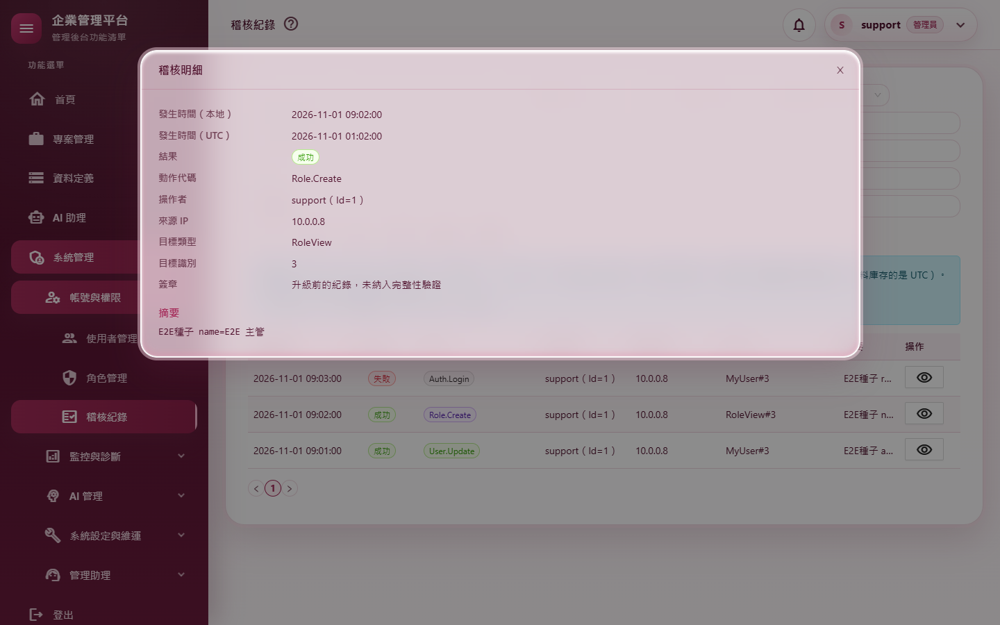
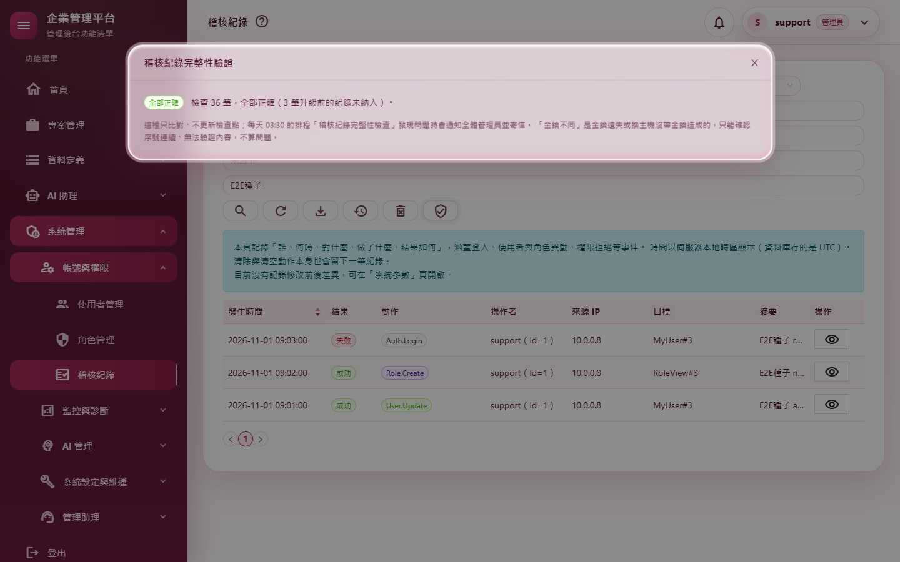
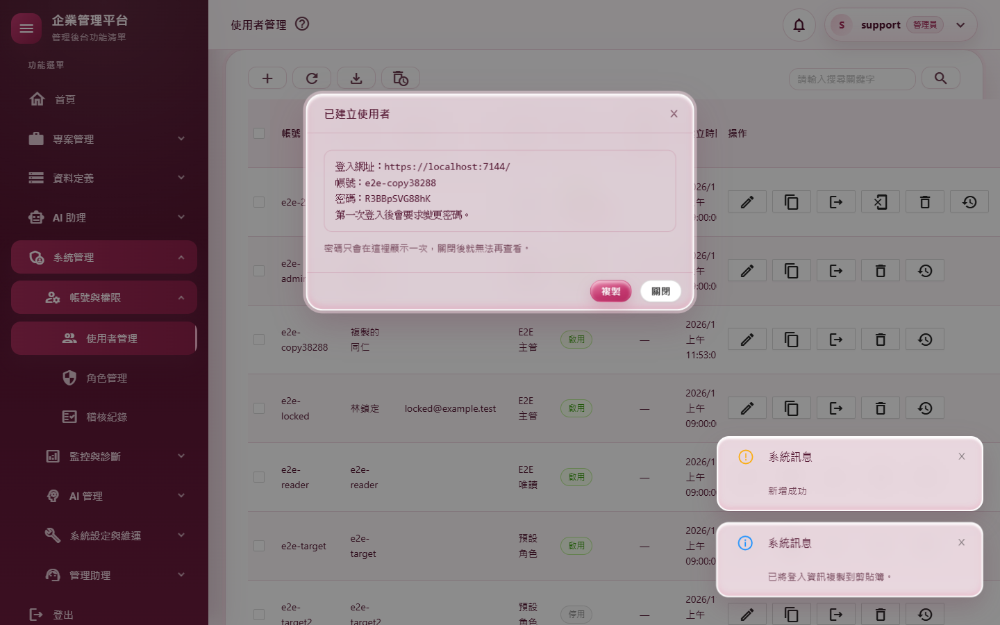
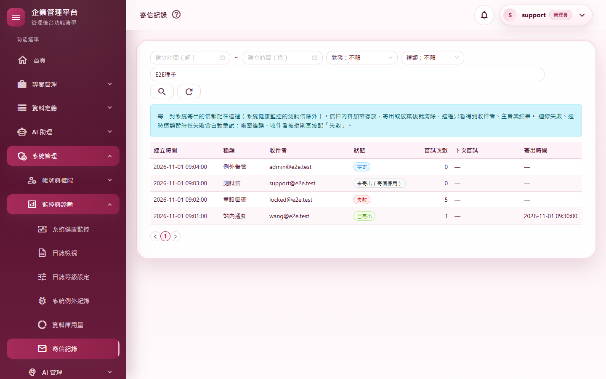
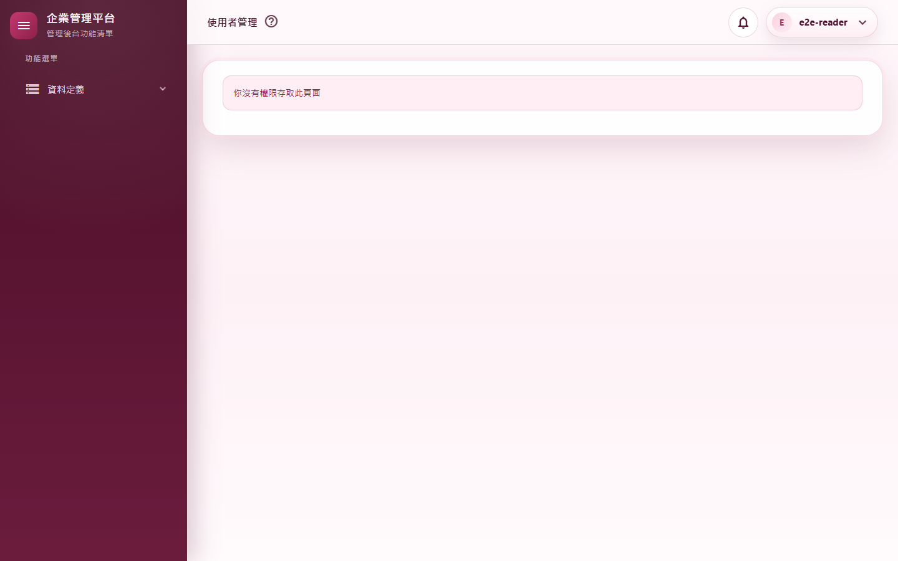
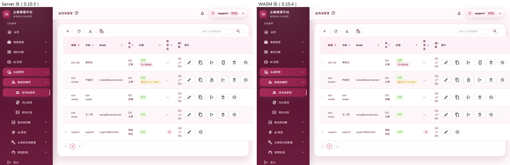

# M05 測試報告：使用者、角色、稽核紀錄、寄信紀錄

- 里程碑：WASM 遷移 M5（計畫見 [WASM遷移計畫](../WASM遷移計畫.md)）
- 版本：0.10.3 → 0.10.4
- 測試日期：2026/11/11
- 分支：`feature/wasm-m05-admin`

## 摘要

| 項目 | 結果 |
|---|---|
| 範圍 | 使用者管理（`/myusers`）、角色管理（`/roleviews`）、稽核紀錄（`/audit-logs`）、寄信紀錄（`/email-logs`）改在 WebAssembly 執行，Server 版頁面刪除；新增只限管理員的使用者、角色、寄信紀錄 API，補齊稽核紀錄 API；`[AdminOnly]` 篩選器、`[SignedInUser]` 標記與「每個 API action 都要標註授權」的守門測試 |
| 授權方式 | 使用者在 M5 開始時授權 M5～M7 連續完成，可自動 commit、合併、推送；小事（訊息、排序統一）自行決定寫進報告 |
| 自動化測試 | 2,734 個全部通過（M4 結束時 2,704 個，淨增 30） |
| 品質關卡 | 7 步全部通過（結果見 A.3） |
| 實機驗證 | 13 個情境全部通過；全部 37 個路由煙霧測試全部通過（全新的隔離資料庫） |
| 外觀比對 | Server 版（改版前）與 WASM 版 8 個畫面逐像素比對：3 個完全相同；其餘最多 17／255（8 個像素），肉眼無差異 |
| 實機發現 | 稽核明細的 UTC 時間差 8 小時（單筆查詢回的是 UTC，被當成本地再換算一次），已修正並補測試 |
| 獨立審查 | 12 項發現（1 高、3 中、8 低）：11 項修正並補測試，1 項是說明（寫進文件） |
| 版本 | 0.10.3 → 0.10.4 |

---

## A.1 測試策略

| 層次 | 涵蓋什麼 | 工具 |
|---|---|---|
| 整合測試 | 真的主機與資料庫、以 API 登入拿到的 Token 呼叫：四組 API 每個端點的成功與失敗、非管理員 403 並記權限拒絕、稽核各一筆、改別人與改自己對工作階段的影響、自我保護、support 保護、權限矩陣只採納目錄、時間不帶時差 | `WebApplicationFactory` |
| 守門測試 | 每個 Web API action 都要標註授權意圖，而且受保護的端點一定有 `[Authorize]` | 反射 |
| 單元測試 | WASM 端日期去時區、路由表認得四個新頁 | xUnit |
| 回歸 | M4 結束時的 2,704 個測試 | xUnit |
| 品質關卡 | 建置（Release）、格式、全部測試、文件編碼、CRUD 產生器錨點、弱點掃描 | `scripts/Invoke-QualityGate.ps1` |
| 實機驗證 | 真的網站（隔離資料庫）、真的 Chrome：多個帳號同時登入，驗證被登出與換發登入、下載匯出檔、查資料庫與稽核 | `scripts/Start-E2EHost.ps1`、`scripts/e2e/m05-admin.mjs`、`smoke-routes.mjs` |
| 外觀比對 | 同一組固定資料，改版前（Server）與改版後（WASM）各拍 8 個畫面逐像素比對 | `scripts/e2e/m05-views.mjs`＋Pillow |
| 獨立程式審查 | 未參與實作的審查者讀完整份變更 | 另一個 AI 審查代理（只讀） |

---

## A.2 自動化測試

### 新增與修改的測試

| 測試類別 | 驗證的行為 |
|---|---|
| `UserApiTests`（新，8） | 新增（額外角色、團隊）→ 查看 → 修改 → 過期版本號 409 → 停用 → 啟用 → 強制登出 → 刪除 → 顯示已刪除 → 還原 → 刪除 → 永久刪除，**稽核依序各一筆**；**改別人的角色，對方下一個 API 呼叫 401**；**停用後對方 401、刷新被拒**；重設兩步驟驗證；**改自己的密碼回傳換發登入網址**（`/Auths/RefreshSession?ticket=…&returnUrl=%2Fmyusers`），之後用新密碼登入；**不可對自己強制登出、重設兩步驟驗證、停用、刪除（400）**，清單上自己那列的對應按鈕旗標為 false；複製：support 回 404、範本帶團隊、產生密碼、查 Email 已被誰使用、建立後稽核記 copiedFrom；support 那列不可刪不可複製、搜尋與匯出各一筆稽核；解鎖後鎖定文字消失；審查補測：**support 不可改帳號**、必填欄位 400、產生的密碼 `no-store`、新增前檢查端點 409、每頁筆數 0 回 400；非管理員 403 |
| `RoleApiTests`（新，5） | 以空白矩陣新增、勾專案項目的檢視與編輯，存成權限鍵；查看、改名、過期版本號 409、刪除、顯示已刪除、還原、永久刪除，**稽核各一筆**；搜尋帶矩陣、只有按搜尋才記稽核；預設角色不可刪（400）、重名 409、不存在 404、仍是某人的主要角色不可刪（400）；審查補測：**多塞的「稽核紀錄」節點與偽造群組不會被存成權限鍵**、建立時間不被覆寫、名稱必填、每頁筆數 0 回 400；非管理員 403 |
| `AuditEmailLogApiTests`（新，9） | 稽核搜尋的篩選（關鍵字、結果）、新到舊、UTC 時間與簽章文字、按查詢才記一筆搜尋稽核；選項（動作、目標類型、保留天數）；明細與清單的時間一致（實機發現後補）、查看稽核一筆、不存在 404；匯出 CSV（UTF-8 含 BOM、欄位、匯出稽核）；清除兩段各一筆稽核、完整性驗證一筆、清空後只剩清空那一筆；寄信紀錄依狀態、種類、關鍵字篩選、新到舊、不寫稽核；審查補測：**清單、明細、異動歷程、寄信紀錄的本地時間都不帶時差**、每頁筆數不合法 400；非管理員呼叫 9 個端點都 403、各記一筆權限拒絕 |
| `ApiAuthorizationConventionTests`（新，3） | 每個 API action 都標了 `[HasPermission]`、`[AdminOnly]`、`[SignedInUser]` 或 `[AllowAnonymous]`（新增時先看到 18 個漏標的失敗，再逐一標註）；**除了匿名端點都有 `[Authorize]`**（審查補）；確實掃到所有 controller |
| `Client/ClientCultureTests`（＋1） | 日期選擇器的值去掉時區後序列化不帶時差 |
| `Client/ClientSessionTests`（＋4） | 路由表認得 `/myusers`、`/roleviews?deleted=1`、`/audit-logs`、`/email-logs`，`/logs` 仍是 Server 頁 |

### 因改寫而調整的既有測試

| 測試 | 修改 | 理由 |
|---|---|---|
| `ExportTests` | `AuditLogView.CsvColumns` 改成 `AuditLogExport.CsvColumns` | CSV 欄位搬到伺服器端的匯出類別（輸出完全不變，相容性測試照舊通過） |
| `Client/ClientSessionTests` | `/myusers` 從「不是 WASM」改成「是」 | 頁面已搬到 WASM |

**TDD 說明**：

- **先看到失敗再實作**：
  - 角色、使用者 API 測試：全部失敗後才寫 controller。
  - 守門測試：先列出 18 個漏標的 action。
  - 實機發現的時間錯誤：先補斷言、看到失敗。
  - 審查補的測試：4 個測試先失敗，再修正。
- **與實作一起寫**：稽核、寄信紀錄 API 的第一批測試，第一次執行就全部通過，沒有「先失敗」的紀錄。

---

## A.3 品質關卡

`pwsh ./scripts/Invoke-QualityGate.ps1`

| 步驟 | 結果 | 秒數 |
|---|---|---|
| Restore | 通過 | 1.1 |
| Build（Release） | 通過（0 警告、0 錯誤） | 9.9 |
| Format | 通過（`dotnet format --verify-no-changes`） | 84.8 |
| Test | 通過（2,734 個） | 115.3 |
| Docs encoding | 通過（296 個檔案，`docs/` 與根目錄 `.md` 皆 UTF-8 含 BOM） | 0.1 |
| CRUD anchors | 通過（一般、含團隊、管理員專屬各 24 項） | 0.7 |
| Vulnerability | 通過（沒有已知弱點） | 22.3 |

合計 234.3 秒（第一次執行時格式檢查抓到 `UserApiTests.cs` 一行放了多個物件初始化欄位，以 `dotnet format` 修正後重跑通過）。CRUD 樣板這次沒有改動，所以沒有跑 `Test-CrudGenerator.ps1`。

---

## A.4 實機驗證

以 `scripts/Start-E2EHost.ps1` 啟動全新的隔離網站（12 個外部路徑與日誌在暫存資料夾、support 的暫時密碼只放在環境變數），用 `scripts/e2e/m05-admin.mjs` 操作真的 Chrome。support 的 Email 在隔離資料庫改成 `support@e2e.test`，截圖不會露出個資。

### 情境

| # | 情境 | 步驟 | 預期 | 實際結果 | 判定 |
|---|---|---|---|---|---|
| A1 | 使用者完整流程 | 新增（未指定團隊的提醒→仍要儲存）、修改名稱、點狀態停用、再啟用、刪除、顯示已刪除、還原、再刪除、永久刪除 | 每一步都成功、稽核依序各一筆 | 頁面以 WebAssembly 執行；稽核 Create→View→Update→Disable→Enable→Delete→Restore→Delete→Purge | 通過 |
| A2 | 改別人的角色 | `e2e-target` 在另一個瀏覽器開著個人資料頁；管理員替他加一個額外角色 | 對方下一次開頁就被登出 | 對方重新開 `/Profile` 後被帶到 `/Auths/Login` | 通過 |
| A3 | 停用帳號 | `e2e-target2` 登入中；管理員點狀態停用 | 對方被登出 | 對方重新開 `/Profile` 後被帶到 `/Auths/Login` | 通過 |
| A4 | 解除鎖定 | 被鎖定的 `e2e-locked` 按「解鎖」 | 鎖定解除 | 通知「已解除「e2e-locked」的鎖定。」；資料庫鎖定時間為空 | 通過 |
| A5 | 複製使用者 | 以 `e2e-wang` 為範本，填帳號與名稱、按「產生」密碼、建立 | 交付窗列出登入資訊、稽核記範本 | 交付窗列出帳號與密碼（截圖 05）；`User.Create` 稽核含 `copiedFrom=e2e-wang` | 通過 |
| A6 | 匯出使用者 | 按「匯出 Excel」 | 下載 xlsx、寫匯出稽核 | 下載 `MyProject.Web-users-…xlsx`；`User.Export` 稽核 | 通過 |
| A7 | 角色權限矩陣 | 「E2E 主管」勾「團隊清單（全部）」存檔 | 權限鍵寫進資料庫 | 權限鍵多了「團隊清單」（截圖 02 為矩陣） | 通過 |
| A8 | 稽核紀錄 | 關鍵字查詢、看明細、驗證完整性、匯出 CSV | 3 筆、明細有 UTC 與簽章、驗證有結果、CSV 3 筆、稽核各有紀錄 | 明細 UTC 為 01:02（截圖 03）；驗證「發現問題」（種子資料是未簽章的舊式紀錄，預期，截圖 04）；CSV 3 筆；Search 2、View 2、Verify 1、Export 1 | 通過 |
| A9 | 寄信紀錄 | 關鍵字＋狀態「失敗」 | 只剩 1 筆 | 只剩「重設密碼」那一筆（截圖 06 為未篩選的清單） | 通過 |
| A10 | Server 與 WASM 頁面互相切換 | `/logs`（Server）→ `/roleviews` | 整頁載入、以 WASM 顯示 | `/logs` 不是 WASM；`/roleviews` 是 WASM | 通過 |
| A11 | 管理員操作沒有錯誤 | A1～A10 期間收集頁面錯誤與 Blazor 未處理例外 | 沒有 | 無 | 通過 |
| A12 | 改自己仍維持登入 | 另一位管理員 `e2e-admin2` 替自己加一個額外角色 | 整頁導到換發登入，回到使用者頁仍登入 | 先請求 `/Auths/RefreshSession`，回到 `/myusers` 清單正常 | 通過 |
| A13 | 非管理員 | `e2e-reader` 開 `/myusers`；以他的 Token 呼叫四組搜尋與強制登出 | 顯示沒有權限；API 403 | 顯示「你沒有權限存取此頁面」（截圖 07）；五個呼叫都 403 | 通過 |

### 全部路由煙霧測試

37 個路由全部通過，四個新頁以 WebAssembly 顯示。

### 外觀比對

| 畫面 | 差異 |
|---|---|
| 使用者清單 | 完全相同 |
| 使用者修改窗 | 完全相同 |
| 使用者已刪除清單 | 2,246 個像素、最多 4／255（背景漸層的抖色） |
| 角色清單 | 41 個像素、最多 8／255（搜尋按鈕邊緣的陰影） |
| 角色修改窗 | 8 個像素、最多 17／255（勾選框邊緣） |
| 稽核紀錄清單 | 6 個像素、最多 1／255 |
| 稽核明細 | 完全相同 |
| 寄信紀錄 | 57 個像素、最多 8／255（搜尋按鈕邊緣） |

截圖 08 為使用者清單的並排對照。

### 實機發現並修正的問題

**稽核明細的 UTC 時間差了 8 小時**：第一次比對時，WASM 版明細的「發生時間（UTC）」是 10-31 17:02，Server 版是 11-01 01:02。

- **原因**：稽核的單筆查詢（`GetByIdAsync`）回的是資料庫的 UTC，清單才換成本地時間。明細端點把這個 UTC 當成本地，再換算一次 UTC。
- **修正**：明細端點先換成本地時間，與清單一致。AI 管理助理也用這個方法，所以服務本身不改。
- **測試**：補上「明細與清單的時間一致」的斷言，先看到失敗再修正。

### 伺服器日誌

最後一次執行的錯誤共 3 筆，都是煙霧測試登出時的已知收尾時序問題（M01～M04 報告都已記錄），四個新頁與新 API 沒有任何錯誤。

---

## A.5 獨立審查

審查者讀完整份變更（未參與實作）。

### 修正的發現

| # | 嚴重度 | 發現 | 修正 | 補的測試 |
|---|---|---|---|---|
| 1 | 高 | 稽核紀錄、寄信紀錄（含 M3 的異動歷程對話窗）的本地時間以 `+08:00` 送出，WASM 會換成瀏覽器的時區：伺服器與瀏覽器時區不同時整頁時間都錯 | API 的本地時間一律以不帶時差（Kind=Unspecified）送出，UTC 欄位以 Z 結尾 | `LocalTimes_ShouldBeSentWithoutAnOffset`（先失敗） |
| 2 | 中（推論） | 日期篩選的起訖時間可能帶瀏覽器的時差送出，伺服器換算後區間偏移 | WASM 送出前去掉時區（`ClientCulture.Unzoned`） | `Unzoned_ShouldDropTheKind_SoNoOffsetIsSerialized` |
| 3 | 中 | 角色 API 可以寫入權限矩陣以外的鍵（例如管理員專屬的「稽核紀錄」），破壞「管理員專屬鍵不可授予」的不變量；選單會多出管理員項目（頁面與 API 仍只看 IsAdmin，沒有實際越權） | 伺服器以權限目錄為範本，只採納目錄裡有的群組、頁面與動作 | `Save_ShouldOnlyAcceptTheCatalog_KeepCreateAt_AndRequireAName`（先失敗） |
| 4 | 中 | 先把 support 改名，就能停用或刪除它（改寫前就有，Server 版也可以） | 服務層禁止修改 support 的帳號（畫面與 API 都適用） | `ServerSideRules_ShouldHoldWithoutTheScreen`（先失敗） |
| 5 | 低 | 四個新 controller 沒有套驗證篩選器，每頁筆數 0 或負數會變成「不限筆數」 | 加上 `[ApiValidationFilter]`，寄信查詢加上範圍 | 三組測試各一個 400 案例 |
| 6 | 低 | 使用者、角色的必填欄位只在畫面驗證，API 可建立帳號空白的使用者 | 伺服器以模型的驗證規則再驗一次，另檢查帳號與名稱 | 同 4、3 |
| 7 | 低 | 修改角色時，建立時間會被呼叫端送來的值覆寫 | 修改時不更新建立時間 | 同 3 |
| 8 | 低 | 產生密碼的回應沒有 `no-store` | 加上 `Cache-Control: no-store` | 同 4 |
| 9a | 低 | 「複製」建立時先問「Email 已有人使用」才發現帳號重複（Server 版是先檢查帳號） | 新增 `POST users/check`，WASM 先檢查再問 Email | 同 4（檢查端點 409） |
| 10 | 低 | 稽核匯出超過 10,000 筆被截掉時，稽核記的卻是總筆數 | 記實際匯出筆數，截掉時另記總筆數 | — |
| 11 | 低 | 守門測試抓不到繼承來的 action、也不檢查有沒有 `[Authorize]` | 檢查繼承鏈；新增「受保護的端點一定有 `[Authorize]`」 | `ProtectedActions_ShouldAlsoRequireAuthentication` |
| 12 | 低 | 備份下載標 `[SignedInUser]` 容易讓人誤會只要登入 | 註解寫明是管理員專屬、不可拿掉方法裡的檢查（M7 改用票證時改成 `[AdminOnly]`） | — |

### 寫進文件的說明

- 9b：稽核紀錄頁「發生時間」的排序在 Server 版其實沒有生效（方向字串比對錯），WASM 版依點選方向排序。
- 審查順帶指出，例外紀錄、AI 呼叫紀錄、Token 用量頁也有同樣的排序問題。這三頁在 M6 搬遷時一併處理。

---

## A.6 已知限制

- **兩種頁面並存**：日誌、AI 管理、維運等 29 個頁面仍是 Server 版。在兩種頁面之間切換時會整頁載入，M10 移除 Server 模式前都是如此。
- **改自己仍經 Cookie 換發**：管理員改了自己的密碼、角色或管理員身分後，WASM 頁整頁導到 `/Auths/RefreshSession` 換發 Cookie（沿用 0.9.103 的一次性 ticket）。M9 改成純 Token 登入後，改為直接回新的 Token。
- **完整性驗證是一個長時間請求**：瀏覽器最多等 30 分鐘。紀錄極多時可能更久，可改等每天 03:30 的排程。
- **CRUD 產生器的 `-AdminOnly`**：仍以 `[HasPermission]`（不在矩陣的權限鍵）達到只限管理員，效果與 `[AdminOnly]` 相同，樣板這次沒有改。
- **伺服器日誌的收尾時序錯誤**：見 A.4，屬 Blazor Server 電路收尾，M10 後消失。

---

## A.7 截圖

| # | 內容 |
|---|---|
| 01 |  |
| 02 |  |
| 03 |  |
| 04 |  |
| 05 |  |
| 06 |  |
| 07 |  |
| 08 |  |

截圖中沒有個人 Email：隔離資料庫只有測試帳號，support 的 Email 已改成 `support@e2e.test`。複製交付窗裡的密碼是隔離資料庫中測試帳號的隨機密碼。
