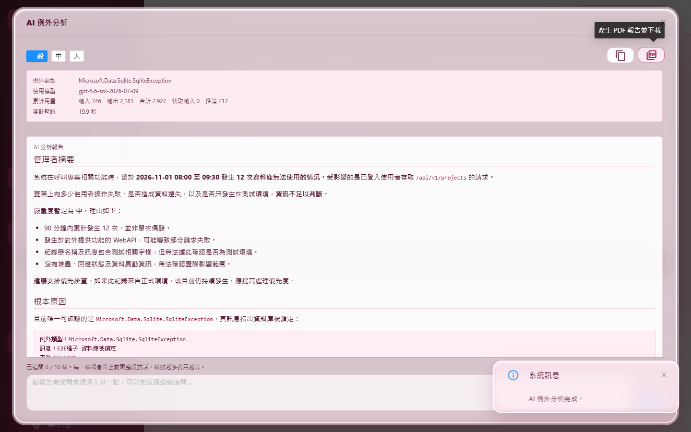
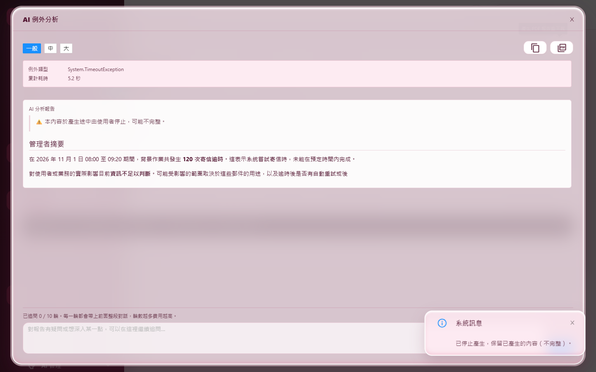
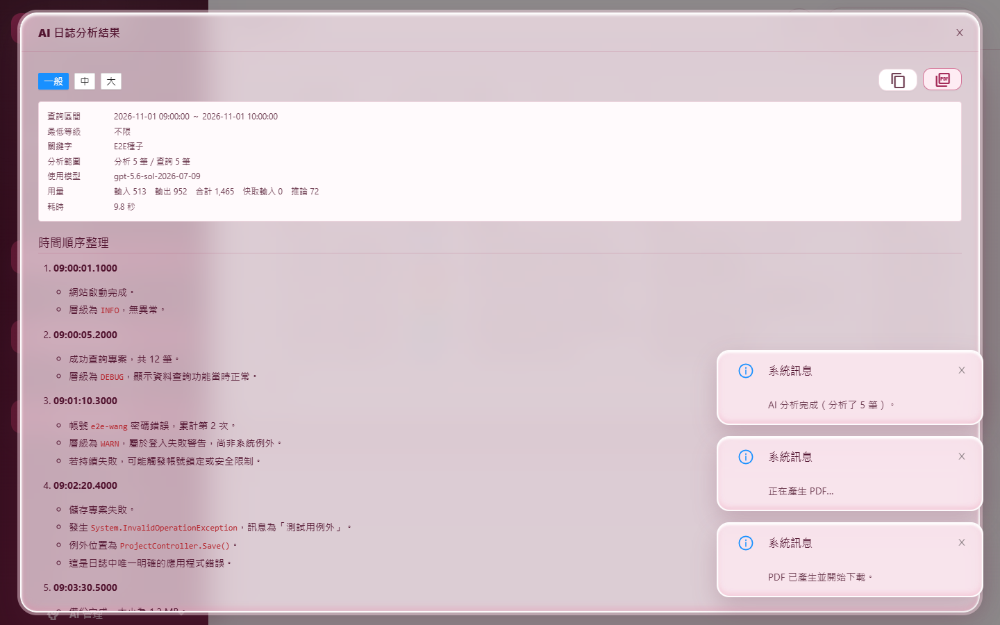
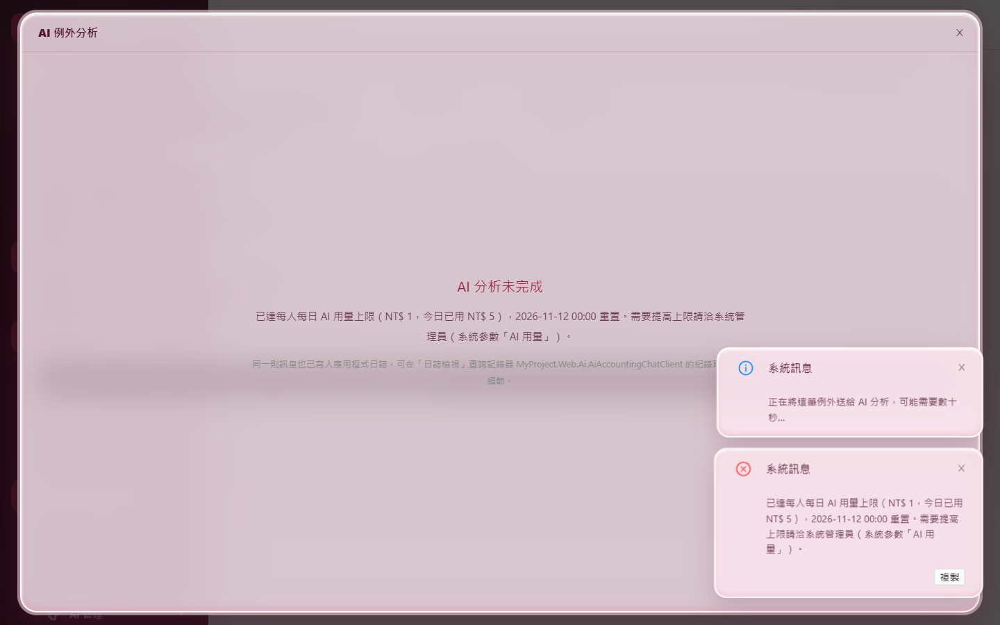
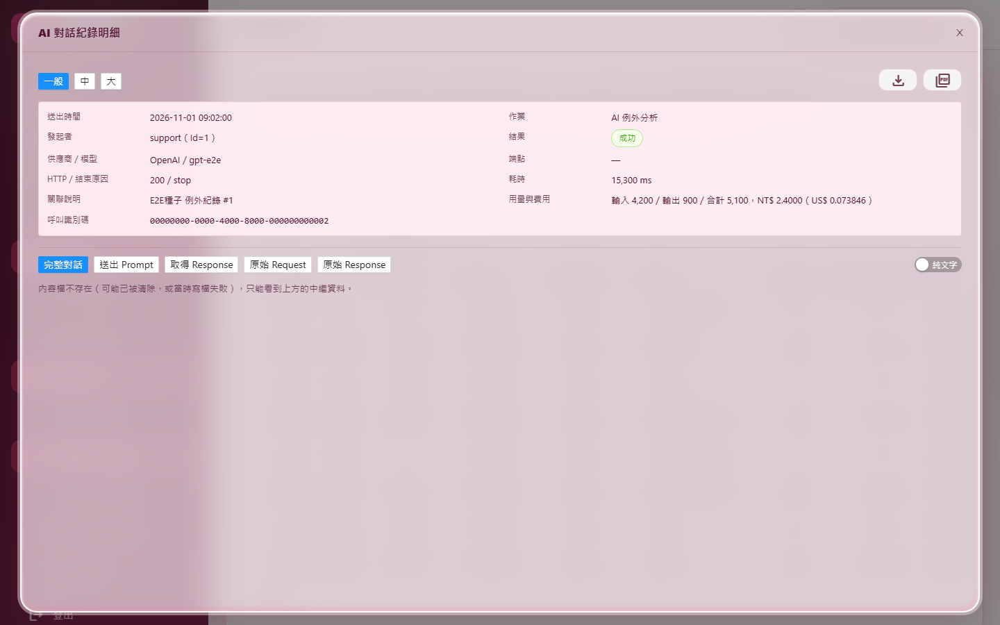
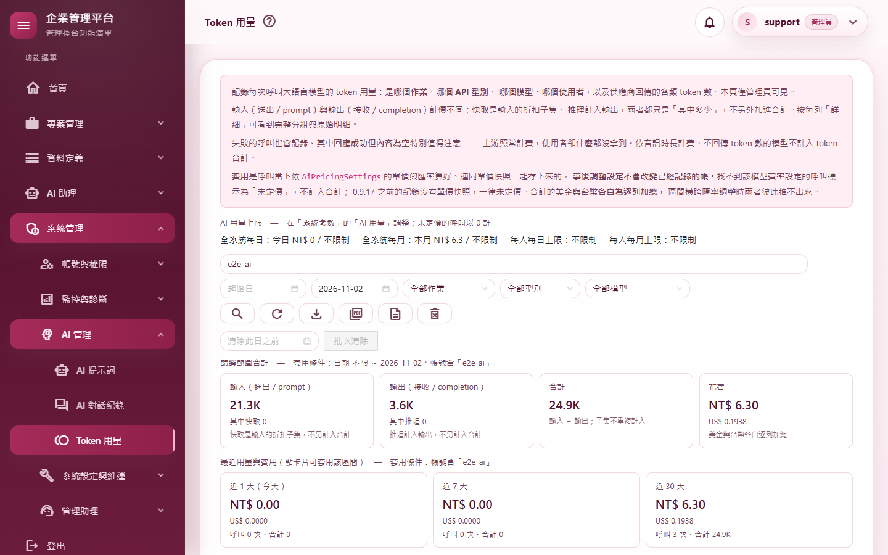
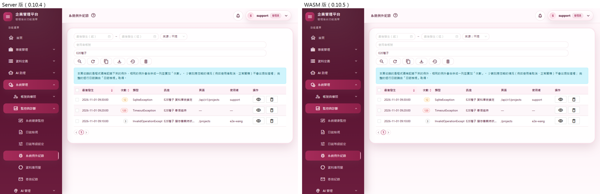

# M06 測試報告：AI 串流、日誌與 AI 管理頁

- 里程碑：WASM 遷移 M6（計畫見 [WASM遷移計畫](../WASM遷移計畫.md)）
- 版本：0.10.4 → 0.10.5
- 測試日期：2026/11/11
- 分支：`feature/wasm-m06-ai-logs`

## 摘要

| 項目 | 結果 |
|---|---|
| 範圍 | 日誌檢視（`/logs`，含 AI 日誌分析）、日誌等級設定（`/log-level-setting`）、系統例外（`/system-exceptions`，含 AI 例外分析與追問）、AI 對話紀錄（`/ai-call-logs`）、Token 用量（`/token-usage`）、AI 提示詞（`/prompt-templates`）改在 WebAssembly 執行，Server 版頁面刪除；新增 6 組只限管理員的 API；AI 回覆改走 NDJSON 串流 HTTP（不用 SignalR） |
| 授權方式 | 使用者在 M5 開始時授權 M5～M7 連續完成，可自動 commit、合併、推送；用真實模型做實機驗證前另外取得同意（2026/11/11） |
| 自動化測試 | 2,828 個全部通過（M5 結束時 2,734 個，淨增 94） |
| 品質關卡 | 7 步全部通過（結果見 A.3） |
| 實機驗證 | 真實模型 9 個情境＋超過用量上限 1 個＋操作 8 個情境全部通過；全部 37 個路由煙霧測試全部通過（全新的隔離資料庫） |
| 外觀比對 | Server 版（改版前）與 WASM 版 9 個畫面逐像素比對：6 個完全相同；其餘最多 8／255（122 個像素以內），肉眼無差異 |
| 實機發現 | ① 提示詞頁沒有任何頁籤被選中（內容空白）；② 連續快速換頁被 API 限流時，WASM 把人丟回登入頁。兩項都已修正並補測試 |
| 獨立審查 | 7 項發現（1 高、4 低、1 資源、1 流程）：6 項修正並補測試，資源一項與 Server 版相同、記為已知限制 |
| 版本 | 0.10.4 → 0.10.5 |

---

## A.1 測試策略

| 層次 | 涵蓋什麼 | 工具 |
|---|---|---|
| 整合測試 | 真的主機與資料庫、以 API 登入拿到的 Token 呼叫：6 組 API 每個端點的成功與失敗、非管理員 403 並記權限拒絕、稽核各一筆且內容與 Server 版相同、時間不帶時差、排序與匯出同序；AI 服務換成假的，驗證串流的幀順序、瀏覽器中斷時上游被取消且稽核照寫 | `WebApplicationFactory` |
| 元件測試 | WASM 版 AI 例外分析窗：逐段顯示、停止產生（有／沒有收到文字）、追問送回的對話、追問被拒時問題放回輸入框、停止與失敗結果同時發生 | bUnit |
| 單元測試 | NDJSON 回應（逐行、中斷後仍讀完序列）、串流保護層、瀏覽器端串流讀取（逐行、401 刷新、伺服器拒絕、取消）、被限流不登出、Markdown 消毒（含自動連結） | xUnit |
| 回歸 | M5 結束時的 2,734 個測試 | xUnit |
| 品質關卡 | 建置（Release）、格式、全部測試、文件編碼、CRUD 產生器錨點、弱點掃描 | `scripts/Invoke-QualityGate.ps1` |
| 實機驗證 | 真的網站（隔離資料庫）、真的 Chrome、**真實模型**（User Secrets 的金鑰只在網站執行時讀取）：逐字出現、停止、取消、追問、匯出、配額、非管理員 403 | `scripts/Start-E2EHost.ps1`、`scripts/e2e/m06-ai.mjs`、`m06-ops.mjs`、`smoke-routes.mjs` |
| 外觀比對 | 同一組固定資料（例外、AI 對話紀錄、Token 用量、提示詞版本、固定日期的日誌檔），改版前後各拍 9 個畫面逐像素比對 | `scripts/e2e/m06-views.mjs`＋Pillow |
| 獨立程式審查 | 未參與實作的審查者讀完整份變更 | 另一個 AI 審查代理（只讀） |

---

## A.2 自動化測試

### 新增與修改的測試

| 測試類別 | 驗證的行為 |
|---|---|
| `ExceptionLogApiTests`（新，24） | 查詢（起訖、來源、帳號、關鍵字含追蹤碼）、按查詢才記搜尋稽核；**排序生效，匯出與複製同序**；明細含堆疊（堆疊檔不存在為 null）、查看稽核；CSV 匯出；刪除、清除、清空各一筆稽核；**AI 串流的第一則例外明細由伺服器組、不含帳號**；對話格式不合格（角色不交替、塞 system、追問超過 2000 字、超過輪數）回 400、不呼叫 AI；**瀏覽器中斷時仍寫一筆稽核（失敗原因 Canceled）**；PDF 由伺服器補明細與堆疊；審查補測：**對話途中調低追問上限仍可匯出 PDF**；時間不帶時差；非管理員對每個端點 403 |
| `LogApiTests`（新，16） | 查詢的順序與欄位、搜尋稽核只在按查詢時寫；起訖對調、3 天上限的警告、追蹤碼篩選；**預設區間與四個快速區間都用伺服器時間**；不認得的代碼或等級 400；匯出有 BOM、檔名、稽核；AI 串流的幀順序與範圍、稽核 detail；中斷時取消並寫稽核；PDF 由伺服器重建附錄；日誌等級套用與還原的稽核；審查補測：**報告與模型名稱過長回 400、不寫稽核**；8 個端點非管理員 403 |
| `AiCallLogApiTests`（新，16） | 查詢、內文掃描、深連結找 Id、明細（每段前 20 萬字元與完整長度）、取全文、JSON／PDF／合併 PDF（超過 50 筆 400）、CSV（不含內文、順序同畫面）、刪除、清除、清空，稽核與 Server 版相同；**排序生效**；時間不帶時差；非管理員 403 |
| `TokenUsagePromptApiTests`（新，15） | 儀表板一次回明細、合計、分組、每日（補零、最多 180 天）、近 N 天卡（伺服器今天）；明細窗平攤原始 usage；CSV／PDF（不認得的頁籤 400）；刪除、清除、清空；**排序生效且 CSV 同序**；提示詞存新版本（建立者由伺服器取）、樂觀鎖衝突 409、切換版本或內建預設；非管理員對 11 個端點 403 |
| `NdjsonResultTests`（新，2） | 每個項目一行 JSON、類型與 `no-cache, no-transform` 標頭；**使用者已中斷時不再寫出，但序列照樣讀到最後**（收尾的稽核一定執行） |
| `AiStreamGuardTests`（新，4） | 文字照常往下傳、遇到結果就停；中斷時服務丟的取消例外變成「已取消」結果；其他例外變成「未預期的錯誤」並標記（不寫稽核）；服務沒給結果時補一筆 |
| `Client/ClientSessionTests`（＋7） | 串流：逐行交給呼叫端、401 刷新重送一次、伺服器拒絕帶回訊息且不呼叫、取消回失敗不丟例外；**被限流（429）：換發 Token 被限流不回登入頁、讀身分被限流不刷新也不登出、刷新被限流回 429 訊息且維持登入**；路由表認得 `/logs`、`/log-level-setting` |
| `Components/ExceptionAiAnalysisModalStreamingTests`（改寫，6） | 改測 WASM 版：逐段顯示與停止鍵、停止後保留內容並中斷請求、沒收到文字就停止、追問送回整段對話與同一個 ConversationId、追問被拒時問題放回輸入框；審查補測：**按停止的同時收到失敗結果，問題仍放回輸入框** |
| `AiMarkdownRendererTests`（＋6） | 審查補測：**`<javascript:…>` 等角括號自動連結不會變成可點的連結**；安全的自動連結保留並另開分頁 |

### 因改寫而調整的既有測試

| 測試 | 修改 | 理由 |
|---|---|---|
| `ExportTests` | 三份 CSV 欄位改指 `ExceptionLogExport`、`AiCallLogExport`、`TokenUsageExport` | 欄位定義搬到伺服器端的匯出類別（輸出不變） |
| `AiModalStyleConventionTests` | 三個 AI 對話窗的路徑改用 `SourceTree.UiFile`（Server 或 WASM 都找得到） | 對話窗搬到 WASM |
| `ExceptionLogClipboardTextTests` | 命名空間改成 `MyProject.Web.Client.Views.Admins` | 類別搬到 Client，畫面與伺服器共用 |
| `LoggingConventionTests` | Token 用量頁從「空 catch 白名單」移除 | 原始 usage 的解析搬到伺服器，解析失敗改記 Warning |

---

## A.3 品質關卡

`pwsh ./scripts/Invoke-QualityGate.ps1`：

| 步驟 | 結果 | 秒數 |
|---|---|---|
| Restore | 通過 | 1.1 |
| Build（Release） | 通過（0 警告、0 錯誤） | 44.1 |
| Format | 通過（`dotnet format --verify-no-changes`） | 90.4 |
| Test | 通過（2,828 個） | 127.7 |
| Docs encoding | 通過（298 個檔案，`docs/` 與根目錄 `.md` 皆 UTF-8 含 BOM） | 0.2 |
| CRUD anchors | 通過 | 0.9 |
| Vulnerability | 通過（沒有已知弱點） | 22.6 |

---

## A.4 實機驗證

全新的隔離資料庫；support 的 Email 改成 `support@e2e.test`；AI 用 User Secrets 裡的真實模型（`gpt-5.6-sol`），金鑰只在網站執行時讀取，沒有印出或寫進任何檔案。
最終一輪共呼叫模型 6 次分析／追問（另有開發中一輪），費用很少。

### AI 情境（真實模型，`m06-ai.mjs`）

| # | 情境 | 步驟 | 預期 | 實際結果 | 判定 |
|---|---|---|---|---|---|
| A1 | 例外 AI 分析逐字出現 | 系統例外頁（WASM）開「資料庫被鎖定」明細 → AI 分析 | 回覆逐段長出來 | 每 200ms 取樣看到 33 種長度，最後 2,705 字（截圖 01） | 通過 |
| A2 | 追問 | 輸入「請用一句話總結最可能的原因。」送出 | 第 1 輪回覆出現、輪數更新 | 「AI 回覆（追問 1）」出現，「已追問 1／10 輪」 | 通過 |
| A3 | `javascript:` 連結被中和 | 追問要求原樣輸出 `[點我看說明](javascript:alert(1))` | 畫面上沒有 `javascript:` 連結 | 模型沒有照做；畫面上 0 個 `javascript:` 連結（消毒規則另有單元測試，含審查發現的自動連結） | 通過 |
| A4 | 匯出 PDF | 對話窗按「產生 PDF 報告並下載」 | 伺服器產生 PDF、稽核一筆 | 下載 `MyProject.Web-ai-exception-report-….pdf`（184,830 bytes，`%PDF`）；`ExceptionLog.AiExportPdf` 一筆 | 通過 |
| A5 | 稽核 | 查資料庫 | 初始分析 1 筆、追問 2 筆，不含對話內容 | 「初始分析」「追問第 1 輪」「追問第 2 輪」；detail 只有輪次、數量、模型、用量、耗時 | 通過 |
| A6 | 關窗＝取消 | 重新分析，第一個字出現後按右上角關閉 | 通知「已取消」；伺服器記下被取消的呼叫；AI 對話紀錄看得到 | 通知「已取消本次 AI 分析。」；AI 對話紀錄多一筆失敗，FailureReason=Canceled，清單最新一列就是它 | 通過 |
| A7 | 停止產生保留部分 | 「寄信逾時」分析，收到 40 字以上後按「停止產生」 | 保留已產生的部分並標示已中止 | 保留 165 字，開頭「⚠️ 本內容於產生途中由使用者停止，可能不完整。」（截圖 02） | 通過 |
| A8 | 日誌 AI 分析 | 日誌檢視頁（WASM）查固定日期的 5 筆 → AI 分析 → 匯出 PDF | 逐字出現、完成通知、PDF、稽核 | 30 種長度；「AI 分析完成（分析了 5 筆）。」；PDF 下載；`LogViewer.AiAnalyze`、`AiAnalyzeExportPdf` 各一筆（截圖 03） | 通過 |
| A9 | 沒有錯誤 | A1～A8 期間收集頁面錯誤 | 沒有 | 0 個 | 通過 |
| Q1 | 超過用量上限 | 另開主機，每人每日上限設 1 元；資料庫放一筆今天 5 元的用量 → AI 分析 | 對話窗顯示上限訊息，不呼叫模型 | 「已達每人每日 AI 用量上限（NT$ 1，今日已用 NT$ 5），2026-11-12 00:00 重置。…」；AI 對話紀錄筆數不變（截圖 04） | 通過 |

### 操作情境（`m06-ops.mjs`）

| # | 情境 | 步驟 | 預期 | 實際結果 | 判定 |
|---|---|---|---|---|---|
| O1 | 日誌等級 | 選 Warn 套用，再還原 | 頂部通知、稽核各一筆 | 「日誌最低等級由 INFO 調整為 WARN（僅執行期有效）。」與還原各一筆 | 通過 |
| O2 | 提示詞 | 編輯 → 存成新版本 → 內建預設那列「設為作用中」 | 第 3 版、建立者 support、稽核兩筆 | 「已存成第 3 版」；`version=3`、`version=default`；建立者 support | 通過 |
| O3 | 系統例外 | 點「次數」排序 → 匯出 CSV → 刪除一列 | 依次數遞增；CSV 同序；稽核 | 3＜12＜120；CSV 同序；「刪除成功」；匯出、刪除稽核各一筆 | 通過 |
| O4 | AI 對話紀錄 | `/ai-call-logs?callId=…` 深連結 → 匯出 CSV → 匯出查詢結果 PDF | 自動開明細窗；CSV；合併 PDF；稽核 | 明細窗自動開啟（截圖 05）；CSV 標頭「送出時間（本地）」；合併 PDF 下載，稽核 `format=pdf-merged; source=query; rows=3` | 通過 |
| O5 | Token 用量 | 匯出 CSV 與全部頁籤 PDF → 明細窗「查看這次呼叫」 | 兩個檔案、稽核兩筆、導到 AI 對話紀錄 | `format=csv; rows=3`、`format=pdf; scope=All; rows=3`；導到 `/ai-call-logs?callId=…` 並開明細窗 | 通過 |
| O6 | 日誌檢視 | 按「今天」→ 查固定區間 → 匯出 | 起點是伺服器今天 00:00；.log 含 BOM、5 筆 | 起點 `2026-11-11 00:00:00`；BOM；5 筆；稽核 `rows=5` | 通過 |
| O7 | 非管理員 | 一般帳號以自己的 Token 呼叫 18 個 M6 端點（含 AI、清空） | 一律 403、資料不受影響 | 18 個都是 403；資料都還在 | 通過 |
| O8 | 沒有錯誤 | O1～O7 期間收集頁面錯誤 | 沒有 | 0 個 | 通過 |

### 全部路由煙霧測試

37 個路由全部通過，六個新頁以 WebAssembly 顯示。這次加強了檢查：登入後的頁面若被丟回登入頁、或停在限流提示，就算失敗（見下方實機發現 ②）。

### 外觀比對

| 畫面 | 差異 |
|---|---|
| 日誌檢視（固定日期 5 筆） | 21 個像素、最多 8／255（日期欄位邊緣） |
| 日誌等級設定 | 完全相同 |
| 系統例外 | 19 個像素、最多 7／255（日期欄位邊緣） |
| 例外明細 | 完全相同 |
| AI 對話紀錄 | 122 個像素、最多 8／255（說明框與按鈕邊緣） |
| Token 用量（合計、趨勢圖） | 完全相同 |
| Token 明細頁籤 | 完全相同 |
| AI 提示詞 | 完全相同 |
| 提示詞編輯窗 | 完全相同 |

截圖 07 為系統例外的並排對照。

### 實機發現並修正的問題

**① 提示詞頁沒有任何頁籤被選中**：第一輪截圖時，頁籤列出現了，但沒有一個被選中，下面的內容整片空白。

- **原因**：WASM 版的資料要等 API 回來。AntDesign 的 Tabs 先以零個頁籤畫出、資料到了才補上頁籤時，預設的 ActiveKey 不會套用。
- **修正**：資料到了才畫 Tabs。這個踩雷點寫進速查表。

**② 連續快速換頁被限流時，WASM 把人丟回登入頁**：第二輪的煙霧測試中，`/audit-logs`、`/email-logs`、`/logs`、`/log-level-setting` 四頁最後停在登入頁。

- **原因**：
  - 腳本一分鐘內整頁載入二十幾個 WASM 頁，每頁都要換 Token、讀身分與外框，超過每人每分鐘 120 次的 API 上限（伺服器日誌有 429）。
  - WASM 的登入工作階段把「讀身分失敗」一律當成登入失效：接著刷新、再換發，都被 429 擋下，最後清掉 Token、回登入頁。
  - 這是 M2 就有的行為，只是 M6 之後 WASM 頁面多到測得出來。
- **修正**：
  - 被限流是暫時的。`ClientSession` 遇到 429 不清 Token、不回登入頁，外框改顯示「請求過於頻繁，請稍後再試。」與「重新整理」按鈕。
  - `ApiClient` 刷新 Token 被限流時，回 429 訊息、維持登入。
- **測試**：補 3 個單元測試。
- **腳本調整**：
  - 煙霧測試加上「登入後頁面不可停在登入頁或限流提示」。
  - 測試主機的 API 上限放寬到每分鐘 1000 次（只限 `Start-E2EHost.ps1`）。腳本換頁比人快得多；正式設定不變。

### 伺服器日誌

最終一輪的錯誤共 3 筆，都是煙霧測試登出時的已知收尾時序問題（M01～M05 報告都已記錄）。六個新頁與新 API 沒有任何錯誤。

---

## A.5 獨立審查

審查者讀完整份變更（未參與實作）。

### 修正的發現

| # | 嚴重度 | 發現 | 修正 | 補的測試 |
|---|---|---|---|---|
| 1 | 高 | Markdown 消毒只檢查 `[文字](網址)`，漏掉角括號自動連結 `<javascript:…>`（`DisableHtml()` 關不掉這種語法），可在 AI 回覆或 AI 對話紀錄的 Markdown 檢視產生可點的惡意連結。改寫前就有；改成 WASM 後 Token 存在瀏覽器 storage，影響更大 | `AutolinkInline` 套同一份連結白名單，不合格的降級成純文字；PDF 共用同一棵消毒後的語法樹 | `ToSafeHtml_ShouldNotTurnDangerousAutolinkIntoALink`（5 種，先失敗）、安全的自動連結保留 |
| 2 | 低 | 日誌 AI 報告匯出 PDF 時，報告內文與模型名稱來自畫面且沒有上限，會拿去排版 PDF 並寫進稽核摘要 | 報告 ≤ 512K 字、模型名稱 ≤ 200、原因 ≤ 50，超過回 400 | `AiPdf_WithOversizedFieldsFromTheBrowser_ShouldReturn400WithoutAudit` |
| 3 | 低 | 按「停止產生」的同時剛好收到失敗結果（例如額度用完）：例外窗的追問問題留在對話尾端，之後的追問與匯出一律被拒；日誌窗停在「進行中」 | 「使用者放棄」的判斷改成「關窗」，按停止時照常處理失敗結果 | `Stop_AfterAFailureResultArrived_ShouldStillPutTheQuestionBack`（先失敗） |
| 4 | 低 | AI 對話紀錄的內文掃描失敗後改用其他條件重查，搜尋稽核把「內文」記成沒填 | 搜尋稽核在掃描之前就寫（記使用者送出的條件），退回重查不再記 | — |
| 5 | 低 | 剛好在讀取提示詞時取消，日誌分析會記成「未預期錯誤」且不寫稽核；例外分析端點沒有這層防護，例外會在回應標頭送出後往外拋，串流直接斷掉 | 新增 `AiStreamGuard`，兩個串流端點共用：取消變成「已取消」結果（照寫稽核），其他例外變成「未預期的錯誤」結果（不寫稽核，同 Server 版） | `AiStreamGuardTests`（4） |
| 7 | 流程 | 版本號沒升；`NdjsonResult` 的註解指向不存在的 web.config 說明 | 版本 0.10.5；web.config 補上串流說明（不要把 ndjson 加進 IIS 動態壓縮、反向代理不要緩衝） | — |

另外，實作代理提出例外 PDF 匯出也套用追問輪數上限，對話途中調低上限就無法匯出。已放寬：匯出不檢查輪數（輪數上限管的是 AI 費用，匯出不花費用）。補測試 `AiPdf_WithMoreRoundsThanTheCurrentLimit_ShouldStillExport`。

### 記為已知限制

- 6（資源，與 Server 版相同）：Token 用量的 CSV 與 PDF 明細不設筆數上限；例外的「複製目前查詢結果」最多 5,000 筆、每筆含完整堆疊；AI 對話紀錄的 JSON 下載一次讀進記憶體。這些在 Server 版就是如此，只是現在也能直接呼叫 API（只限管理員）。

---

## A.6 設計決定與與 Server 版的差異

- **AI 串流用 NDJSON**：每行一個 JSON，依序是 start、零到多筆 delta、最後一定是 result。伺服器關閉回應緩衝、每行送出。使用者中斷後不再寫出，但序列照樣讀完，所以稽核與記帳一定執行。
- **例外 AI 的對話由畫面送回**：遷移分析報告原本寫「對話存在伺服器快取」，改成每輪由畫面送回之前的問答，伺服器用資料庫與堆疊檔重建第一則例外明細與系統提示。理由：
  - 不怕 IIS 回收，伺服器也不必保存狀態。
  - 畫面改不到例外內容與系統提示。
  - 對話格式有嚴格驗證。
- **日誌 AI、匯出、PDF 由伺服器依同一份條件重查**：不把上萬筆日誌從瀏覽器送回去。
- **「現在」一律由伺服器算**：快速區間、預設區間、近 N 天卡、檔名、PDF 產生時間都用伺服器時間。
- **排序修正**：系統例外、AI 對話紀錄、Token 用量明細在 Server 版的排序從未生效（比對 `ascend`／`descend`），WASM 版依點選方向排序，匯出、複製、PDF 與畫面同序。
- **停止產生之後**：請求已中斷，畫面收不到伺服器最後的結果，只能用已收到的文字自己收尾。所以對話窗資訊不顯示模型與用量；伺服器的稽核與用量紀錄仍然完整。
- **直接離開頁面造成的取消**：伺服器也會記 AI 分析稽核。Server 版因為電路已經收掉，不會記。
- **小差異**：
  - Token 用量 PDF 由伺服器重查，查詢與匯出之間有新紀錄時，數字可能多幾筆。
  - 例外「複製目前查詢結果」多一次查總筆數的請求。
  - AI 是否可用改在開頁與重新整理時讀。

---

## A.7 已知限制

- **兩種頁面並存**：維運頁、首頁儀表板、Agent 與系統管理助理等仍是 Server 版。在兩種頁面之間切換時會整頁載入，M10 移除 Server 模式前都是如此。
- **IIS 或反向代理的設定**：若主機把 `application/x-ndjson`（或 `*/*`）加進動態壓縮，或前面有會緩衝回應的反向代理，AI 回覆會等全部產生完才一次出現。功能正常，只是不會逐字顯示。web.config 與部署文件已說明。
- **資源上限**：見 A.5 第 6 項。
- **伺服器日誌的收尾時序錯誤**：見 A.4，屬 Blazor Server 電路收尾，M10 後消失。

---

## A.8 截圖

| # | 內容 |
|---|---|
| 01 |  |
| 02 |  |
| 03 |  |
| 04 |  |
| 05 |  |
| 06 |  |
| 07 |  |

截圖中沒有個人 Email：隔離資料庫只有測試帳號，support 的 Email 已改成 `support@e2e.test`。AI 回覆是真實模型對測試資料的分析。
