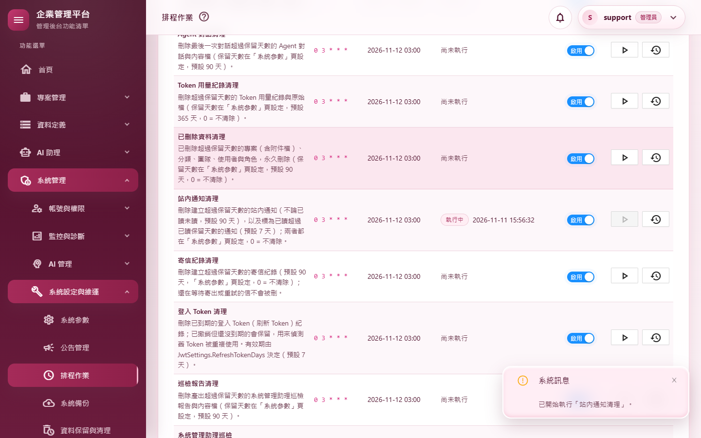
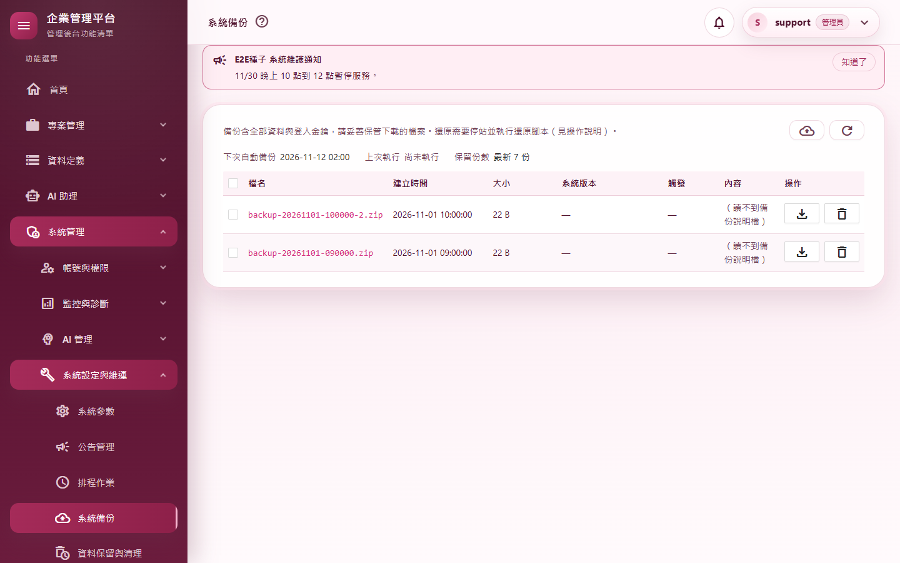
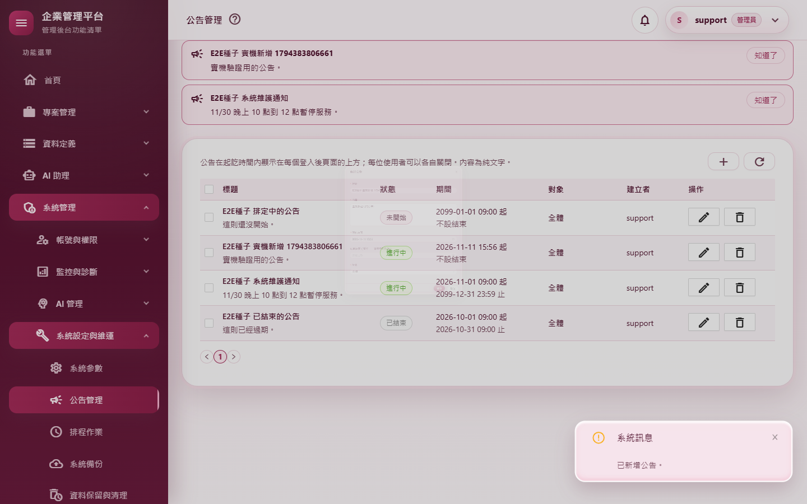
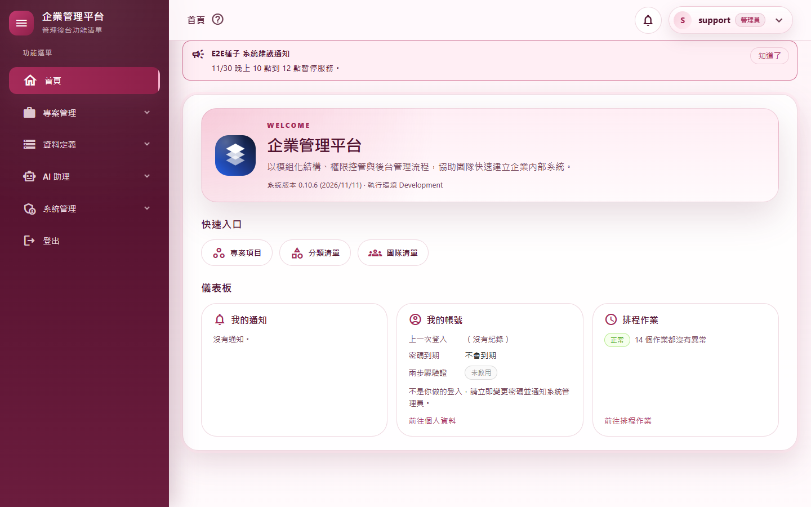
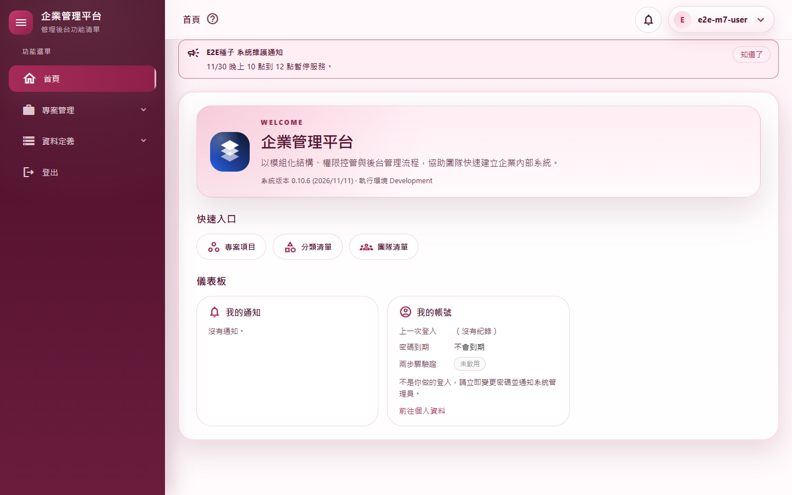
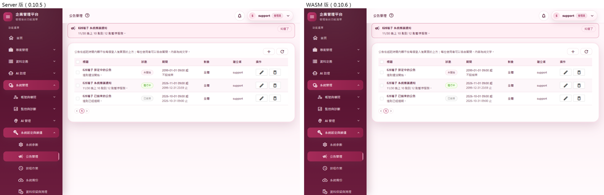

# M07 測試報告：維運頁與首頁儀表板

- 里程碑：WASM 遷移 M7（計畫見 [WASM遷移計畫](../WASM遷移計畫.md)）
- 版本：0.10.5 → 0.10.6
- 測試日期：2026/11/11
- 分支：`feature/wasm-m07-ops`

## 摘要

| 項目 | 結果 |
|---|---|
| 範圍 | 排程作業（`/scheduled-jobs`）、系統健康監控（`/system-health`）、系統備份（`/backups`）、資料保留與清理（`/data-retention`）、資料庫用量（`/database-usage`）、系統參數（`/system-parameters`）、公告管理（`/announcements`）、登入後首頁（`/App`）改在 WebAssembly 執行，Server 版頁面刪除；新增 7 組 API、擴充公告 API；備份下載改用一次性下載票證，退役只收 Cookie 的 `BackupController` |
| 授權方式 | 使用者在 M5 開始時授權 M5～M7 連續完成，可自動 commit、合併、推送 |
| 自動化測試 | 2,885 個全部通過（M6 結束時 2,828 個，淨增 57） |
| 品質關卡 | 7 步全部通過（結果見 A.3） |
| 實機驗證 | 9 個情境全部通過；全部 37 個路由煙霧測試全部通過（全新的隔離資料庫） |
| 外觀比對 | Server 版（改版前）與 WASM 版 9 個畫面逐像素比對：版面與文字沒有差異；差異只在版本號、即時數值（系統健康、資料庫大小、最新紀錄時間）與右側固定操作欄 1 像素的對齊（見 A.4） |
| 合併時發現 | M2 留下的時差問題：通知鈴鐺、個人資料、「關於」的本地時間帶 `+08:00` 送出，已修正並補測試 |
| 獨立審查 | 4 項低嚴重度發現：3 項修正（含 1 項補測試）、1 項是文件與新行為不一致（文件同步時修正）；另有 2 項設計備註 |
| 版本 | 0.10.5 → 0.10.6 |

---

## A.1 測試策略

| 層次 | 涵蓋什麼 | 工具 |
|---|---|---|
| 整合測試 | 真的主機與資料庫、以 API 登入拿到的 Token 呼叫：8 組 API 每個端點的成功與失敗、非管理員 403 並記權限拒絕、稽核各一筆且內容與 Server 版相同、時間不帶時差；票證只能用一次、過期、非管理員兌換、路徑穿越；系統參數不在目錄的鍵 404、伺服器驗證 400、版本衝突 409；首頁只回自己看得到的小工具 | `WebApplicationFactory` |
| 守門測試 | 每個 API action 都標註授權意圖；有單筆刪除的列表頁都有「刪除選取」（改掃 Server 與 WASM 兩處）；首頁小工具代號兩邊一致 | 反射、原始碼掃描 |
| 回歸 | M6 結束時的 2,828 個測試 | xUnit |
| 品質關卡 | 建置（Release）、格式、全部測試、文件編碼、CRUD 產生器錨點、弱點掃描 | `scripts/Invoke-QualityGate.ps1` |
| 實機驗證 | 真的網站（隔離資料庫）、真的 Chrome、兩個帳號：排程立即執行、建立並下載備份、修改參數生效、公告在同一分頁與另一分頁出現、首頁依權限、非管理員 403 | `scripts/Start-E2EHost.ps1`、`scripts/e2e/m07-ops.mjs`、`smoke-routes.mjs` |
| 外觀比對 | 固定的公告與兩個備份檔，改版前後各拍 9 個畫面逐像素比對 | `scripts/e2e/m07-views.mjs`＋Pillow |
| 獨立程式審查 | 未參與實作的審查者讀完整份變更 | 另一個 AI 審查代理（只讀） |

---

## A.2 自動化測試

### 新增與修改的測試

| 測試類別 | 驗證的行為 |
|---|---|
| `MaintenanceApiTests`（新，22） | 備份清單、立即備份（執行中 409）、刪除（不存在 404）、**下載票證只能用一次、過期失效、非管理員或工作階段失效時兌換回 404、路徑穿越與不合格檔名一律 404、兌換時才寫一筆下載稽核**；資料保留總覽與伺服器「今天」、立即清理的 expected 由伺服器重算、預覽與自訂清除的伺服器驗證；資料庫用量不送完整路徑；時間不帶時差；非管理員 403 |
| `OpsDashboardApiTests`（新，17） | 排程總覽、立即執行（執行中 409、稽核 `job=名稱`）、啟用與停用、執行紀錄；系統健康報告、WARN 日誌（伺服器時間）、測試信與測試通知；首頁依權限回小工具與快速入口、我的帳號、我的通知（不安全的連結被拿掉）、排程小工具只限管理員；非管理員 403 |
| `SystemParameterAnnouncementApiTests`（新，13 方法／21 筆） | 參數清單、修改（值與設定檔相同改記還原）、還原；**不在目錄的鍵（例如 `JwtSettings:SigningKey`）404**、型別與範圍由伺服器驗證 400、版本衝突 409；公告新增（建立者由伺服器取）、修改、刪除，稽核標題取自資料庫；另一位使用者的 active 立即看到或不再看到；時間不帶時差；非管理員 403 |
| `DashboardTests`（改寫，7） | 小工具依權限顯示的規則改由伺服器決定；伺服器與前端的小工具代號一致 |
| `ShellApiIntegrationTests`（＋1） | **通知鈴鐺、個人資料、「關於」的本地時間不帶時差**（先失敗） |
| `Client/ClientRefreshSignalTests`（新，2） | 「立即重讀」訊號可以排除呼叫端自己（在鈴鐺標已讀後只請首頁「我的通知」重讀）；沒有訂閱者時不出錯 |

### 因改寫而調整的既有測試

| 測試 | 修改 | 理由 |
|---|---|---|
| `BackupDownloadTests`、`SystemBackupTests.IsFirstRange` | 刪除，由 `MaintenanceApiTests` 涵蓋 | `BackupController`（Cookie 下載、續傳）退役 |
| `SessionTests` | 「只收 Cookie 的端點」改用整頁載入 `/Profile` | 原本用的備份下載網址已不存在 |
| `BatchDeleteConventionTests` | 改掃 Server 的 Components 與 `MyProject.Web.Client` 兩處 | 有單筆刪除的列表頁都搬到 WASM，只掃 Server 會空跑而失敗 |
| `PageAuthorizationTests` | 掃描下限從 10 降到 4 | 呼叫登入檢查的 Server 元件只剩 4 個 |
| `ShellApiIntegrationTests` | 「非 WASM 頁不記開頁稽核」的例子從 `/App` 換成 `/ChangePassword` | `/App` 已是 WASM 頁 |
| `MenuPermissionConsistencyTests`、`LoggingConventionTests`、`ExportTests` | 補上新檔名、拿掉已不存在的命名空間 | 檔案搬家 |

---

## A.3 品質關卡

`pwsh ./scripts/Invoke-QualityGate.ps1`：

| 步驟 | 結果 | 秒數 |
|---|---|---|
| Restore | 通過 | 1.1 |
| Build（Release） | 通過（0 警告、0 錯誤） | 23.1 |
| Format | 通過（`dotnet format --verify-no-changes`） | 91.5 |
| Test | 通過（2,885 個） | 126.8 |
| Docs encoding | 通過（300 個檔案，`docs/` 與根目錄 `.md` 皆 UTF-8 含 BOM） | 0.2 |
| CRUD anchors | 通過 | 0.9 |
| Vulnerability | 通過（沒有已知弱點） | 22.1 |

---

## A.4 實機驗證

全新的隔離資料庫；support 的 Email 改成 `support@e2e.test`；另一個一般帳號 `e2e-m7-user`。

### 情境（`m07-ops.mjs`）

| # | 情境 | 步驟 | 預期 | 實際結果 | 判定 |
|---|---|---|---|---|---|
| P1 | 排程立即執行 | 排程作業頁（WASM）對「站內通知清理」按「立即執行」→ 確認 | 作業執行、畫面不重新整理就更新、稽核一筆 | 執行紀錄 0 → 1，該列自動更新；`Job.Trigger` `job=NotificationRetention`（截圖 01） | 通過 |
| P2 | 建立並下載備份 | 「立即備份」→ 確認 → 等清單出現新的一列 → 「下載」；另以 API 申請票證兌換兩次；呼叫舊網址 | 新備份自動出現；下載的是 zip、檔名正確；票證第二次 404；舊網址 404 | 清單 5 秒內多出 `backup-20261111-155637.zip`；下載的檔名相同、內容是 zip（19,421 bytes）；稽核 `Backup.Download` 在兌換時寫；票證第二次 404；舊網址 `api/backups/{檔名}/download` 404（截圖 02） | 通過 |
| P3 | 修改參數立即生效 | 把「系統名稱」改成「E2E 平台」→ 開首頁 → 還原 | 首頁標題立刻變；還原成功；稽核修改、還原各一筆 | 首頁標題「E2E 平台」；還原成功；稽核各一筆 | 通過 |
| P4 | 公告在同一分頁立即出現 | 公告管理頁新增一則全體公告 | 本頁上方的橫幅立即出現（Server 版是即時的） | 5 秒內出現（截圖 03） | 通過 |
| P5 | 公告在另一分頁出現 | 一般使用者在另一個瀏覽器開個人資料頁 | 上方出現新公告 | 出現 | 通過 |
| P6 | 首頁小工具依權限 | 管理員與一般使用者各開首頁；一般使用者呼叫排程小工具 API | 管理員有「排程作業」，一般使用者沒有；API 403 | 管理員 3 個小工具（截圖 04）；一般使用者 2 個（截圖 05）；API 403 | 通過 |
| P7 | 其他三頁 | 開系統健康、資料保留、資料庫用量 | 都以 WASM 顯示 | 三頁都是 WASM | 通過 |
| P8 | 非管理員 | 一般帳號以自己的 Token 呼叫 13 個 M7 端點（含立即備份、發票、清空參數） | 一律 403 | 13 個都是 403 | 通過 |
| P9 | 沒有錯誤 | P1～P8 期間收集頁面錯誤 | 沒有 | 0 個 | 通過 |

### 全部路由煙霧測試

37 個路由全部通過，八個新頁以 WebAssembly 顯示；登入後的頁面沒有被丟回登入頁或停在限流提示。

### 外觀比對

| 畫面 | 差異 | 說明 |
|---|---|---|
| 排程作業 | 右側「啟用」與「操作」欄 | 右側固定欄在 WASM 版晚一點量測寬度，按鈕差 1 像素；標記與 CSS 與 Server 版逐字相同 |
| 系統健康 | 多處數值 | 即時數值（記憶體、檔案大小、檢查時間、AI 探測耗時），版面相同 |
| 系統備份 | 右側操作欄（最終一輪） | 同排程作業，1 像素；第一輪完全相同 |
| 資料保留與清理 | Token 用量那一列 | 「最新一筆」是系統健康 AI 探測剛寫入的時間，每次不同 |
| 資料庫用量 | 檔案大小 | 即時數值 |
| 系統參數 | 完全相同 | — |
| 公告管理 | 完全相同（最終一輪） | 第一輪右側操作欄差 1 像素；兩輪結果互換，證實是量測時機而非程式差異 |
| 首頁（管理員） | 版本號、側邊欄選中項的光暈 | 版本 0.10.5 → 0.10.6；光暈最多 2／255 |
| 首頁（一般使用者） | 版本號、側邊欄光暈 | 同上 |

截圖 06 為公告管理的並排對照。

### 伺服器日誌

最終一輪的錯誤共 3 筆，都是煙霧測試登出時的已知收尾時序問題（M01～M06 報告都已記錄）。八個新頁與新 API 沒有任何錯誤。

---

## A.5 獨立審查

審查者讀完整份變更（未參與實作），逐項確認：每個管理動作都只限管理員、首頁端點只回自己的資料；票證防路徑穿越、不可重放、會過期、兌換時重新檢查身分與管理員；系統參數驗證全在伺服器、不在目錄的鍵寫不進去；公告以純文字輸出、對象篩選正確；稽核與 Server 版一致；時間不帶時差、「現在」用伺服器時間；輪詢離開頁面會停、不會重複開計時器。

### 修正的發現

| # | 嚴重度 | 發現 | 修正 | 補的測試 |
|---|---|---|---|---|
| 1 | 中低 | 排程、備份、資料保留頁在作業執行中自動輪詢，伺服器重啟或斷線時每次輪詢都跳一則不會自動關閉的錯誤通知（排程頁每 2 秒一則） | 輪詢失敗只記日誌、不跳通知；使用者按「重新整理」時照常顯示錯誤 | — |
| 2 | 低 | 首頁「我的通知」在第一次讀取完成前就換頁時，仍會訂閱更新訊號，元件無法回收，之後每次發送測試通知都多打一次 API | 讀取回來後先確認元件還在才訂閱 | — |
| 3 | 低 | 「關於」的啟動時間仍帶 `+08:00` 送出（與鈴鐺、個人資料同一種問題，M2 留下的） | 改不帶時差 | 時差測試加上 `shell/info`（先失敗） |
| 4 | 低 | 操作說明與文件仍寫「備份大檔可以續傳」、「排程每 5 秒自動更新」 | 文件同步時修正（見 A.6 第 1、2 點） | — |

### 設計備註（不修改，寫進文件）

- **備份票證**：票證是「拿到網址就能下載」，沿用 M4 已決定的機制：只發給管理員、60 秒、只能用一次、兌換時重新檢查帳號與管理員身分。備份含整個資料庫與登入金鑰環，風險比附件高；票證網址只出現在管理員的瀏覽器裡，風險可接受。如果日後要加強，可以在兌換時再比對同源 Cookie 是否同一人。
- **公告 API 的時間格式**：起訖時間是伺服器本地時間；非 WASM 的呼叫端若送 `…Z` 的 UTC 時間，會被當成本地時間。已寫進 API 端點目錄。

---

## A.6 設計決定與與 Server 版的差異

1. **備份下載改用一次性票證，不能續傳**：遷移計畫原本就規定大檔要用票證，M4 附件也已決定採一次性票證。下載中斷時要回頁面重新點一次。舊的 Cookie 下載端點已移除。
2. **排程執行中每 2 秒自動更新**：遷移計畫寫的是 1～2 秒，Server 版是 5 秒。只在有作業排隊或執行中時輪詢，結束或離開頁面就停。備份、資料保留頁維持 5 秒。
3. **首頁小工具由伺服器決定**：伺服器只回這個人看得到的小工具，畫面不自己判斷權限；每個小工具壞掉只影響自己那張卡片。
4. **公告在同一分頁立即出現**：公告頁存檔或刪除後，請外框的公告橫幅立即重讀（新的 `ClientAnnouncementSignal`）。其他分頁照舊 60 秒輪詢，切回分頁時也會重讀。
5. **站內通知**：自己這一頁的鈴鐺立即更新；在鈴鐺標已讀或刪除後，首頁「我的通知」也立即更新（文件同步時發現首頁原本要等 60 秒，已修正並補測試）。其他已開的頁面最慢 60 秒才看到；Server 版是即時的，M8 的推播串流補上。
6. **讀取失敗時的畫面**：系統健康頁停在「正在讀取…」並跳出錯誤通知（Server 版整頁進錯誤畫面）；資料庫用量頁在頁面上顯示失敗原因（Server 版一直停在讀取中）。
7. **立即清理的 expected 由伺服器重算**：伺服器在按下時重新計算，可能和確認窗的數字差幾筆。

---

## A.7 已知限制

- **仍是 Server 版的頁面**：`/`（導到 `/App`）、改密碼、兩步驟驗證設定、Agent 測試台、Agent 工作流程、系統管理助理、錯誤頁與登入相關頁。M8、M9 搬遷。
- **系統健康頁每次開啟都呼叫一次模型**（AI 探測），會記進 Token 用量。Server 版也是如此。
- **伺服器日誌的收尾時序錯誤**：見 A.4。屬於 Blazor Server 電路收尾，M10 後消失。

---

## A.8 截圖

| # | 內容 |
|---|---|
| 01 |  |
| 02 |  |
| 03 |  |
| 04 |  |
| 05 |  |
| 06 |  |

截圖中沒有個人 Email：隔離資料庫只有測試帳號，support 的 Email 已改成 `support@e2e.test`。
