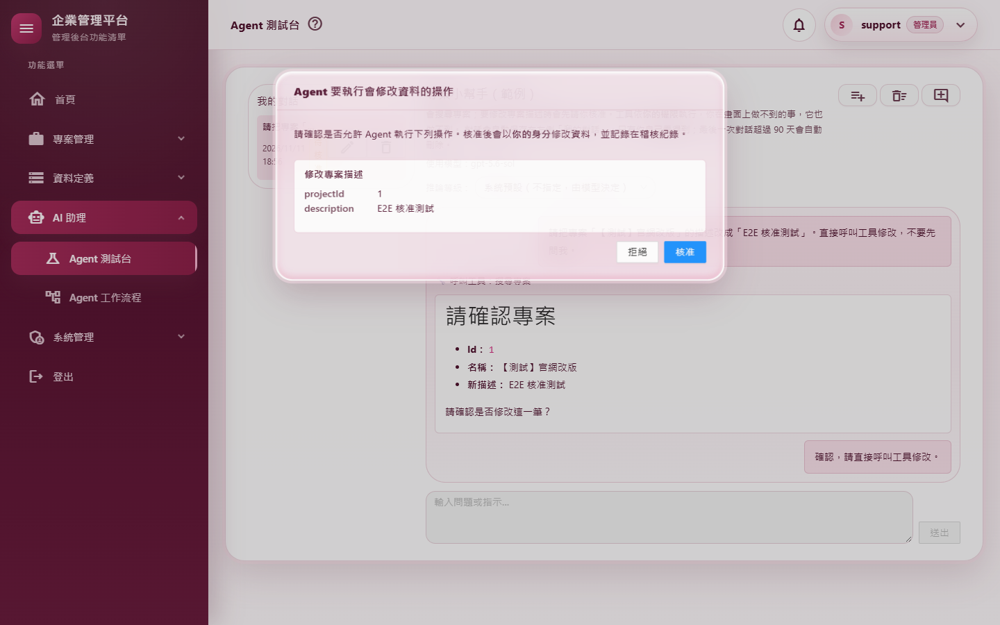
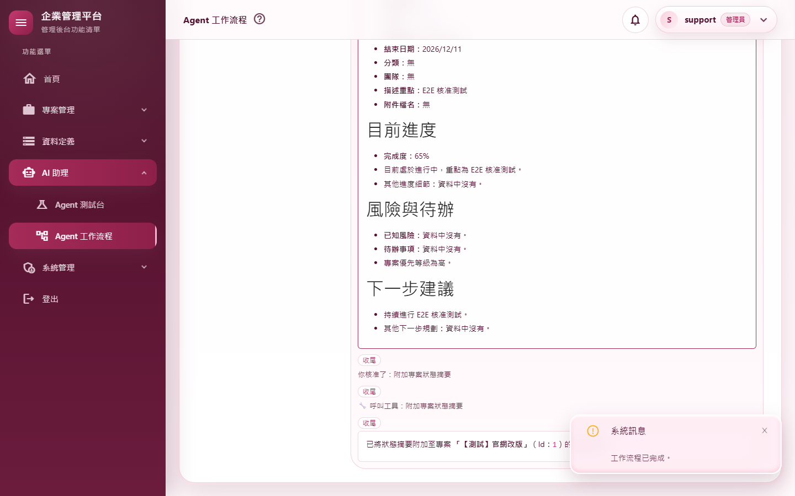
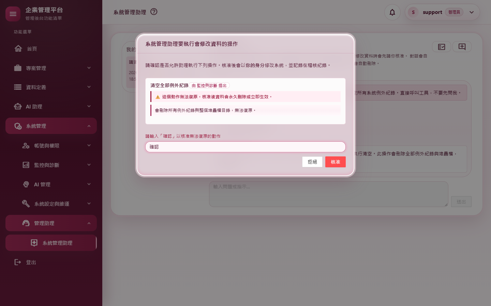
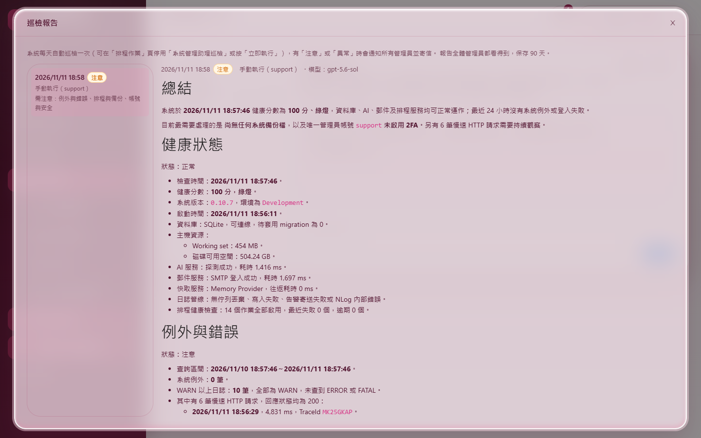
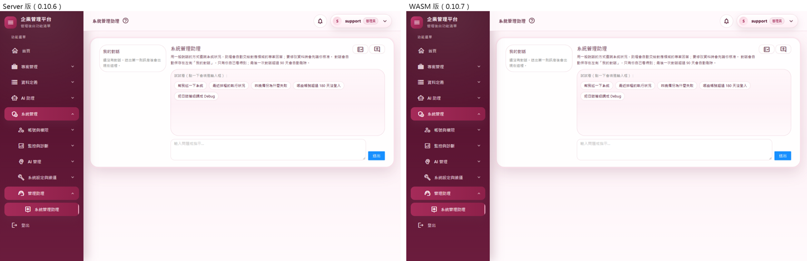

# M08 測試報告：Agent、系統管理助理與通知推播

- 里程碑：WASM 遷移 M8（計畫見 [WASM遷移計畫](../WASM遷移計畫.md)）
- 版本：0.10.6 → 0.10.7
- 測試日期：2026/11/11
- 分支：`feature/wasm-m08-agents`

## 摘要

| 項目 | 結果 |
|---|---|
| 範圍 | Agent 測試台（`/agent-playground`）、Agent 工作流程（`/agent-workflows`）、系統管理助理（`/admin-assistant`，含巡檢報告窗與深連結）改在 WebAssembly 執行，Server 版頁面刪除；Agent 對話每個請求接續已保存的對話、每段對話一把鎖、核准不重複執行；工作流程改由伺服器端執行登錄表保管；新增通知推播串流 |
| 授權方式 | 使用者在 2026/11/11 授權 M8～M10 連續完成，可自動 commit、合併、推送；真實模型實測已於 M6 取得同意 |
| 自動化測試 | 2,970 個全部通過（M7 結束時 2,885 個，淨增 85） |
| 品質關卡 | 7 步全部通過（結果見 A.3） |
| 實機驗證 | 真實模型 9 個情境＋關閉推播 1 個情境全部通過；全部 37 個路由煙霧測試全部通過（全新的隔離資料庫） |
| 外觀比對 | Server 版與 WASM 版 4 個畫面逐像素比對：2 個完全相同，其餘最多 11／255（24 個像素以內），肉眼無差異 |
| 實機發現 | 真實模型常會先回問「請確認是否要修改？」再呼叫寫入工具（不是程式問題，實機腳本改成回答「確認」後再等核准窗） |
| 獨立審查 | 5 項發現（2 中、3 低），全部修正並補測試 |
| 版本 | 0.10.6 → 0.10.7 |

---

## A.1 測試策略

| 層次 | 涵蓋什麼 | 工具 |
|---|---|---|
| 整合測試 | 真的主機與資料庫，上游模型換成劇本：對話串流的每一行與存檔、接續、2,000 字上限、等待核准時送訊息 409、同一核准送兩次只執行一次、兩分頁同時核准只執行一次、兩個請求排隊、不可復原沒有「確認」400、核准後沿用原本分派到的領域；工作流程開始 → 提問 → 換新 client 模擬重新整理接回 → 回答 → 審閱 → 核准 → 完成、別人 404、一人一次 409、閒置逾時釋放 scope；推播立即到達、別人的不推、斷線釋放訂閱與名額、Token 到期前結束、心跳 | `WebApplicationFactory` |
| 元件／單元測試 | 巡檢報告窗（bUnit）、推播連線的退避與重連、串流心跳、對話檔同時讀寫 | bUnit、xUnit |
| 回歸 | M7 結束時的 2,885 個測試（含 AiAgentRunner 29、AiWorkflowRunner 9、系統管理助理與工具約 170 個） | xUnit |
| 品質關卡 | 建置（Release）、格式、全部測試、文件編碼、CRUD 產生器錨點、弱點掃描 | `scripts/Invoke-QualityGate.ps1` |
| 實機驗證 | 真的網站（隔離資料庫）、真的 Chrome、**真實模型**：核准與拒絕、核准中重新整理、兩分頁排隊、工作流程人工介入、不可復原要輸入「確認」、巡檢報告連結、推播到達時間、關閉推播 | `scripts/Start-E2EHost.ps1`、`scripts/e2e/m08-agents.mjs`、`smoke-routes.mjs` |
| 外觀比對 | 三頁的初始畫面與巡檢報告窗，改版前後逐像素比對（對話內容是 AI 輸出，改由情境驗證） | `scripts/e2e/m08-views.mjs`＋Pillow |
| 獨立程式審查 | 未參與實作的審查者讀完整份變更 | 另一個 AI 審查代理（只讀） |

---

## A.2 自動化測試

### 新增的測試

| 測試類別 | 驗證的行為 |
|---|---|
| `AgentConversationApiTests`（新，22） | 串流各行順序與存檔、接續、2,000 字上限、推論等級；中斷連線後照樣存檔；**重新整理後待核准還在、等待核准時送訊息 409、同一核准送兩次只執行一次、兩分頁同時核准只執行一次、沒有待核准 409**；**兩個請求排隊而不是被拒**、執行中打開對話讀到上次存下的內容；**不可復原沒有「確認」400**、核准後沿用監控領域；非管理員與缺頁面權限 403（含權限拒絕稽核）；巡檢報告與深連結 404；時間不帶時差；稽核內容 |
| `AgentWorkflowApiTests`（新，17） | 完整流程：開始 → 提問 → **換新的 client 模擬重新整理後接回** → 回答 → 審閱 → 核准工具 → 完成，專案描述真的被改，稽核與模型呼叫都記在這個使用者身上；別人操作 404、一人一次 409、10 個端點無權限 403；**閒置逾時結束成中斷且 scope 已釋放**；停止、串流中斷線、放棄；驗證 400、重複回覆 409；紀錄清單、開啟、改名、刪除；時間不帶時差 |
| `NotificationPushApiTests`（新，19） | 沒登入 401；送通知立即推、另一分頁全部標為已讀也推、公告推、別人的不推；**斷線後訂閱與名額都釋放**；Token 到期前送 renew、滿最長時間送 reconnect、網站關閉送 reconnect；心跳；每人連線上限；關閉推播時端點 404 |
| `Client/ClientPushConnectionTests`（新，13） | 收到變動請對應區塊重讀、退避間隔、穩定後重置、renew 與 reconnect、短連線不迴圈、401/403/404 停止、429 退避、重連補讀 |
| `NdjsonHeartbeatTests`（新，3） | 資料源慢時插入 ping 且順序不變、快時不插、例外照樣丟出 |
| `AiAgentConversationFileStoreTests`（新，3） | 審查補測：**有人開著對話檔時寫入照樣成功、寫入端開著時讀取照樣成功** |
| `AiAgentRunnerTests`（＋2）、`AdminAssistantTurnPlannerTests`（＋2）、`AgentDtoMapperTests`（新，3） | 還原上次分派的那一輪、新增紀錄的通知、DTO 轉換 |

### 因改寫而調整的既有測試

| 測試 | 修改 | 理由 |
|---|---|---|
| `AdminPatrolReportsModalTests` | 改測 Client 版，用假的 HTTP 回應 | 巡檢報告窗搬到 WASM |
| `AdminPatrolNotificationTests` | 改讀 Client 路徑 | 同上 |
| `PageAuthorizationTests` | 掃描下限改為 1 | 呼叫登入檢查的 Server 元件只剩兩步驟驗證設定 |
| `LoggingConventionTests`、`LoggingPipelineHealthTests` | 新檔名的豁免；推播路徑不記慢請求 | 新檔案、長連線 |

---

## A.3 品質關卡

`pwsh ./scripts/Invoke-QualityGate.ps1`：

| 步驟 | 結果 | 秒數 |
|---|---|---|
| Restore | 通過 | 0.9 |
| Build（Release） | 通過（0 警告、0 錯誤） | 4.1 |
| Format | 通過（`dotnet format --verify-no-changes`） | 29.6 |
| Test | 通過（2,970 個） | 71.9 |
| Docs encoding | 通過（302 個檔案，`docs/` 與根目錄 `.md` 皆 UTF-8 含 BOM） | 0.1 |
| CRUD anchors | 通過 | 0.3 |
| Vulnerability | 通過（沒有已知弱點） | 8.0 |

---

## A.4 實機驗證

全新的隔離資料庫；support 的 Email 改成 `support@e2e.test`；AI 用 User Secrets 裡的真實模型（金鑰只在網站執行時讀取，沒有印出或寫進任何檔案）。

### 情境（`m08-agents.mjs`，真實模型）

| # | 情境 | 步驟 | 預期 | 實際結果 | 判定 |
|---|---|---|---|---|---|
| G1 | 測試台在 WASM | 開 `/agent-playground`、按「產生 10 筆測試專案」 | WASM、建立測試專案 | 建立 10 筆（第一筆「【測試】官網改版」） | 通過 |
| G2 | 寫入工具核准 | 要求把該專案描述改成「E2E 核准測試」；模型回問時回答「確認」；核准窗出現後按核准 | 核准窗列出工具與參數；核准後真的寫入；稽核一筆；網址帶對話 | 模型先回問 1 次；核准窗列出 projectId、description（截圖 01）；描述已改；`Ai.ToolInvoked`；網址有 `conversation=` | 通過 |
| G3 | 核准中重新整理 | 再要求改成「E2E 重新整理」，核准窗出現後重新整理頁面，按拒絕 | 回到同一段對話、核准窗再跳出；拒絕後不寫入 | 核准窗再跳出；拒絕後描述仍是「E2E 核准測試」；`Ai.ToolRejected` | 通過 |
| G4 | 兩分頁同時送出 | 兩個分頁開同一段對話，同時送出「只回覆甲」「只回覆乙」 | 後到的排隊，兩則都完成、都存在同一段對話裡 | 兩則都在對話裡，沒有互相覆蓋、沒有錯誤 | 通過 |
| G5 | 工作流程人工介入 | 執行「專案狀態報告」；第一次停下來等人時重新整理頁面；之後依序回答、審閱通過、核准收尾工具 | 重新整理後接回等待中的請求；最後收尾工具真的寫入專案 | 重新整理後接回 → 審閱通過 → 核准收尾工具；專案描述加上狀態摘要（截圖 02） | 通過 |
| G6 | 不可復原要輸入「確認」 | 系統管理助理：要求清空所有系統例外紀錄 | 核准鈕停用，輸入「確認」才可按（這次按拒絕） | 未輸入時停用、輸入後可按（截圖 03）；按拒絕，沒有清空 | 通過 |
| G7 | 巡檢報告連結 | 立即執行「排程巡檢」，等報告產生後開 `/admin-assistant?patrolReport={id}` | 直接打開那一份報告 | 報告窗打開（截圖 04） | 通過 |
| G8 | 推播 2 秒內到達 | 另一個瀏覽器的同一位使用者開著個人資料頁；管理員發送測試通知 | 鈴鐺 2 秒內更新 | **531 ms**（未讀 1 → 2）；開發中第一輪 550 ms | 通過 |
| G9 | 沒有錯誤 | G1～G8 期間收集頁面錯誤 | 沒有 | 0 個 | 通過 |
| N1 | 關閉推播仍可輪詢 | 另開主機（`NotificationSettings__PushEnabled=false`），同 G8 | 鈴鐺在 60 秒輪詢時更新 | 57 秒後由輪詢更新 | 通過 |

### 全部路由煙霧測試

37 個路由全部通過，三個新頁以 WebAssembly 顯示；登入後的頁面沒有被丟回登入頁或停在限流提示。

### 外觀比對

| 畫面 | 差異 |
|---|---|
| Agent 測試台 | 9 個像素、最多 7／255 |
| Agent 工作流程 | 完全相同 |
| 系統管理助理 | 24 個像素、最多 11／255 |
| 巡檢報告窗 | 完全相同 |

截圖 05 為系統管理助理的並排對照。

### 實機發現

- **真實模型會先回問再呼叫寫入工具**：第一輪的 G2、G3 等了 10 分鐘都沒有核准窗。查對話內容發現模型先找到專案，回覆「請確認是否要將描述改為……？確認後我會呼叫工具修改」。這是模型謹慎的行為，不是程式問題；實機腳本改成回問時回答「確認」，最多三輪。G5 的失敗是腳本以「描述有沒有變」判斷完成，受 G2 連帶影響，改成與開始時的描述比較。

### 伺服器日誌

最終一輪的錯誤共 3 筆，都是煙霧測試登出時的已知收尾時序問題（M01～M07 報告都已記錄）。三個新頁、推播與新 API 沒有任何錯誤。

---

## A.5 獨立審查

審查者讀完整份變更（未參與實作），逐項確認沒有問題的部分：別人的對話與執行一律當作找不到（IDOR）；核准編號必須在目前的待核准裡、加上鎖與搶占；「確認」由伺服器用目前工具定義判斷；等待核准時不能送訊息；每個端點都有權限標註、工具執行時再檢查一次權限、工作流程回覆時套用最新的使用者資料；巡檢報告只限管理員；鎖以參考計數清理；推播只訂閱自己的、名額一定歸還、重連有退避；本地時間都不帶時差。

### 修正的發現

| # | 嚴重度 | 發現 | 修正 | 補的測試 |
|---|---|---|---|---|
| 1 | 中 | 工作流程：另一個分頁接回來看一下就離開，會把第一個分頁正在跑的流程中斷；收到 409 時畫面停在舊的待回覆，再按「新的執行」一樣會中斷 | 離開頁面時只放棄這個分頁自己開始或回覆過的執行，而且伺服器在有別的請求正在使用時不放棄（`abandon?onlyIfIdle=true`）；收到 409 時重讀伺服器上的狀態 | — |
| 2 | 中低 | 對話內容檔在有人讀取時寫入可能失敗（Windows 共用衝突），資料庫的「待核准」旗標與內容檔不一致，對話永久卡死 | 讀寫都改成允許彼此同時開啟的共用模式，被短暫鎖住時重試 | `AiAgentConversationFileStoreTests`（先失敗） |
| 3 | 低 | 還在排隊（另一個分頁正在用這段對話）就按「停止產生」，畫面補上伺服器沒有存的紀錄 | 改為重讀伺服器上的對話（核准中的話核准窗也會回來） | — |
| 4 | 低 | 系統管理助理核准後那一輪收不到「由誰回答」標籤，停止後補的那則少了標示 | 每個請求至少送一次標籤 | — |
| 5 | 低 | 網站關閉時，工作流程登錄表在串流中途就釋放了 scope，那一輪存成「中斷」時可能失敗 | 先中斷、等收尾（最多 5 秒）再釋放 | — |

---

## A.6 設計決定與與 Server 版的差異

1. **對話每個請求接續一次**：伺服器每次先讀回已存檔的對話再執行，串流結束就存檔。重新整理、換裝置都能從左側清單或網址回到同一段對話。
2. **網址帶對話**（`?conversation=`）：重新整理回到同一段對話，停在核准的會再跳出核准窗。Server 版重新整理後要自己從清單點開。
3. **兩分頁同時操作同一段對話會排隊**：Server 版沒有鎖，可能互相覆蓋，同一筆核准也可能執行兩次。
4. **工作流程**：
   - 停在等人回覆時重新整理或關分頁，執行留在伺服器最多 30 分鐘，回到頁面自動接回（Server 版是中斷）。
   - 串流途中斷線仍中斷整個流程（同 Server 版，不在背景沒人看時繼續花 AI 費用）。
   - **一人同時只能有一次執行**：第二個分頁在第一個執行中按開始，會看到「已有執行中的流程」的提示。
5. **通知推播**：鈴鐺、公告橫幅、首頁「我的通知」改由推播串流幾乎即時更新（實測約 0.5 秒）；推播斷線或關閉時退回 60 秒輪詢。每位使用者最多 3 條推播連線，第 4 個分頁起只靠輪詢。
6. **停止產生之後**：請求已中斷，畫面照伺服器的寫法自己補上「已停止產生…」的紀錄（同 M6）。
7. **推論等級**：改成送出下一則訊息時才在伺服器套用（Server 版改下拉就立即重建 agent），效果相同。每個請求用當下系統參數的模型（Server 版開對話時就固定）。

---

## A.7 已知限制

- **工作流程只在單一行程有效**：IIS 回收、網站重啟或多台伺服器之間不共用執行登錄表；重啟後執行就沒了，紀錄停在最後一次存檔的內容。
- **跨行程同時送一般訊息**：鎖只在同一個行程內排隊；IIS 重疊回收的瞬間兩個行程同時寫同一段對話，後存的會蓋掉先存的（核准不受影響，靠資料庫條件式更新只會執行一次）。
- **推播與 HTTP/1.1**：本機以 http 開發時是 HTTP/1.1，瀏覽器每個網域只有 6 條連線；每人最多 3 條推播保留另外 3 條給一般 API。正式環境 IIS＋HTTPS 通常是 HTTP/2，不受影響。
- **強制登出與推播**：被強制登出或停用帳號後，推播連線最多再撐到重連（最長 30 分鐘），但只送「有變動」的訊號；下一次讀資料時就會被登出。
- **仍是 Server 版的頁面**：`/`、改密碼、兩步驟驗證設定、錯誤頁與登入相關頁，M9 搬遷。
- **伺服器日誌的收尾時序錯誤**：見 A.4，M10 後消失。

---

## A.8 截圖

| # | 內容 |
|---|---|
| 01 |  |
| 02 |  |
| 03 |  |
| 04 |  |
| 05 |  |

截圖中沒有個人 Email：隔離資料庫只有測試帳號，support 的 Email 已改成 `support@e2e.test`。AI 回覆是真實模型對測試資料的處理結果。
