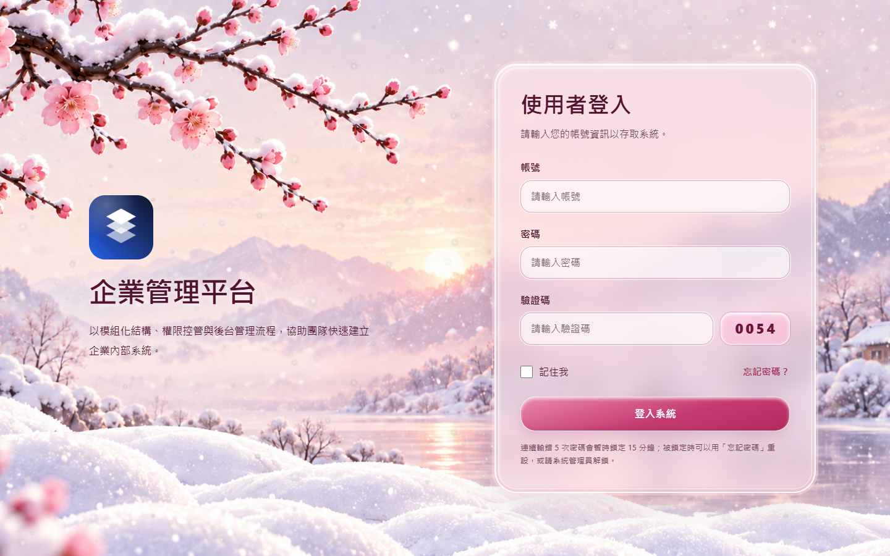
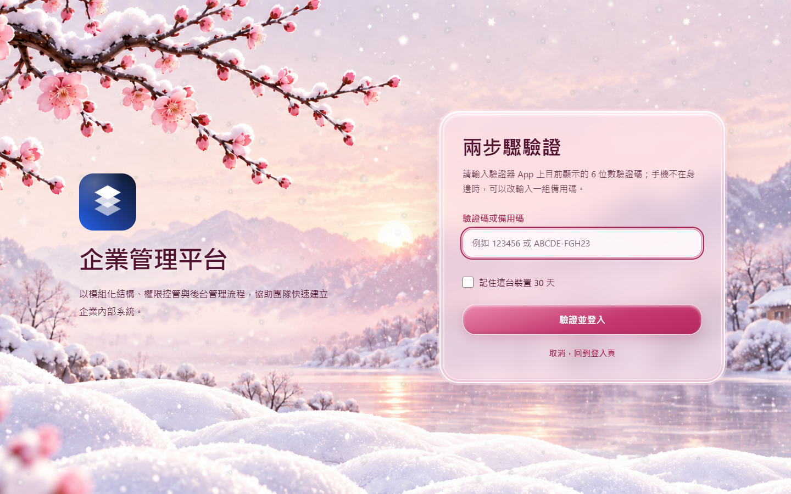
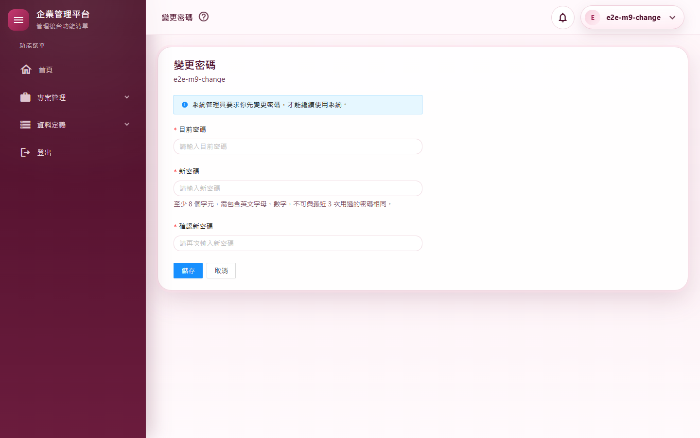
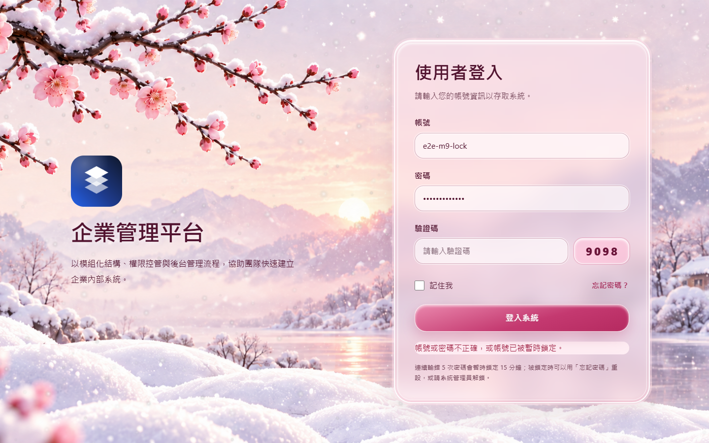
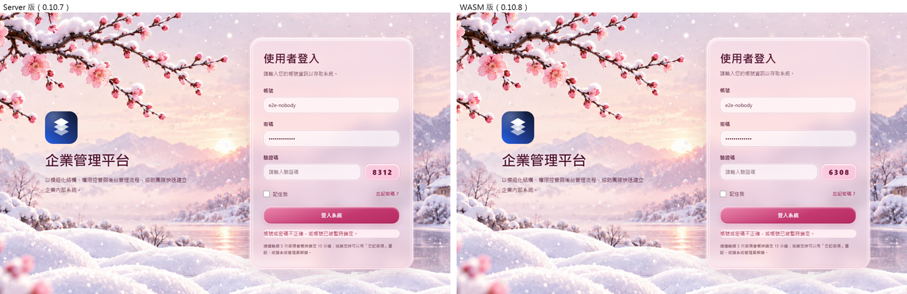

# M09 測試報告：純 Token 登入

- 里程碑：WASM 遷移 M9（計畫見 [WASM遷移計畫](../WASM遷移計畫.md)）
- 版本：0.10.7 → 0.10.8
- 測試日期：2026/11/11
- 分支：`feature/wasm-m09-token-login`

## 摘要

| 項目 | 結果 |
|---|---|
| 範圍 | 登入、兩步驟驗證、忘記／重設密碼、Google 待審、登出、變更密碼、兩步驟驗證設定、`/`、`/Error`、`/not-found` 搬到 WebAssembly；停發登入 Cookie（Cookie 驗證機制移除），移除 bridge 與換發 Cookie 的流程；新增網頁登入與帳號自助 API；所有頁面都在 WASM |
| 做法 | 同一個分支分兩段：9a（Cookie 照發，補 API、搬 5 個中性頁）→ 9b（真正切換），一次合併，版本照計畫 0.10.8 |
| 授權方式 | 使用者在 2026/11/11 授權 M8～M10 連續完成，可自動 commit、合併、推送 |
| 自動化測試 | 3,050 個全部通過（M8 結束時 2,970 個，淨增 80） |
| 品質關卡 | 7 步全部通過（結果見 A.3） |
| 實機驗證 | 登入 11 個情境全部通過；全部 36 個路由煙霧測試全部通過；M1、M2、M5 的情境腳本改成純 Token 後回歸全部通過 |
| 外觀比對 | Server 版與 WASM 版 10 個畫面：登入後的 4 個（強制改密碼、兩步驟驗證設定、找不到頁面、錯誤頁）完全相同；登入相關的 6 個頁面背景有飄雪動畫、驗證碼是亂數，像素差異來自這兩處，並排目視版面與文字相同（截圖 05） |
| 實機發現 | 限流在驗證之前（每人配額實際是每 IP），實機腳本一分鐘內登入超過 10 次就被擋（與獨立審查第 2 項相同，已修正） |
| 獨立審查 | 7 項發現（1 中高、2 中、4 低），全部修正，6 項補測試 |
| 版本 | 0.10.7 → 0.10.8 |

---

## A.1 測試策略

| 層次 | 涵蓋什麼 | 工具 |
|---|---|---|
| 整合測試 | 真的主機與資料庫：網頁登入（記住我、記住裝置、兩步驟待驗票證）、兩步驟完成、Google 一次性代碼兌換（一次、60 秒、綁定瀏覽器）、新分頁 fork、忘記／重設／變更密碼、兩步驟設定（設定票證、啟用回新 Token）、管理員改自己回 Token、沒有主要角色 403、強制設定期間業務 API 403、登出依登入撤銷每一串、重用撤銷整次登入、每人分區限流、登入配額範圍；頁面不可標 `[Authorize]`、未登入整頁請求只拿到空外殼 | `WebApplicationFactory` |
| 元件／單元測試 | 登入頁（`?reset=1`、`?sso=` 訊息）、WASM 工作階段（新分頁向已開分頁取得 Token、兩分頁同時刷新、storage 事件、登入廣播、匿名頁 401 不導回登入、強制設定不重複導頁）、效期設定與舊鍵相容 | bUnit、xUnit |
| 回歸 | M8 結束時的 2,970 個測試（停發 Cookie 而改寫的見 A.2） | xUnit |
| 品質關卡 | 建置（Release）、格式、全部測試、文件編碼、CRUD 產生器錨點、弱點掃描 | `scripts/Invoke-QualityGate.ps1` |
| 實機驗證 | 真的網站（隔離資料庫）、真的 Chrome、多分頁與多瀏覽器：記住我、新分頁、跨分頁登出、鎖定、兩步驟＋記住裝置（腳本以 TOTP 演算法產生驗證碼）、強制改密碼、忘記密碼信件（主機把信存成 .eml）、Token 重用、同時刷新 | `scripts/Start-E2EHost.ps1`、`scripts/e2e/m09-auth.mjs`、`smoke-routes.mjs`、m01／m02／m05 |
| 外觀比對 | 登入相關 6 頁＋登入後 4 頁，改版前後逐像素比對 | `scripts/e2e/m09-views.mjs`＋Pillow |
| 獨立程式審查 | 未參與實作的審查者以安全為重點讀完整份變更（並寫暫時測試實證） | 另一個 AI 審查代理（只讀） |

---

## A.2 自動化測試

### 新增與改寫的測試（重點）

| 測試類別 | 驗證的行為 |
|---|---|
| `AccountSelfServiceApiTests` 等 9a 新增的整合測試 | 登入頁設定（匿名、不算登入配額）；`login/web`：記住我的整串上限、沒勾的閒置上限、需要兩步驟時回待驗票證、必須設定兩步驟的帳號也能取得 Token；`two-factor`：票證只能成功一次、錯了可再試、記住裝置 Token 綁使用者與版本；`google/exchange`：一次性、60 秒、沒帶綁定值或綁定值不符被拒；`session/fork`：沿用登入識別與上限、已被換掉的舊 Token 不能 fork；忘記／重設／變更密碼（改密碼回新 Token、舊的一串失效）；兩步驟設定（金鑰確認前不進資料庫、啟用回備用碼與新 Token、停用）；管理員改自己回 Token；**沒有主要角色的網頁 Token 403**（先寫測試證明原本的缺口）；強制設定期間業務 API 403、外框 API 可用；新的匿名與敏感端點都在登入配額內（網頁登入、登入頁設定除外） |
| `PageAuthorizationTests`（改寫） | **頁面不可標 `[Authorize]`**、匿名白名單 9 頁、非匿名頁必須經外框閘門、外框在登入檢查通過前不渲染、**未登入的整頁請求只拿到空的 WASM 外殼** |
| `TokenApiIntegrationTests`、`SessionTests`、`TwoFactorTests`（改寫） | 刪除 bridge、換發 Cookie、待驗與記住裝置 Cookie 的測試；網頁登出撤銷每個分頁但不影響別的登入；超過寬限期重用舊 Token 整串撤銷 |
| `Client/ClientSessionTests`（改寫＋新增） | 新分頁向已開分頁取得 Token、沒人回應回登入頁、兩個分頁同時刷新不會被登出、storage 事件（被清掉回登入頁、換人重新載入、同人沿用）、匿名頁 401 不導回登入、已在強制設定頁不再導頁；審查補測：**登入廣播（另一人登入時改用新的登入、同一人不受影響）** |
| `RefreshTokenStoreTests`（＋2） | 審查補測：**重用時撤銷同一次網頁登入的每一串（含 fork 出來的）**、登出之後不能再 fork |
| `PerUserRateLimitTests`（新） | 審查補測：**一個人用完一般 API 配額，同一個位址的另一個人不受影響**（限流在驗證之後） |
| `SessionSettingsTests`（＋1） | 審查補測：舊的 `CookieSettings:SlidingExpiration=false` 對應到 `IdleTimeoutSliding=false`、有記警告 |
| `EmailPagesIntegrationTests`、`ErrorPageIntegrationTests`、登入頁元件測試 | 原本讀伺服器渲染的 HTML，改成 API 與主機回應標頭（重設密碼頁 `no-referrer`、`no-store`）與元件測試 |

---

## A.3 品質關卡

`pwsh ./scripts/Invoke-QualityGate.ps1`：

| 步驟 | 結果 | 秒數 |
|---|---|---|
| Restore | 通過 | 1.2 |
| Build（Release） | 通過（0 警告、0 錯誤） | 21.3 |
| Format | 通過（`dotnet format --verify-no-changes`） | 29.0 |
| Test | 通過（3,050 個） | 77.3 |
| Docs encoding | 通過（304 個檔案，`docs/` 與根目錄 `.md` 皆 UTF-8 含 BOM） | 0.1 |
| CRUD anchors | 通過 | 0.5 |
| Vulnerability | 通過（沒有已知弱點） | 21.3 |

合計 150.8 秒，`QUALITY GATE PASSED`。

---

## A.4 實機驗證

全新的隔離資料庫。測試主機把信件一律存成 .eml 到隔離資料夾（開發機的 User Secrets 可能設了真的 SMTP，0.10.8 起 `Start-E2EHost.ps1` 預設如此）。

### 登入情境（`m09-auth.mjs`）

| # | 情境 | 步驟 | 預期 | 實際結果 | 判定 |
|---|---|---|---|---|---|
| T1 | 沒有登入 Cookie | 勾「記住我」登入，查瀏覽器 Cookie 與 storage，整頁開 `/projects` | 沒有登入 Cookie、Token 在 localStorage、整頁開頁正常 | 只有 antiforgery Cookie；Token 在 localStorage；`/projects` 正常（截圖 01 為登入頁） | 通過 |
| T2 | 記住我：關掉重開 | 關掉所有分頁再開 `/App` | 仍維持登入 | 直接進入 | 通過 |
| T3 | 不記住我：新分頁與關閉 | 沒勾登入 → 開新分頁 → 關掉所有分頁再開 | 新分頁自動取得 Token（另開一串）；全部關掉後要重新登入 | 新分頁自動進入、刷新 Token 與原分頁不同；全部關掉後回登入頁 | 通過 |
| T4 | 跨分頁登出 | 兩個分頁登入中，在其中一個登出 | 兩個分頁都回登入頁；伺服器撤銷 | 兩個都回登入頁；撤銷原因 Logout | 通過 |
| T5 | 連錯 5 次鎖定 | 錯 5 次，第 6 次用正確密碼 | 仍然進不去；資料庫有鎖定時間；稽核 `Login.LockedOut` | 進不去（截圖 04）；鎖定 15 分鐘；稽核有 | 通過 |
| T6 | 兩步驟＋記住裝置 | 兩步驟設定頁：開始設定 → 讀金鑰 → 腳本算 TOTP → 啟用 → 備用碼 → 繼續（仍登入）→ 登出 → 登入要求驗證碼（截圖 02）並勾記住這台裝置 → 登出 → 再登入 | 啟用後維持登入；記住裝置後不用再輸入驗證碼 | 全程符合；登入稽核依序含 `mfa=totp`、`mfa=device` | 通過 |
| T7 | 強制改密碼無法繞過 | 被要求改密碼的帳號登入，以它的 Token 直接呼叫業務 API 與 `/me` | 業務 API 403 `PASSWORD_CHANGE_REQUIRED`；`/me` 200；改密碼頁不會一直重新載入 | 符合（截圖 03） | 通過 |
| T8 | 忘記密碼信件 | 忘記密碼頁送出 → 從 .eml 取出連結 → 重設 → 登入 | 登入頁提示「密碼已重設，請以新密碼登入。」、新密碼可登入 | 符合 | 通過 |
| T9 | Token 重用偵測 | 取出刷新 Token 刷新一次，等 32 秒（超過 30 秒寬限）再用舊的 | 401、整串撤銷、頁面被登出 | 401；撤銷原因 Reused；頁面回登入頁 | 通過 |
| T10 | 兩分頁同時刷新 | 兩個分頁登入中，把存取 Token 改成已到期，兩個同時重新載入 | 兩個都維持登入 | 都維持登入（Web Locks 排隊，第二個分頁沿用第一個換好的） | 通過 |
| T11 | Google 登入 | 開登入頁 | 設定齊備才顯示 Google 按鈕 | 開發機未設定 Google，按鈕不顯示；實際的 Google 登入需人工驗證，一次性代碼兌換由整合測試涵蓋 | 通過（有限制） |

### 回歸

- 36 個路由煙霧測試全部通過（`/Auths/RefreshSession` 已移除，37 → 36）。
- M1、M2、M5 的情境腳本改成純 Token 後：M1 11 項、M2 14 項、M5 13 項全部通過，每輪附帶的 36 路由煙霧也全部通過。
- 回歸時修正兩處腳本本身的問題（不影響程式）：
  - M2 與 M1 在同一個資料庫依序執行時，兩個腳本建同名的測試帳號而衝突。M2 改用自己的帳號 `e2e-m2-user`。
  - M2 的 W1b 原本要求「從快取整頁重新載入」比 W1「第一次進入（含下載）」的兩倍快。0.10.8 起登入頁就是 WASM，程式本體在登入時已經下載，W1 量到的其實是 WASM 內換頁（約 470 ms），比較的前提不成立。W1b 改成整頁重新載入在 5 秒內，實測 1,313 ms。

### 外觀比對

| 畫面 | 差異 |
|---|---|
| 登入、登入失敗、忘記密碼 | 背景飄雪動畫與亂數驗證碼不同；並排目視版面、文字、錯誤訊息相同（截圖 05） |
| 重設密碼（無效連結）、兩步驟驗證 | 背景飄雪動畫（最多 51／255、33／255） |
| Google 待審 | 最多 1／255，肉眼看不出 |
| 強制改密碼、兩步驟驗證設定、找不到頁面、錯誤頁 | 完全相同 |

### 實機發現

- **限流在驗證之前**：第一輪的 T3、T4、T6 失敗。原因是限流排在驗證之前，分區鍵讀不到使用者，全部依 IP 計算；腳本一分鐘內從同一個位址登入超過 10 次，新分頁取得 Token、登出、登入都被 429 擋下。獨立審查也發現同一個問題（第 2 項），修正後全部通過。
- **推播長連線讓「網路閒置」永遠等不到**：M8 之後每個 WASM 頁都有一條推播連線，實機腳本不可再用 `networkidle`，改等頁面元素。
- 腳本自身的錯誤（API 網址大小寫、依舊有 bridge 的假設）已一併修正，不影響程式。

---

## A.5 獨立審查

審查者以安全為重點讀完整份變更，並把建置輸出另放、寫暫時測試實證第 1、2 項。確認沒有問題的部分：伺服器已沒有可路由的 Server 頁面、整頁請求只回空的 WASM 外殼；Controller 預設要登入、新的匿名端點都合理；強制設定閘門；沒有主要角色 403；各票證以不同 Data Protection 用途加密並綁使用者與版本、待驗票證成功一次即作廢；Google 代碼只存雜湊、60 秒、先移除再驗、綁瀏覽器、`#code=` 兌換前就從網址拿掉；30 秒寬限與重用偵測；記住我上限在伺服器強制；2FA 錯誤計入鎖定；重設密碼頁不帶 Referer 不快取；Token 不進日誌與稽核。

### 修正的發現

| # | 嚴重度 | 發現 | 修正 | 補的測試 |
|---|---|---|---|---|
| 1 | 中高 | 偷到目前有效的刷新 Token 的人先以 `session/fork` 開一串自己的：fork 不輪替來源、受害者察覺不到，之後就算偵測到重用也只撤銷那一串，偷開的那串照常可用（已實證） | 偵測到重用時撤銷同一次網頁登入的每一串 | `Reuse_ShouldRevokeEveryFamilyOfTheSameWebLogin_IncludingForks` |
| 2 | 中 | 限流在驗證之前，已登入的「每人」配額實際是每 IP；網頁登入被算進每 IP 每分鐘 10 次（同一出口 IP 的公司早上會被擋）；fork 被擋會讓新分頁被導回登入頁（已實證） | 限流移到驗證之後；網頁登入照 Server 版不算嚴格登入配額（靠帳號鎖定，受一般 API 每 IP 配額） | `PerUserRateLimitTests`、登入配額範圍測試 |
| 3 | 中 | 舊設定 `CookieSettings:SlidingExpiration=false`（要的是 8 小時絕對上限）升級後被靜默忽略，變成永不到期 | 新增 `SessionSettings:IdleTimeoutSliding`，舊鍵相容並記警告 | `LegacySlidingExpirationFalse_…` |
| 4 | 低 | 同一個瀏覽器兩個分頁分別登入不同人（都沒勾記住我）時，新分頁可能拿到另一個人的 Token | 登入成功時廣播；顯示另一個人的分頁改用新的登入 —— 同一個瀏覽器只有一個身分（與 Server 版的 Cookie 相同） | `SignedInBroadcast_…` |
| 5 | 低 | fork 與登出同時發生時，新的那串可能沒被撤銷 | fork 後再確認來源沒被撤銷（被取代不算），否則作廢 | `Fork_AfterTheLoginWasRevoked_…` |
| 6 | 低 | 不再寫 `Login.SessionExpired`，個人資料的登入紀錄少了「其他地方變更了帳號，被登出」 | 刷新因工作階段版本換掉而失敗時補寫（同 Server 版內容） | — |
| 7 | 低 | 匿名頁發生未處理例外時，錯誤回報會觸發 401 而被導回登入頁 | 沒有登入時只留在瀏覽器主控台 | — |

---

## A.6 設計決定與與 Server 版的差異

1. **效期**：網頁登入勾「記住我」最長 30 天（從登入起算）；沒勾則 8 小時沒使用就要重新登入，關掉分頁也登出。存取 Token 15 分鐘。App 的 API 登入維持 `JwtSettings`。設定改在 `SessionSettings`，舊的 `CookieSettings` 鍵仍有效。
2. **登出立即生效**：存取 Token 帶這一串的識別，每個請求檢查是否已撤銷。Server 版的 Cookie 到期前一直有效。
3. **沒勾「記住我」時開新分頁**：新分頁向已開的分頁要，各自一串。Server 版是共用一個 Cookie。
4. **同一個瀏覽器只有一個身分**：在一個分頁換人登入，其他分頁也換成那個人（與 Server 版相同）。
5. **管理員改自己、改密碼、啟用或停用兩步驟驗證**：API 直接回新的 Token，不再經過換發登入的過場頁。
6. **頁面不再由伺服器擋未登入**：未登入時先載入 WASM 再導到登入頁（第一次開頁要先下載 WASM，冷啟動在 M12 量測）。
7. **錯誤頁**：正式環境頁面出錯改成導到 `/Error?trace=追蹤碼`。
8. **登入頁要等設定讀回才顯示**，送出期間按鈕停用。

---

## A.7 已知限制

- **Google 登入未實測**：開發機沒有 Google 設定，實際登入需人工驗證；一次性代碼兌換由整合測試涵蓋。Google Console 的回呼網址仍是 `/signin-google`。
- **票證與代碼的「已用過」記在單一行程的記憶體**（待驗票證、Google 代碼，與下載票證相同）：多台主機時要黏著同一台。
- **跨主機的撤銷**：同一台主機登出立即生效；多台主機時其他主機最晚 30 秒（這一串）或 5 分鐘（工作階段版本）。
- **升級後每個人要重新登入一次**：舊的登入 Cookie 不再被認得。
- **Token 存在瀏覽器 storage**：遷移開始時已決定（為了未來的 App）；XSS 的防線是 Markdown 消毒（M6 已補自動連結）與不輸出未消毒的 HTML。

---

## A.8 截圖

| # | 內容 |
|---|---|
| 01 |  |
| 02 |  |
| 03 |  |
| 04 |  |
| 05 |  |

截圖中沒有個人 Email：隔離資料庫只有測試帳號。
