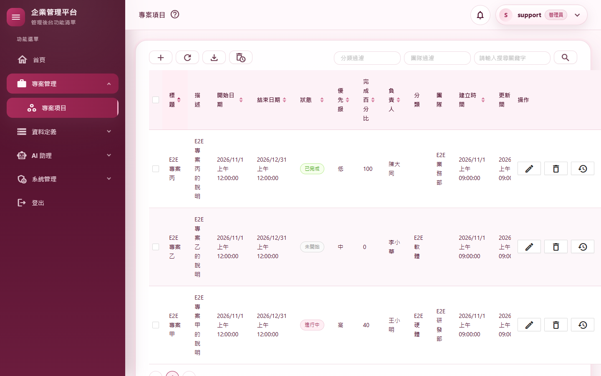
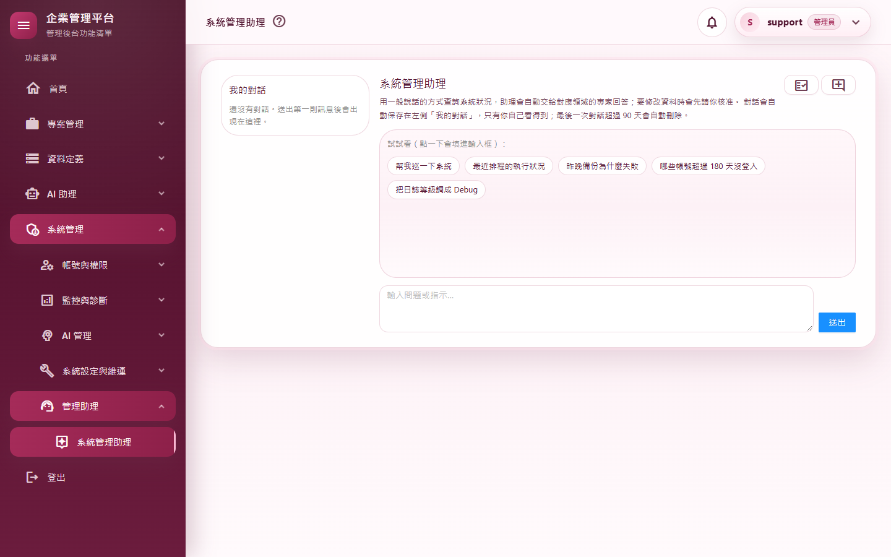
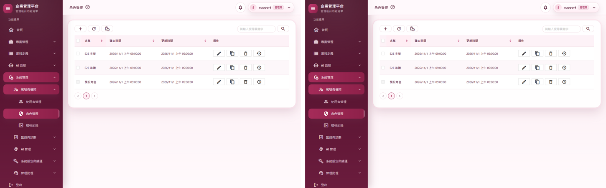

# M10 測試報告：移除 Server 模式

- 里程碑：WASM 遷移 M10（計畫見 [WASM遷移計畫](../WASM遷移計畫.md)）
- 版本：0.10.8 → 0.10.9
- 測試日期：2026/11/11
- 分支：`feature/wasm-m10-remove-server`

## 摘要

| 項目 | 結果 |
|---|---|
| 範圍 | `MyProject.Web` 拿掉 Blazor Server 互動模式（電路、SignalR `_blazor`、重連畫面、Server 版外框與元件、`AuthenticationStateHelper`、Server 版權限與稽核實作），Cookie 驗證的殘留分支一併移除；Web 只剩 API 主機、WASM 主機頁（`Components/App.razor`）與靜態檔 |
| 授權方式 | 使用者授權 M8～M10 連續完成（2026/11/11），之後再授權 M11、M12 一路做完，可自動 commit、合併、推送 |
| 程式變更 | 131 個檔案，新增 812 行、刪除 5,544 行（實作階段；另含審查修正） |
| 自動化測試 | 3,040 個全部通過（M9 結束時 3,050：刪除只測 Server 元件的 32 個，新增 22 個） |
| 品質關卡 | 7 步全部通過（結果見 A.3） |
| 實機驗證 | M10 情境 4 項＋36 路由煙霧全部通過；M9 登入 11 個情境、M2 外框 14 個情境回歸全部通過 |
| 外觀比對 | 移除前後 53 個畫面：42 個完全相同；其餘 11 個的差異都是資料（版本號、時間、檔案大小、隔離資料夾名稱、登入頁的飄雪動畫與亂數驗證碼），版面沒有變化 |
| 獨立審查 | 沒有會讓執行期壞掉或造成安全漏洞的缺陷；5 項發現（守門測試缺口 2、孤兒套件 1、過時註解與文件 1、M9 遺留的產生器範本 1）全部修正 |
| 使用者看得到的差異 | 沒有（Server 的重連提示畫面原本就只出現在 Server 頁面，M9 起已沒有 Server 頁面） |
| 版本 | 0.10.8 → 0.10.9 |

---

## A.1 測試策略

| 層次 | 涵蓋什麼 | 工具 |
|---|---|---|
| 新的守門測試 | 主機沒有 Server 互動模式：`/_blazor/negotiate` 不會成功、沒有註冊 `CircuitHandler`、主機組件只剩 `App` 且沒有 `@page`、`MyProject.Web` 原始檔不再提到 Server 模式（先寫、確認 4 個都失敗，再改程式） | xUnit、`WebApplicationFactory` |
| 改寫的守門測試 | 畫面慣例（對話窗、批次刪除、按鈕圖示、登出確認、鍵盤、轉場、表格預設排序、色票、操作說明、資料保留、AI 對話窗樣式、通知只經 ViewNotification）改成掃 Client，並斷言掃到的檔案數有下限 | xUnit＋`SourceTree.UiFiles` |
| 整合測試 | 目前使用者的載入規則（由 `AuthenticationStateHelperTests` 改寫成 `CurrentUserLoaderTests`）、通知「清除已讀」、稽核紀錄的歷史查詢 | `WebApplicationFactory` |
| 回歸 | M9 結束時的全部測試（扣掉只測 Server 元件的） | xUnit |
| 品質關卡 | 建置（Release）、格式、全部測試、文件編碼、CRUD 產生器錨點、弱點掃描 | `scripts/Invoke-QualityGate.ps1` |
| 實機驗證 | 真的網站（隔離資料庫）、真的 Chrome：整頁請求的 HTML、SignalR 端點、36 個路由全程監聽 WebSocket 與 `/_blazor` 請求、各頁以 WebAssembly 執行；M9、M2 情境回歸 | `scripts/e2e/m10-no-server.mjs`、`m09-auth.mjs`、`m02-shell.mjs` |
| 外觀比對 | M3～M9 的 53 個畫面，移除前後逐像素比對 | `scripts/e2e/m03～m09-views.mjs`＋Pillow |
| 獨立程式審查 | 未參與實作的審查者讀完整份變更，並在複本加回 Server 模式實證新守門測試抓得到 | 另一個 AI 審查代理（只讀） |

---

## A.2 自動化測試

### 新增

| 測試 | 驗證的行為 |
|---|---|
| `WasmOnlyHostTests`（4 個） | `BlazorServerHub_ShouldNotBeMapped`：`/_blazor/negotiate` 不成功；`CircuitHandlers_ShouldNotBeRegistered`；主機組件只剩 `App`、沒有 `@page` 元件；`WebSources_ShouldNotMentionServerMode`（掃描檔案數須超過 100）。審查者在複本加回 `AddInteractiveServerComponents`／`AddInteractiveServerRenderMode`，第一與第四個測試失敗 |
| `CurrentUserLoaderTests`（17 個） | 由 `AuthenticationStateHelperTests` 改寫：API 仍在用的目前使用者載入規則（停用、鎖定、工作階段版本、主要角色、權限資料讀不出來等） |
| `ShellApiIntegrationTests.NotificationSummary_HasRead_…`（1 個，審查補測） | 最新 10 則全部未讀、但更舊的有已讀時 `HasRead` 仍為真（0.9.136 的修正，原本只由 Server 版鈴鐺的元件測試守）。暫時把 `HasReadAsync` 改成只看最新 10 則，測試失敗，確認有效 |

### 刪除（32 個）與理由

| 測試 | 數量 | 理由 |
|---|---|---|
| `AuthenticationStateHelperTests` | 22 | 類別已刪；規則由 `CurrentUserLoaderTests` 逐條涵蓋（審查確認），導頁相關的規則已在 Client |
| Server 版鈴鐺與公告橫幅元件測試 | 4 | 元件已刪；訊號更新、刪除、清除已讀、公告關閉由 `ShellApiIntegrationTests` 涵蓋，「清除已讀」另補一個（見上） |
| Toast 理論列 | 3 | 測的是只存在於 Server 版 `ServerPagePermissions` 的「開發環境放行例外細節」規則，WASM 版只有管理員能複製 |
| `PageAuthorizationTests` | 2 | 只測 Server 外框 |
| 慢請求排除 `/_blazor/negotiate` 的測試列 | 1 | 端點已不存在 |

### 改寫

- `SourceTree.UiRoots` 只剩 Client，新增 `UiFiles()`（排除 bin、obj）。
- 審查指出：ButtonIcon、FormModal、LogoutConfirmation、ModalKeyboard、RazorTransition、TableDefaultSort 這幾條以前只掃 `Web/Components`，M2 起搬到 Client 的畫面其實都沒被檢查。這次改掃 Client 後才真正有作用。`TableDefaultSortConventionTests` 補上下限斷言。
- `ViewNotificationTests.Notifications_ShouldOnlyBeOpenedThroughViewNotification`（審查發現漏改）：原本只掃 `MyProject.Web`，改成掃 Client 並斷言檔案數。
- `FormModalConventionTests` 的 OverlayStyles／AntContainer 檢查改看 `ClientRoutes.razor` 與 `ClientErrorBoundary`。`SidebarLinkColorConventionTests` 改看 `ClientNavMenu.razor.css`。
- `MenuPermissionConsistencyTests` 只接受 WASM 的寫法。
- `RequestActorResolverTests` 改成「Cookie 形狀的身分不再被認得」。

---

## A.3 品質關卡

`pwsh ./scripts/Invoke-QualityGate.ps1`：

| 步驟 | 結果 | 秒數 |
|---|---|---|
| Restore | 通過 | 1.2 |
| Build（Release） | 通過（0 警告、0 錯誤） | 9.5 |
| Format | 通過（`dotnet format --verify-no-changes`） | 26.4 |
| Test | 通過（3,040 個） | 75.6 |
| Docs encoding | 通過（306 個檔案） | 0.1 |
| CRUD anchors | 通過 | 0.3 |
| Vulnerability | 通過（沒有已知弱點） | 20.9 |

合計 133.9 秒，`QUALITY GATE PASSED`。

---

## A.4 實機驗證

全新的隔離資料庫，信件一律存成 .eml 到隔離資料夾。

### M10 情境（`m10-no-server.mjs`）

同一支腳本先在移除前的程式跑一次當對照：

| # | 情境 | 預期 | 移除前 | 移除後 | 判定 |
|---|---|---|---|---|---|
| N1 | 以管理員開 30 個登入後路由、另開未登入視窗開 5 個登入相關路由、最後登出，全程監聽 | 沒有 WebSocket、沒有 `/_blazor` 請求 | 0 條、0 個（M9 起已沒有 Server 頁面） | 監聽 9,571 個請求：WebSocket 0 條、`/_blazor` 0 個 | 通過 |
| N2 | 直接請求 `/projects`、`/Auths/Login`、不存在的網址（不執行 JS），看回應的 HTML | 只有 WASM 外殼：有 `blazor.web.js` 與 WebAssembly 根元件標記，沒有 Server 根元件標記與重連畫面 | 有重連畫面（`ReconnectModal`） | 三個都符合；不存在的網址 HTTP 404、仍是 WASM 外殼（由 WASM 顯示找不到頁面） | 通過 |
| N3 | `POST /_blazor/negotiate` | 不成功 | HTTP 200（Server 互動模式還在） | HTTP 400（端點已不存在，請求落到主機頁、被防偽驗證擋下） | 通過 |
| N4 | 登入頁、登入後的 `/projects` | 都以 WebAssembly 執行 | 是 | 是 | 通過 |

36 路由煙霧測試（R01～R36）：移除前、移除後各一輪，全部通過。

### 回歸

| 腳本 | 結果 |
|---|---|
| `m09-auth.mjs`：記住我、新分頁、跨分頁登出、鎖定、TOTP＋記住裝置、強制改密碼、忘記密碼信件、Token 重用、兩分頁同時刷新、Google 未設定 | 11 項全部通過，附帶 36 路由煙霧全部通過 |
| `m02-shell.mjs`：外框、個人資料、通知鈴鐺、公告橫幅、換頁、斷線、登出、換人登入、強制改密碼、開頁稽核 | 14 項全部通過，附帶 36 路由煙霧全部通過 |

### 外觀比對（移除前後，53 個畫面）

| 來源 | 畫面數 | 完全相同 | 有差異的畫面與原因 |
|---|---|---|---|
| M3 分類與團隊 | 8 | 3 | 5 個最多 5／255、每張不到 2,400 個像素（反鋸齒） |
| M4 專案 | 5 | 5 | — |
| M5 使用者、角色、稽核、寄信 | 8 | 6 | 角色修改窗 8 個像素、稽核紀錄 6 個像素（反鋸齒） |
| M6 日誌與 AI 管理 | 9 | 9 | — |
| M7 維運與首頁 | 9 | 5 | 系統健康（版本、啟動時間、隔離資料夾名稱）、資料保留（Token 用量的時間與大小 469 B → 470 B）、首頁兩張（版本 0.10.8 → 0.10.9）；並排目視確認 |
| M8 Agent | 4 | 4 | — |
| M9 登入相關 | 10 | 4 | 6 個登入相關頁：背景飄雪動畫與亂數驗證碼（與 M9 相同） |

### 實機發現

- **M6 畫面腳本的日期欄位**：拍移除前基準時，`m06-views.mjs` 連續失敗在日誌頁的結束時間，與 M10 無關。原因有兩個：
  1. 開頁的第一次查詢會把起訖時間設成伺服器實際套用的值，太早填會被蓋掉。
  2. AntDesign 含時間的日期欄位，面板打開時的重新渲染會蓋掉直接 `fill` 的值，而按 Enter 確定時，同一頁第二個欄位會吃不進去。

  以除錯腳本確認：按面板的「確定」（真人的操作方式）兩個欄位都正常。腳本改成先等第一次查詢回來，等面板打開後用鍵盤逐字輸入，再按「確定」。程式不需修改。
- `smoke-routes.mjs` 的 `runSmoke` 多一個 `onContext` 選項，讓 M10 腳本能監聽每個瀏覽器內容的請求與 WebSocket。

---

## A.5 獨立審查

審查者讀完整份變更，以 `dotnet build`／`dotnet test` 驗證，並在複本加回 Server 模式，實證新守門測試抓得到退步。

確認沒有問題的部分：

- **已刪類別沒有遺留的執行期依賴**：程式碼已沒有參照被刪的類別；伺服器端沒有任何東西解析 `PagePermissions`、`IAuditHistorySource`、`CircuitHandler`（WASM 不預先渲染）。
- **靜態資源**：Web 移除 AntDesign 套件參考後，主機的靜態資源清單仍有 `_content/AntDesign`；`MyProject.Web.styles.css` 仍產生並匯入 Client 的樣式。
- **JS 互通**：互通名稱都對得上。
- **身分只認 JWT 是安全的**：`RequestActorResolver`、`HasPermissionAttribute` 改成只認 JWT，因為預設驗證機制是 JWT；Google 的外部 Cookie 只在回呼明確讀取。
- **其他路徑不受影響**：下載票證、NDJSON 串流、排程、防偽、限流順序、`/Error?trace=`、404 重跑都沒有依賴被刪的分支。
- **稽核與公告的搬移**：`AuditLogsController` 直接寫的兩筆歷史稽核與原本 Server 實作相同；公告挑選規則搬到 `AnnouncementCache` 後邏輯一致。

### 修正的發現

| # | 嚴重度 | 發現 | 修正 |
|---|---|---|---|
| 1 | 中 | 「通知只能經 ViewNotification 開」的守門測試只掃 `MyProject.Web`，畫面全在 Client，已經沒有作用 | 改掃 Client 並斷言檔案數超過 100 |
| 2 | 低 | 0.9.136「清除已讀」的規則失去測試保護（唯一的測試是被刪的 Server 鈴鐺元件測試） | 補 API 整合測試，並暫時改壞程式確認測試會失敗 |
| 3 | 低 | Business 專案留下只給 `AuthenticationStateHelper` 用的套件參考 `Microsoft.AspNetCore.Components.Authorization` | 移除（Client 仍參考，版本宣告保留） |
| 4 | 低 | 過時的註解與文件：CSP 註解仍寫 Blazor Server、兩處指向已刪的 `PageHelpDialog.razor.css`、`ProfileService` 註解提到 MainLayout；文件仍寫「允許時一般使用者也能複製例外細節」（WASM 版只有管理員，M9 起如此） | 註解改成現況；文件由文件同步一併修正 |
| 5 | 中（M9 遺留） | CRUD 產生器的頁面範本仍產生 `@attribute [Authorize]`：0.10.8 起整頁請求不帶 Token，產生的頁面重新整理會拿到 401，且會被 `PageAuthorizationTests` 擋下 | 範本拿掉 `[Authorize]`、註解改成現況 |

---

## A.6 設計決定

1. **主機頁 `App.razor` 保留到 M11**：一律渲染 `ClientRoutes`、`HeadOutlet` 也改成 WebAssembly、不預先渲染；M11 才換成獨立站台的 index.html。
2. **仍被 API 使用的類別暫留原資料夾**：`SidebarMenuService`、`PageHelpService` 等仍在 `Components/Layout`、`Components/Commons`，命名空間不變。這些類別給 `ShellController`、公告 API 使用；搬家會連帶改 CRUD 產生器錨點與文件，M11 移除 Razor 元件時一起搬。
3. **伺服器不再註冊 AntDesign**：主機頁是靜態渲染，不使用 AntDesign 元件；Web 移除 AntDesign、BlazorMaterialIcons 套件參考，AntDesign 語系只在 Client 設定。
4. **暫留且已知沒作用**：`CurrentUserService.Changed`（`ProfileService` 仍呼叫、有測試）、`CircuitDisconnect`、`BrowserErrorReporter` 的 `[JSInvokable]` 與每實例計數、`BlazorDisableThrowNavigationException`。保留它們是為了少動程式。設定鍵 `MaxPerCircuitPerMinute` 仍有作用：`ShellController` 用它當瀏覽器錯誤回報每人每分鐘的上限，只是鍵名沿用舊名，不改以免現有設定失效。

---

## A.7 已知限制

- 日誌的低價值路徑清單（`ApplicationBuilderExtensions`）仍列著 `/_blazor`（以 Debug 記錄），無害，M11 後端移除 Razor 元件時一併整理。
- `/_blazor/negotiate` 回 400 而不是 404：POST 落到主機頁的表單端點，被防偽驗證擋下。SignalR 端點已經不存在，M11 後端移除 Razor 元件後會變成 404。
- 冷啟動下載量與時間仍是開發模式的數字（未修剪、未壓縮），M11 記錄、M12 修剪後量測。

---

## A.8 截圖

| # | 內容 |
|---|---|
| 01 |  |
| 02 |  |
| 03 |  |

截圖中沒有個人 Email：隔離資料庫只有測試帳號。
