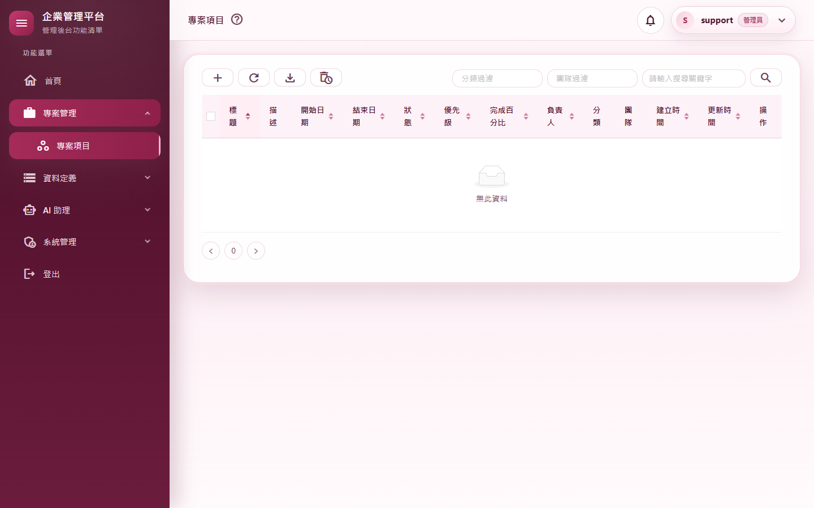
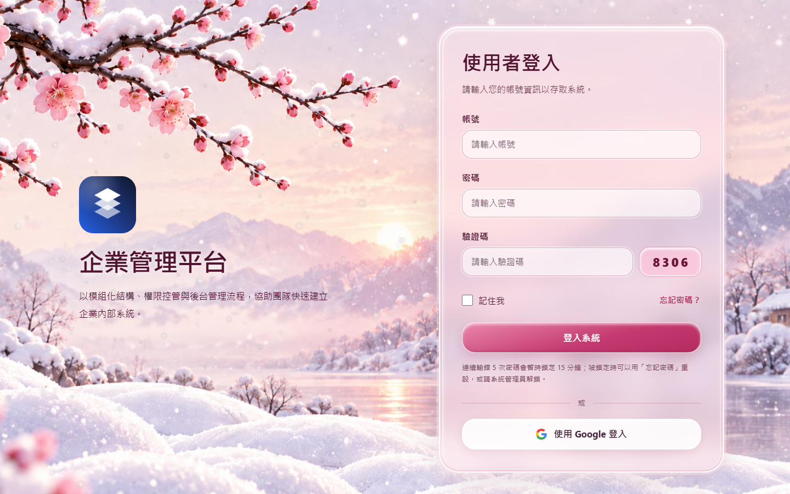

# M11 測試報告：獨立靜態站台＋API 主機

- 里程碑：WASM 遷移 M11（計畫見 [WASM遷移計畫](../WASM遷移計畫.md)）
- 版本：0.10.9 → 0.10.10
- 測試日期：2026/11/13
- 分支：`feature/wasm-m11-split-hosts`

## 摘要

| 項目 | 結果 |
|---|---|
| 範圍 | 前端 `MyProject.Web.Client` 成為獨立的 WebAssembly 靜態網站（`wwwroot/index.html`、`wwwroot/appsettings.json` 的 `ApiBaseUrl`、靜態站 `web.config`）；靜態檔從 `MyProject.Web/wwwroot` 搬到前端；後端移除 Razor 元件（`App.razor`），只剩 API；新增 `ClientSettings:BaseUrl` 切換同站台（API 主機一併提供前端）與雙站台（前端與 API 各一個站台，CORS、Google 導回、信中連結都指向前端） |
| 授權方式 | 使用者授權 M8～M12 一路做完（2026/11/11 授權 M11、M12，2026/11/13「把所有未完成的一次做完」），可自動 commit、合併、推送 |
| 自動化測試 | 3,098 個全部通過（M10 結束時 3,040） |
| 品質關卡 | 7 步全部通過（結果見 A.3） |
| 實機驗證 | 雙站台：M11 情境 7 項、M4 專案與附件 20 項、M9 登入 11 項，各附 36 路由煙霧，全部通過；同站台：M11 情境 4 項、M4 19 項、M9 11 項，各附 36 路由煙霧，全部通過 |
| 冷啟動 | 正式發佈（Brotli）：第一次開登入頁 1.3 秒、`_framework` 69 個檔傳輸 4.3 MB（解壓後 16.0 MB）；第二次（有快取）1.1 秒、幾乎不傳輸。開發模式（同站台、未修剪未壓縮）30.1 MB |
| 外觀比對 | M3～M9 的 53 個畫面與 M10 比對：34 個完全相同；其餘的差異都是資料（版本號與日期、排程的下次執行時間、登入頁的飄雪動畫與亂數驗證碼）或次像素（最多 17／255、每張不到 2,400 個像素），版面沒有變化 |
| 獨立審查 | 6 項（1 高、3 中、2 低），全部修正：重複發佈失敗（高）、`-r` 發佈失敗、雙站台下載變整頁導覽、404 被長期快取、靜態站沒有 HSTS、部署手改的值被重新發佈蓋掉 |
| 實機發現 | AntDesign 頁籤的行內事件被 CSP 擋（無功能影響，記為已知）；實機腳本的截圖曾露出開發機的個人信箱（已改腳本，報告不使用該圖） |
| 使用者看得到的差異 | 沒有（畫面與操作不變）。雙站台下載失敗時改為顯示錯誤通知、留在原頁 |
| 版本 | 0.10.9 → 0.10.10 |

---

## A.1 測試策略

| 層次 | 涵蓋什麼 | 工具 |
|---|---|---|
| 整合測試 | 同站台（`SameSiteHostTests`）：深層網址回 index.html、`/api` 找不到 404 `ApiResult`、`_framework` 找不到 404、安全標頭與 CSP、重設密碼頁標頭、沒有 CORS 標頭；雙站台（`DualSiteHostTests`）：允許來源有 CORS 標頭、非允許來源沒有、預檢、非 API 路徑 404、Google 回呼導向設定的前端網址、重設密碼信件連結用前端網址、錯誤設定啟動失敗 | `WebApplicationFactory` |
| 守門測試 | 主機沒有 Razor 元件（`ApiOnlyHostTests`）；index.html 樣式順序（theme.css 在 AntDesign 之後）；靜態站 web.config 的 SPA 回退、Brotli、MIME、快取（只有 200 才長期快取）、安全標頭（含 HSTS）、CSP、重設密碼頁（`StaticSiteWebConfigTests`）；前端所有導到伺服器的網址都經 `ApiAddress`（`ServerUrlConventionTests`） | xUnit |
| 前端單元測試 | `ApiBaseUrl` 空值與有值時的 API 網址、上傳與下載交給瀏覽器的是完整的 API 網址、下載失敗回伺服器訊息（`ApiAddressTests`） | bUnit |
| 發佈 | 前端與 Web 各連續發佈兩次到同一個資料夾；Web 帶 `-r win-x64`；前端帶與不帶 `StaticSiteApiOrigin` 交替發佈，檢查 `appsettings.json` 與 `connect-src` | `dotnet publish` |
| 品質關卡 | 建置（Release）、格式、全部測試、文件編碼、CRUD 產生器錨點、弱點掃描 | `scripts/Invoke-QualityGate.ps1` |
| 實機驗證 | 雙站台：前端發佈成靜態檔（`-p:StaticSiteApiOrigin`）由靜態站提供，API 主機 `ClientSettings__BaseUrl` 指向前端；同站台：API 主機一併提供前端 | `scripts/e2e/m11-split.mjs`、`m04-projects.mjs`、`m09-auth.mjs`＋Playwright＋本機 Chrome |
| 外觀比對 | 53 個畫面與 M10 逐像素比對 | `scripts/e2e/m03～m09-views.mjs`＋Pillow |
| 獨立程式審查 | 未參與實作的審查者讀完整份變更，實際執行多種發佈方式重現問題 | 另一個 AI 審查代理（只讀） |

---

## A.2 自動化測試

| 測試 | 驗證的行為 |
|---|---|
| `SameSiteHostTests`（新） | 同站台的回退、404、標頭、CSP（主機執行時從 index.html 算 import map 的雜湊）、沒有 CORS |
| `DualSiteHostTests`（新） | 雙站台的 CORS（允許與拒絕、預檢、不帶憑證、公開 Content-Disposition）、非 API 404、Google 導回與信中連結用 `ClientSettings:BaseUrl`、錯誤設定不啟動 |
| `StaticSiteWebConfigTests`（新，審查後補兩條） | 規則順序與條件、MIME、快取、安全標頭、CSP 佔位、重設密碼頁；審查補：帶指紋檔案的長期快取只套用在 200、HSTS |
| `ApiOnlyHostTests`（由 M10 的 `WasmOnlyHostTests` 改寫） | 主機沒有 Razor 元件、沒有 `@page`、沒有 Server 模式 |
| `Client/ApiAddressTests`（新，審查後補一條） | `ApiBaseUrl` 解析與錯誤設定；`BrowserFiles` 交給瀏覽器的是 API 主機的完整網址；審查補：下載失敗時回伺服器的訊息（先寫測試、看到編譯失敗再實作） |
| `Client/ServerUrlConventionTests`（新） | 前端不得有沒經過 `ApiAddress` 的伺服器端點導覽 |
| `ThemeConventionTests` 等（改寫） | 色票來源與樣式順序改查 `MyProject.Web.Client/wwwroot/theme.css` 與 index.html |

測試數：3,040 → 3,098。

---

## A.3 品質關卡

`pwsh ./scripts/Invoke-QualityGate.ps1`：

| 步驟 | 結果 | 秒數 |
|---|---|---|
| Restore | 通過 | 1.2 |
| Build（Release） | 通過（0 警告、0 錯誤） | 18.2 |
| Format | 通過（`dotnet format --verify-no-changes`） | 33.6 |
| Test | 通過（3,098 個） | 88.2 |
| Docs encoding | 通過（308 個檔案） | 0.1 |
| CRUD anchors | 通過 | 0.4 |
| Vulnerability | 通過（沒有已知弱點） | 21.8 |

合計 163.7 秒，`QUALITY GATE PASSED`。

另外：實作者跑過 `scripts/Test-CrudGenerator.ps1`（建置、格式、3,144 個測試、文件編碼通過；實跑頁面那一步需要 Playwright 環境變數，未執行）。

---

## A.4 實機驗證

### 環境

- **雙站台**
  - 前端以 `dotnet publish src/MyProject/MyProject.Web.Client -c Release -p:StaticSiteApiOrigin=https://localhost:7144` 發佈（文件寫的部署方式），在 `http://localhost:7145` 提供。
  - API 主機在 `https://localhost:7144`，`ClientSettings__BaseUrl=http://localhost:7145/`。
  - 腳本以 `E2E_BASE_URL`（前端）、`E2E_API_URL`（API）區分兩個網址；`/api` 請求一律打到 API 主機，實際經過 CORS。
- **靜態站的提供方式**：這台開發機的 IIS Express 無法啟動，連 IIS Express 內建的範本設定檔都讀不到（「無法讀取設定檔案：redirection.config」），是開發機本身的問題。實機改用一個照 web.config 規則寫的 Node 模擬站台：
  - 規則：`wwwroot` 實體檔、`.br` 預壓縮、`_framework` 找不到回 404、SPA 回退、快取標頭、重設密碼頁的標頭。
  - 安全標頭與 CSP 直接讀發佈出來的 web.config。
  - 所以 CSP（含發佈時填入的 import map 雜湊與 `connect-src`）在真的瀏覽器裡是實測的。web.config 的 IIS 規則本身由 `StaticSiteWebConfigTests` 守門，部署清單已加「上線前在真的 IIS 驗證一次」。
- **同站台**：API 主機一併提供前端（`scripts/Start-E2EHost.ps1`，開發模式）。

### M11 情境（`m11-split.mjs`）

| # | 情境 | 雙站台結果 | 同站台結果 | 判定 |
|---|---|---|---|---|
| S1 | 登入後開 `/projects`、`/myusers`、`/Profile`，記錄所有 `/api` 請求的來源 | 全部打到 `https://localhost:7144`；落在前端網址的 `/api` 請求 0 個 | 全部在同一個網址 | 通過 |
| S2 | CORS：允許的來源與非允許的來源（`http://evil.e2e.test`），GET 與預檢；再從假的來源頁面以瀏覽器呼叫 API | 允許來源：`Access-Control-Allow-Origin=http://localhost:7145`，預檢 204、允許標頭 `Authorization,Content-Type`；非允許來源：沒有 ACAO（GET 200、預檢 204）；瀏覽器實際擋下（Failed to fetch）；不帶 `Allow-Credentials` | — | 通過 |
| S3 | 靜態站回應：深層網址、安全標頭與 CSP、快取、Brotli、重設密碼頁、`appsettings.json` | `/projects` 回 index.html（200）；CSP 含 `'wasm-unsafe-eval'`、import map 雜湊與 `connect-src 'self' https://localhost:7144`；`nosniff`、`DENY`、`strict-origin-when-cross-origin`；index.html `no-cache`；重設密碼頁 `no-referrer`＋`no-store`；`_framework` 的 wasm／js 68 個全部 br；`ApiBaseUrl=https://localhost:7144/` | 同樣的標頭與 CSP（`connect-src 'self'`） | 通過 |
| S4 | 雙站台時 API 主機不提供前端 | `GET /projects`、`GET /` 都是 404 | — | 通過 |
| S5 | Google 登入（以假的用戶端設定讓按鈕出現；瀏覽器在導往 API 主機那一步停下，不真的連到 Google） | 按鈕導到 `https://localhost:7144/Auths/Google/Login?binding=…`；API 回 302 到 `accounts.google.com`，回呼網址 `https://localhost:7144/signin-google` | — | 通過 |
| S6 | 冷啟動（全新瀏覽器、無快取）開登入頁到表單出現 | 1,263 ms、`_framework` 69 個檔、傳輸 4.3 MB（解壓後 16.0 MB）；第二次 1,059 ms、傳輸 0.0 MB | 開發模式 1,187 ms、219 個檔、傳輸 30.1 MB；第二次 0.1 MB | 記錄 |
| S7 | 36 個路由沒有 CSP 違規（以 `securitypolicyviolation` 事件收集，含違規元素） | 沒有（已知排除：AntDesign 頁籤的 `ondragover` 23 則） | 同左 | 通過 |

36 路由煙霧測試在兩種模式下都全部通過。

### 回歸

| 腳本 | 雙站台 | 同站台 |
|---|---|---|
| `m04-projects.mjs`：附件上傳（multipart 跨來源）、下載內容一致、票證只能用一次、移除與新增附件、版本衝突、權限等 | 20 項全部通過；下載走 fetch＋blob，票證網址在 API 主機；**P2b（新）**：下載回 410 時顯示「下載連結已失效，請重新下載。」、仍在 `/projects`、修改窗還開著 | 19 項全部通過（P2b 只在雙站台）；下載走原生 `<a download>` |
| `m09-auth.mjs`：記住我、新分頁、跨分頁登出、鎖定、TOTP＋記住裝置、強制改密碼、**忘記密碼信件連結指向前端**、Token 重用、兩分頁同時刷新、Google 未設定 | 11 項全部通過；信中連結是 `http://localhost:7145/Auths/ResetPassword?token=…` | 11 項全部通過 |

### 外觀比對（53 個畫面，M10 → M11）

| 來源 | 完全相同 | 差異 |
|---|---|---|
| M3 分類與團隊（8） | 6 | 2 個最多 1／255（反鋸齒） |
| M4 專案（5） | 5 | — |
| M5 使用者、角色、稽核、寄信（8） | 4 | 4 個最多 17／255、每張 3～57 個像素（反鋸齒） |
| M6 日誌與 AI 管理（9） | 7 | 2 個最多 8／255（反鋸齒） |
| M7 維運與首頁（9） | 3 | 排程作業的下次執行時間（日期往後兩天）、系統健康（版本、時間、隔離資料夾）、系統備份與資料保留的時間、首頁的版本「0.10.10 (2026/11/13)」；並排目視確認 |
| M8 Agent（4） | 4 | — |
| M9 登入相關（10） | 5 | 登入、登入失敗、忘記密碼、重設密碼無效連結、Google 待審：飄雪動畫與亂數驗證碼 |

### 實機發現

- **AntDesign 頁籤的行內事件被 CSP 擋**：Token 用量頁、提示詞頁的頁籤帶 `ondragover="event.preventDefault();"`，是 AntDesign 支援拖曳頁籤用的。本專案頁籤不開放拖曳，點選走 Blazor 事件，所以被擋不影響功能，只會在主控台留訊息。刻意不為此加 `'unsafe-hashes'`（放寬 CSP），記為已知；S7 以元素層級的事件精確排除這一種。
- **實機腳本的截圖露出開發機設定的個人信箱**（個人資料頁）：M11 腳本沒有像其他畫面腳本一樣先把隔離資料庫 support 的 Email 換成測試地址。已補上；本報告不使用那張截圖。
- **Playwright 攔不到重新導向後的請求**：S5 第一版讓瀏覽器真的連到 Google（假的用戶端編號，Google 回錯誤頁，沒有送出任何機密）。改成在導往 API 主機那一步停下，由腳本直接讀 302 的目的地。
- **IIS Express 在這台開發機無法啟動**（見上方「環境」）。

---

## A.5 獨立審查

審查者讀完整份變更，實際執行多種 `dotnet publish` 重現問題。確認沒有問題的部分：

- **CORS**：完整來源比對、不帶憑證、方法與標頭和前端一致；實際請求的 CORS 標頭在 401、429 也帶得到；預檢之外的請求照常經過驗證與限流。
- **導向與信件**：Google 回呼、錯誤導頁只用設定值；`returnUrl` 仍經檢查；信中連結不採用 Host header。
- **同站台回退**：不會吃掉 `/api`、`/_framework`、`/signin-google`、`/swagger`、`/health`，POST 與 OPTIONS 不回 index.html。
- **web.config**：規則順序正確，沒有會讓 IIS 回 500 的寫法。
- **前端網址**：HttpClient、上傳、下載、Google、串流、推播、錯誤回報都經過 `ApiAddress`。
- **守門測試與產生器**：都有下限斷言；CRUD 產生器的新錨點正確。

### 修正的發現

| # | 嚴重度 | 發現 | 修正 | 驗證 |
|---|---|---|---|---|
| 1 | 高 | 同一個輸出資料夾第二次發佈必定失敗（前端與 Web 都會；Web 的補救步驟固定發佈到同一個中繼資料夾，同站台每次都中）：第一次發佈後輸出的 web.config 佔位已被換掉 | 雜湊一律從專案裡的 web.config 範本讀、寫到輸出 | 前端、Web 各連續發佈兩次成功 |
| 2 | 中 | Web 的補救步驟把外層的 `-r win-x64`、發行設定檔等帶進前端發佈，前端發佈失敗 | `RemoveProperties` 拿掉 RuntimeIdentifier、SelfContained、PublishProfile 等 | `dotnet publish -r win-x64 --self-contained false` 連續兩次成功 |
| 3 | 中 | 雙站台時瀏覽器忽略跨來源 `<a download>` 的下載屬性而整頁導過去（M4 的「AntDesign 表格整頁空白」會回來）；票證失效時整個前端換成 API 的 JSON 頁 | 跨來源改由 JS 以 fetch 取回、blob 網址存檔（檔案在瀏覽器記憶體、不經過 WASM）；失敗回伺服器的訊息，畫面顯示錯誤通知、留在原頁；同一個網址照舊原生下載 | 補測試；實機 P2、P2b 通過 |
| 4 | 中 | 帶指紋的 `_framework` 檔案即使是 404 也被快取一年（部署途中缺檔時，該使用者在清除快取前都載不到前端） | 長期快取的條件加上回應狀態 200 | 補測試 |
| 5 | 低 | 靜態站沒有 HSTS（Token 存在前端網址的 storage） | 加 `Strict-Transport-Security: max-age=2592000`（與 API 主機的 `UseHsts` 相同） | 補測試；實機 S3 |
| 6 | 低 | 雙站台部署時手改輸出裡的 `ApiBaseUrl` 與 `connect-src`，下次發佈會被蓋回空白，所有 API 呼叫被 CSP 擋下 | 新增發佈參數 `-p:StaticSiteApiOrigin=…`，發佈時同時填入兩處；兩處一律從範本重寫，不帶參數時回到空白 | 交替發佈檢查；實機雙站台即以此參數發佈 |

---

## A.6 設計決定與與計畫的差異

1. **同站台＝API 主機直接提供前端，不用反向代理**：計畫原寫「同站台反向代理」。改成這樣不必另裝 ARR，開發、實機測試、單一站台部署都只要一個主機。雙站台＝兩個 IIS 站台。
2. **`ClientSettings:BaseUrl` 一個鍵切換兩種模式**：留空是同站台；有值是雙站台，CORS、Google 導回、信中連結、非 API 例外導頁都用它。信中連結以 PostConfigure 讓它蓋過 `EmailSettings:PublicBaseUrl`。既有的 `Cors:AllowedOrigins` 保留並合併。
3. **SPA 回退做成中介軟體**（沒有端點時才回 index.html），不用 `MapFallback` 端點，否則 API 的錯誤狀態碼會改變。
4. **CSP**：`script-src 'self' 'wasm-unsafe-eval' 'sha256-<import map>'`，`style-src` 含 `'unsafe-inline'`（AntDesign 注入行內樣式），`img-src` 含 `data:`（兩步驟驗證 QR）。import map 雜湊每次建置不同：同站台由主機執行時計算，靜態站在發佈時寫進 web.config。
5. **同站台發佈的補救步驟**：Web 發佈時從參考專案帶進來的 index.html 沒有處理過（import map 空白），所以再發佈一次前端到中繼資料夾，用它的 index.html 覆蓋並逐一確認引用的檔案都在。代價是多一次前端發佈的時間。
6. **版本日期**：0.10.10 (2026/11/13)。
7. **複刻腳本**：前端沒有自己的開發主機，`New-StarterProject.ps1` 只把 `.html` 加進文字取代範圍，沒有「處理兩個主機」的額外工作。
8. **M7 遺留**：CRUD 產生器沒把新模組登記進資料保留種類的測試清單，實作時發現並補上。

---

## A.7 已知限制

- **web.config 的 IIS 規則沒有在真的 IIS 實測**（這台 IIS Express 無法啟動）：規則由守門測試檢查，實機以照規則寫的模擬站台驗證；上線前要在真的 IIS（需 URL Rewrite 模組）驗證一次，部署清單已列。
- **雙站台下載大檔**：檔案先完整下載到瀏覽器記憶體再存檔（不經過 WASM）；備份檔很大時比原生下載吃記憶體。同站台照舊原生下載。
- **同站台不可在部署後修改 `wwwroot/appsettings.json`**：以建置時的清單為準；同站台本來就不需要改（`ApiBaseUrl` 空白）。
- **靜態站的「找不到頁面」回 200**（SPA 回退），由前端路由顯示找不到頁面。
- **AntDesign 頁籤的 CSP 主控台訊息**（見實機發現）。
- 開發模式（同站台、`dotnet run`）的下載量 30 MB；正式發佈 4.3 MB。修剪與延遲載入在 M12。

---

## A.8 截圖

| # | 內容 |
|---|---|
| 01 |  |
| 02 |  |

截圖中沒有個人 Email。
