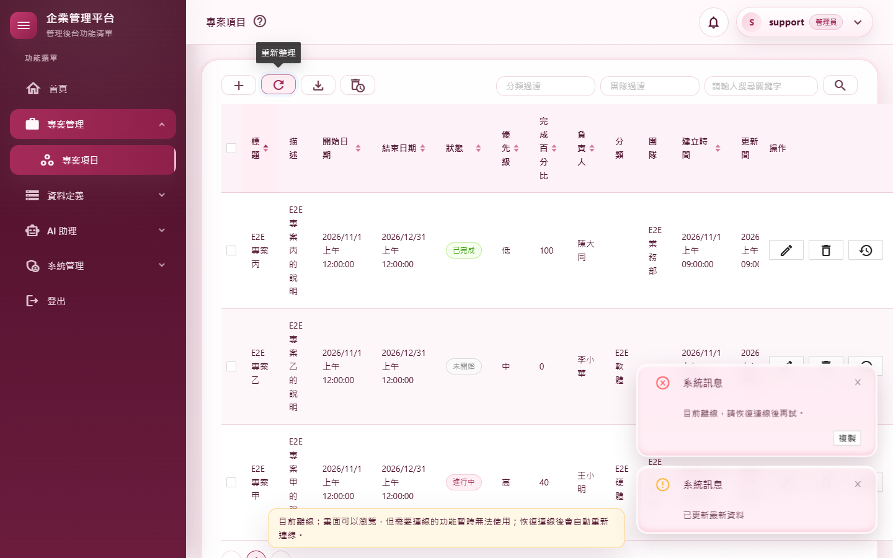
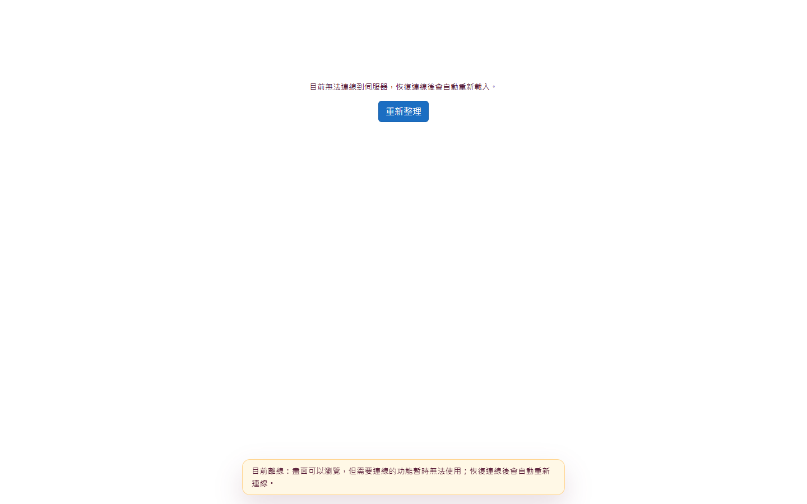
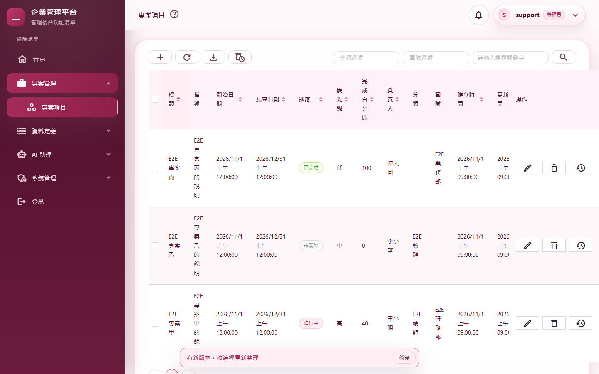
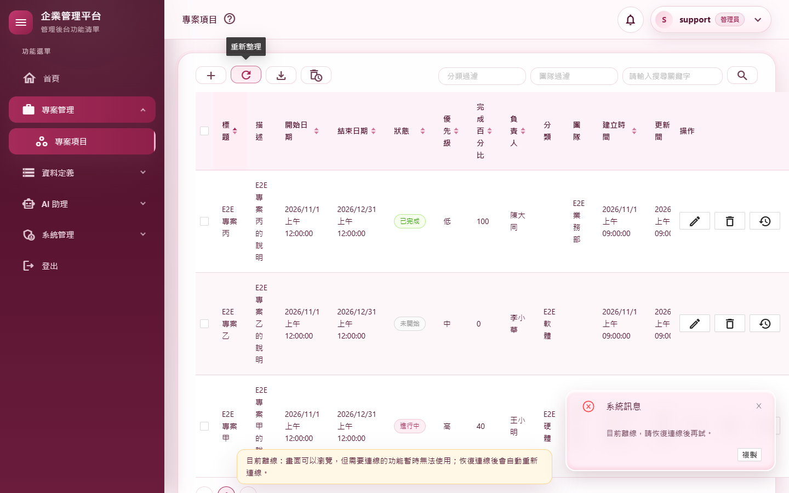

# M12 測試報告：PWA 與離線

- 里程碑：WASM 遷移 M12（最後一個里程碑；計畫見 [WASM遷移計畫](../WASM遷移計畫.md)）
- 版本：0.10.10 → 0.10.11
- 測試日期：2026/11/13
- 分支：`feature/wasm-m12-pwa`

## 摘要

| 項目 | 結果 |
|---|---|
| 範圍 | Service Worker（只快取前端靜態檔、API 與伺服器端點一律走網路）、manifest 與圖示（可安裝為 PWA）、離線提示列、離線時的 API 訊息、新版本提示列（使用者按下才套用）、離線開頁不登出且恢復後自動重新載入、修剪與延遲載入的量測（改只載中日韓語系資料） |
| 授權方式 | 使用者授權 M11、M12 一路做完（2026/11/11、2026/11/13），可自動 commit、合併、推送；需要決定時推播通知 |
| 自動化測試 | 3,158 個全部通過（M11 結束時 3,098） |
| 品質關卡 | 7 步全部通過（結果見 A.3） |
| 實機驗證 | 雙站台（發佈版前端）M12 情境 7 項全部通過（安裝與快取內容、可安裝、離線、恢復連線、部署新版、英文瀏覽器、伺服器暫時連不上），Service Worker 接管下 36 路由煙霧全部通過 |
| 修剪與延遲載入 | 改只載中日韓語系資料：地區資料 329,770 → 248,840 位元組（`_framework` Brotli 總量 −1.8%），英文瀏覽器實測日期仍是 zh-TW 格式；System.Private.Xml（AntDesign 用到）與 Markdig 延遲載入（風險大於 1.7% 的效益）不做 |
| 獨立審查 | 沒有高嚴重度；3 項中、5 項低，全部修正（502／503／504 被登出、安裝失敗無聲無息、退版與移除 Service Worker 的程序、同站台 SW 壓縮副本、開發用 SW 不清快取、守門測試漏洞、快取名稱互刪、入口頁標頭被快取） |
| 實機發現 | 伺服器暫時連不上（瀏覽器有網路）時收不到恢復連線事件 → 改為每 15 秒試一次伺服器；清單「重新整理」讀取失敗時仍顯示「已更新最新資料」（M3 起就有，離線時每次都出現）→ 9 個清單與 CRUD 產生器樣板只在成功時顯示 |
| 使用者看得到的差異 | 新增兩條提示列（離線、有新版本）；可安裝為 App；離線開頁不再被登出；伺服器停機或部署中（502／503／504）、刷新 Token 時連不上都不再被登出；重新整理失敗時不再誤報成功 |
| 版本 | 0.10.10 → 0.10.11 |

---

## A.1 測試策略

| 層次 | 涵蓋什麼 | 工具 |
|---|---|---|
| 守門測試 | Service Worker 的排除清單涵蓋實際註冊的每個非 `/api` 端點（從 `EndpointDataSource` 列出）、只處理同來源 GET、`put`／`add`／`addAll` 只能在 `onInstall`、導覽回退排除伺服器端點、快取名稱帶範圍且不同範圍不相撞、開發用 SW 只刪不寫；index.html 有 manifest 與圖示連結；manifest 名稱等於 `SystemName`、顏色等於 theme.css；web.config 的 `.webmanifest` MIME；SW 腳本、`appsettings*.json`、manifest 不產生壓縮副本（前端與 API 主機兩個專案都匯入 `FrontendCompression.props`）；安裝失敗會回報；「已更新最新資料」只在讀取成功後顯示 | `PwaConventionTests`、`RefreshMessageConventionTests` |
| 元件測試 | 離線提示列（離線出現、恢復消失、恢復時推播立即重連與鈴鐺公告重讀）、新版本提示列（收到通知出現、按下套用、稍後收起） | bUnit（`PwaStatusBarTests`） |
| 單元測試 | `ApiClient` 離線訊息；`ClientSession`：離線或 502／503／504 時保留 Token 不導頁、500 照舊回登入頁、刷新時連不上不登出、`WaitUntilReachableAsync` 要拿到非 5xx 才結束 | `ClientSessionTests` |
| 整合測試 | 同站台的 `/service-worker.js`、`/manifest.webmanifest` MIME 與 no-cache | `SameSiteHostTests` |
| 發佈 | 前端與 Web 各發佈，確認 SW 腳本有版本註解、沒有壓縮副本、資產清單雜湊與檔案全部相符；重複發佈與帶 `-p:StaticSiteApiOrigin` 發佈 | `dotnet publish` |
| 品質關卡 | 建置（Release）、格式、全部測試、文件編碼、CRUD 產生器錨點、弱點掃描 | `scripts/Invoke-QualityGate.ps1` |
| 實機驗證 | 發佈版前端（雙站台，`-p:StaticSiteApiOrigin`）＋API 主機；真的 Chrome（W2 用有使用者資料夾的瀏覽器，無痕模式不能安裝 PWA） | `scripts/e2e/m12-pwa.mjs`、`static-site.mjs` |
| 獨立程式審查 | 未參與實作的審查者讀完整份變更，在複本寫測試實證 | 另一個 AI 審查代理（只讀） |

---

## A.2 自動化測試

| 測試 | 驗證的行為 |
|---|---|
| `PwaConventionTests`（新） | 見 A.1 守門測試；排除清單改從實際註冊的端點檢查（審查後），故意從清單拿掉 `/health`、在 `onInstall` 外加 `put(` 都會失敗（已確認後還原） |
| `PwaStatusBarTests`（新） | 兩條提示列的出現、消失、按下的動作 |
| `ClientSessionTests`（增加） | 離線開頁保留 Token；審查後新增 14 個：`/me`／刷新回 502／503／504 視同連不上、`ApiClient` 與登出廣播遇 503 不清 Token、探測遇 5xx 繼續等、500 照舊回登入頁、恢復後 Token 真的失效照舊清掉（先跑 12 個失敗、2 個釘住不變的行為）；實機發現後新增 `WaitUntilReachable_ShouldFinishOnlyAfterTheServerAnswersAgain`（先看到編譯失敗） |
| `ClientPushConnectionTests`（增加） | 恢復連線時立即重連（`ReconnectNow`） |
| `SameSiteHostTests`（增加） | SW 與 manifest 的 MIME 與快取標頭 |
| `RefreshMessageConventionTests`（新，實機發現） | 「已更新最新資料」必須包在 `if (await …)` 的成功判斷裡；涵蓋 CRUD 產生器樣板（先跑列出 10 處違規） |

測試數：3,098 → 3,158。

---

## A.3 品質關卡

`pwsh ./scripts/Invoke-QualityGate.ps1`：

| 步驟 | 結果 | 秒數 |
|---|---|---|
| Restore | 通過 | 1.1 |
| Build（Release） | 通過（0 警告、0 錯誤） | 10.6 |
| Format | 通過（`dotnet format --verify-no-changes`） | 94.9 |
| Test | 通過（3,158 個） | 151.6 |
| Docs encoding | 通過（310 個檔案） | 0.2 |
| CRUD anchors | 通過 | 0.5 |
| Vulnerability | 通過（沒有已知弱點） | 22.9 |

合計 281.8 秒，`QUALITY GATE PASSED`。

另外跑了 `scripts/Test-CrudGenerator.ps1`（改了產生器樣板）：產生、建置、格式、測試都通過（產生後的專案 3,205 個測試全數通過）；實跑頁面那一步需要 Playwright 環境變數，未執行。

---

## A.4 實機驗證（`m12-pwa.mjs`）

雙站台：前端以 `dotnet publish src/MyProject/MyProject.Web.Client -c Release -p:StaticSiteApiOrigin=https://localhost:7144` 發佈，由照 web.config 規則的靜態站提供（`http://localhost:7145`，這台的 IIS Express 無法啟動，見 M11 報告）；API 主機 `https://localhost:7144`。必須用發佈版：`dotnet run` 的開發用 Service Worker 不快取、不會出現新版本提示。

| # | 情境 | 步驟 | 實際結果 | 判定 |
|---|---|---|---|---|
| W1 | Service Worker 安裝並接管 | 登入、開 `/projects`，等 SW 就緒並接管；列出快取內容 | 接管；快取 `offline-cache-%2F:<版本>` 共 96 個項目（`_framework` 69 個、index.html）；`/api` 項目 0 個 | 通過 |
| W2 | 可安裝為 PWA | 以有使用者資料夾的瀏覽器開登入頁，查 Chrome 的安裝條件 | 安裝條件錯誤：沒有；manifest：name「企業管理平台」、display standalone、圖示 192／512 | 通過 |
| W3 | 離線 | 已開的 `/projects` 切成離線 → 按「重新整理」→ 離線重新整理頁面 | 離線提示列出現；通知「目前離線，請恢復連線後再試。」、沒有誤報「已更新最新資料」（截圖 04）；離線重新整理後停在 `/projects`、沒被登出，顯示「目前無法連線到伺服器，恢復連線後會自動重新載入。」與離線提示列（截圖 01、02） | 通過 |
| W4 | 恢復連線 | 恢復連線 | 提示列消失、自動重新載入回到外框、清單 3 列、推播重新連線 | 通過 |
| W5 | 部署新版 | 改發佈輸出 `service-worker-assets.js` 的版本（模擬部署）→ 重新整理 → 「稍後」→ 再重新整理 → 按提示列 | 提示列出現（截圖 03）；「稍後」收起；重新整理後再出現；按下後整頁載入 1 次；快取換成新版本、沒有等待中的新版 | 通過 |
| W6 | 英文瀏覽器 | `en-US` 的瀏覽器開專案清單 | 「2026/11/1 上午 12:00:00」，沒有 AM／PM（只載中日韓語系資料後 zh-TW 格式正確） | 通過 |
| W7 | 伺服器暫時連不上（瀏覽器有網路） | 攔下所有送往 API 主機的請求並重新整理 → 解除攔截 | 顯示連不上的訊息、沒有離線提示列（瀏覽器仍在線）、沒被登出；解除後 16.2 秒自動回到外框 | 通過 |

36 路由煙霧測試（Service Worker 接管下）全部通過。

### 實機發現

1. **伺服器暫時連不上時不會自動恢復**：第一版只靠瀏覽器「離線→上線」的事件。瀏覽器一直有網路、只是伺服器暫時連不上（或恢復連線發生在畫面還在啟動時）收不到那個事件，畫面一直停在「無法連線」。改為另外每 15 秒試一次伺服器（`ClientSession.WaitUntilReachableAsync`），有回應就重新載入；W7 驗證。審查後再改為要拿到非 5xx 的回應才算恢復。
2. **重新整理失敗仍說「已更新最新資料」**：離線時按清單的「重新整理」，畫面同時跳出「目前離線，請恢復連線後再試。」與「已更新最新資料」（截圖 01）。9 個清單（分類、團隊、專案、使用者、角色、寄信紀錄、排程作業、資料保留、系統備份）與 CRUD 產生器樣板不管讀取成功與否都送出成功訊息（公告、提示詞、系統參數三頁原本就正確）。改為讀取成功才顯示，並加守門測試 `RefreshMessageConventionTests`。修正後的畫面見截圖 04。
3. **Playwright 一般的瀏覽器內容是無痕模式**，Chrome 規定無痕不能安裝 PWA；W2 改用有使用者資料夾的瀏覽器。
4. 實機腳本的時序：離線開頁從快取啟動 WebAssembly、再讀身分失敗，離線偵測在第一次渲染後才啟動，約需數秒；腳本改為等提示列出現（最多 20 秒）。

---

## A.5 獨立審查

審查者讀完整份變更，在複本寫測試實證。確認沒有問題的部分：

- **Service Worker 不會存下或回傳任何 API 回應、Token、使用者資料**：執行期從不寫快取（包括 opaque、重新導向、錯誤回應），伺服器端點的導覽都走網路（Google 登入每一站、下載、Swagger、健康檢查、重設密碼頁）；雙站台的 API 是跨來源，SW 不攔截。
- **登出後別人離線開頁看不到資料**：快取只有靜態檔。
- **離線保留 Token 不會讓已撤銷的 Token 有可乘之機**：離線拿不到資料，恢復後照常由伺服器驗證。
- **更新流程**：不會一直重新載入、多分頁正確、第一次安裝不誤報新版。
- **發佈**：同站台、雙站台、`-r win-x64` 的資產清單雜湊全部相符；`icudt_CJK.dat` 含 `zh_Hant_TW` 與排序資料。

### 修正的發現

| # | 嚴重度 | 發現 | 修正 |
|---|---|---|---|
| 1 | 中 | 伺服器回 502／503／504（IIS 應用程式集區停止、`app_offline`、反向代理）時清掉 Token 導去登入頁；探測把 5xx 當成恢復 | `/me` 與刷新回 502／503／504 視同連不上（保留 Token）；探測要拿到非 5xx 才結束。另一併修正：API 回 401 後刷新時連不上，`ApiClient` 四條路與登出廣播也不再清 Token（以前「刷新時網路斷線」會被登出）。500 照舊。補 14 個測試 |
| 2 | 中 | 退版到 0.10.10 以前、拿掉 Service Worker、同站台改雙站台時，已安裝的使用者會一直卡在舊前端 | 部署清單新增「退版／移除 Service Worker」程序與自我註銷的 `service-worker.js` 範例 |
| 3 | 中 | 新版安裝失敗（例如部署後手改了前端檔案，integrity 不符）時使用者無聲地卡在舊版；文件說手改 `appsettings.json`「只會離線開不起來」低估了後果 | `pwa.js` 偵測安裝失敗，經瀏覽器錯誤回報記到伺服器日誌（`Service worker installation failed…`）；文件改成「一律重新發佈」 |
| 4 | 低 | 同站台發佈的 SW 腳本壓縮副本沒有版本註解（同站台發佈時前端的壓縮排除清單根本沒套用，`appsettings.json`、manifest 也有壓縮副本） | 新增 `FrontendCompression.props`，前端與 API 主機兩個專案共用；移除「發佈後刪壓縮副本」的步驟；補守門測試 |
| 5 | 低 | 快取的入口頁連同回應標頭一起存，只改伺服器的安全標頭不會生效 | 文件：改安全標頭要同時重新發佈前端 |
| 6 | 低 | 開發用 SW 換上後，發佈版留下的快取不會被清掉 | 開發用 SW 在啟用時刪掉同範圍的快取（只刪不寫） |
| 7 | 低 | 排除清單的守門測試漏掉方法層路由、絕對路徑、`MapGet` 等；「不寫快取」只禁止 `.put(` | 改從實際註冊的端點檢查；`put`／`add`／`addAll` 只能在 `onInstall` |
| 8 | 低 | 同一來源不同路徑部署兩套系統時，互相刪掉對方的離線快取（文件同步時發現） | 快取名稱帶範圍：`offline-cache-<編碼過的範圍路徑>:<版本>`，只刪同範圍的舊版 |

---

## A.6 設計決定

1. **導覽快取優先**（Blazor 標準做法）：部署新版後，使用者按「有新版本」才換新版，不強制重新載入（可能正在編輯）。代價：部署後要等使用者按提示；API 要能相容前一版前端（部署清單已寫）。
2. **只快取前端靜態檔，不做離線資料**（計畫決策「斷線不卡死即可」）：離線時外框與提示可開，資料畫面需要連線。
3. **離線開頁不登出**：讀不到身分是因為連不上，不是 Token 失效；保留 Token、顯示訊息、恢復後自動重新載入。
4. **「稍後」按鈕**：讓使用者收起新版本提示（重新整理後會再出現）。
5. **只載中日韓語系資料**：語系固定 zh-TW，英文瀏覽器實測格式正確。
6. **manifest 名稱固定**為「企業管理平台」，守門測試要求等於 `SystemName`；在系統參數頁改系統名稱不會改到已安裝的 App 名稱（複刻新專案時要一起改）。
7. **新版本的判斷綁資產清單版本**，不是 `SystemVersion`：前端檔案有任何變動才會出現提示。

---

## A.7 已知限制

- Service Worker 只在 HTTPS 或 localhost 生效；純 HTTP 的內網部署沒有離線與 PWA，但網站照常可用。
- Material Icons 字型是跨來源資源，不在快取裡，離線時圖示顯示成文字。
- 部署後不會立刻生效：使用者要按「有新版本」；手改發佈輸出的任何前端檔案都會讓新版安裝失敗（一律重新發佈）。
- 退版或拿掉 Service Worker 要照部署清單的程序（自我註銷的 Service Worker）。
- 「新版安裝中又被更新的版本取代」會被誤報一次安裝失敗（機率很低）。
- 雙站台的 web.config IIS 規則仍待上線前在真的 IIS 驗證（見 M11 報告）。

---

## A.8 截圖

| # | 內容 |
|---|---|
| 01 |  |
| 02 |  |
| 03 |  |
| 04 |  |

截圖中沒有個人 Email。
