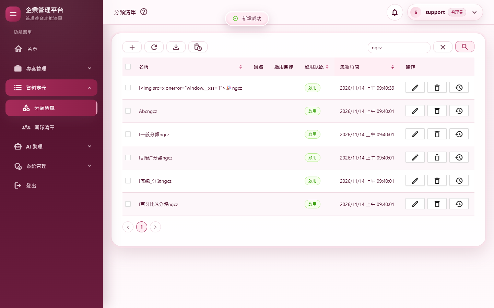

# 測試報告：.NET 11 全面實機探索

- 範圍：升級 .NET 11（0.10.14）之後，用瀏覽器實際連到每個畫面、模擬各種操作，盡可能探索每一步；除了錯誤，也看效能與其他問題
- 版本：0.10.15 → 0.10.16
- 測試日期：2026/11/14
- 分支：`feature/dotnet11-exploration`
- 變更紀錄：[2026-11-14-NET11全面實機探索](../../changelog/2026-11-14-NET11全面實機探索.md)

## 摘要

| 項目 | 結果 |
|---|---|
| 使用者決定（2026/11/14） | 探索越深越好；AI 以真實模型實測；效能前後端都量，慢 20% 以上要追查；Runtime Async 只在 API 主機試，明顯變快且全部測試通過才採用 |
| 既有實機腳本（起點） | m01～m10 共 12 支（含真實模型 AI）全部通過（A.1） |
| 新的探索腳本 | 六支、63 個情境，全部通過（A.2） |
| 找到並修正的問題 | 4 個，都是升級前（.NET 10、0.10.13）就有、不是升級造成的（每一個都在 .NET 10 的版本重現過）（A.3） |
| 等使用者決定 | 5 項既有行為的改善建議（A.4） |
| 效能 | 與 .NET 10 相比沒有慢 20% 以上的項目（量測雜訊除外）；Runtime Async 評估後不採用（A.5） |
| 自動化測試 | 3,218 個全部通過（0.10.15 是 3,209） |
| 品質關卡、CRUD 產生器 | 品質關卡 7 步通過；`Test-CrudGenerator.ps1` 通過 |
| 實際開瀏覽器巡檢 | 看得到的 Chrome 跑 `walkthrough.mjs`（30 個登入後路由、10 個對話窗與浮層、提示框、5 個登入相關頁、登出），同站台與雙站台各 47／47，兩輪 92 張截圖逐張目視 |
| 獨立審查 | 沒有高、中嚴重度；低 6 項中 3 項修改、3 項確認不需要改（A.6） |

---

## A.1 既有實機腳本（同站台，隔離的資料庫與路徑）

| 腳本 | 結果 |
|---|---|
| `m01-tokens`、`m02-shell`、`m03-crud`＋36 路由煙霧 | 11／11、14／14、13／13、36／36 |
| `m04-projects`、`m05-admin` | 19／19、13／13（m05 單獨跑：與 m04 同一個資料庫時，m04 多建的使用者把 `e2e-wang` 擠到第二頁，是腳本之間的資料相依） |
| `m06-ai`（真實模型）、`m06-ops`、`m07-ops`、`m08-agents`（真實模型） | 9／9、8／8、9／9、9／9 |
| `m09-auth`、`m10-no-server`、`ux-data-freshness` | 11／11、4／4、11／11 |
| 雙站台 | `m11-split` 6／6、`m12-pwa` 7／7（發佈版前端、雙站台）＋36 路由煙霧 36／36 |

每一輪跑完都讀隔離資料夾的伺服器日誌（WARN 以上）與系統例外紀錄，扣掉情境刻意造成的（權限拒絕、鎖定、種子資料、AI 回應慢）之外沒有新的錯誤——除了 A.3 第 1 項。

---

## A.2 新的探索腳本

共用 `explore-common.mjs`：每個情境都收集頁面錯誤、主控台錯誤、CSP 違規、伺服器 5xx 與 Blazor 錯誤列，並依資料表結構灌測試資料。

| 腳本 | 情境 | 結果 | 重點 |
|---|---|---|---|
| `explore-perm.mjs` | X1～X3 | 3／3 | 低權限帳號開每個路由，能開的照常、其他顯示沒有權限並寫稽核；從 Controllers 原始碼列出的 **203 個 API 端點**，沒登入一律 401（允許匿名的 14 個除外）、低權限帳號一律 403／404，**沒有任何 5xx** |
| `explore-lists.mjs` | L1～L5 各 6 項 | 29／29 | 分類、團隊、專案、使用者、角色：搜尋與清空、每個可排序欄位遞增遞減、分頁與每頁筆數、顯示已刪除、匯出 Excel、操作說明 |
| `explore-input.mjs` | I1～I15 | 15／15 | 留空、只有空白、超過長度一律擋下並說明；名稱含 HTML 與 emoji 照字面顯示、不會執行；重名的大小寫與全形空白都擋；搜尋 `% _ ' " \` 不會當成萬用字元；按 Enter 不會誤存；未存檔關窗或開著下拉按 Esc 都先問 |
| `explore-edge.mjs` | E1～E5 | 5／5 | 2,000 筆專案：開清單 3.4 秒、跳到第 250 頁 1.9 秒、匯出 0.9 秒；慢速網路連按兩下「儲存」只寫一筆；離線時顯示訊息、表格保留，恢復後正常；手機尺寸 30 個路由都沒有橫向捲動；英文語系、東京與 UTC 時區看到的時間與台北一字不差 |
| `explore-ops.mjs` | O1～O7 | 7／7 | 備份與刪除（實體檔一併刪除）；資料保留、系統參數的不合法值一律 400 且值不變、過期版本 409；排程停用時仍可立即執行；測試通知與已讀；寄信測試 |
| `explore-auth.mjs` | U1～U4 | 4／4 | 改密碼的各種錯誤都擋下、成功後舊密碼失效；重設連結用過再開顯示無效；登出後按上一頁回登入頁；錯誤密碼與不存在的帳號訊息相同 |

### 截圖

| | |
|---|---|
|  |  |
| 01 300 個分類的下拉打字篩選（修正後） | 02 名稱含 HTML 與 emoji：照字面顯示、不會執行 |
|  |  |
| 03 改了內容、開著下拉按 Esc：先問要不要放棄 | 04 手機尺寸的首頁（另見 A.4 F） |

---

## A.3 找到並修正的問題

每一個都先寫測試重現（測試先失敗）再修；也都在升級前的 .NET 10 版本（0.10.13，git worktree）以同一個腳本重現過，結果相同——不是升級造成的。

| # | 問題 | 怎麼發現 | 修正 | 測試 |
|---|---|---|---|---|
| 1 | 使用者在查詢還沒回來時換頁或關分頁，伺服器把「用戶端中斷」（`IOException: The client reset the request stream.`，或讀警告日誌時的取消）記成 Error、回 500，系統例外紀錄頁多一筆 | 讀歷次實機資料庫的系統例外紀錄：WASM 遷移以來幾乎每輪都有；這一輪的 `m05-admin` 也在系統健康頁出現取消 | `ApiExceptionFilterAttribute`：請求已被用戶端中止、且例外是連線中斷造成的（取消、`IOException` 本身、連線重設、請求逾時）時只記 Information、回 499；找不到檔案、磁碟錯誤這類真正的 IO 錯誤照常記 Error | `ApiClientAbortTests`（5） |
| 2 | 關閉已被刪除的公告：寫入關閉紀錄撞外鍵，服務本來就接住，但 EF Core 在丟出之前已把失敗記成 Error | `explore-perm` 對每個端點的探測留下一筆系統例外 | `AnnouncementService.DismissAsync` 先確認公告還在 | `NotificationTests` +1 |
| 3 | **可搜尋的下拉打字後一片空白**：九個下拉（專案的分類與團隊〔表單與工具列〕、使用者的額外角色與團隊、角色的預設團隊、分類的適用團隊、團隊的上層團隊）選項沒有 `Label`，AntDesign 比不到任何選項 | `explore-edge` E1：300 個分類打「E大量分類29」後下拉只剩 8px 高 | 九處與 CRUD 產生器樣板補 `Label` | `SearchableSelectConventionTests`（含樣板） |
| 4 | 按「匯出 Excel」後提示框一直停在畫面上，滑鼠移開也不收（0.10.12 的修正只涵蓋按下的當下） | `explore-edge` 截圖裡停著「新增」「匯出 Excel」兩個提示框 | `ToolbarIconButton`、`CrudActionButton` 處理完成後再收一次 | `TooltipDismissTests` +2 |

另外修正偶發失敗的單元測試：`ClientSessionTests.WaitUntilReachable…5xx` 在全套測試負載高時約四次失敗一次（單獨跑 25 次都通過）。原因是測試用的假 HTTP 處理器在背景重試與測試執行緒同時讀寫 `List`／`Dictionary`；改成加鎖、以 `CountRequests` 讀次數（不影響產品）。

另外修正實機共用工具（不影響產品）：`clickToolbar` 以前用「含有」比對，「搜尋」會先比到排在前面的「清空搜尋」（看起來像搜尋沒作用，實際是按了清空）；`confirmIfShown` 會去等接著跳出的下一個確認窗。

---

## A.4 等使用者決定（既有行為，.NET 10 也一樣）

都是改變使用者看得到的行為，依約定不自行修改：

| # | 現況 | 建議 |
|---|---|---|
| B | 清單的搜尋框按 Enter 不會搜尋（要按搜尋鈕） | 按 Enter 等於按「搜尋」 |
| C | 專案標題沒有長度上限（5,000 字也存得進去；分類、團隊名稱上限 100） | 加上限（例如 200） |
| D | 使用者帳號沒有格式規則（含空白與 HTML 字元也能建立，例如 `bad account<b>…`） | 限制為英數字與 `-_.@` |
| E | 角色沒有「首頁」權限時，登入後第一個畫面就是「你沒有權限存取此頁面」（預設角色都有首頁） | 角色編輯時提醒，或首頁不受權限限制 |
| F | 手機尺寸（390 寬）時，收合的側邊欄仍佔約 220px 高的深色區塊，使用者選單被擠到下一行 | 手機版收合時只留一列（選單鈕＋使用者選單） |

已有決定、不再問：AntDesign 頁籤的 `ondragover` 行內事件被 CSP 擋下（`/token-usage`、`/prompt-templates` 的主控台錯誤），速查表 §10 已記錄「刻意不加 `'unsafe-hashes'`」，沒有功能影響；探索腳本與 `m11-split` 同樣排除。

觀察、不改：錯誤回報端點接受空白回報並記成「(no message)」（瀏覽器本來就有沒有訊息的錯誤，且每人每分鐘有上限）；對話窗開著下拉時按 Esc 會連對話窗一起關（有修改時會先問，見 I15）。

---

## A.5 效能

量法：`Start-E2EHost.ps1 -Published`（Release 發佈版）＋`perf.mjs`，灌 2,000 筆專案、300 個分類，每項五次取中位數。Runtime Async 以「關、開、關」交替量測，排除機器狀態的差異。

| 項目 | NET10（0.10.13） | 關（第一次） | 開 | 關（第二次） |
|---|---|---|---|---|
| 第一次開啟（毫秒） | 1068（+0%） | 950（-11%） | 1104（+3%） | 942（-12%） |
| 第一次開啟傳輸量（KB） | 6860（+0%） | 6991（+2%） | 6991（+2%） | 6991（+2%） |
| 再次開啟（毫秒） | 1063（+0%） | 1241（+17%） | 1024（-4%） | 1196（+13%） |
| 換頁合計（25 頁，毫秒） | 4313（+0%） | 4295（-0%） | 4381（+2%） | 4283（-1%） |
| API 使用者查詢（毫秒） | 7（+0%） | 7（+0%） | 8（+14%） | 7（+0%） |
| API 分類修改（毫秒） | 13（+0%） | 14（+8%） | 18（+38%） | 15（+15%） |
| API 分類新增（毫秒） | 13（+0%） | 12（-8%） | 15（+15%） | 13（+0%） |
| API 分類查詢（毫秒） | 7（+0%） | 7（+0%） | 7（+0%） | 8（+14%） |
| API 分類查詢（關鍵字）（毫秒） | 7（+0%） | 7（+0%） | 7（+0%） | 7（+0%） |
| API 外框選單（毫秒） | 7（+0%） | 6（-14%） | 6（-14%） | 7（+0%） |
| API 專案匯出（毫秒） | 186（+0%） | 176（-5%） | 307（+65%） | 239（+28%） |
| API 專案查詢（毫秒） | 9（+0%） | 9（+0%） | 9（+0%） | 9（+0%） |
| API 專案查詢（每頁 200）（毫秒） | 14（+0%） | 14（+0%） | 14（+0%） | 14（+0%） |
| API 專案查詢（第 50 頁）（毫秒） | 11（+0%） | 11（+0%） | 12（+9%） | 12（+9%） |
| API 日誌查詢（毫秒） | 32（+0%） | 9（-72%） | 8（-75%） | 9（-72%） |
| API 目前使用者（毫秒） | 6（+0%） | 6（+0%） | 6（+0%） | 7（+17%） |
| API 稽核紀錄查詢（毫秒） | 8（+0%） | 7（-12%） | 8（+0%） | 7（-12%） |
| API 首頁儀表板（毫秒） | 7（+0%） | 6（-14%） | 6（-14%） | 7（+0%） |
| 伺服器工作集（MB） | 353（+0%） | 361（+2%） | 360（+2%） | 357（+1%） |
| JS heap（MB） | 16（+0%） | 17（+6%） | 19（+19%） | 9（-44%） |
| WASM 記憶體（MB） | 286（+0%） | 286（+0%） | 286（+0%） | 286（+0%） |

- **與 .NET 10 比較**：沒有慢 20% 以上、且多 20 毫秒以上的頁面。專案匯出第二次「關」是 239 毫秒（+28%），但第一次「關」是 176 毫秒（−5%），同一份程式兩次差 63 毫秒，屬於量測雜訊。
- **Runtime Async**：在 API 主機開啟後，確認編譯後的非同步狀態機由 435 個降到 18 個（剩下的是非同步列舉），設定確實生效；但 API 與換頁沒有變快，存檔與匯出反而略慢。依「明顯變快才採用」維持關閉。
- 與 0.10.14 的量測（升級 .NET 11 測試報告）相比整體慢了幾毫秒，同一台機器、同一份程式（Runtime Async 關閉）在這一輪的兩次量測彼此一致，差異來自機器狀態，不是這一輪的修改。

---

## A.6 獨立審查

審查者（未參與實作）只讀程式碼。確認正確的部分：中斷判斷的運算優先順序、沒有被中斷的請求行為不變、串流回應（NDJSON）不經過這個篩選器、499 不會到達用戶端；公告沒有軟刪除、外鍵會連帶刪除；提示框修正對有連結的按鈕沒有影響；九個下拉加上 `Label` 不影響值的繫結。

| # | 嚴重度 | 發現 | 處理 |
|---|---|---|---|
| 1 | 低 | 中斷判斷太寬：找不到檔案、磁碟錯誤這類真正的 IO 錯誤剛好碰上使用者離開，也會被當成中斷 | 收窄為連線中斷造成的例外（取消、`IOException` 本身、連線重設、`BadHttpRequestException`），補測試 |
| 2 | 低 | 守門測試的比對規則遇到屬性裡的 `=>` 會提早結束，可能漏掉下拉 | 比對規則改成跳過引號內的內容 |
| 3 | 低 | 專案分類的已選標籤會帶「（已限定其他團隊）」 | 不改：修正前（③ 的 F2 截圖）就是這樣顯示 |
| 4 | 低 | 公告在確認之後、寫入之前被刪除的競態仍會留下一筆 | 不改：極少見，例外仍被接住 |
| 5 | 低 | API 的狀態碼頁面會對已中斷的連線寫一次回應本文 | 不改：Kestrel 直接丟棄，只多一點工作 |
| 6 | 低 | 處理期間按鈕被釋放時的情況 | 不改：Blazor 忽略已釋放元件的重新渲染 |

---

## A.7 已知限制

- 探索腳本以同站台主機執行；雙站台由 `m11-split`、`m12-pwa` 與巡檢涵蓋。
- Visual Studio 的瀏覽器連結（① 的 CSP 放寬）這台電腦仍無法重現，請在 VS 按 F5 確認一次。
