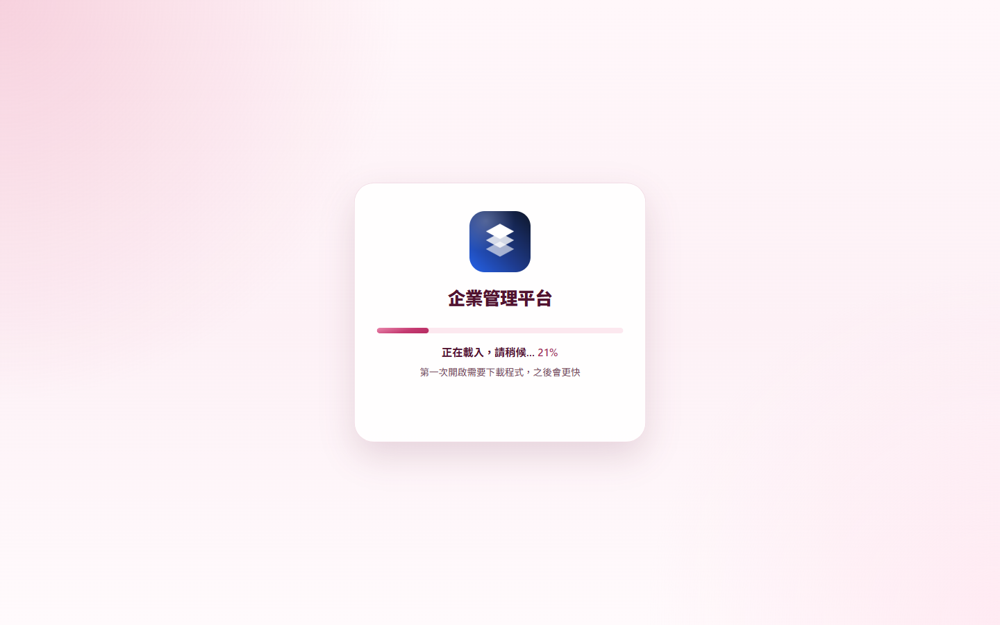
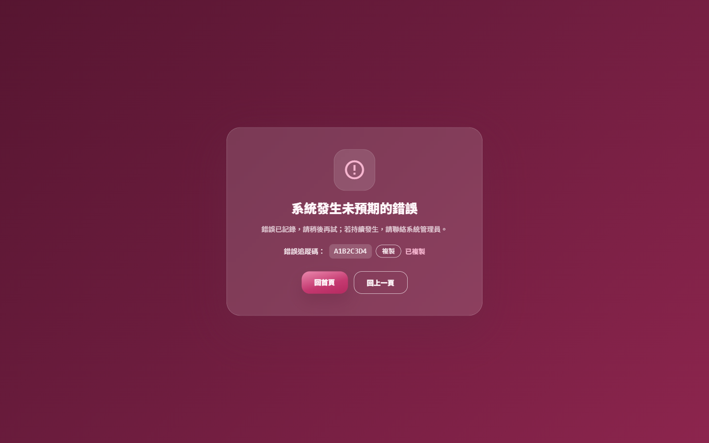
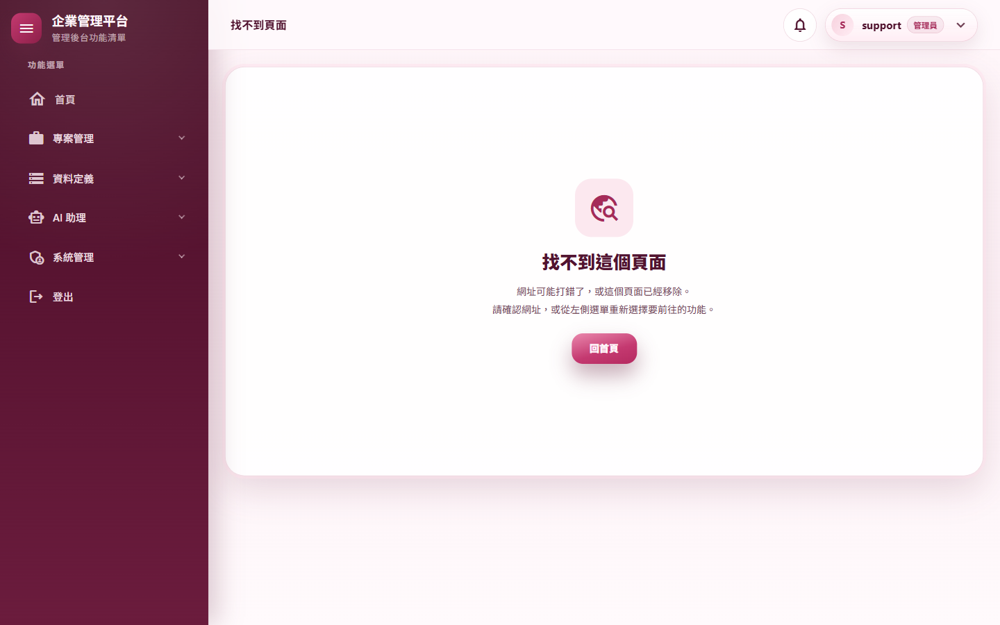
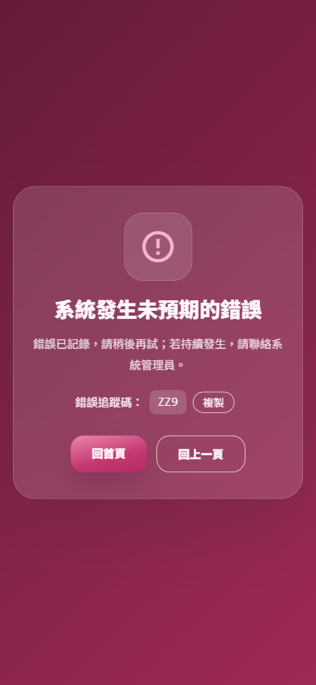

# 測試報告：首次載入畫面、錯誤頁與找不到頁面

- 範圍：使用者第一次以 Visual Studio 開啟 WASM 專案時回報的四件事（主控台錯誤、首次載入空白、找不到頁面是英文、錯誤頁簡陋）
- 版本：0.10.12 → 0.10.13
- 測試日期：2026/11/14
- 分支：`feature/ux-loading-error-pages`
- 變更紀錄：[2026-11-14-載入畫面錯誤頁與找不到頁面](../../changelog/2026-11-14-載入畫面錯誤頁與找不到頁面.md)

## 摘要

| 項目 | 結果 |
|---|---|
| 使用者決定（2026/11/14） | 載入畫面：系統名稱＋進度條＋百分比；錯誤頁：置中卡片、風格同登入頁；開發錯誤：只在 Development 放寬安全政策 |
| 自動化測試 | 3,184 個全部通過（0.10.12 是 3,161） |
| 品質關卡 | 7 步全部通過（A.3） |
| 實機驗證 | 新腳本 `ux-loading-pages.mjs` L1～L6：同站台、雙站台各一輪全部通過；`m02-shell`、`m09-auth`、`m09-views`、`m12-pwa`（雙站台）與 36 路由煙霧全部通過 |
| 實際開瀏覽器巡檢 | 看得到的 Chrome 跑 `walkthrough.mjs`（30 個登入後路由、10 個對話窗與浮層、提示框、登入相關頁、登出），同站台與雙站台各一輪全部通過，截圖逐張目視 |
| 獨立審查 | 沒有阻擋性問題；1 項中、5 項低與文件遺漏，全部處理（A.5） |
| 使用者看得到的差異 | 第一次開啟有載入卡片與進度、不再空白；錯誤頁與找不到頁面改成繁中卡片；頁首「找不到頁面」；框架錯誤提示列繁中；VS 開發時主控台不再出現瀏覽器連結的錯誤 |

---

## A.1 主控台的兩個錯誤是什麼

截圖中失敗的請求是 `http://localhost:62773/<識別碼>/browserLinkSignalR/negotiate`：Visual Studio 的「瀏覽器連結」（Browser Link）在開發時注入頁面、以 SignalR 連回 VS。
前端 CSP（0.10.10 起）的 `connect-src` 只有 `'self'`，`localhost:62773` 不是本站，所以被擋（兩個請求各一個錯誤）。這只發生在用 VS 開發時，正式環境的使用者不會遇到。
處理方式（使用者選擇）：只有 Development 的同站台主機在 `connect-src` 另外允許 `http(s)://localhost:*`、`ws(s)://localhost:*`；熱重載的 WebSocket 也因此不再被擋。正式環境與靜態站 `web.config` 不變。

⚠️ 這台電腦沒有 Visual Studio，無法重現瀏覽器連結本身；實機以 L6（在頁面裡連 `ws://localhost`、`wss://localhost`、`http://localhost/…/browserLinkSignalR/negotiate`，看有沒有 CSP 違規）代替。**請在 VS 按 F5 開一次，確認主控台沒有這兩個錯誤。**

---

## A.2 自動化測試

| 測試 | 驗證的行為 |
|---|---|
| `Components/LoadingAndStatusPageTests`（新） | `index.html` 的 `#app` 有載入卡片、名稱等於 `appsettings` 的 `SystemName`、啟動失敗 30 秒後的提示；進度條與百分比讀 `--blazor-load-percentage`；`ClientLoadingScreen` 的固定名稱與內容；外框的最後一個分支是載入卡片；五個登入相關頁在讀取期間顯示載入卡片；錯誤頁繁中、回首頁、回上一頁、只顯示格式正確的追蹤碼（`<script>` 不顯示）、複製；找不到頁面繁中與回首頁；`#blazor-error-ui` 與預設錯誤邊界不再是英文 |
| `FrontendDevelopmentCspTests`（新） | `connect-src` 只在 `allowLocalDevTools` 時含 localhost、其他規則不變；`FrontendIndexPage` 只有 Development 放寬（Production、Staging、Testing 都不含） |
| `SameSiteHostTests`（增加） | 測試環境的前端 CSP 不含 localhost |
| `PageAuthorizationTests`（調整） | 未登入開不存在的網址：`#app` 只有載入卡片（原本斷言 `

` 是空的），沒有任何版面 |
| `ClientSessionTests`、`ProfileTests`（調整） | 不是頁面的網址與 `/not-found` 的頁首標題是「找不到頁面」（原本是「系統首頁」）；`WaitUntilReachable…5xx` 的上限放寬（全套測試負載高時 10 秒偶爾不夠，正常幾十毫秒就完成） |

測試數：3,161 → 3,184。

---

## A.3 品質關卡

`pwsh ./scripts/Invoke-QualityGate.ps1`：

| 步驟 | 結果 | 秒數 |
|---|---|---|
| Restore | 通過 | 1.2 |
| Build（Release） | 通過（0 警告、0 錯誤） | 6.5 |
| Format | 通過 | 26.3 |
| Test | 通過（3,184 個） | 72.3 |
| Docs encoding | 通過 | 0.1 |
| CRUD anchors | 通過 | 0.4 |
| Vulnerability | 通過（沒有已知弱點） | 19.9 |

合計 126.8 秒，`QUALITY GATE PASSED`。

---

## A.4 實機驗證

### `ux-loading-pages.mjs`（新）

同站台以 `Start-E2EHost.ps1`（開發模式，前端約 30 MB）；雙站台以發佈版前端（約 4.3 MB，`static-site.mjs` 照 `web.config` 規則提供）＋API 主機。

| # | 情境 | 同站台 | 雙站台 |
|---|---|---|---|
| L1 | 未登入、無快取、CDP 限速（約 4 Mbps、40 毫秒延遲）開登入頁，每 150 毫秒取樣到登入表單出現 | 64 秒、取樣 380 次，第一個畫面之後空白 0 次；進度 0%→100% 共約 70 種、進度條逐步變長 | 11 秒、取樣 54 次，空白 0 次 |
| L2 | 已登入、限速下重新整理 `/projects` | 空白 0 次；下載卡片接著「正在確認登入狀態…」卡片 | 同左 |
| L2b | `/me` 延遲 3 秒 | 看得到「正在確認登入狀態…」卡片（截圖 02），之後正常進入 | 同左 |
| L3 | `/Error?trace=A1B2C3D4` | 繁中卡片；複製後顯示「已複製」、剪貼簿內容核對相符；回上一頁回到 `/projects`；沒帶追蹤碼時不顯示追蹤碼；回首頁 | 同左 |
| L4 | 登入後開 `/no-such-page-e2e`、`/not-found` | 外框內的繁中卡片、頁首「找不到頁面」、沒有英文；回首頁 | 同左 |
| L5 | 未登入開錯誤頁、手機尺寸（390×844） | 照樣顯示（截圖 05） | 同左 |
| L6 | 在頁面裡連 localhost 的開發工具 | 同站台（Development）：CSP 違規 0 則，`connect-src` 含四個 localhost 來源 | 雙站台（靜態站的正式 CSP）：照樣被擋（3 則違規，預期），`connect-src` 只有 `'self'` 與 API 主機 |

### 既有腳本迴歸

- 同站台：`m02-shell.mjs`、`m09-auth.mjs`（T1～T11）、`m09-views.mjs`（10 個畫面，找不到頁面與錯誤頁改認新畫面）、每支附帶的 36 路由煙霧，全部通過。
- 雙站台：`m12-pwa.mjs` W1～W7 全部通過（W3「離線重新整理後畫面有內容」改為同時確認不是停在下載期間的載入卡片）。

### 實際開瀏覽器巡檢（`walkthrough.mjs`，`E2E_HEADED=1`）

| 部署 | 結果 |
|---|---|
| 同站台 | V01～V30、D01～D10、T01（真實模型一次）、A01～A05、A99 全部通過；連同 L1～L6 共 67 張截圖排成總覽圖逐張目視，沒有版面或內容異常 |
| 雙站台 | V01～V30、D01～D10、T01、A01～A05、A99 與 L1～L6 共 54 項全部通過；61 張截圖排成總覽圖逐張目視，沒有版面或內容異常（發佈版前端，限速下約 10 秒載入完成） |

### 截圖

| | |
|---|---|
|  |  |
| 01 首次載入（限速，21%） | 02 登入檢查期間 |
|  |  |
| 03 系統錯誤頁（已複製追蹤碼） | 04 找不到頁面（外框內） |
|  | |
| 05 手機尺寸的錯誤頁 | |

### 實機發現（已修正）

1. **登入頁讀設定時一閃空白**（第一輪 L1 抓到 1 次空白）：WASM 接手後，登入頁在讀到登入頁設定前不渲染任何東西。登入、忘記密碼、重設密碼、兩步驟驗證四頁在讀取期間改顯示載入卡片，登出期間也是。
2. **錯誤頁標題在深色背景看不清楚、圖示太小**：bootstrap 給 `h1` 固定的標題色 → 標題 `color: inherit`；`MaterialIcon` 輸出行內 font-size，CSS 蓋不過 → 改用 `Size="46"`。
3. **找不到頁面卡片疊在內容區的白卡片裡、頁首仍是「系統首頁」**：外框內的狀態卡片拿掉自己的底與陰影；不是頁面的網址與 `/not-found` 的頁首改成「找不到頁面」。
4. 雙站台 L1 第一輪判定失敗：最早的取樣在樣式表套用前（進度條寬度是整個畫面，瀏覽器在樣式表載入前不繪製，使用者看不到），腳本改從出現百分比之後才比較寬度；品牌圖下載完成前顯示淡色方塊。

---

## A.5 獨立審查

審查者（未參與實作）讀完整份變更並執行相關測試。確認沒有問題的部分：CSP 只在 `IsDevelopment()` 放寬、靜態站 `web.config` 不變；追蹤碼只接受 `^[0-9A-Z]{1,32}$` 且 Razor 會編碼；登入閘門不變（`InitializeAsync` 回 false 的每一條路都會換頁或進入限流／連不上的分支，「正在確認登入狀態…」卡片不會卡住）；發佈流程解析 `index.html` 的正規式不受影響；色票都用 theme.css 的變數。

| # | 嚴重度 | 發現 | 處理 |
|---|---|---|---|
| 1 | 中 | WebAssembly 啟動失敗（第一次開就離線、部署後手改檔案導致完整性驗證失敗、瀏覽器不支援）時載入卡片一直停著，進度條甚至是滿的，讓人以為還在載入 | 卡片加上 30 秒後才浮現的提示「若一直停在這個畫面，請重新整理；仍然無法開啟請聯絡系統管理員。」（純 CSS） |
| 2 | 低 | 整頁版錯誤頁與登出卡片在 `ClientEmptyLayout`（60px 下邊距）裡多出捲軸、露出底色 | 改 `position: fixed` 鋪滿視窗 |
| 3 | 低 | 直接開 `/Error` 或新分頁時「回上一頁」沒有反應 | 沒有上一頁時回首頁（`js/nav-state.js` 的 `appNavigation.backOrHome`） |
| 4 | 低 | 「已複製」的狀態區插入時就有內容，螢幕報讀器可能不唸；載入卡片的 `h1` 會被 `FocusOnNavigate` 抓去 | 狀態區一直存在、只換文字；卡片標題改用 `p` |
| 5 | 低 | 載入卡片用 171 KB 的品牌圖，和 WebAssembly 搶頻寬 | 改用 15 KB 的 `icon-192.png` |
| 6 | 低 | 同站台的實機主機是 Development，跑的情境不再驗證正式 CSP 對 localhost 的阻擋 | `scripts/e2e/README.md` 註明；正式 CSP 由雙站台與單元測試涵蓋 |
| 7 | 文件 | 畫面與欄位字典的錯誤頁表格仍寫英文 Not Found；VS Code 指南仍寫 `An unhandled error has occurred.`（尚未中文化） | 更新 |

---

## A.6 設計決定

1. **載入畫面用 Blazor 內建的 CSS 變數**：不加行內腳本（CSP 只允許 import map 的雜湊），也不用 `loadBootResource` 自己追蹤進度。
2. **系統名稱用固定值**：下載完成前讀不到伺服器設定；與 manifest 一樣，改 `SystemName` 時一起改（測試會提醒）。系統參數頁改系統名稱不會改到它。
3. **錯誤頁的第二個按鈕是「回上一頁」，不是「重新整理」**：出錯的網址已換成 `/Error`，在這一頁重新整理只會再顯示錯誤頁（使用者看過的預覽是「重新整理」，這是實作時的決定）。
4. **錯誤頁不放選單外框**：外框本身可能就是出錯的原因，未登入的人也可能看到這一頁。
5. **找不到頁面在外框內**：登入後網址打錯，使用者還能直接從左側選單換頁。

---

## A.7 已知限制與待人工確認

- **Visual Studio 的瀏覽器連結**：這台電腦無法重現，請在 VS 按 F5 確認主控台沒有錯誤。
- 本機 API 很快時，「正在確認登入狀態…」卡片只會一閃而過（L2 取樣 2～3 次）；伺服器慢時才看得清楚（L2b）。
- 第一次開啟的時間取決於網路：發佈版前端約 4.3 MB（Brotli），4 Mbps 約 11 秒；之後由 Service Worker 快取，再次開啟不必下載。
