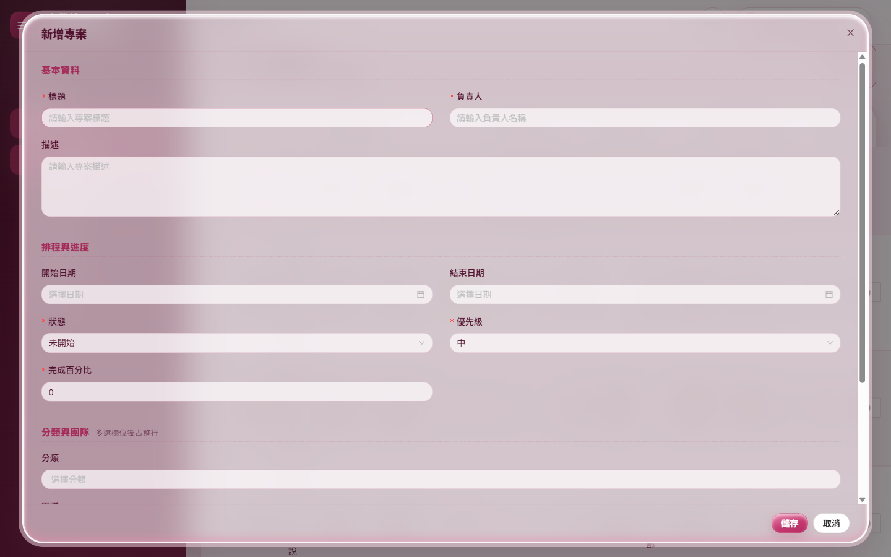
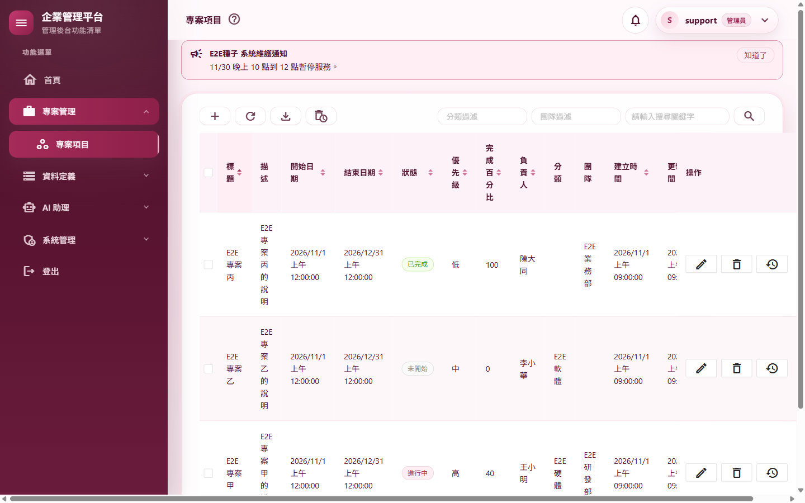
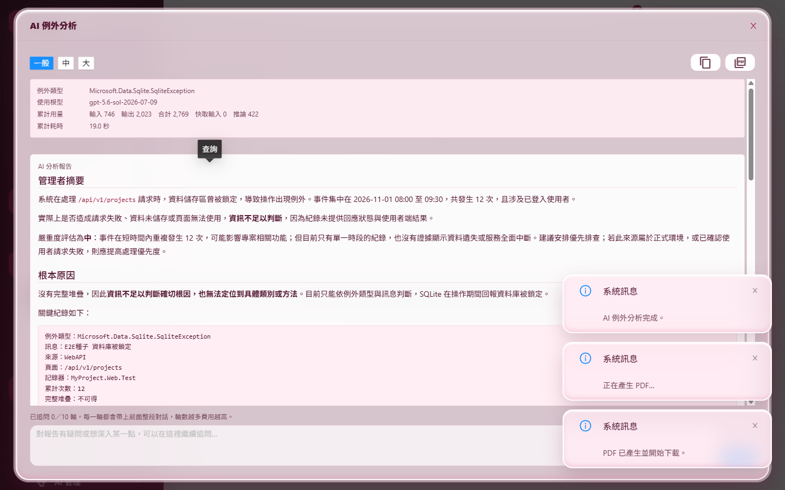

# 測試報告：升級 .NET 11

- 範圍：專案從 .NET 10 升到 .NET 11（框架、套件、建置與發佈流程、複刻腳本），並導入使用者選的新功能（WASM 發佈瘦身、EF Core 指令設定檔）
- 版本：0.10.13 → 0.10.14
- 測試日期：2026/11/14
- 分支：`feature/dotnet11`
- 變更紀錄：[2026-11-14-升級NET11](../../changelog/2026-11-14-升級NET11.md)

## 摘要

| 項目 | 結果 |
|---|---|
| 使用者決定（2026/11/14） | 升 .NET 11；AntDesign 用 `1.6.3-dotnet11.rc3`；名稱不改；採用 WASM 發佈瘦身、EF Core 指令設定檔；移除沒用的 OpenApi 套件；C# 15 不改寫既有程式 |
| 建置 | .NET 11 SDK 11.0.100，0 警告、0 錯誤（處理了 27 個新分析器與過時 API 的錯誤，見 A.2） |
| 獨立審查 | 沒有高嚴重度；2 項中（文件索引、報告未完成）、6 項低，全部處理（A.8） |
| 自動化測試 | 3,188 個全部通過（0.10.13 是 3,184）；CRUD 產生器驗證（產生、建置、格式、全部測試、三個產生頁面實跑、重跑不重複）通過；複刻腳本實際複刻 `Acme.Erp`：3,184 個測試全部通過、啟動後 36 路由煙霧全部通過 |
| 品質關卡 | 7 步全部通過（A.3） |
| 發佈流程 | 同站台、雙站台（帶與不帶 `-p:StaticSiteApiOrigin`）、`-r win-x64`、同一資料夾重複發佈：index.html 佔位、import map 雜湊、`icudt_CJK`、壓縮排除清單、Service Worker 資產清單雜湊全部檢查通過（A.4） |
| 實機驗證 | 同站台 15 支腳本 131 個情境全部通過（含真實模型 AI 18 項）；雙站台 4 支腳本＋載入畫面 L1～L7 全部通過；看得到的 Chrome 巡檢兩種部署各 47 項全部通過、截圖逐張目視（A.5） |
| 外觀比對 | 與最終驗收（0.10.12）的 53 個畫面比對：版面相同；差異只有資料、時間、版本、亂數驗證碼，以及 AntDesign RC 的幾項外觀細節（頁尾按鈕順序已維持原樣、表單說明列與頁尾高度少幾個像素、按下工具列按鈕後滑鼠停在上面時提示框會再出現）（A.6） |
| 效能 | 發佈版前後端都量（A.7）：第一次開啟 1,068 → 1,075 毫秒（+1%）、傳輸量 +2%；其餘畫面換頁與 API 都變快（多數 −40%～−60%），記憶體持平；沒有任何一項慢 20% 以上 |
| 需要使用者決定 | **對話窗頁尾的按鈕順序**：AntDesign RC 把預設頁尾改成「取消　儲存」，這次以樣式維持原本的「儲存　取消」，要不要採用新順序請使用者決定（A.6） |
| 發現的既有問題（交給 ④） | 使用者在查詢還沒回來時就換頁，伺服器把「用戶端中斷的請求」（`IOException: The client reset the request stream.`）記成系統例外。.NET 10 一樣會發生（0.10.13 的實機資料庫裡也有），不是升級造成的 |

---

## A.1 套件調查與決定

| 套件 | 0.10.13 | 0.10.14 | 理由 |
|---|---|---|---|
| ASP.NET Core、EF Core、Redis 快取 | 10.0.14 | 11.0.0 | 正式版 |
| AntDesign | 1.6.2 | 1.6.3-dotnet11.rc3 | 1.6.2 只替 net10.0 編譯；RC3 是唯一替 net11.0 編譯的版本（PR #4875 調整了 .NET 11 的數字轉換與事件回呼型別），使用者同意採用 |
| Swashbuckle.AspNetCore | 10.3.1 | 11.0.1 | 支援 .NET 11；本專案沒有自訂篩選器，輸出維持 OpenAPI 3.0 |
| bunit、NLog.Web.AspNetCore、Microsoft.NET.Test.Sdk | 2.14.0、6.2.2、18.11.0 | 2.15.2、6.3.0、18.12.0 | 相容的最新版 |
| Microsoft.AspNetCore.OpenApi | 10.0.14 | 移除 | 沒有在用（`AddOpenApi` 一直是註解） |
| Microsoft.Agents.AI（×3）、Microsoft.Extensions.AI.OpenAI、OpenAI | 1.28、10.11、2.14 | 不變 | MAF 已是最新且綁 M.E.AI 10.11；共用框架 11 提供的 `Microsoft.Extensions.*` 會勝出，沒有綁定衝突（真實模型實測 18 項通過） |
| PDFsharp-MigraDoc、ClosedXML | — | 不變 | 授權原因刻意固定 |
| MailKit、AutoMapper | 4.18.2、16.3.0 | 不變 | 新版是主版號升級（5.0、17.0），另案評估 |

AntDesign 的非同步表單驗證（PR #4882）在 11/13 才合併，RC3 沒有；NuGet 上也沒有更新的版本，留到 ③ 試驗。

---

## A.2 .NET 11 帶來的建置錯誤與處理

| 錯誤 | 數量 | 處理 |
|---|---|---|
| BL0016（JS 互通沒包 try/catch） | 18 | 錯誤頁的「回上一頁」補上 `try/catch (JSException)`；`TokenStore`、`BrowserFiles`、`FileDownload` 是刻意把例外交給呼叫端的薄包裝，以類別層級的 `SuppressMessage` 豁免並寫明理由 |
| BL0012（多餘的 `StateHasChanged`） | 2 | `ToastCopyButton.CopyAsync` 最後一個、`ClientNavMenu.RestoreMenuSelection`（只由子元件的 EventCallback 呼叫）——Blazor 之後會自動重新渲染 |
| CS0618 `EditContext.Validate()` 已過時 | 6 | 改成 `await ValidateAsync()`；CRUD 產生器樣板一起改 |
| SYSLIB0066 `IStartupValidator` 已過時 | 1 | 改用 `IAsyncStartupValidator`；`OptionsValidationTests` 的五個測試改成非同步 |
| AD0001（BL0014 分析器本身丟 NullReferenceException） | 1 | 以逐檔替換找到觸發的是 `Layout/ClientNavMenu.razor`（找不到確切寫法）；人工確認四個 `@for` 都沒有在 lambda 裡用到迴圈變數後，`MyProject.Web.Client.csproj` 以 `NoWarn` 關掉 BL0014，寫明解除條件 |

其他檢查過、不受影響的不相容變更：表單自動 CSRF（只影響標了 antiforgery 的端點）、OpenAPI 3.2 預設與 Microsoft.OpenApi 3.x（沒有自訂篩選器）、`BackgroundService` 例外時主機的結束方式（四個背景工作都自己接住例外）、回應壓縮的 `Vary` 與 zstd（沒有用回應壓縮中介軟體）、`IAuthorizationRequirementData`（沒有實作它的屬性）、C# 15 的語境關鍵字（沒有撞名）。EF Core 模型沒有差異（`has-pending-model-changes`）。

---

## A.3 品質關卡與腳本

`pwsh ./scripts/Invoke-QualityGate.ps1`：Restore、Build（Release，0 警告）、Format、Test、Docs encoding、CRUD anchors、Vulnerability 七步全部通過（審查修正後重跑）。

- `scripts/Test-CrudGenerator.ps1`（樣板改用 `ValidateAsync`）：產生三個範例模組、建置、格式、全部測試、三個產生頁面的實跑、`-Force` 重跑不改動任何檔案，全部通過。
- `scripts/New-StarterProject.ps1` 實際複刻 `Acme.Erp` 到暫存資料夾：dotnet-ef 版本檢查通過、`.config/dotnet-ef.json` 的路徑換成 `src/Acme.Erp/…`、Init migration 重建；複刻出的專案 3,184 個測試全部通過，啟動後登入跑 36 路由煙霧全部通過。

---

## A.4 發佈流程

以發佈輸出檢查腳本逐項確認：

| 項目 | 雙站台（`-p:StaticSiteApiOrigin`） | 雙站台（不帶參數） | 同站台 | 同站台 `-r win-x64` |
|---|---|---|---|---|
| index.html 沒有未處理的佔位、import map 已填入、引用的 `_framework` 檔案都在 | 通過 | 通過 | 通過 | 通過 |
| 地區資料只有 `icudt_CJK` | 通過 | 通過 | 通過 | 通過 |
| Service Worker、資產清單、`appsettings.json`、manifest 沒有壓縮副本；SW 是發佈版且有版本註解 | 通過 | 通過 | 通過 | 通過 |
| 資產清單上每個檔案的雜湊相符（只看 Service Worker 會抓的副檔名） | 通過（517 個） | 通過 | 通過 | 通過 |
| `web.config` 的 CSP 帶 import map 雜湊、不含 localhost | 通過 | 通過 | — | — |
| `connect-src` 與 `ApiBaseUrl` 填入 API 來源 | 通過 | 回到 `'self'`（同一資料夾重複發佈） | — | — |

觀察到的 .NET 11 變化：
- `blazor.webassembly.js` 不再帶指紋（.NET 10 是 `blazor.webassembly.<指紋>.js`）。靜態站的長效快取規則只認 10 碼指紋，這個檔維持 `no-cache`，正確；Service Worker 以 integrity 驗證，不受影響。
- 發佈輸出多了 `blazor.webassembly.js.map`，不在 Service Worker 的快取清單裡（副檔名不符）。
- **大小**：.NET 11 為了 OpenTelemetry 把 WebAssembly 的計量、事件追蹤、HTTP 追蹤傳遞預設改成開啟，`_framework` 的 Brotli 總量一度從 4,444,473 變成 4,826,043 位元組（+8.6%；`System.Private.CoreLib` +113 KB、`System.Diagnostics.DiagnosticSource` +41 KB）。在 Client 專案明確關掉三個開關後是 **4,574,113 位元組（+2.9%）**；剩下的增加是 .NET 11 執行階段本身（CoreLib、`dotnet.native.wasm`、ICU、System.Text.Json），專案設定無法再縮。

---

## A.5 實機驗證

### 同站台（`Start-E2EHost.ps1`）

| 腳本 | 結果 |
|---|---|
| `m01-tokens` S1～S11、`m02-shell` W1～W14 | 25／25 |
| `m03-crud` C1～C13 | 13／13 |
| `m04-projects` P1～P19 | 19／19 |
| `m05-admin` A1～A13 | 13／13 |
| `m06-ops` O1～O8 | 8／8 |
| `m06-ai`（真實模型）A1～A9 | 9／9 |
| `m07-ops` O1～O9 | 9／9 |
| `m08-agents`（真實模型）G1～G9 | 9／9 |
| `m09-auth` T1～T11 | 11／11 |
| `m10-no-server` N1～N4、`m11-split hosted` S1／S3／S6／S7、`ux-loading-pages` L1～L7 | 15／15 |

每支附帶的 36 路由煙霧全部通過。

### 雙站台（發佈版前端＋`static-site.mjs`＋API 主機）

| 腳本 | 結果 |
|---|---|
| `m11-split google`（`-FakeGoogle`）S1～S7、`m04-projects` P1～P20 | 全部通過 |
| `m09-auth` T1～T11、`m12-pwa` W1～W7 | 全部通過 |
| `ux-loading-pages` L1～L7 | 全部通過。看得到的瀏覽器跑時 L3 讀剪貼簿兩次被拒（那時視窗沒有焦點，「已複製」照常出現）；腳本改成先把分頁拉到前景並記下錯誤，無頭模式重跑通過，剪貼簿內容核對相符 |

### 實際開瀏覽器巡檢（`walkthrough.mjs`，`E2E_HEADED=1`）

同站台與雙站台各一輪：V01～V30、D01～D10、T01（真實模型）、A01～A05、A99 共 47 項全部通過；兩輪共 92 張截圖排成總覽圖逐張目視，版面與內容正常，對話窗頁尾是「儲存　取消」。

| | |
|---|---|
|  |  |
| 01 專案新增窗（.NET 11，頁尾維持「儲存　取消」） | 02 專案清單 |
|  |  |
| 03 雙站台：AI 例外分析（真實模型）完成、按過 PDF 後滑鼠移到關閉鈕 | 04 頁尾按鈕：左 0.10.12、中 RC 預設（取消　儲存）、右 0.10.14（維持儲存　取消） |

---

## A.6 外觀比對（與最終驗收的 53 個畫面）

| 差異 | 原因 | 處理 |
|---|---|---|
| 所有表單對話窗的頁尾按鈕順序反過來（「取消　儲存」） | AntDesign RC 的預設頁尾改成先取消再確定（PR #4857，對齊 antd） | 使用者看得到的改變，依計畫不自行採用：`OverlayStyles` 以 `flex-direction: row-reverse` 維持「儲存　取消」（`ModalFooterOrderTests` 守門，並禁止自訂頁尾）。⚠️ 畫面順序與 Tab 順序（先取消）不一致。**請使用者決定**要不要改用新順序（刪掉那段樣式即可） |
| 表單說明文字、頁尾的高度少幾個像素 | RC 不再為沒有說明的欄位輸出空白的說明區（PR #4863）；頁尾改成 flex | 外觀差異，不處理 |
| 按下工具列按鈕後滑鼠停在上面，提示框會再出現 | RC 的浮層滑鼠事件修正 | 一般的懸停行為；0.10.12 起提示框不攔截點擊，T01 兩種部署都通過 |
| 專案修改窗第一次截圖時對話窗還在進場動畫 | 截圖時機 | 重拍後相同 |
| 時間、版本、亂數驗證碼、日誌內容、飄雪 | 資料 | — |

---

## A.7 效能（.NET 10 基準 vs .NET 11）

量法：`scripts/e2e/perf.mjs`，`Start-E2EHost.ps1 -Published`（同站台、前端與 API 都是 Release 發佈版），灌入 2,000 筆專案與 300 個分類，每項跑 5 次取中位數；同一台電腦、同樣條件（基準在 0.10.13 合併後、升級前量）。

| 項目 | .NET 10 | .NET 11 | 差異 |
|---|---|---|---|
| 第一次開啟（無快取、擋掉 Service Worker）| 1,068 毫秒、6,860 KB、91 個請求 | 1,075 毫秒、6,986 KB、94 個請求 | 時間 +1%、傳輸量 +2% |
| 再次開啟（Service Worker 與快取） | 1,063 毫秒 | 621 毫秒 | -42% |

| 畫面（前端換頁到 API 全部完成，毫秒） | .NET 10 | .NET 11 | 差異 |
|---|---|---|---|
| `/App` | 123 | 53 | -57% |
| `/Profile` | 95 | 52 | -45% |
| `/projects` | 499 | 264 | -47% |
| `/categories` | 284 | 142 | -50% |
| `/teams` | 99 | 55 | -44% |
| `/myusers` | 166 | 40 | -76% |
| `/roleviews` | 127 | 75 | -41% |
| `/audit-logs` | 282 | 152 | -46% |
| `/email-logs` | 104 | 58 | -44% |
| `/logs` | 131 | 76 | -42% |
| `/log-level-setting` | 69 | 39 | -43% |
| `/system-exceptions` | 138 | 65 | -53% |
| `/ai-call-logs` | 93 | 41 | -56% |
| `/token-usage` | 168 | 68 | -60% |
| `/prompt-templates` | 74 | 39 | -47% |
| `/system-health` | 1139 | 1163 | +2% |
| `/database-usage` | 72 | 38 | -47% |
| `/scheduled-jobs` | 86 | 41 | -52% |
| `/backups` | 82 | 46 | -44% |
| `/data-retention` | 86 | 42 | -51% |
| `/system-parameters` | 75 | 38 | -49% |
| `/announcements` | 80 | 45 | -44% |
| `/agent-playground` | 70 | 37 | -47% |
| `/agent-workflows` | 103 | 39 | -62% |
| `/admin-assistant` | 68 | 40 | -41% |

| API（中位數，毫秒） | .NET 10 | .NET 11 | 差異 |
|---|---|---|---|
| 分類查詢 | 7 | 4 | -43% |
| 分類查詢（關鍵字） | 7 | 3 | -57% |
| 專案查詢 | 9 | 5 | -44% |
| 專案查詢（每頁 200） | 14 | 7 | -50% |
| 專案查詢（第 50 頁） | 11 | 6 | -45% |
| 專案匯出 | 186 | 177 | -5% |
| 使用者查詢 | 7 | 4 | -43% |
| 稽核紀錄查詢 | 8 | 3 | -62% |
| 日誌查詢 | 32 | 4 | -88% |
| 外框選單 | 7 | 3 | -57% |
| 目前使用者 | 6 | 3 | -50% |
| 首頁儀表板 | 7 | 3 | -57% |
| 分類新增 | 13 | 7 | -46% |
| 分類修改 | 13 | 7 | -46% |

| 記憶體 | .NET 10 | .NET 11 |
|---|---|---|
| 伺服器工作集（MB） | 353 | 359 |
| 瀏覽器 JS heap（MB） | 16 | 13 |
| WebAssembly 記憶體（MB） | 286 | 286 |

結論：沒有任何一項慢 20% 以上；第一次開啟持平（下載量 +2%），其餘普遍變快。API 的數字只有幾毫秒，絕對值的差異很小，④ 會再量一次（同時比較 Runtime Async 開與關）。

---

## A.8 獨立審查

審查者（未參與實作）讀完整份變更、建置並執行全部測試。確認沒有問題的部分：同步 Main 裡等 `IAsyncStartupValidator` 不會死結（主控台程式沒有同步內容）；BL0012 拿掉的兩個 `StateHasChanged` 在所有呼叫路徑都會自動重新渲染；三個豁免 BL0016 的包裝類別呼叫端行為不變；前端沒有用到計量、事件追蹤或 Activity，關掉 HTTP 追蹤傳遞還避免雙站台時多帶 `traceparent` 標頭觸發預檢；共用框架 11 的 `Microsoft.Extensions.*` 不會與 MAF 1.28 衝突；`Microsoft.OpenApi` 仍由 Swashbuckle 帶入；`.config/dotnet-ef.json` 在複刻時會改名；部署清單的 .NET 11 說明正確。

| # | 嚴重度 | 發現 | 處理 |
|---|---|---|---|
| 1 | 中 | `docs/README.md` 版本與索引沒更新 | 更新 |
| 2 | 中 | 測試報告未完成 | 完成本報告 |
| 3 | 低 | 複刻腳本「沒裝 dotnet-ef」的訊息沒帶版本，EF 12 出來後會裝到不符的版本 | 訊息依專案的 EF Core 主版號帶 `--version 11.*` |
| 4 | 低 | 版本檢查連比專案新的工具也擋；找不到 `Directory.Packages.props` 時丟原始例外 | 只擋比專案舊的工具；找不到時給明確訊息 |
| 5 | 低 | 頁尾守門測試只抓 `Footer="…"` | 也抓 `Footer=@x`、`<Footer>`、`.cs` 裡的 `Footer = …` |
| 6 | 低 | 頁尾反轉後很窄的畫面按鈕不會換行；畫面順序與 Tab 順序不一致 | 加 `flex-wrap`；順序不一致寫進 A.6，交給使用者決定 |
| 7 | 低 | `ValidateAsync` 在非同步驗證器出錯而沒有訊息時回 false，畫面不會有任何提示（目前沒有非同步驗證器，潛在） | 記下來，③ 加非同步驗證時一併處理 |
| 8 | 低 | `Directory.Packages.props` 多了 BOM、部分檔案是 LF | 無害（git 會轉換） |
