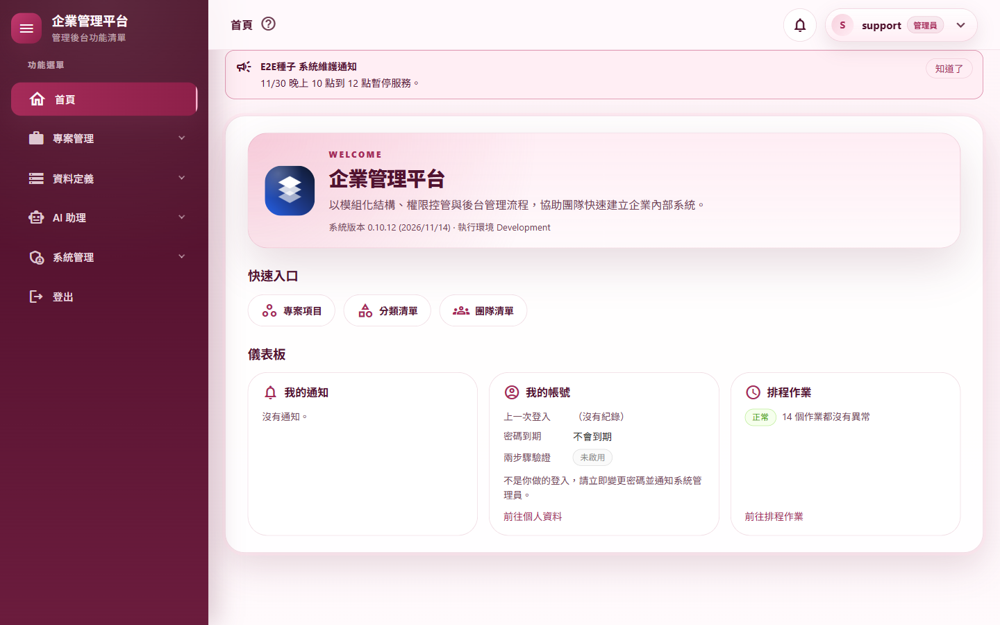
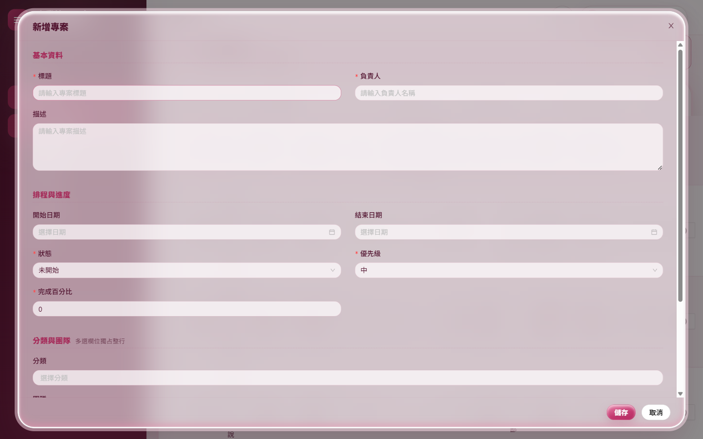
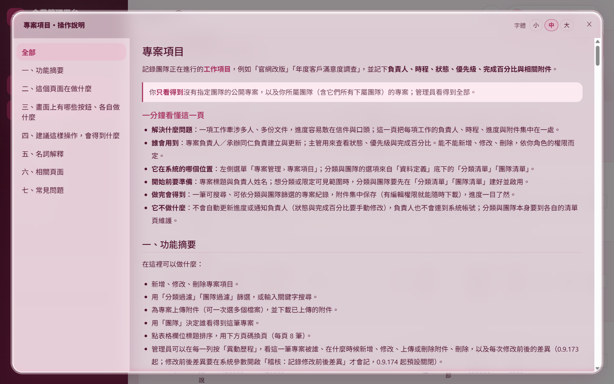
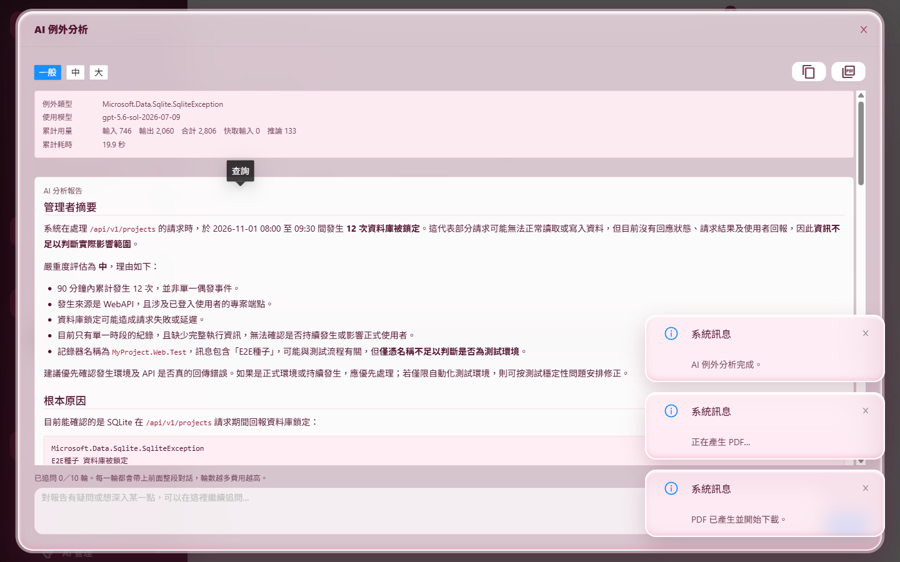
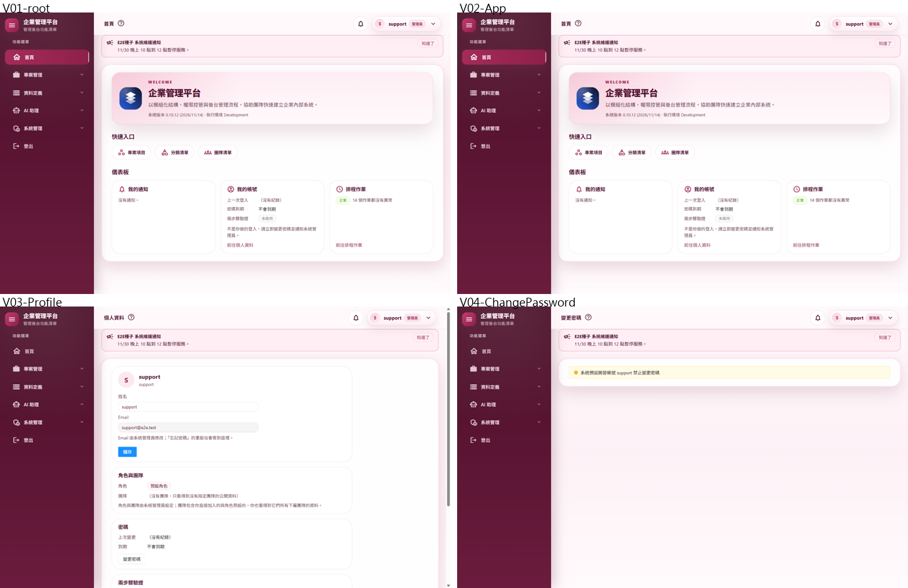

# 最終驗收報告：WASM 遷移

- 範圍：WASM 遷移 M1～M12 全部完成後的最終驗收（計畫 [§5 最終驗收](../WASM遷移計畫.md)）
- 版本：0.10.12（最終驗收中修正一項，0.10.11 → 0.10.12）
- 驗收日期：2026/11/13～2026/11/14
- 分支：`feature/wasm-final-acceptance`

## 摘要

| 項目 | 結果 |
|---|---|
| 全功能回歸 | 依[分析報告 §4 功能對照表](../WASM改寫可行性分析報告.md#4-功能對照表原功能--wasm-後如何保留)逐項驗證（見 A.2）：M1～M12 全部實機腳本在最終版本重跑，**全部通過** |
| 同站台（API 主機一併提供前端） | 12 支情境腳本、共 124 個情境全部通過，每支附帶的 36 路由煙霧測試全部通過 |
| 雙站台（前端獨立靜態站＋API 主機） | 4 支情境腳本、共 45 個情境全部通過（CORS、Google 導向、信中連結、跨來源附件上傳下載、PWA 與離線），各附 36 路由煙霧全部通過 |
| 真實模型 AI | 例外與日誌 AI 分析串流、追問、停止產生、取消、PDF 匯出（M6 9 項）；Agent 測試台、工作流程、系統管理助理的核准與拒絕、重新整理接回、兩分頁排隊（M8 9 項）：全部通過 |
| 離線與 PWA | 安裝、離線提示、離線重新整理不登出、恢復連線、部署新版提示、伺服器暫時連不上自動恢復（M12 7 項）：全部通過 |
| 外觀比對 | M3～M9 的 53 個畫面與 M11 比對：36 個完全相同，其餘差異都是資料（版本、時間、日期、檔案大小、飄雪動畫與驗證碼）或次像素，版面沒有變化 |
| 實際開瀏覽器巡檢 | 以看得到的 Chrome 開遍 30 個登入後路由、10 個主要對話窗與浮層、6 個登入相關頁面與登出，兩種部署方式各一輪（共 94 張截圖），逐張目視檢查：**沒有版面或內容異常**；同時記錄主控台錯誤與 CSP 違規：除已知的 AntDesign 頁籤訊息外沒有 |
| 驗收中發現並修正 | **工具列按鈕的提示框停住並蓋住對話窗的關閉鈕**（按「產生 PDF 報告並下載」後無法用滑鼠關閉 AI 對話窗）→ 提示框不攔截點擊、按鈕按下時收起提示框（0.10.12，補 3 個測試） |
| 品質關卡 | 7 步全部通過（結果見 A.4） |
| 結論 | **WASM 遷移完成，所有原功能在 Blazor WebAssembly＋Web API 上保留且可用** |

---

## A.1 驗收環境

| 項目 | 內容 |
|---|---|
| 同站台 | `scripts/Start-E2EHost.ps1`（開發模式 `dotnet run`，隔離資料庫與所有外部路徑，信件存成 .eml） |
| 雙站台 | 前端 `dotnet publish src/MyProject/MyProject.Web.Client -c Release -p:StaticSiteApiOrigin=https://localhost:7144`，由照 web.config 規則的 `scripts/e2e/static-site.mjs` 提供（`http://localhost:7145`；這台開發機的 IIS Express 無法啟動，見 M11 報告）；API 主機 `ClientSettings__BaseUrl=http://localhost:7145/` |
| 瀏覽器 | 本機 Chrome＋playwright-core；巡檢以看得到的視窗（`E2E_HEADED=1`）執行 |
| 真實模型 | 開發機 User Secrets 的金鑰（未印出、未寫入檔案） |
| 截圖 | 隔離資料庫的 support Email 一律換成 `support@e2e.test`，截圖沒有個人資料 |

---

## A.2 功能對照表逐項驗證

依分析報告 §4 的每一列，對應到最終版本實際通過的腳本與情境。

### 頁面

| 路由 | 驗證腳本與情境（最終版本） | 結果 |
|---|---|---|
| `/Profile` | m02-shell W1～W3（WASM、改姓名右上角立即更新）、W8（離線訊息、恢復後存檔）；巡檢 V03 | 通過 |
| （外框） | m02-shell W2、W4（操作說明）、W5（通知鈴鐺）、W6（公告橫幅）、W7（換頁不整頁載入）；m08-agents 推播；巡檢 D07～D10 | 通過 |
| `/categories`、`/teams` | m03-crud C1～C13（新增、修改、停用、刪除、還原、永久刪除、團隊樹、唯讀權限）；外觀比對 m03 8 畫面 | 通過 |
| `/projects` | m04-projects P1～P19（附件上傳、下載內容一致、票證只能用一次、版本衝突、權限、異動歷程）；雙站台 P1～P20（含 P2b 下載失敗留在原頁）；外觀比對 m04 5 畫面 | 通過 |
| `/myusers`、`/roleviews`、`/audit-logs`、`/email-logs` | m05-admin A1～A13（改他人角色後被登出、改自己仍登入、停用、非管理員 403、匯出、複製使用者、角色矩陣、稽核查詢／明細／驗證／匯出、寄信紀錄）；外觀比對 m05 8 畫面 | 通過 |
| `/logs`、`/log-level-setting`、`/system-exceptions`、`/ai-call-logs`、`/token-usage`、`/prompt-templates` | m06-ops M6-O1～O8；m06-ai M6-A1～A9（真實模型）；外觀比對 m06 9 畫面 | 通過 |
| `/system-health`、`/database-usage`、`/scheduled-jobs`、`/backups`、`/data-retention`、`/system-parameters`、`/announcements`、`/App` | m07-ops M7-O1～O9；m01-tokens S9（排程與資料保留）；外觀比對 m07 9 畫面 | 通過 |
| `/agent-playground`、`/agent-workflows`、`/admin-assistant` | m08-agents M8-G1～G9（真實模型：寫入工具核准與拒絕、核准中重新整理、兩分頁排隊、工作流程人工介入中重新整理接回、不可復原要輸入「確認」、巡檢報告連結、推播）；外觀比對 m08 4 畫面 | 通過 |
| `/Auths/Login`、`/Auths/TwoFactor`、`/Auths/ForgotPassword`、`/Auths/ResetPassword`、`/Auths/Pending`、`/Auths/Logout` | m09-auth M9-T1～T11（記住我、新分頁、跨分頁登出、鎖定、TOTP＋記住裝置、強制改密碼、忘記密碼信件、Token 重用、兩分頁同時刷新），同站台與雙站台各一輪；外觀比對 m09 10 畫面；巡檢 A01～A05、A99 | 通過 |
| `/Auths/RefreshSession` | M9 移除（不再需要換發 Cookie）；煙霧測試 36 路由不含它 | 依設計移除 |
| `/ChangePassword`、`/TwoFactorSetup` | m09-auth T6、T7；m02-shell W11；巡檢 V04、V05 | 通過 |
| （Google 登入） | m11-split S5（雙站台：前端 → API 主機 `/Auths/Google/Login` → Google，回呼 API 主機）；一次性代碼兌換由整合測試涵蓋（開發機沒有真的 Google 設定） | 通過（真的 Google 帳號登入需上線前人工驗證） |
| `/` | m01、煙霧 R01；巡檢 V01 | 通過 |
| `/Error`、`/not-found` | 煙霧 R29、R30；外觀比對 m09 09、10；巡檢 V29、V30 | 通過 |

### 機制

| 原機制 | WASM 後的做法與驗證 | 結果 |
|---|---|---|
| `ApplicationCircuitHandler` 每次換頁寫 `Page.View` 稽核 | 前端呼叫 `shell/page-view`；m02-shell W13（每頁只記一筆）；巡檢期間稽核紀錄頁看得到 | 通過 |
| 電路取得用戶端 IP | API 由請求取得（`ApiActorMiddleware`）；稽核紀錄的來源 IP | 通過 |
| `BrowserErrorReporter`（JS 呼叫 .NET） | 前端錯誤經 API 回報；m02-shell W12、各腳本「沒有未處理的瀏覽器錯誤」 | 通過 |
| 前端 `ILogger` 寫入伺服器日誌 | 同上（錯誤經 API 回報） | 通過 |
| `ReconnectModal` 斷線重連畫面 | M10 移除；改為離線提示列與「目前離線」訊息（m02-shell W8、m12-pwa W3／W4） | 依設計取代 |
| 例外紀錄的「發生在哪個頁面」 | 前端回報帶頁面；系統例外頁 | 通過 |
| 約 12 個 `IOptions<…Settings>` 直接注入畫面 | 改由 API 提供（`shell/info`、各頁 options API）；各頁正常顯示（巡檢） | 通過 |

---

## A.3 實機結果明細

### 同站台

| 腳本 | 情境 | 結果 | 附帶煙霧 |
|---|---|---|---|
| `m01-tokens.mjs` | S1～S11（Token 發出、刷新、輪替、撤銷、強制登出、排程清理） | 11／11 | — |
| `m02-shell.mjs` | W1～W14（外框、個人資料、通知、公告、換頁、離線、登出、換人、強制改密碼、開頁稽核） | 14／14 | 36／36 |
| `m03-crud.mjs` | C1～C13 | 13／13 | 36／36 |
| `m04-projects.mjs` | P1～P19 | 19／19 | 36／36 |
| `m05-admin.mjs` | A1～A13 | 13／13 | 36／36 |
| `m06-ops.mjs` | M6-O1～O8 | 8／8 | 36／36 |
| `m06-ai.mjs`（真實模型） | M6-A1～A9 | 9／9 | — |
| `m07-ops.mjs` | M7-O1～O9 | 9／9 | 36／36 |
| `m08-agents.mjs`（真實模型） | M8-G1～G9 | 9／9 | 36／36 |
| `m09-auth.mjs` | M9-T1～T11 | 11／11 | 36／36 |
| `m10-no-server.mjs` | N1～N4（沒有 WebSocket／`_blazor`、只有 WASM 外殼） | 4／4 | 36／36 |
| `m11-split.mjs hosted` | S1、S3、S6、S7（同站台的回應、標頭、CSP、冷啟動） | 4／4 | 36／36 |

### 雙站台

| 腳本 | 情境 | 結果 | 附帶煙霧 |
|---|---|---|---|
| `m11-split.mjs google` | S1～S7（API 全打到 API 主機、CORS 允許與瀏覽器實際擋下、靜態站標頭與 CSP 與 Brotli、API 主機不提供前端、Google 導向、冷啟動 4.3 MB、36 路由沒有 CSP 違規） | 7／7 | 36／36 |
| `m04-projects.mjs` | P1～P20（跨來源 multipart 上傳、fetch＋blob 下載、下載失敗留在原頁） | 20／20 | 36／36 |
| `m09-auth.mjs` | M9-T1～T11（信中連結指向前端、跨來源刷新） | 11／11 | 36／36 |
| `m12-pwa.mjs` | W1～W7（SW 接管且快取沒有 API、可安裝、離線、恢復、部署新版、英文瀏覽器、伺服器暫時連不上） | 7／7 | 36／36 |

### 外觀比對（53 個畫面，M11 → 最終版本）

| 來源 | 完全相同 | 差異 |
|---|---|---|
| M3 分類與團隊（8） | 7 | 修改窗 1／255（反鋸齒） |
| M4 專案（5） | 5 | — |
| M5 使用者、角色、稽核、寄信（8） | 7 | 角色修改窗 8 個像素（反鋸齒） |
| M6 日誌與 AI 管理（9） | 6 | 3 個最多 8／255、每張不到 120 個像素 |
| M7 維運與首頁（9） | 4 | 系統健康（版本、時間、隔離資料夾）、資料保留（時間與大小）、首頁兩張（版本 0.10.11 → 0.10.12）、公告管理 2／255 |
| M8 Agent（4） | 3 | Agent 測試台 9 個像素（反鋸齒） |
| M9 登入相關（10） | 4 | 登入相關頁的飄雪動畫與亂數驗證碼 |

### 實際開瀏覽器巡檢（`walkthrough.mjs`，看得到的 Chrome）

| 項目 | 同站台 | 雙站台 |
|---|---|---|
| V01～V30 登入後 30 個路由（每頁等外框與內容出現、記錄頁面錯誤／主控台錯誤／CSP 違規／錯誤列） | 30／30 | 30／30 |
| D01～D10 主要對話窗與浮層（分類、團隊、專案、使用者、角色、公告的新增窗、操作說明窗、使用者選單、通知鈴鐺、關於） | 10／10 | 10／10 |
| T01 按過「產生 PDF 報告並下載」後，滑鼠（分段移動）移到關閉鈕一般點擊能關掉 AI 對話窗（真實模型一次） | 通過（修正後） | 通過 |
| A01～A05 登入相關頁面（未登入）、A99 登出 | 6／6 | 6／6 |

- **逐張目視檢查**：同站台的 46 張截圖排成 12 張總覽圖逐一檢查，版面、資料、按鈕、提示列、對話窗都正常。雙站台的 46 張與同站台逐像素比對，差異都是資料（日誌內容、時間、AI 回覆）、飄雪動畫，以及輸入框的焦點框（截圖瞬間是否已取得焦點），版面相同。
- **主控台與 CSP**：除已知的 AntDesign 頁籤 `ondragover` 行內事件（Token 用量、提示詞兩頁，共 23 則，不影響功能）外，沒有任何錯誤或違規。

---

## A.4 品質關卡

`pwsh ./scripts/Invoke-QualityGate.ps1`：

| 步驟 | 結果 | 秒數 |
|---|---|---|
| Restore | 通過 | 1.2 |
| Build（Release） | 通過（0 警告、0 錯誤） | 11.3 |
| Format | 通過 | 83.5 |
| Test | 通過（3,161 個） | 130.8 |
| Docs encoding | 通過（312 個檔案） | 0.1 |
| CRUD anchors | 通過 | 0.8 |
| Vulnerability | 通過（沒有已知弱點） | 23.6 |

合計 251.3 秒，`QUALITY GATE PASSED`。測試從 M12 結束時的 3,158 增加到 3,161（`TooltipDismissTests` 3 個；第一次全量執行時這 3 個中有 2 個因 AntDesign 按鈕非同步處理點擊而偶發失敗，改為等待斷言後連跑三次與全量都通過）。

---

## A.5 驗收中發現的問題

### 修正（0.10.12）

**工具列按鈕的提示框停住、蓋住對話窗的關閉鈕**

- **現象**：例外 AI 分析完成後按「產生 PDF 報告並下載」，按鈕的提示框一直停在對話窗右上角、蓋住關閉鈕。用滑鼠點關閉鈕時，點擊被提示框擋下，對話窗關不掉（按 Esc 才行）。
- **發現經過**：最終回歸時 m06-ai 的 A6 失敗；巡檢 T01 以分段移動的滑鼠（接近真人）在看得到的瀏覽器重現。
- **原因**：按鈕在產生 PDF 期間重新渲染，滑鼠離開的事件沒觸發，AntDesign 的提示框就收不起來。
- **修正**：
  1. `OverlayStyles.razor` 讓 `.ant-tooltip` 不攔截點擊（`pointer-events: none`）。提示框只是說明文字，萬一停住也不擋底下的按鈕。
  2. `ToolbarIconButton`、`CrudActionButton` 按下時收起自己的提示框。
- **測試**：新增 `TooltipDismissTests` 3 個，先看到失敗再實作；巡檢 T01 兩種部署方式都通過。
- **仍存在的外觀問題**：滑鼠停在按鈕上時提示框照常顯示，移開後可能仍短暫停留，但不再擋住點擊。

### 實機腳本的修正（不影響程式）

| 腳本 | 問題 | 修正 |
|---|---|---|
| `common.mjs` 等 7 支 | `page.waitForFunction` 第一次判斷不成立、開始輪詢時要在頁面裡 eval，被前端的 CSP（M11 起沒有 `'unsafe-eval'`）擋下，造成偶發失敗 | 新增 `waitForPredicate`（在 Node 端以 `page.evaluate` 輪詢），全部改用它 |
| `m02-shell.mjs` | W8 等的是舊的離線訊息；M12 起瀏覽器確定離線時是「目前離線，請恢復連線後再試。」 | 改認新訊息 |
| `m06-ai.mjs` | 關閉對話窗前上一個按鈕的提示框還停著（即上面那項程式問題） | 先把滑鼠移到對話窗標題；失敗時截圖並記下擋住的元素 |
| `m06-views.mjs`、`m06-ai.mjs` | 日期欄位「確定」鈕停用時點不下去；開日誌頁太早填起訖時間會被第一次查詢蓋掉 | 停用時改按 Enter；先等第一次查詢回來 |
| `crud-ui.mjs` | 確認窗按下後，接著跳出的下一個確認窗變成新的 `.last()`，腳本等錯對象 | 等「按下的那一個」關掉 |
| `m03-crud.mjs` 與 `m04-projects.mjs` | 同一個資料庫依序執行時，M3 會刪掉 M4 要用的測試團隊 | 兩者分開以各自的主機執行（已寫進 README） |

### 遷移前就存在、這次沒有改的

| 項目 | 說明 |
|---|---|
| `/not-found` 顯示英文「Not Found／Sorry, the content you are looking for does not exist.」、頁名「系統首頁」 | 專案建立時（Blazor 樣板）就是如此，M9 外觀比對與 Server 版完全相同；改成繁體中文只要改 `NotFoundContent.razor` 一處 |
| `/Error` 是沒有外框的簡單頁面 | 同 Server 版，出錯時刻意不依賴外框 |
| AntDesign 頁籤的 `ondragover` 行內事件被 CSP 擋下 | 主控台訊息，不影響功能（M11 起記為已知） |

---

## A.6 已知限制（彙整）

- **web.config 未在真的 IIS 實測**：靜態站 web.config 的 IIS 規則由守門測試檢查、實機以模擬站台驗證，上線前要在真的 IIS（URL Rewrite 模組）驗證一次（部署清單已列）。
- **Google 登入**：真的 Google 帳號登入需上線前人工驗證。
- **Service Worker 只在 HTTPS 或 localhost 生效**；部署新版後使用者要按「有新版本」才換新版；退版或拿掉 Service Worker 要照部署清單的程序。
- **單一行程內的狀態**：下載票證、Google 一次性代碼、兩步驟待驗票證、工作流程執行登錄表在單一行程內有效（IIS 應用程式集區維持一個背景工作處理序）。
- **離線**：只能開外框與看到提示，資料畫面需要連線（計畫決策）。Material Icons 字型跨來源不快取，離線時圖示顯示成文字。

---

## A.7 截圖

巡檢截圖（各 46 張）與總覽圖在驗收執行的暫存資料夾。報告只收錄代表畫面：

| # | 內容 |
|---|---|
| 01 |  |
| 02 |  |
| 03 |  |
| 04 |  |
| 05 |  |

截圖中沒有個人 Email。
