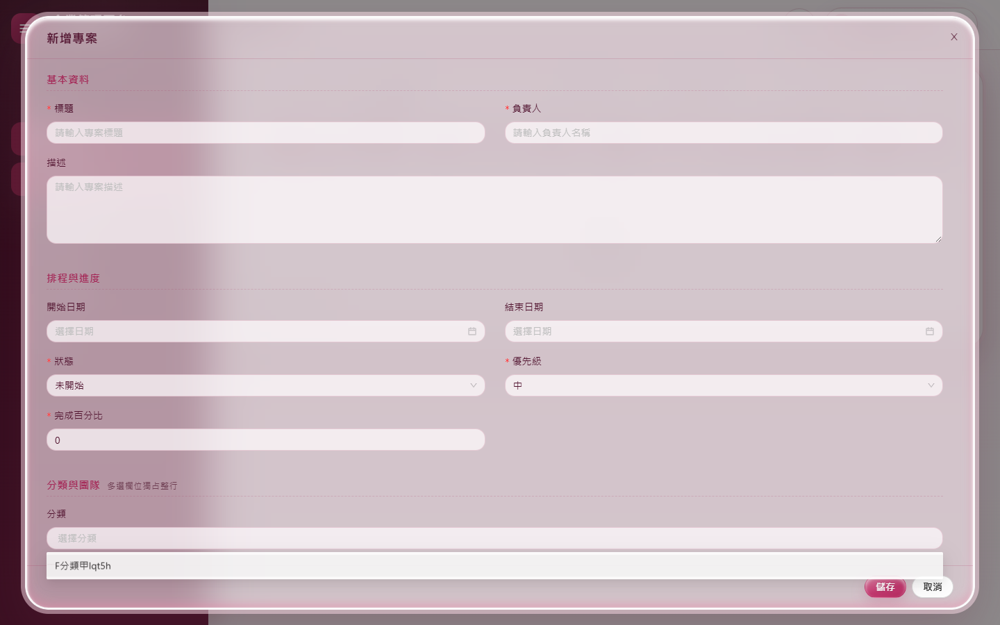
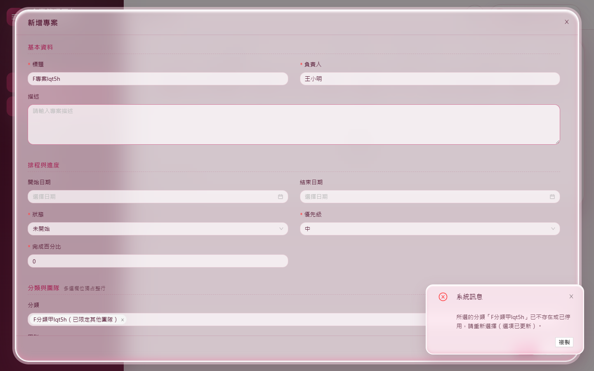
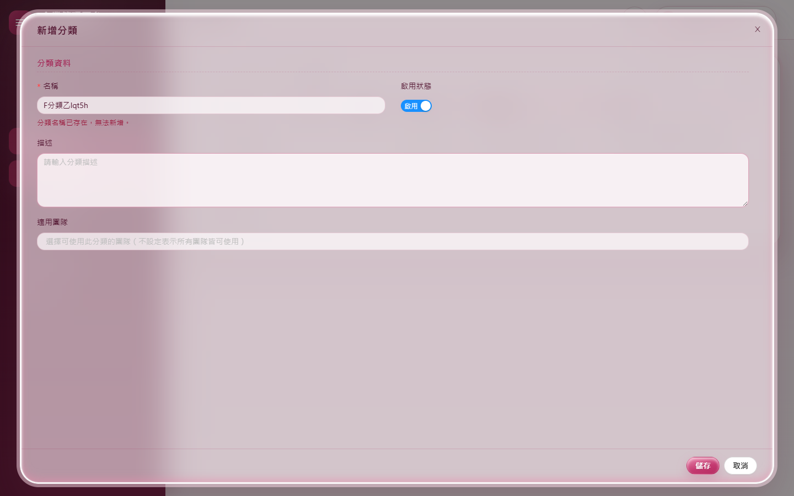
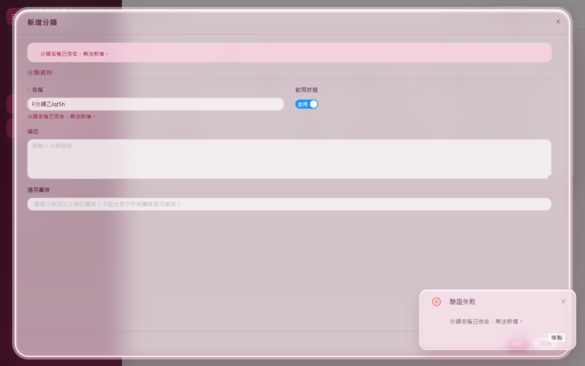
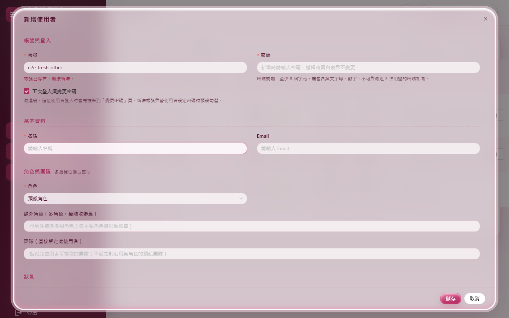
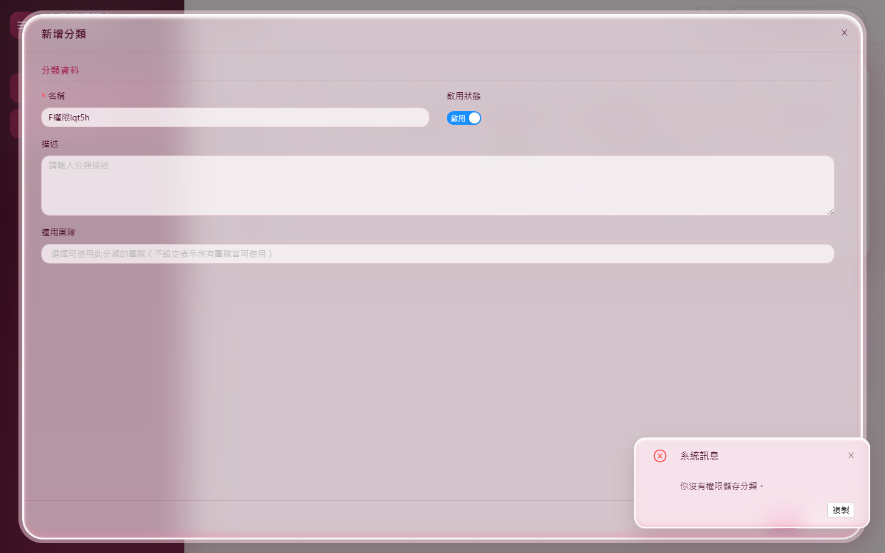

# 測試報告：畫面選項資料一致性

- 範圍：前後端分離後，下拉選單的選項（分類、團隊、角色）在別人新增、停用之後，停在畫面上的使用者看到的是否最新；存檔時選了已停用的選項如何處理
- 版本：0.10.14 → 0.10.15
- 測試日期：2026/11/14
- 分支：`feature/ui-data-freshness`
- 變更紀錄：[2026-11-14-畫面選項資料一致性](../../changelog/2026-11-14-畫面選項資料一致性.md)

## 摘要

| 項目 | 結果 |
|---|---|
| 使用者決定（2026/11/14） | 開窗時重讀選項；查詢條件在「重新整理」時重讀；存檔時由伺服器檢查，選項已不存在或已停用就擋下並說明、畫面換成最新的選項 |
| 自動化測試 | 3,209 個全部通過（0.10.14 是 3,188） |
| 品質關卡 | 7 步全部通過（A.3） |
| CRUD 產生器 | `Test-CrudGenerator.ps1` 通過（三種模組的建置、全部測試、實際開瀏覽器操作產生的頁面、重跑不再改動） |
| 實機驗證 | 新腳本 `ux-data-freshness.mjs`（兩個瀏覽器、兩個帳號）F1～F10 與 F8b 共 11 項全部通過；改到的頁面的既有腳本 `m03-crud`、`m04-projects`、`m05-admin`、`m07-ops`、`m03`／`m04`／`m05`／`m07-views` 與 36 路由煙霧全部通過 |
| 獨立審查 | 1 項中、2 項低，全部處理（A.5） |
| 使用者看得到的差異 | 別人新增的分類、團隊、角色不必重新整理整頁就選得到；選了剛被停用的分類或團隊時存檔被擋下並說明原因；分類與團隊名稱、使用者帳號輸入重複時，欄位下方立刻顯示「已存在」 |

---

## A.1 盤點：畫面上暫存了哪些伺服器資料

| 畫面 | 暫存的選項 | 以前 | 現在 |
|---|---|---|---|
| 專案管理 | 表單的分類、團隊；工具列的分類過濾、團隊過濾；預設團隊、附件限制 | 開頁時讀一次 | 開窗、存檔失敗後、按「重新整理」時重讀 |
| 分類管理 | 適用團隊 | 開頁時讀一次 | 開窗、存檔失敗後重讀 |
| 角色管理 | 預設團隊、空白權限矩陣 | 開頁時讀一次 | 開窗（含「複製」）、存檔失敗後重讀；複製不帶已停用的預設團隊 |
| 使用者管理 | 角色、團隊、密碼規則 | 開窗時重讀（已符合） | 統一成 `LoadFormOptionsAsync`，存檔失敗後也重讀 |
| 公告管理 | 對象的角色、團隊 | 開頁時讀一次 | 開窗時重讀 |
| 團隊管理 | 上層團隊 | 開窗時讀（已符合） | 不變 |
| 稽核紀錄、系統例外紀錄、AI 對話紀錄、Token 用量 | 查詢條件的下拉 | 按「重新整理」時重讀（已符合） | 不變 |
| 日誌檢視 | 只讀「AI 是否可用」，不是下拉資料 | — | 不變 |
| 側邊選單、按鈕權限 | 登入時的 `/me` | 重新整理才更新；伺服器每個請求重新檢查 | 不變（不在這次的規則裡，F10 記錄實際行為） |

---

## A.2 自動化測試

| 測試 | 驗證的行為 |
|---|---|
| `SelectedOptionValidationApiTests`（新） | 經 Web API：專案新選的分類已刪除或已停用、團隊已刪除時回 400 與「所選的…已不存在或已停用」；原本就掛著、後來才停用的分類照樣能存；選項都有效時正常存檔；分類的適用團隊停用時擋下、原本就有的照樣能存；角色的預設團隊已刪除時擋下；使用者的團隊已停用時擋下（以前是默默略過） |
| `Client/FormOptionsConventionTests`（新） | 有表單選項的頁面（含 CRUD 產生器產生的、任何定義了 `LoadFormOptionsAsync` 的頁面）每個開窗方法第一行就重讀選項、存檔失敗後再讀；只有查詢條件的頁面「重新整理」時重讀；讀了 `Api.OptionsAsync()` 卻沒照規則的頁面會失敗；產生器樣板照做 |
| `Components/AsyncFieldCheckTests`（新） | 欄位改變後顯示伺服器的衝突訊息、改好後消失；`ValidateAsync` 會等檢查完成；檢查本身失敗不擋存檔；**真實的巢狀結構**（`EditForm` → `AntDesign.Form`）下外層的 `ValidateAsync` 也會等（拿掉 `SaveContext` 時這個測試會失敗，已確認）；每個用法都要給 `SaveContext` |
| `ProjectApiTests`（調整） | 測試資料補上搜尋用的分類（新規則下不存在的分類會被擋） |

測試數：3,188 → 3,209。

---

## A.3 品質關卡

`pwsh ./scripts/Invoke-QualityGate.ps1`：

| 步驟 | 結果 | 秒數 |
|---|---|---|
| Restore | 通過 | 0.4 |
| Build（Release） | 通過（0 警告、0 錯誤） | 13.3 |
| Format | 通過 | 17.8 |
| Test | 通過（3,209 個） | 85.2 |
| Docs encoding | 通過 | 0.1 |
| CRUD anchors | 通過 | 0.5 |
| Vulnerability | 通過（沒有已知弱點） | 17.5 |

合計 134.9 秒，`QUALITY GATE PASSED`。

---

## A.4 實機驗證

同站台、隔離的資料庫與路徑（`Start-E2EHost.ps1`），Playwright。

### `ux-data-freshness.mjs`（新）

甲＝support，乙＝另一個瀏覽器登入的管理員（腳本自建，密碼只在記憶體），以 API 新增或停用資料，模擬「別人」。

| # | 情境 | 結果 |
|---|---|---|
| F1 | 乙新增分類，甲不重新整理直接開「新增專案」 | 分類下拉看得到新分類 |
| F2 | 甲選了分類 X，乙停用 X，甲按儲存 | 擋下並顯示「所選的分類「X」已不存在或已停用，請重新選擇（選項已更新）。」；對話窗不關；下拉的可選項已沒有 X |
| F3 | 乙新增分類，甲按工具列「重新整理」 | 「分類過濾」重新整理前沒有、之後有 |
| F4 | 乙新增團隊，甲開「新增分類」 | 「適用團隊」看得到 |
| F5 | 同上，「新增角色」 | 「預設團隊」看得到 |
| F6 | 同上，「新增公告」對象選團隊 | 看得到 |
| F7 | 同上，「新增使用者」 | 「團隊」看得到 |
| F8 | 「新增分類」輸入已存在的名稱、離開欄位 | 不必按儲存，欄位下方顯示「分類名稱已存在，無法新增。」；改名後消失 |
| F8b | 輸入已存在的名稱後立刻按「儲存」 | 儲存等檢查完成並以驗證錯誤擋下，不跳出確認窗（獨立審查發現的問題修正後新增） |
| F9 | 「新增使用者」輸入已存在的帳號 | 欄位下方顯示「帳號已存在，無法新增。」 |
| F10 | 丙（只有分類的檢視與新增）停在分類頁，管理員以角色 API 拿掉「新增」 | 沒重新整理時「新增」鈕還在，存檔被伺服器擋下「你沒有權限儲存分類。」、資料庫沒有新增；重新整理後「新增」鈕消失（既有機制，這次不改） |

### 既有腳本迴歸

| 腳本 | 結果 |
|---|---|
| `m03-crud.mjs`（分類、團隊）＋36 路由煙霧 | C1～C13 全部通過 |
| `m04-projects.mjs`（專案、附件） | P1～P18 全部通過 |
| `m05-admin.mjs`（使用者、角色、稽核） | A1～A13 全部通過（單獨執行三次）。與 `m04-projects` 同一個資料庫接著跑時 A5 失敗一次：m04 多建了使用者，`e2e-wang` 被擠到第二頁、腳本找不到那一列——腳本之間的資料相依，與這次的變更無關 |
| `m07-ops.mjs`（公告等） | M7-P1～P9 全部通過 |
| `m03`／`m04`／`m05`／`m07-views.mjs` | 全部通過，修改窗截圖逐張目視 |

### 截圖

| | |
|---|---|
|  |  |
| 01 別人剛新增的分類，開窗就看得到（F1） | 02 選的分類被停用，存檔擋下並說明（F2） |
|  |  |
| 03 名稱重複，不必按儲存就看到（F8） | 04 打完立刻按儲存，也會等檢查並擋下（F8b） |
|  |  |
| 05 帳號重複（F9） | 06 權限被拿掉後沒重新整理就存檔，伺服器擋下（F10） |

### 實機發現（已修正）

- **CRUD 產生器產生的頁面沒被守門測試認出來**（`Test-CrudGenerator.ps1` 發現）：`-WithTeams` 的頁面讀了選項，但守門測試的頁面清單是寫死的。改成「定義了 `LoadFormOptionsAsync` 的頁面都檢查」。
- **分類修改時團隊檢查排在重名之前**：選的團隊被停用、名稱又重複時，名稱欄位的即時檢查看不到「已存在」。改成先查重名（與新增、產生器樣板相同）。

---

## A.5 獨立審查

審查者（未參與實作）讀完整份變更，並反組譯 AntDesign 確認 `Form` 的行為。確認沒有問題的部分：`SelectedOptionGuard` 的空值、去空白與不分大小寫（與團隊名稱唯一、團隊範圍的比較一致）；各服務的「原本的值」都取自資料庫；AI Agent 工具改使用者與角色時會帶入目前的團隊，不受影響；開窗重讀只換選項，不動正在編輯的資料；沒有 `async void`；`AsyncFieldCheck` 的訂閱、取消、換 `EditContext` 與釋放都正確。

| # | 嚴重度 | 發現 | 處理 |
|---|---|---|---|
| 1 | 中 | **按「儲存」不會等欄位的非同步檢查**：`AntDesign.Form` 另外建了自己的 `EditContext`，元件掛在它上面；頁面儲存時驗證的是外層 `EditForm` 的。欄位下方的訊息正常，但打完重複的名稱立刻按儲存會跳出確認窗，最後由伺服器的 409 擋下。單元測試只用了一層 `EditContext`，沒抓到 | 元件新增 `SaveContext` 參數（外層 `EditForm` 的 `Context`），按儲存時也掛上外層、結果寫進外層（只有按儲存時寫，打字時不在上方重複顯示）；所有用法與產生器樣板都給；新增以真實巢狀結構驗證的測試（拿掉 `SaveContext` 時失敗）與「每個用法都要給」的守門；實機 F8b |
| 2 | 低～中 | **複製時的死路**：使用者複製窗的團隊是唯讀的，開窗後範本的團隊被停用時每次存檔都被擋、只能關窗重來；角色複製會帶著已停用的預設團隊 | 使用者複製被擋時把不能用的團隊從要建立的資料拿掉（訊息已說明，窗內清單更新，再按一次就能建立）；角色複製開窗時就不帶已停用的預設團隊 |
| 3 | 低 | 團隊的名稱即時檢查把「團隊代號已存在」（也是 409）顯示在名稱下面 | 名稱檢查不帶代號（代號留給存檔時的完整檢查） |
| — | 既有 | 專案存檔失敗後，剛被停用的分類標示為「（已限定其他團隊）」 | 不改：操作說明本來就說明這個標示包含「已停用」（`Datas/Help/projects.md`），存檔被擋的通知也會說明原因 |

---

## A.6 設計決定

1. **只檢查「這次新選的」**：紀錄原本就掛著、後來才被停用或限定其他團隊的值不檢查，否則舊資料改其他欄位也存不了。複製建立的是新紀錄，沒有「原本的值」。
2. **伺服器檢查放在服務的存檔前檢查**（`BeforeAddCheckAsync`／`BeforeUpdateCheckAsync`）：畫面與 Web API 走同一份規則；AI Agent 工具與「產生測試專案」不受影響。
3. **欄位即時檢查沿用既有的 `POST …/check`**，只認 409：不必新增端點；檢查本身失敗不擋存檔，存檔時伺服器還會再檢查一次。
4. **不等 AntDesign 的非同步驗證**：它的支援（PR #4882）不在 `1.6.3-dotnet11.rc3` 裡，所以直接用 .NET 11 `EditContext` 的 `RegisterAsyncFieldValidator`／`AddAsyncValidator`，訊息顯示在既有的 `ValidationMessage`。AntDesign 正式版支援後可再評估。
5. **權限不跟著即時更新**：伺服器每個請求都重新檢查，畫面上的按鈕要重新整理才更新（F10）；要做到即時，需要權限變更的推播，不在這次的範圍。

---

## A.7 已知限制

- 別人新增的選項要在**下一次開窗**時才看得到；對話窗開著的期間不會自動更新（除非存檔失敗）。
- 只有查詢條件的頁面，選項要按「重新整理」才更新（使用者的決定）。
- 權限變更要重新整理才反映在按鈕與選單上（A.6 第 5 點）。
